# LavaFácil

**Sistema de Gestión de Servicios y Turnos para Lavaderos de Vehículos**

**Documento de Diseño del Sistema**

**Versión 2.0**

**Fecha:** 20/07/2026

**Realizado por:** Gelabert André

---

## **Diagrama de clases**

A continuación se presenta el modelo integral de clases del sistema LavaFácil. El diseño responde al patrón arquitectónico por capas adoptado en el repositorio (Controladores ASP.NET Core MVC, Servicios de Aplicación y Dominio, Entidades y Objetos de Valor de Dominio, Repositorios sobre Google Cloud Firestore y Servicios de Integración Externa).

Para facilitar la legibilidad sin perder coherencia estructural, se expone en primer lugar el **Diagrama General de Clases de Dominio** y seguidamente los **Diagramas Detallados por Módulo**, incluyendo los subsistemas de Planificación de Turnos, Notificaciones y Estadísticas y Reportes.

### Diagrama General de Clases de Dominio

```plantuml
@startuml LavaFacil_Diagrama_Clases_General
title Diagrama General de Dominio - LavaFácil
skinparam classAttributeIconSize 0
skinparam roundcorner 4
skinparam shadowing false
skinparam linetype ortho
skinparam defaultFontName "Segoe UI", Arial, sans-serif
skinparam packageStyle rectangle

skinparam class {
    BackgroundColor #FFFFFF
    ArrowColor #2C3E50
    BorderColor #2C3E50
}

package "Seguridad y Roles" {
    class Empleado {
        - id : string
        - nombre : string
        - apellido : string
        - email : string
        - estado : EstadoEmpleado
        - emailVerificado : bool
        - fechaCreacion : DateTime
        + AsignarRol(rol: Rol): void
        + ModificarDatos(nombre: string, apellido: string): void
        + Desactivar(): void
        + Reactivar(): void
    }

    class Rol {
        - id : string
        - nombre : string
        - descripcion : string
        - permisos : List<string>
        - estado : EstadoRol
        + AsignarPermiso(permiso: string): void
        + RemoverPermiso(permiso: string): void
        + TienePermiso(permiso: string): bool
    }

    enum EstadoEmpleado {
        Activo
        Inactivo
    }

    enum EstadoRol {
        Activo
        Inactivo
    }
}

package "Clientes y Vehículos" {
    class Cliente {
        - id : string
        - tipoDocumento : string
        - numeroDocumento : string
        - nombre : string
        - apellido : string
        - telefono : string
        - email : string
        - estado : EstadoCliente
        + ModificarDatos(nombre: string, apellido: string, tel: string, email: string): void
        + Desactivar(): void
        + Reactivar(): void
    }

    class Vehiculo {
        - id : string
        - patente : string
        - marca : string
        - modelo : string
        - color : string
        - claveAsociacionHash : string
        - estado : EstadoVehiculo
        + GenerarClaveAsociacion(): string
        + ValidarClaveAsociacion(clavePlana: string): bool
        + Desactivar(): void
        + Reactivar(): void
    }

    class TipoDocumento {
        - id : string
        - nombre : string
        - formato : string
        - estado : string
        + ValidarFormato(doc: string): bool
    }

    class TipoVehiculo {
        - id : string
        - nombre : string
        - formatoPatente : string
        - cantidadEmpleadosRequeridos : int
        - estado : string
        + ValidarPatente(patente: string): bool
    }
}

package "Servicios y Paquetes" {
    class Servicio {
        - id : string
        - nombre : string
        - descripcion : string
        - precio : decimal
        - tiempoEstimado : int
        - estado : EstadoServicio
        + ModificarDatos(precio: decimal, tiempo: int, desc: string): void
        + ActualizarEtapas(etapas: List<Etapa>): void
        + Desactivar(): void
        + Reactivar(): void
    }

    class TipoServicio {
        - id : string
        - nombre : string
        - estado : string
    }

    class Etapa {
        - id : string
        - nombre : string
        - orden : int
    }

    class RecetaInsumo <<Value Object>> {
        - insumoId : string
        - cantidadDosis : decimal
    }

    class PaqueteServicio {
        - id : string
        - nombre : string
        - precio : decimal
        - porcentajeDescuento : decimal
        - tiempoEstimado : int
        - estado : EstadoPaquete
        + RecalcularPrecioYTiempo(servicios: List<Servicio>): void
    }
}

package "Operaciones de Lavado" {
    class Lavado {
        - id : string
        - estado : EstadoLavado
        - precioOriginal : decimal
        - precio : decimal
        - descuento : decimal
        - tiempoEstimado : int
        - tiempoInicio : DateTime
        - tiempoFinalizacion : DateTime?
        - estadoRetiro : EstadoRetiro
        - fechaRetiro : DateTime?
        + IniciarLavado(): void
        + IniciarServicio(idServicio: string): void
        + FinalizarServicio(idServicio: string): void
        + FinalizarLavado(): void
        + CancelarLavado(motivo: string): void
        + RegistrarPago(monto: decimal, medio: string, notas: string): void
        + RegistrarRetiro(clienteRetiraId: string): void
    }

    class ServicioEnLavado <<Embedded Document>> {
        - servicioId : string
        - servicioNombre : string
        - precio : decimal
        - estado : EstadoServicioLavado
        - orden : int
    }

    class EtapaEnLavado <<Embedded Document>> {
        - etapaId : string
        - nombre : string
        - estado : EstadoEtapa
    }

    class PagoLavado <<Embedded Document>> {
        - estado : EstadoPago
        - montoTotal : decimal
        - descuentoAplicado : decimal
        - montoPagado : decimal
        - saldoPendiente : decimal
        + RegistrarCobro(monto: decimal, medio: string, notas: string): DetallePago
    }

    class DetallePago <<Embedded Document>> {
        - id : string
        - monto : decimal
        - medioPago : string
        - fecha : DateTime
        - notas : string
    }
}

package "Planificación de Turnos" {
    class Turno {
        - id : string
        - clienteId : string
        - vehiculoId : string
        - fechaHora : DateTime
        - duracionEstimada : int
        - estado : EstadoTurno
        - motivoCancelacion : string
        - origen : string
        - fechaCreacion : DateTime
        + Reprogramar(nuevaFecha: DateTime, duracion: int): void
        + Cancelar(motivo: string): void
        + Completar(): void
    }

    enum EstadoTurno {
        Pendiente
        Confirmado
        Completado
        Cancelado
    }
}

package "Gestión de Insumos y Stock" {
    class Insumo {
        - id : string
        - nombre : string
        - tipo : string
        - unidadMedida : string
        - stockActual : decimal
        - stockMinimo : decimal
        - cantidadReabastecimiento : decimal
        - permiteReabastecimientoAutomatico : bool
        - costoUnitarioCompra : decimal
        - estado : EstadoInsumo
        + DescontarStock(cantidad: decimal): void
        + IncrementarStock(cantidad: decimal): void
        + EstaBajoMinimo(): bool
    }

    class Proveedor {
        - id : string
        - razonSocial : string
        - cuit : string
        - telefono : string
        - email : string
        - estado : EstadoProveedor
    }

    class OrdenCompra {
        - id : string
        - grupoSolicitudId : string
        - modalidadOrigen : string
        - proveedorId : string
        - montoTotal : decimal
        - estado : EstadoOrdenCompra
        + Despachar(): void
        + Recibir(): void
        + Cancelar(motivo: string): void
    }

    class OrdenCompraItem <<Embedded Document>> {
        - insumoId : string
        - insumoNombre : string
        - cantidadPedida : decimal
        - precioUnitarioPactado : decimal
        - subtotal : decimal
    }

    class MovimientoStock {
        - id : string
        - fechaHora : DateTime
        - insumoId : string
        - tipoMovimiento : TipoMovimientoStock
        - cantidad : decimal
        - saldoResultante : decimal
        - userId : string
    }
}

package "Configuración y Auditoría" {
    class Configuracion {
        - id : string
        - capacidadMaximaConcurrente : int
        - empleadosMaximosPorLavado : int
        - tiempoNotificacionMinutos : int
        - tiempoToleranciaMinutos : int
        - sesionDuracionHoras : int
        - sesionInactividadMinutos : int
        - nombreLavadero : string
        - ubicacion : string
        + EsHorarioLaborable(fechaHora: DateTime): bool
    }

    class HorarioAtencion <<Value Object>> {
        - diaSemana : DayOfWeek
        - horaApertura : TimeSpan
        - horaCierre : TimeSpan
        - esLaborable : bool
    }

    class AuditLog {
        - id : string
        - userId : string
        - userEmail : string
        - action : string
        - targetId : string
        - targetType : string
        - timestamp : DateTime
        - detalles : string
    }

    class WhatsAppSession {
        - id : string
        - phoneNumber : string
        - currentState : string
        - temporaryData : string
        - lastInteraction : DateTime
    }
}

' Relaciones
Empleado "1..*" --> "1" Rol : asignado a >
AuditLog "0..*" --> "1" Empleado : registrado por >

Cliente "1..*" -- "1..*" Vehiculo : posee / pertenece a >
Cliente "1..*" --> "1" TipoDocumento : identificado por >
Vehiculo "1..*" --> "1" TipoVehiculo : clasificado como >

Servicio "1..*" --> "1" TipoServicio : categorizado por >
Servicio "1..*" --> "1" TipoVehiculo : tarifado para >
Servicio "1" *-- "0..*" Etapa : estructurado en >
Etapa "1" *-- "0..*" RecetaInsumo : consume insumos >
RecetaInsumo "0..*" --> "1" Insumo : referencia a >

PaqueteServicio "1" o-- "2..*" Servicio : agrupa >
PaqueteServicio "1..*" --> "1" TipoVehiculo : tarifado para >

Lavado "0..*" --> "1" Cliente : contratado por >
Lavado "0..*" --> "1" Vehiculo : realizado sobre >
Lavado "0..*" --> "1..*" Empleado : ejecutado por >

Lavado "1" *-- "1..*" ServicioEnLavado : contiene >
ServicioEnLavado "1" *-- "0..*" EtapaEnLavado : contiene >
Lavado "1" *-- "1" PagoLavado : registra >
PagoLavado "1" *-- "0..*" DetallePago : compuesto por >

Turno "0..*" --> "1" Cliente : agendado para >
Turno "0..*" --> "1" Vehiculo : reservado para >
Turno "0..1" ..> "0..1" Lavado : origina >

Configuracion "1" *-- "7" HorarioAtencion : define >
WhatsAppSession "0..1" --> "0..1" Cliente : vincula a >
Configuracion ..> Turno : valida franjas y capacidad >
Configuracion ..> Lavado : regula capacidad >

Proveedor "1..*" <--> "1..*" Insumo : provee >
OrdenCompra "0..*" --> "1" Proveedor : emitida a >
OrdenCompra "1" *-- "1..*" OrdenCompraItem : contiene >
OrdenCompraItem "0..*" --> "1" Insumo : referencia >

EtapaEnLavado "0..*" ..> "1..*" MovimientoStock : origina consumo >
MovimientoStock "0..*" --> "1" Insumo : afecta existencia >
MovimientoStock "0..*" --> "0..1" Empleado : registrado por >
OrdenCompra "0..1" ..> "0..*" MovimientoStock : ingresa mercaderia >
@enduml
```

### Diagramas de Clases Detallados por Módulo

#### 1. Módulo Seguridad y Roles

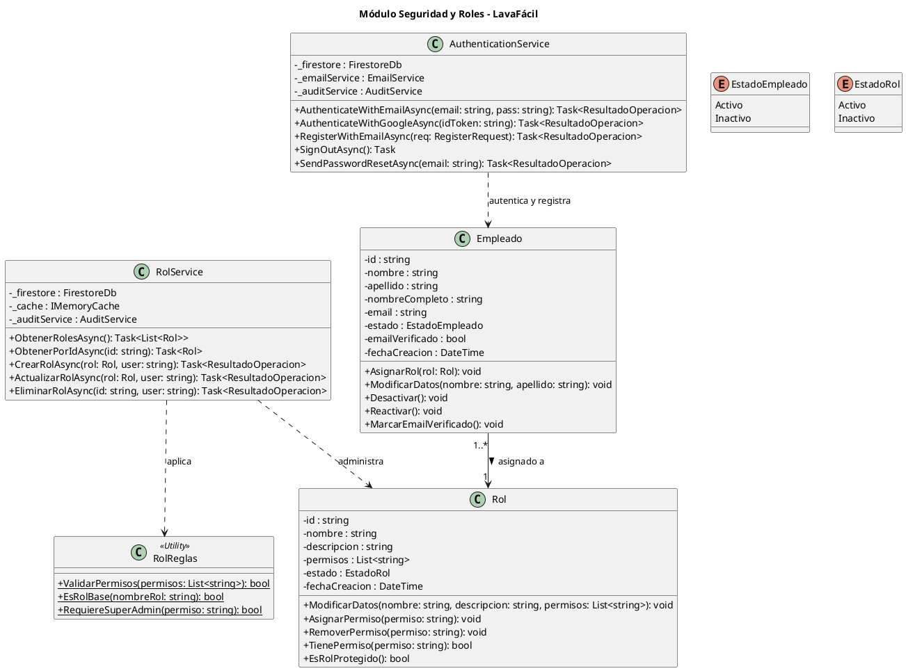

#### 2. Módulo Clientes y Vehículos

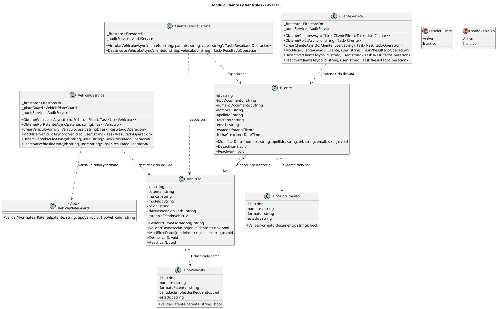

#### 3. Módulo Servicios y Paquetes

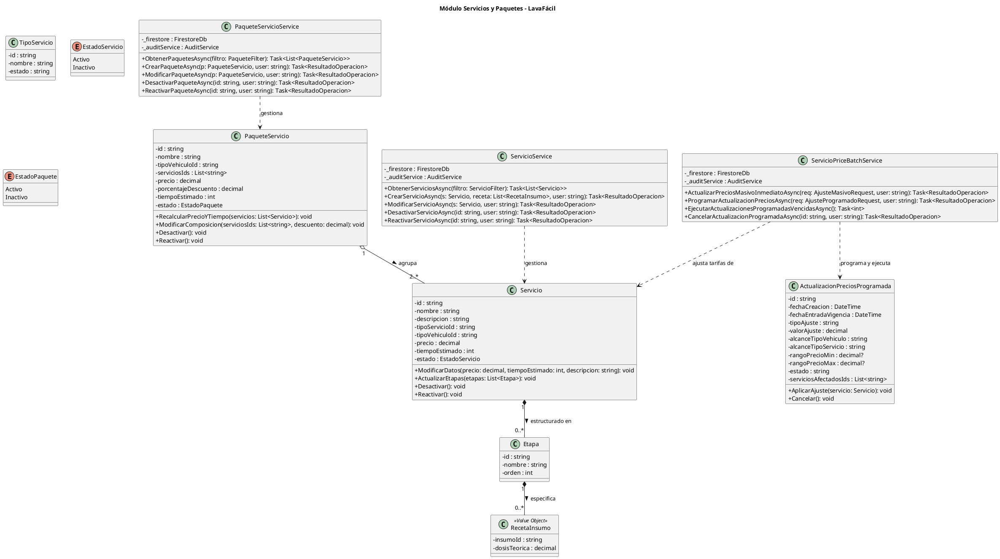

#### 4. Módulo Operaciones de Lavado

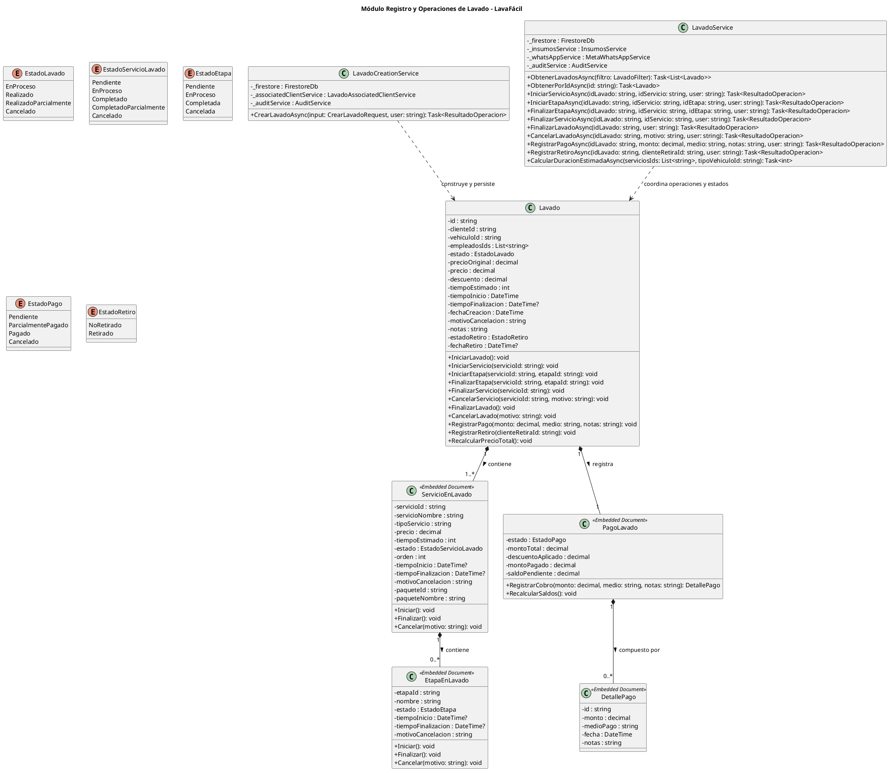

#### 5. Módulo Planificación de Turnos

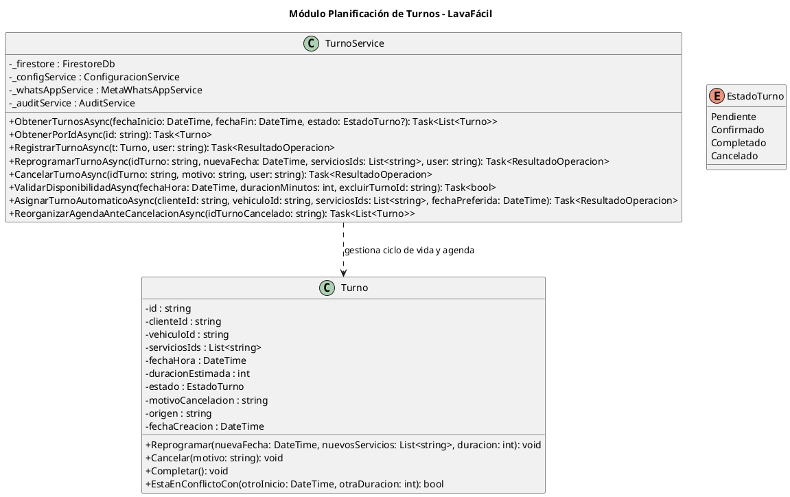

#### 6. Módulo Configuración, Auditoría y Notificaciones

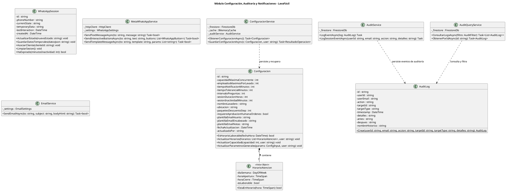

#### 7. Módulo Gestión de Insumos y Stock

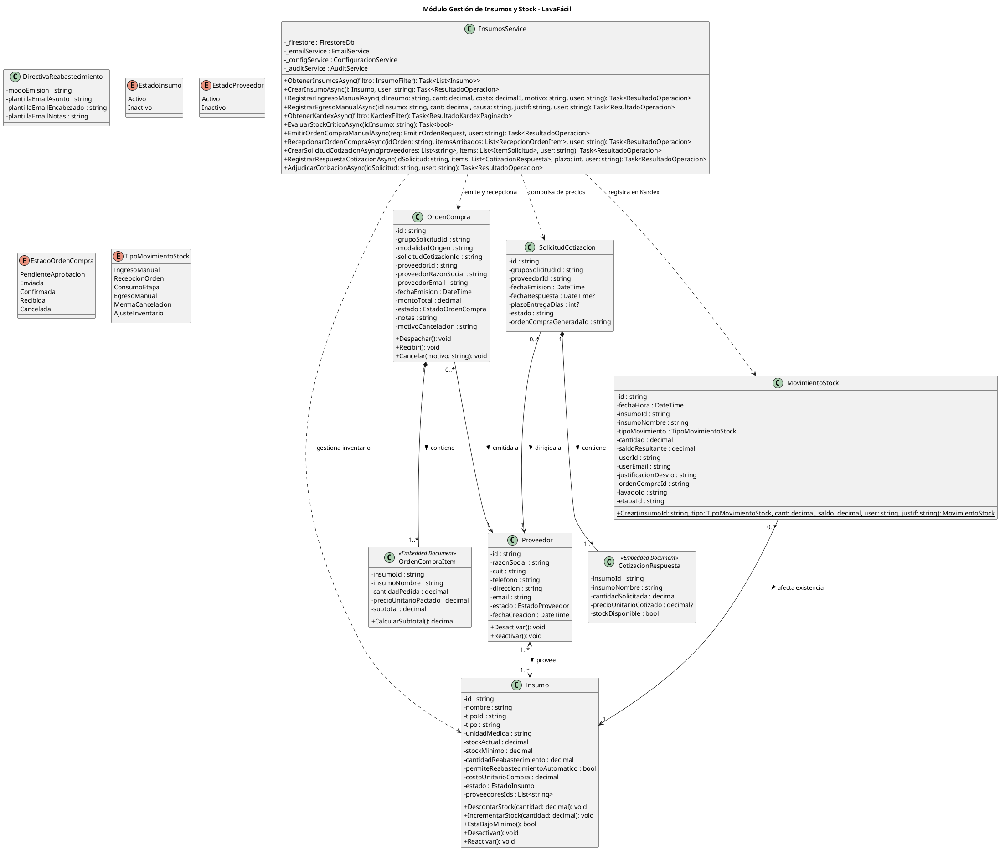

#### 8. Módulo Estadísticas y Reportes

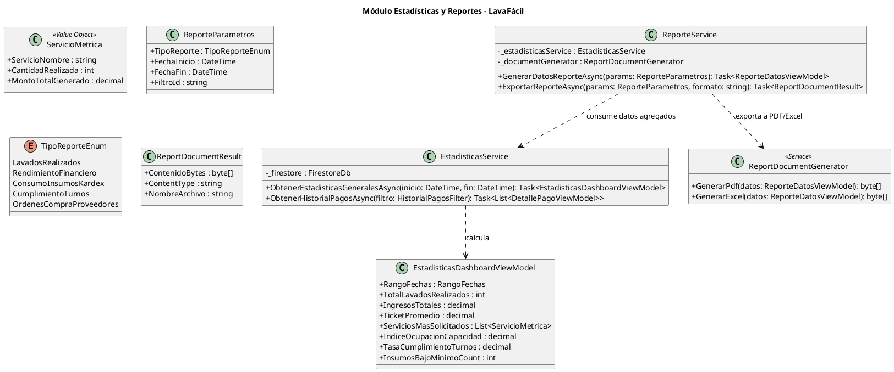

#### 9. Arquitectura Integral y Capas de Software

```plantuml
@startuml LavaFacil_Arquitectura_Capas
title Arquitectura en Capas y Patrón de Colaboración - LavaFácil
skinparam classAttributeIconSize 0
skinparam roundcorner 4
skinparam shadowing false
skinparam defaultFontName "Segoe UI", Arial, sans-serif

package "Capa de Presentación (Controllers & Views)" #E8F4F8 {
    class LoginController
    class PersonalController
    class ClienteController
    class VehiculoController
    class ServicioController
    class LavadosController
    class TurnosController
    class InsumosController
    class ConfiguracionController
    class EstadisticasController
    class ReportesController
    class AuditoriaController
    class WhatsAppWebhookController
}

package "Capa de Servicios de Aplicación y Negocio" #FFF9E6 {
    interface IAuditWriter
    class AuthenticationService
    class PersonalService
    class ClienteService
    class VehiculoService
    class ServicioService
    class ServicioPriceBatchService
    class LavadoCreationService
    class LavadoService
    class TurnoService
    class InsumosService
    class ConfiguracionService
    class EstadisticasService
    class ReporteService
    class AuditService
    class WhatsAppFlowService
    class MetaWhatsAppService
    class EmailService
}

package "Capa de Dominio y Modelos" #EAF2E8 {
    class Empleado
    class Rol
    class Cliente
    class Vehiculo
    class Servicio
    class PaqueteServicio
    class Lavado
    class Turno
    class Insumo
    class OrdenCompra
    class SolicitudCotizacion
    class MovimientoStock
    class Configuracion
    class AuditLog
}

package "Capa de Persistencia e Integración Externa" #F2E8FA {
    class FirestoreDb <<Google Cloud Firestore>>
    class FirebaseAuth <<Firebase Authentication>>
    class MetaCloudApi <<WhatsApp Cloud API>>
    class SmtpServer <<Servidor SMTP de Correo>>
}

' Relaciones entre capas
LoginController --> AuthenticationService
PersonalController --> PersonalService
ClienteController --> ClienteService
VehiculoController --> VehiculoService
ServicioController --> ServicioService
ServicioController --> ServicioPriceBatchService
LavadosController --> LavadoService
LavadosController --> LavadoCreationService
TurnosController --> TurnoService
InsumosController --> InsumosService
ConfiguracionController --> ConfiguracionService
EstadisticasController --> EstadisticasService
ReportesController --> ReporteService
AuditoriaController --> AuditService
WhatsAppWebhookController --> WhatsAppFlowService

WhatsAppFlowService --> ClienteService
WhatsAppFlowService --> VehiculoService
WhatsAppFlowService --> TurnoService
WhatsAppFlowService --> MetaWhatsAppService

LavadoService --> InsumosService
LavadoService --> MetaWhatsAppService
InsumosService --> EmailService
TurnoService --> MetaWhatsAppService

PersonalService --> Empleado
PersonalService --> Rol
ClienteService --> Cliente
VehiculoService --> Vehiculo
ServicioService --> Servicio
LavadoService --> Lavado
TurnoService --> Turno
InsumosService --> Insumo
InsumosService --> OrdenCompra
InsumosService --> MovimientoStock
ConfiguracionService --> Configuracion
AuditService --> AuditLog

PersonalService ..> FirestoreDb
ClienteService ..> FirestoreDb
VehiculoService ..> FirestoreDb
ServicioService ..> FirestoreDb
LavadoService ..> FirestoreDb
TurnoService ..> FirestoreDb
InsumosService ..> FirestoreDb
ConfiguracionService ..> FirestoreDb
AuditService ..> FirestoreDb
AuthenticationService ..> FirebaseAuth
MetaWhatsAppService ..> MetaCloudApi
EmailService ..> SmtpServer
@enduml
```


---

## **Diagrama de base de datos**

A continuación se presenta el modelo integral de base de datos de LavaFácil implementado sobre **Google Cloud Firestore**, un motor NoSQL orientado a documentos en la nube. 

### Consideraciones de Diseño Documental en Cloud Firestore

1. **Estructura Documental vs. Paradigma Relacional:**  
   Firestore organiza la información en **Colecciones** y **Documentos**. Los documentos son objetos semiesquematizados tipo JSON/BSON con tipos de datos nativos (cadenas, números enteros y de punto flotante de 64 bits, marcas temporales `Timestamp`, booleanos, arreglos y mapas o subdocumentos embebidos). No existen tablas, esquemas rígidos, claves foráneas a nivel de motor, restricciones de integridad referencial declarativas ni operaciones `JOIN`.
2. **Embebido de Documentos para Cohesión Operativa:**  
   Se utiliza el patrón de **documentos embebidos** para estructuras con alta afinidad transaccional y ciclo de vida indivisible:
   - En `lavados`: los arrays/mapas embebidos `servicios`, `etapas`, `pago` y `detalles` garantizan que la lectura y actualización del estado del lavado sea atómica, rápida y no requiera múltiples lecturas dispersas en Firestore.
   - En `ordenesCompra`: los `items` cotizados o adjudicados se almacenan como lista embebida dentro de la orden.
   - En `solicitudesCotizacion`: los ítems solicitados y respondidos se embeben para consolidar la compulsa de precios.
   - En `configuracion`: el documento singleton `system_config` contiene la lista de subdocumentos `horarios` correspondientes a cada día de la semana.
3. **Referencias Lógicas entre Colecciones:**  
   Las asociaciones entre entidades mutables independientes (como `Cliente`, `Vehiculo`, `Servicio`, `Proveedor` e `Insumo`) se implementan mediante **identificadores alfanuméricos de documento (`DocumentId`)**. Las relaciones son verificadas y gobernadas a nivel de la capa de servicios de aplicación (p. ej., `ClienteVehicleService`, `LavadoCreationService`), garantizando la integridad de negocio sin acoplar la base de datos a bloqueos relacionales.
4. **Estructuras para Módulos Específicos:**  
   - **Planificación de Turnos:** Utiliza la colección dedicada `turnos`, donde cada documento almacena fecha/hora, duración estimada, referencias a cliente y vehículo, servicios seleccionados y estado. Esto permite consultas eficientes ordenadas por fecha y hora con cursores de paginación.
   - **Notificaciones:** No requiere una colección pesada independiente; las notificaciones transaccionales a clientes (vía WhatsApp Cloud API y SMTP) se disparan de forma desacoplada a partir de los eventos de cambio de estado de `lavados`, `turnos` y `ordenesCompra`, registrándose la trazabilidad de cada despacho en la colección `registros_auditoria`.
   - **Estadísticas y Reportes:** No requiere colecciones persistentes de agregados redundantes; se calculan bajo demanda de manera reactiva mediante consultas de agregación (`Count()`, `Sum()`, rangos temporales) sobre las colecciones operativas `lavados`, `turnos`, `insumos` y `movimientosStock`, optimizando almacenamiento y evitando inconsistencias de datos duplicados.
5. **Estrategia de Índices Compuestos y Paginación por Cursores:**  
   Para historiales de gran crecimiento (`movimientosStock`, `registros_auditoria`, `lavados`), Firestore exige índices compuestos específicos cuando se combinan filtros de igualdad, rangos de fechas y ordenamientos. La navegación en estas colecciones se diseña mediante cursores deterministas (`OrderBy(Timestamp).OrderBy(DocumentId)` combinados con `StartAfter`), evitando el costo y degradación del offset tradicional.

### Diagrama del Modelo Documental en Cloud Firestore

```plantuml
@startuml LavaFacil_Modelo_Firestore
title Modelo de Base de Datos Documental - Cloud Firestore (LavaFácil)
skinparam classAttributeIconSize 0
skinparam roundcorner 6
skinparam shadowing false
skinparam linetype ortho
skinparam defaultFontName "Segoe UI", Arial, sans-serif
skinparam packageStyle rectangle

skinparam class {
    BackgroundColor #FFFFFF
    ArrowColor #2C3E50
    BorderColor #2C3E50
}

package "Colecciones de Seguridad y Roles" #F4F6F7 {
    class "empleados" <<Collection>> {
        * **_id** : string [UID Firebase Auth]
        --
        nombre : string
        apellido : string
        nombreCompleto : string
        email : string
        rolId : string [ref -> roles]
        estado : string ["Activo" | "Inactivo"]
        emailVerificado : bool
        fechaCreacion : Timestamp
    }

    class "roles" <<Collection>> {
        * **_id** : string [AutoId]
        --
        nombre : string ["Administrador" | "Empleado" | ...]
        descripcion : string
        permisos : array<string>
        estado : string ["Activo" | "Inactivo"]
        fechaCreacion : Timestamp
    }
}

package "Colecciones de Clientes y Vehículos" #EAF2F8 {
    class "clientes" <<Collection>> {
        * **_id** : string [AutoId]
        --
        tipoDocumentoId : string [ref -> tiposDocumento]
        numeroDocumento : string
        nombre : string
        apellido : string
        telefono : string [E.164]
        email : string
        estado : string ["Activo" | "Inactivo"]
        fechaCreacion : Timestamp
    }

    class "tiposDocumento" <<Collection>> {
        * **_id** : string ["DNI" | "Pasaporte" | ...]
        --
        nombre : string
        formato : string [Regex]
        estado : string ["Activo"]
    }

    class "vehiculos" <<Collection>> {
        * **_id** : string [AutoId]
        --
        patente : string [Clave natural única / mayúsculas]
        tipoVehiculoId : string [ref -> tiposVehiculos]
        marca : string
        modelo : string
        color : string
        claveAsociacionHash : string [SHA-256]
        clientesIds : array<string> [refs -> clientes]
        estado : string ["Activo" | "Inactivo"]
    }

    class "tiposVehiculos" <<Collection>> {
        * **_id** : string ["Auto" | "Camioneta" | "Moto" | ...]
        --
        nombre : string
        formatoPatente : string [Regex]
        cantidadEmpleadosRequeridos : int
        estado : string ["Activo"]
    }
}

package "Colecciones de Servicios y Paquetes" #FEF9E7 {
    class "servicios" <<Collection>> {
        * **_id** : string [AutoId]
        --
        nombre : string
        descripcion : string
        tipoServicioId : string [ref -> tiposServicio]
        tipoVehiculoId : string [ref -> tiposVehiculos]
        precio : number [decimal]
        tiempoEstimado : int [minutos]
        estado : string ["Activo" | "Inactivo"]
        etapas : array<map> [EtapaDoc]
    }

    class "EtapaDoc" <<Embedded Map>> {
        etapaId : string
        nombre : string
        orden : int
        recetaInsumos : array<map> [{insumoId, dosisTeorica}]
    }

    class "tiposServicio" <<Collection>> {
        * **_id** : string ["Lavado Basico" | "Lavado Completo" | ...]
        --
        nombre : string
        estado : string ["Activo"]
    }

    class "paquetes_servicios" <<Collection>> {
        * **_id** : string [AutoId]
        --
        nombre : string
        tipoVehiculoId : string [ref -> tiposVehiculos]
        serviciosIds : array<string> [refs -> servicios]
        porcentajeDescuento : number [decimal]
        precio : number [decimal]
        tiempoEstimado : int [minutos]
        estado : string ["Activo" | "Inactivo"]
    }

    class "actualizaciones_precios" <<Collection>> {
        * **_id** : string [AutoId]
        --
        fechaCreacion : Timestamp
        fechaEntradaVigencia : Timestamp
        tipoAjuste : string ["Porcentaje" | "MontoFijo"]
        valorAjuste : number [decimal]
        alcanceTipoVehiculo : string ["Todos" | id]
        alcanceTipoServicio : string ["Todos" | id]
        rangoPrecioMin : number? [decimal]
        rangoPrecioMax : number? [decimal]
        estado : string ["Pendiente" | "Aplicada" | "Cancelada"]
        serviciosAfectados : array<string> [refs -> servicios]
    }
}

package "Colección Operativa de Lavados" #FDEDEC {
    class "lavados" <<Collection>> {
        * **_id** : string [AutoId]
        --
        clienteId : string [ref -> clientes]
        vehiculoId : string [ref -> vehiculos]
        empleadosIds : array<string> [refs -> empleados]
        estado : string ["EnProceso" | "Realizado" | "RealizadoParcialmente" | "Cancelado"]
        precioOriginal : number [decimal]
        precio : number [decimal]
        descuento : number [decimal]
        tiempoEstimado : int [minutos]
        tiempoInicio : Timestamp
        tiempoFinalizacion : Timestamp?
        fechaCreacion : Timestamp
        motivoCancelacion : string
        notas : string
        estadoRetiro : string ["NoRetirado" | "Retirado"]
        fechaRetiro : Timestamp?
        servicios : array<map> [ServicioEnLavadoDoc]
        pago : map [PagoLavadoDoc]
    }

    class "ServicioEnLavadoDoc" <<Embedded Map>> {
        servicioId : string [ref -> servicios]
        servicioNombre : string
        tipoServicio : string
        precio : number [decimal]
        tiempoEstimado : int
        estado : string ["Pendiente" | "EnProceso" | "Completado" | "CompletadoParcialmente" | "Cancelado"]
        orden : int
        tiempoInicio : Timestamp?
        tiempoFinalizacion : Timestamp?
        motivoCancelacion : string
        paqueteId : string? [ref -> paquetes_servicios]
        paqueteNombre : string?
        etapas : array<map> [EtapaEnLavadoDoc]
    }

    class "EtapaEnLavadoDoc" <<Embedded Map>> {
        etapaId : string
        nombre : string
        estado : string ["Pendiente" | "EnProceso" | "Completada" | "Cancelada"]
        tiempoInicio : Timestamp?
        tiempoFinalizacion : Timestamp?
        motivoCancelacion : string
    }

    class "PagoLavadoDoc" <<Embedded Map>> {
        estado : string ["Pendiente" | "ParcialmentePagado" | "Pagado" | "Cancelado"]
        montoTotal : number [decimal]
        descuentoAplicado : number [decimal]
        montoPagado : number [decimal]
        saldoPendiente : number [decimal]
        detalles : array<map> [DetallePagoDoc]
    }

    class "DetallePagoDoc" <<Embedded Map>> {
        id : string
        monto : number [decimal]
        medioPago : string ["Efectivo" | "Transferencia" | "Tarjeta"]
        fecha : Timestamp
        notas : string
    }
}

package "Colección de Planificación de Turnos" #E8F8F5 {
    class "turnos" <<Collection>> {
        * **_id** : string [AutoId]
        --
        clienteId : string [ref -> clientes]
        vehiculoId : string [ref -> vehiculos]
        serviciosIds : array<string> [refs -> servicios]
        fechaHora : Timestamp
        duracionEstimada : int [minutos]
        estado : string ["Pendiente" | "Confirmado" | "Completado" | "Cancelado"]
        motivoCancelacion : string
        origen : string ["Web" | "WhatsApp" | "Presencial"]
        fechaCreacion : Timestamp
    }
}

package "Colecciones de Insumos y Stock" #E9F7EF {
    class "insumos" <<Collection>> {
        * **_id** : string [AutoId]
        --
        nombre : string
        tipoId : string [ref -> tipos_insumo]
        tipo : string ["QuimicoMedible" | "ConsumibleFisico" | "Herramienta"]
        unidadMedida : string ["ml" | "gr" | "unidad"]
        stockActual : number [decimal]
        stockMinimo : number [decimal]
        cantidadReabastecimiento : number [decimal]
        permiteReabastecimientoAutomatico : bool
        costoUnitarioCompra : number [decimal]
        estado : string ["Activo" | "Inactivo"]
        proveedoresIds : array<string> [refs -> proveedores]
    }

    class "proveedores" <<Collection>> {
        * **_id** : string [AutoId]
        --
        razonSocial : string
        cuit : string [11 dígitos]
        telefono : string
        direccion : string
        email : string
        estado : string ["Activo" | "Inactivo"]
        fechaCreacion : Timestamp
    }

    class "ordenesCompra" <<Collection>> {
        * **_id** : string [AutoId]
        --
        grupoSolicitudId : string?
        modalidadOrigen : string ["Manual" | "Automatica" | "Cotizacion"]
        solicitudCotizacionId : string? [ref -> solicitudesCotizacion]
        proveedorId : string [ref -> proveedores]
        proveedorRazonSocial : string
        proveedorEmail : string
        fechaEmision : Timestamp
        estado : string ["PendienteAprobacion" | "Enviada" | "Confirmada" | "Recibida" | "Cancelada"]
        notas : string
        motivoCancelacion : string
        items : array<map> [ItemOrdenDoc]
        montoTotal : number [decimal]
    }

    class "ItemOrdenDoc" <<Embedded Map>> {
        insumoId : string [ref -> insumos]
        insumoNombre : string
        cantidadPedida : number [decimal]
        precioUnitarioPactado : number [decimal]
        subtotal : number [decimal]
    }

    class "movimientosStock" <<Collection>> {
        * **_id** : string [AutoId]
        --
        fechaHora : Timestamp
        insumoId : string [ref -> insumos]
        insumoNombre : string
        tipoMovimiento : string ["IngresoManual" | "RecepcionOrden" | "ConsumoEtapa" | "EgresoManual" | "MermaCancelacion" | "AjusteInventario"]
        cantidad : number [decimal]
        saldoResultante : number [decimal]
        userId : string
        userEmail : string
        justificacionDesvio : string
        ordenCompraId : string? [ref -> ordenesCompra]
        lavadoId : string? [ref -> lavados]
        etapaId : string?
    }

    class "solicitudesCotizacion" <<Collection>> {
        * **_id** : string [AutoId]
        --
        grupoSolicitudId : string
        proveedorId : string [ref -> proveedores]
        fechaEmision : Timestamp
        fechaRespuesta : Timestamp?
        plazoEntregaDias : int?
        estado : string ["Enviada" | "Respondida" | "Adjudicada" | "Cancelada"]
        items : array<map> [ItemCotizacionDoc]
        ordenCompraGeneradaId : string? [ref -> ordenesCompra]
    }

    class "ItemCotizacionDoc" <<Embedded Map>> {
        insumoId : string [ref -> insumos]
        insumoNombre : string
        cantidadSolicitada : number [decimal]
        precioUnitarioCotizado : number? [decimal]
        stockDisponible : bool
    }
}

package "Colecciones de Configuración, Sesiones y Auditoría" #F5EEF8 {
    class "configuracion" <<Collection>> {
        * **_id** : string ["system_config"]
        --
        capacidadMaximaConcurrente : int
        empleadosMaximosPorLavado : int
        tiempoNotificacionMinutos : int
        tiempoToleranciaMinutos : int
        intervaloPreguntas : int
        sesionDuracionHoras : int
        sesionInactividadMinutos : int
        nombreLavadero : string
        ubicacion : string
        paquetesDescuentoStep : int
        requiereAprobacionHumanaOrdenes : bool
        plantillaEmailAsunto : string
        plantillaEmailEncabezado : string
        plantillaEmailNotas : string
        fechaActualizacion : Timestamp
        actualizadoPor : string
        horarios : array<map> [HorarioDoc]
    }

    class "HorarioDoc" <<Embedded Map>> {
        diaSemana : int [0=Sunday..6=Saturday]
        horaApertura : string ["HH:mm"]
        horaCierre : string ["HH:mm"]
        esLaborable : bool
    }

    class "whatsapp_sessions" <<Collection>> {
        * **_id** : string [phoneNumber]
        --
        phoneNumber : string
        currentState : string
        temporaryData : string [JSON serializado]
        lastInteraction : Timestamp
        createdAt : Timestamp
    }

    class "registros_auditoria" <<Collection>> {
        * **_id** : string [AutoId]
        --
        userId : string
        userEmail : string
        action : string
        targetId : string
        targetType : string
        timestamp : Timestamp
        detalles : string
        antes : string? [JSON]
        despues : string? [JSON]
        nombreHistorico : string?
    }
}

' Relaciones lógicas documentales
empleados "1..*" ..> "1" roles : "rolId"
clientes "1..*" ..> "1" tiposDocumento : "tipoDocumentoId"
vehiculos "1..*" ..> "1" tiposVehiculos : "tipoVehiculoId"
vehiculos "0..*" ..> "1..*" clientes : "clientesIds[]"

servicios "1..*" ..> "1" tiposServicio : "tipoServicioId"
servicios "1..*" ..> "1" tiposVehiculos : "tipoVehiculoId"
paquetes_servicios "1..*" ..> "1" tiposVehiculos : "tipoVehiculoId"
paquetes_servicios "0..*" ..> "2..*" servicios : "serviciosIds[]"

servicios "1" *-- "0..*" EtapaDoc : embebe en documento
lavados "1" *-- "1..*" ServicioEnLavadoDoc : embebe en documento
ServicioEnLavadoDoc "1" *-- "0..*" EtapaEnLavadoDoc : embebe en subdocumento
lavados "1" *-- "1" PagoLavadoDoc : embebe en documento
PagoLavadoDoc "1" *-- "0..*" DetallePagoDoc : embebe en subdocumento
configuracion "1" *-- "7" HorarioDoc : embebe en documento

ordenesCompra "1" *-- "1..*" ItemOrdenDoc : embebe en documento
solicitudesCotizacion "1" *-- "1..*" ItemCotizacionDoc : embebe en documento

lavados "0..*" ..> "1" clientes : "clienteId"
lavados "0..*" ..> "1" vehiculos : "vehiculoId"
lavados "0..*" ..> "1..*" empleados : "empleadosIds[]"

turnos "0..*" ..> "1" clientes : "clienteId"
turnos "0..*" ..> "1" vehiculos : "vehiculoId"
turnos "0..*" ..> "1..*" servicios : "serviciosIds[]"

ordenesCompra "0..*" ..> "1" proveedores : "proveedorId"
ordenesCompra "0..1" ..> "0..1" solicitudesCotizacion : "solicitudCotizacionId"
ItemOrdenDoc "0..*" ..> "1" insumos : "insumoId"
ItemCotizacionDoc "0..*" ..> "1" insumos : "insumoId"
movimientosStock "0..*" ..> "1" insumos : "insumoId"
movimientosStock "0..*" ..> "0..1" ordenesCompra : "ordenCompraId"
movimientosStock "0..*" ..> "0..1" lavados : "lavadoId"
actualizaciones_precios "0..*" ..> "0..*" servicios : "serviciosAfectados[]"

@enduml
```


---

## **Casos de Uso Reales del Sistema**

Los casos de uso presentados a continuación constituyen la especificación de diseño de los **Casos de Uso Reales** (Concrete Real Use Cases) del sistema LavaFácil. A diferencia de los casos de uso esenciales del análisis (independientes de tecnología), los casos de uso reales describen la interacción concreta del usuario con la interfaz gráfica real del sistema, detallando:

* **Rutas y vistas reales:** Vistas Razor de ASP.NET Core MVC (`/Views/*`), vistas parciales (`_Form.cshtml`, `_Table.cshtml`, `_Detail.cshtml`) y endpoints de controladores.
* **Componentes de interfaz concretos:** Acordeones colapsables (`#accordion-flush`), diálogos modales interactivos de Flowbite (`modal*`), contenedores asíncronos (`#*-table-container`), paletas visuales de color, y listas con soporte de reordenamiento drag-and-drop.
* **Campos y controles reales:** Inputs con nombres y atributos exactos del modelo (`TipoDocumento`, `Documento`, casillas de verificación para preferencias de notificación `NotificarPorEmail` y `NotificarPorWhatsApp`, selectores desplegables dinámicos, autocompletado predictivo por patente `#patenteSearch`).
* **Validaciones dinámicas en cliente:** Reglas de validación en tiempo real (`form-validation.js`, `cliente.js`, `lavado.js`, `insumos.js`), máscaras dinámicas de formato según tipo de documento (`updateDocumentoFormatoHint`), expresiones regulares de patentes argentinas Mercosur/tradicional y bloqueo visual de envíos inválidos.
* **Interacciones asíncronas (AJAX):** Despacho asíncrono con token anti-falsificación (`@Html.AntiForgeryToken()`), procesamiento en controladores con validación de `ModelState`, delegación en servicios de negocio e interactores de Firestore.
* **Respuestas y notificaciones de usuario:** Cierre automático de modales o repliegue de acordeones, actualización asíncrona de tablas de datos (`reloadClienteTable`, etc.) sin recargar la página completa, y retroalimentación inmediata mediante el sistema de notificaciones flotantes Toast (`notifications.js`).

Todos los flujos se describen representando el sistema completo con todos sus módulos plenamente integrados y operativos.


### Módulo: Seguridad

### CU-001 - Iniciar Sesión

| UC–001 | Iniciar Sesión | |
| :---- | :---- | :---- |
| **Objetivos asociados** | OBJ–09 Gestión de Seguridad | |
| **Requisitos asociados** | IRQ–01 Información sobre Empleados | |
| **Descripción** | El usuario accede al sistema mediante sus credenciales registradas. Permite optar entre autenticación tradicional (correo y contraseña) o autenticación federada con Google. Verifica el estado activo del empleado y establece la sesión autenticada. | |
| **Interfaz** | Vista `/Login/Index`, formulario `#loginForm`, inputs `#Email` y `#Password`, botón `#togglePassword`, botón `#btnLogin` ("Iniciar Sesión"), botón `#btnGoogleSignIn` ("Continuar con Google"), contenedor de alertas `#loginAlert`. | |
| **Precondición** | El usuario no debe poseer sesión activa. La aplicación tiene conectividad con Firebase Authentication y Firestore. | |
| **Secuencia normal** | **Paso** | **Acción** |
| | 1 | El usuario navega a la URL raíz del sistema o `/Login/Index`. |
| | 2 | El sistema renderiza la vista de inicio de sesión con el formulario centralizado, campos de correo, contraseña con alternador visual de visibilidad, botón de login y botón OAuth de Google. |
| | 3 | El usuario selecciona su método preferido (ingreso directo de credenciales o botón de Google). |
| | 4 | Se ejecuta el flujo real correspondiente: CU-001.1 para correo/contraseña o CU-001.2 para Google. |
| | 5 | El sistema valida la autenticación y comprueba en la colección `empleados` de Firestore que el usuario posea estado "Activo". |
| | 6 | El sistema emite la cookie de autenticación segura (`LavaFacilAuth`), crea el principal de reclamos (`ClaimsPrincipal`) con roles y permisos, y registra el evento `LOGIN_SUCCESS` en `registros_auditoria`. |
| | 7 | El sistema redirige automáticamente al usuario al Dashboard principal (`/Home/Index`). |
| **Postcondición** | Sesión autenticada establecida con cookie cifrada HttpOnly. Usuario posicionado en el Dashboard según sus permisos de rol. | |
| **Excepciones** | **Paso** | **Acción** |
| | 5a | Si el empleado posee estado "Inactivo" en Firestore, el sistema revoca el token, no emite cookie y muestra alerta en `#loginAlert`: "Su cuenta se encuentra deshabilitada por administración. Contacte al administrador". |
| | 5b | Si el servicio de Firebase Authentication o Firestore no responden, se muestra alerta: "Error de conexión con el servicio de autenticación. Intente nuevamente más tarde". |
| **Rendimiento** | **Paso** | **Cota de tiempo** |
| | 4-7 | < 2 segundos |
| **Frecuencia** | Diaria (múltiples veces por operador) | |
| **Estabilidad** | Alta | |
| **Comentarios** | Administrado mediante Firebase Authentication y ASP.NET Core Cookie Authentication. | |

---

### CU-001.1 - Iniciar sesión con correo y contraseña

| UC–001.1 | Iniciar sesión con correo y contraseña | |
| :---- | :---- | :---- |
| **Objetivos asociados** | OBJ–09 Gestión de Seguridad | |
| **Requisitos asociados** | IRQ–01 Información sobre Empleados | |
| **Descripción** | Especialización de CU-001. El usuario digita su dirección de correo y contraseña, valida formato en cliente y envía la solicitud al servidor para verificación contra Firebase Authentication. | |
| **Interfaz** | Vista `/Login/Index`, inputs `#Email` y `#Password`, botón `#btnLogin` ("Iniciar Sesión"), alerta `#loginAlert`, script `login.js`. | |
| **Precondición** | Usuario registrado previamente con proveedor de credenciales (email/contraseña). | |
| **Secuencia normal** | **Paso** | **Acción** |
| | 1 | El usuario introduce su dirección de correo en `#Email` y su clave en `#Password`. Puede alternar la visibilidad de caracteres con `#togglePassword`. |
| | 2 | El usuario presiona el botón `#btnLogin` ("Iniciar Sesión"). |
| | 3 | El script `login.js` intercepta el evento `submit`, valida que los campos no estén vacíos y que el email cumpla la expresión regular RFC 5322. |
| | 4 | Se despacha una petición HTTP POST a `/Login/Login` enviando credenciales y token anti-falsificación. |
| | 5 | El controlador invoca `AuthenticationService.AuthenticateWithEmailAsync()`, el cual interactúa con la API REST de Firebase Identity Toolkit. |
| | 6 | Firebase valida hash de contraseña y retorna `FirebaseToken` con UID y estado de email verificado (`EmailVerified`). |
| | 7 | El sistema verifica que el correo haya sido confirmado previamente. Continúa en paso 5 de CU-001. |
| **Postcondición** | Credenciales verificadas exitosamente ante Firebase. Sesión iniciada. | |
| **Excepciones** | **Paso** | **Acción** |
| | 3a | Si el formato de correo es incorrecto o la contraseña está vacía, el script marca el borde del input en rojo y muestra mensaje de validación sin enviar la petición HTTP. |
| | 6a | Si Firebase responde `INVALID_PASSWORD` o `EMAIL_NOT_FOUND`, el sistema registra `LOGIN_FAILED` en auditoría y muestra alerta en `#loginAlert`: "Correo o contraseña incorrectos". |
| | 7a | Si el email no fue verificado, se despliega alerta modal informando la necesidad de activación y ofreciendo el botón "Reenviar correo de verificación". |
| **Rendimiento** | **Paso** | **Cota de tiempo** |
| | 4-6 | < 1.5 segundos |
| **Frecuencia** | Alta | |
| **Estabilidad** | Alta | |
| **Comentarios** | Las contraseñas nunca se persisten en texto plano ni en bases de datos locales. | |

---

### CU-001.2 - Iniciar sesión con Google

| UC–001.2 | Iniciar sesión con Google | |
| :---- | :---- | :---- |
| **Objetivos asociados** | OBJ–09 Gestión de Seguridad | |
| **Requisitos asociados** | IRQ–01 Información sobre Empleados | |
| **Descripción** | Especialización de CU-001. Autenticación federada mediante OAuth2 y Google Identity Services. Si es el primer acceso de la cuenta, aprovisiona automáticamente el empleado en Firestore. | |
| **Interfaz** | Vista `/Login/Index`, botón `#btnGoogleSignIn` ("Continuar con Google"), ventana emergente OAuth2 de Google, módulo `GoogleConnectionModule.js`. | |
| **Precondición** | Cuenta de Google activa y configurada. Conectividad con servidores de Google Accounts. | |
| **Secuencia normal** | **Paso** | **Acción** |
| | 1 | El usuario hace clic en `#btnGoogleSignIn` ("Continuar con Google"). |
| | 2 | `GoogleConnectionModule.js` inicializa el SDK de Google Identity y abre el diálogo modal/popup de selección de cuenta. |
| | 3 | El usuario concede consentimiento a su perfil básico de Google. |
| | 4 | Google retorna un token de identidad JWT (`id_token`) al navegador del cliente. |
| | 5 | El script despacha una petición AJAX POST a `/Login/GoogleSignIn` enviando el `idToken`. |
| | 6 | El servidor verifica la firma criptográfica del token con `FirebaseAuth.VerifyIdTokenAsync(idToken)`. |
| | 7 | El sistema consulta en la colección `empleados` por el UID o correo verificado. Si existe, continúa en paso 5 de CU-001; si no existe, ejecuta CU-011 para provisión inicial. |
| **Postcondición** | Identidad federada verificada. Empleado autenticado en el sistema. | |
| **Excepciones** | **Paso** | **Acción** |
| | 3a | Si el usuario cierra la ventana emergente de Google sin seleccionar cuenta, el script restablece el botón y no realiza ninguna acción. |
| | 6a | Si el token JWT de Google es inválido o expiró, el controlador retorna HTTP 400 y despliega en `#loginAlert`: "Fallo en la validación del proveedor Google". |
| **Rendimiento** | **Paso** | **Cota de tiempo** |
| | 5-7 | < 2 segundos |
| **Frecuencia** | Alta | |
| **Estabilidad** | Alta | |
| **Comentarios** | El correo suministrado por Google se considera automáticamente verificado. | |

---

### CU-002 - Cerrar sesión

| UC–002 | Cerrar sesión | |
| :---- | :---- | :---- |
| **Objetivos asociados** | OBJ–09 Gestión de Seguridad | |
| **Requisitos asociados** | IRQ–01 Información sobre Empleados | |
| **Descripción** | El usuario autenticado finaliza voluntariamente su sesión activa en el sistema. Invalida las cookies locales y registra el evento en auditoría. | |
| **Interfaz** | Barra de navegación superior / menú lateral, botón o enlace `#btnLogout` ("Cerrar Sesión"), modal de confirmación `#modalConfirmLogout`, script `session-logout.js`. | |
| **Precondición** | Usuario con sesión autenticada activa en el sistema. | |
| **Secuencia normal** | **Paso** | **Acción** |
| | 1 | El usuario hace clic en el enlace/botón `#btnLogout` situado en el menú de usuario. |
| | 2 | Se despliega el modal de confirmación Flowbite `#modalConfirmLogout`: "¿Está seguro de que desea cerrar la sesión actual?". |
| | 3 | El usuario presiona el botón "Confirmar Salida". |
| | 4 | Se envía una petición HTTP POST a `/Login/Logout` con token anti-falsificación. |
| | 5 | El controlador invoca `HttpContext.SignOutAsync(CookieAuthenticationDefaults.AuthenticationScheme)`. |
| | 6 | El sistema elimina la cookie `LavaFacilAuth`, limpia la sesión en memoria y registra `LOGOUT` en `registros_auditoria`. |
| | 7 | El servidor redirige al navegador a `/Login/Index?logout=true`. |
| | 8 | La vista de login muestra un mensaje Toast informativo: "Ha cerrado sesión de forma segura". |
| **Postcondición** | Cookie de autenticación eliminada. Acceso a rutas protegidas denegado. | |
| **Excepciones** | **Paso** | **Acción** |
| | 3a | Si el usuario presiona "Cancelar" o pulsa fuera del modal, el diálogo se oculta y la sesión continúa activa sin cambios. |
| **Rendimiento** | **Paso** | **Cota de tiempo** |
| | 4-7 | < 1 segundo |
| **Frecuencia** | Diaria al concluir la jornada de trabajo | |
| **Estabilidad** | Alta | |
| **Comentarios** | Garantiza la destrucción segura de las credenciales en el cliente y servidor. | |

---

### CU-003 - Recuperar contraseña

| UC–003 | Recuperar contraseña | |
| :---- | :---- | :---- |
| **Objetivos asociados** | OBJ–09 Gestión de Seguridad | |
| **Requisitos asociados** | IRQ–01 Información sobre Empleados | |
| **Descripción** | Permite a un empleado que olvidó su clave solicitar un enlace seguro de restablecimiento por correo electrónico a través de Firebase Authentication. | |
| **Interfaz** | Vista `/Login/Index`, enlace `#btnForgotPassword` ("¿Olvidó su contraseña?"), modal Flowbite `#recoveryPasswordModal`, formulario `#recoveryForm`, input `#recoveryEmail`, botón `#btnSendRecovery`, contenedor `#recoveryMessages`. | |
| **Precondición** | Cuenta registrada previamente con método de correo y contraseña. Conectividad con Firebase Auth. | |
| **Secuencia normal** | **Paso** | **Acción** |
| | 1 | El usuario hace clic en `#btnForgotPassword` en la vista de login. |
| | 2 | El sistema abre el modal `#recoveryPasswordModal` con el campo `#recoveryEmail` y botón "Enviar enlace". |
| | 3 | El usuario digita su dirección de correo registrada y presiona `#btnSendRecovery`. |
| | 4 | El script `login.js` valida que el formato de correo sea válido y envía una petición AJAX POST a `/Login/RecuperarContrasenia`. |
| | 5 | El controlador invoca `AuthenticationService.SendPasswordResetEmailAsync(email)`, el cual solicita a Firebase el despacho del correo transaccional con token oobCode. |
| | 6 | El servidor responde `{ success: true, message: 'Se ha enviado un enlace de recuperación a su correo electrónico.' }`. |
| | 7 | El modal muestra un banner verde de éxito en `#recoveryMessages` y se cierra automáticamente tras 3 segundos. |
| | 8 | El sistema registra el evento `PASSWORD_RESET_REQUESTED` en `registros_auditoria`. |
| **Postcondición** | Correo con enlace de restablecimiento despachado por Firebase. Credenciales previas vigentes hasta que el usuario complete el restablecimiento. | |
| **Excepciones** | **Paso** | **Acción** |
| | 4a | Si el campo de correo está vacío o con formato erróneo, se resalta en rojo y no se despacha la petición AJAX. |
| | 5a | Si el correo no existe en Firebase, por directivas de seguridad se emite el mismo mensaje de éxito para prevenir enumeración de usuarios. |
| | 5b | Si se superó el límite de peticiones (quota exceeded), se muestra alerta: "Demasiados intentos. Aguarde unos minutos e intente de nuevo". |
| **Rendimiento** | **Paso** | **Cota de tiempo** |
| | 4-6 | < 2 segundos |
| **Frecuencia** | Ocasional | |
| **Estabilidad** | Alta | |
| **Comentarios** | El restablecimiento efectivo se opera en la página segura hospedada por Firebase Identity. | |

---

### CU-004 - Cierre de sesión automático por inactividad

| UC–004 | Cierre de sesión automático por inactividad | |
| :---- | :---- | :---- |
| **Objetivos asociados** | OBJ–09 Gestión de Seguridad | |
| **Requisitos asociados** | IRQ–01 Información sobre Empleados | |
| **Descripción** | Monitoreo continuo de inactividad del operador en el navegador. Al cumplirse el tiempo límite configurado, advierte con cuenta regresiva y procede al deslogueo automático para resguardar la seguridad del puesto de trabajo. | |
| **Interfaz** | Scripts `session-warning.js` y `session-logout.js` cargados globalmente en `_Layout.cshtml`, modal popup Flowbite `#sessionTimeoutModal`, botón `#btnStayLoggedIn` ("Continuar conectado"), contador regresivo `#timeoutCountdown`. | |
| **Precondición** | Operador autenticado con sesión activa y pestaña del sistema abierta en el navegador. | |
| **Secuencia normal** | **Paso** | **Acción** |
| | 1 | `session-warning.js` rastrea eventos de usuario (movimiento del mouse, pulsaciones de teclas, clicks, scrolls). |
| | 2 | Tras 14 minutos continuos sin interacción (según política de inactividad de 15 minutos), el script despliega el modal `#sessionTimeoutModal`. |
| | 3 | El modal muestra una alerta visual con contador regresivo de 60 segundos: "Su sesión está por expirar por inactividad. ¿Desea mantenerla abierta?". |
| | 4 | Si el usuario presiona el botón `#btnStayLoggedIn`, el script realiza una llamada AJAX GET a `/SessionApi/KeepAlive` y reinicia el temporizador local. |
| | 5 | Si el contador llega a 0 sin interacción, el script ejecuta automáticamente una petición POST a `/Login/Logout` y redirige a `/Login/Index?expired=true`. |
| | 6 | El controlador invalida la cookie de sesión y registra `SESSION_TIMEOUT` en `registros_auditoria`. |
| | 7 | La pantalla de login muestra un Toast de advertencia: "Su sesión ha expirado por inactividad. Inicie sesión nuevamente". |
| **Postcondición** | Sesión cerrada en cliente y servidor. Terminal protegida ante accesos no autorizados. | |
| **Excepciones** | **Paso** | **Acción** |
| | 4a | Si el usuario hace clic en `#btnStayLoggedIn` pero la sesión ya fue revocada en el servidor (ej. revocada por administrador), el sistema redirige de inmediato al login. |
| **Rendimiento** | **Paso** | **Cota de tiempo** |
| | 4-5 | < 1 segundo |
| **Frecuencia** | Condicionada a la inactividad del operador | |
| **Estabilidad** | Alta | |
| **Comentarios** | Protege los puestos de atención física y cajas del lavadero. | |

---

### Módulo: Gestión de Empleados

### CU-005 - Registrarse en el sistema

| UC–005 | Registrarse en el sistema | |
| :---- | :---- | :---- |
| **Objetivos asociados** | OBJ–01 Gestión de Personal y Roles | |
| **Requisitos asociados** | IRQ–01 Información sobre Empleados | |
| **Descripción** | Permite el alta de un nuevo empleado en el sistema mediante formulario administrativo o registro inicial, asignando rol, datos de contacto y credenciales de acceso. | |
| **Interfaz** | Vista `/Personal/Index`, acordeón Flowbite `#accordion-personal` con encabezado `#accordion-flush-heading-1`, formulario `#personalForm`, botón `#btnSubmitPersonal` ("Registrar Empleado"), tabla `#personalTable`. | |
| **Precondición** | Usuario autenticado con permiso `Personal.Crear` (o rol Administrador). Deben existir roles activos registrados en el sistema. | |
| **Secuencia normal** | **Paso** | **Acción** |
| | 1 | El administrador accede a `/Personal/Index`. |
| | 2 | Hace clic en el encabezado del acordeón `#accordion-flush-heading-1` desplegando el formulario de nuevo empleado. |
| | 3 | El formulario carga dinámicamente los roles disponibles en el selector `#RolId` desde la colección `roles`. |
| | 4 | El usuario completa los campos: Nombre, Apellido, Tipo Documento, Documento, Correo Electrónico, Teléfono y selecciona el Rol asignado. |
| | 5 | El usuario opta por método de credencial (envío de invitación por correo CU-005.1 o provisión para Google CU-005.2). |
| | 6 | El usuario presiona `#btnSubmitPersonal` ("Registrar Empleado"). |
| | 7 | `personal.js` valida campos obligatorios y formato en cliente, y envía petición AJAX POST a `/Personal/Crear`. |
| | 8 | El controlador valida `ModelState`, comprueba no duplicidad de correo/documento en Firestore, crea el usuario en Firebase Auth y persiste el documento en la colección `empleados` con estado "Activo". |
| | 9 | El sistema registra el evento `EMPLEADO_CREATED` en `registros_auditoria` y retorna `{ success: true, message: 'Empleado registrado exitosamente' }`. |
| | 10 | La interfaz pliega el acordeón, limpia el formulario, actualiza `#personalTable` mediante recarga AJAX y exhibe una notificación Toast de éxito (`notifications.js`). |
| **Postcondición** | Nuevo empleado registrado en Firebase Auth y Firestore `empleados`. Visible en la tabla de personal. | |
| **Excepciones** | **Paso** | **Acción** |
| | 7a | Si campos obligatorios están vacíos o el email es inválido, `personal.js` muestra mensajes de validación bajo cada input y cancela el envío. |
| | 8a | Si el correo o documento ya se encuentran registrados en `empleados`, el controlador retorna `{ success: false, message: 'El correo electrónico o documento ya se encuentra registrado' }` y se despliega alerta en `#personalFormMessages`. |
| **Rendimiento** | **Paso** | **Cota de tiempo** |
| | 7-10 | < 2 segundos |
| **Frecuencia** | Ocasional (incorporación de personal) | |
| **Estabilidad** | Alta | |
| **Comentarios** | El usuario nuevo recibe correo para establecer su contraseña inicial o ingresar vía Google. | |

---

### CU-005.1 - Registrarse por correo

| UC–005.1 | Registrarse por correo | |
| :---- | :---- | :---- |
| **Objetivos asociados** | OBJ–01 Gestión de Personal y Roles | |
| **Requisitos asociados** | IRQ–01 Información sobre Empleados | |
| **Descripción** | Especialización de CU-005. Registro de usuario mediante correo electrónico y generación de contraseña provisoria o envío de enlace de activación de cuenta. | |
| **Interfaz** | Formulario `#personalForm`, campos `#Email`, `#Password`, `#ConfirmPassword`, selector `#RolId`, botón `#btnSubmitPersonal`. | |
| **Precondición** | Conectividad con Firebase Auth y servicio de correo habilitado. | |
| **Secuencia normal** | **Paso** | **Acción** |
| | 1 | En `#personalForm`, se ingresa el correo corporativo y contraseña inicial (o se tilda "Generar clave aleatoria"). |
| | 2 | `personal.js` valida que la contraseña cumpla los requisitos de complejidad (mínimo 6 caracteres, mayúsculas, minúsculas y números) y que coincida con la confirmación. |
| | 3 | Al presionar `#btnSubmitPersonal`, se envía petición AJAX a `/Personal/CrearConCorreo`. |
| | 4 | El servidor crea la cuenta en Firebase Auth con `CreateUserWithEmailAndPasswordAsync`. |
| | 5 | Se despacha un correo electrónico automático de verificación con enlace para activar la cuenta. |
| | 6 | Continúa con el paso 8 de CU-005 para persistir el empleado en Firestore. |
| **Postcondición** | Cuenta de usuario creada en Firebase Auth en estado pendiente de verificación de email. | |
| **Excepciones** | **Paso** | **Acción** |
| | 2a | Si las contraseñas no coinciden o son débiles, se muestra mensaje de advertencia bajo `#Password` y no se envía la petición. |
| | 4a | Si Firebase responde `EMAIL_EXISTS`, el sistema cancela la operación y muestra alerta: "El correo ya posee una cuenta activa". |
| **Rendimiento** | **Paso** | **Cota de tiempo** |
| | 3-6 | < 2 segundos |
| **Frecuencia** | Ocasional | |
| **Estabilidad** | Alta | |
| **Comentarios** | Permite control estricto de accesos por correo corporativo. | |

---

### CU-005.2 - Registrarse por Google

| UC–005.2 | Registrarse por Google | |
| :---- | :---- | :---- |
| **Objetivos asociados** | OBJ–01 Gestión de Personal y Roles | |
| **Requisitos asociados** | IRQ–01 Información sobre Empleados | |
| **Descripción** | Especialización de CU-005. Vinculación y registro de un empleado para permitir su acceso exclusivo a través de su cuenta corporativa de Google Workspace. | |
| **Interfaz** | Formulario `#personalForm`, campo `#Email`, casilla de verificación `#chkAuthGoogle` ("Habilitar acceso mediante Google"), selector `#RolId`. | |
| **Precondición** | Dirección de correo de Google válida. | |
| **Secuencia normal** | **Paso** | **Acción** |
| | 1 | En `#personalForm`, el administrador ingresa la cuenta Google del empleado y activa `#chkAuthGoogle`. |
| | 2 | Los campos de contraseña propia se ocultan y deshabilitan automáticamente en la interfaz. |
| | 3 | El administrador asigna el rol correspondiente y presiona `#btnSubmitPersonal`. |
| | 4 | Se envía petición AJAX a `/Personal/Crear`. El servidor persiste el registro en Firestore `empleados` marcando el proveedor `google.com` y estado `Activo`. |
| | 5 | Cuando el empleado inicie sesión por primera vez con el botón de Google (CU-001.2), el sistema asociará automáticamente su UID de Firebase con su documento existente. |
| **Postcondición** | Empleado habilitado para autenticación inmediata mediante Google SSO. | |
| **Excepciones** | **Paso** | **Acción** |
| | 4a | Si el correo ingresado no pertenece a un dominio permitido de Google, se muestra advertencia en el formulario. |
| **Rendimiento** | **Paso** | **Cota de tiempo** |
| | 4-5 | < 1 segundo |
| **Frecuencia** | Ocasional | |
| **Estabilidad** | Alta | |
| **Comentarios** | Simplifica la gestión de contraseñas eliminando credenciales locales. | |

---

### CU-006 - Modificar empleado

| UC–006 | Modificar empleado | |
| :---- | :---- | :---- |
| **Objetivos asociados** | OBJ–01 Gestión de Personal y Roles | |
| **Requisitos asociados** | IRQ–01 Información sobre Empleados | |
| **Descripción** | Permite actualizar los datos personales, teléfono, dirección o rol asignado a un empleado registrado en el sistema. | |
| **Interfaz** | Vista `/Personal/Index`, tabla `#personalTable`, botón con ícono de lápiz en fila de empleado, acordeón en modo edición con título `#form-title` ("Editar Empleado"), formulario `#personalForm`, botón `#btnSubmitPersonal` ("Guardar Cambios"), botón `#btnCancelPersonal` ("Cancelar"). | |
| **Precondición** | Usuario autenticado con permiso `Personal.Modificar`. El empleado debe existir en Firestore. | |
| **Secuencia normal** | **Paso** | **Acción** |
| | 1 | El usuario localiza al empleado en `#personalTable` y presiona el botón "Editar". |
| | 2 | `personal.js` realiza una petición AJAX GET a `/Personal/ObtenerEmpleado/{id}`. |
| | 3 | El sistema precarga los datos en `#personalForm`, cambia el título `#form-title` a "Editar Empleado", establece `#Id` oculto, deshabilita la edición del documento por integridad y despliega el acordeón. |
| | 4 | El usuario modifica los datos pertinentes (Teléfono, Nombre, Apellido, Rol). |
| | 5 | El usuario hace clic en `#btnSubmitPersonal` ("Guardar Cambios"). |
| | 6 | `personal.js` valida los datos en cliente y despacha petición AJAX POST a `/Personal/Editar`. |
| | 7 | El controlador valida `ModelState`, ejecuta `PersonalService.UpdateEmpleadoAsync()`, actualiza el documento en `empleados` y registra `EMPLEADO_UPDATED` en `registros_auditoria` con el diff de cambios. |
| | 8 | El servidor retorna `{ success: true, message: 'Empleado actualizado correctamente' }`. |
| | 9 | Se pliega el acordeón, se recarga la fila en `#personalTable` y se muestra Toast de éxito. |
| **Postcondición** | Documento del empleado actualizado en Firestore. Cambios de rol impactan en la próxima emisión de token/sesión. | |
| **Excepciones** | **Paso** | **Acción** |
| | 5a | Si el usuario presiona `#btnCancelPersonal`, el formulario se resetea al modo alta y el acordeón se pliega sin guardar cambios. |
| | 6a | Si la validación falla (ej. teléfono con caracteres inválidos), se muestran alertas bajo los campos correspondientes. |
| | 7a | Si el empleado fue eliminado concurrentemente, el servidor retorna HTTP 404 con mensaje: "El empleado no existe". |
| **Rendimiento** | **Paso** | **Cota de tiempo** |
| | 6-9 | < 1.5 segundos |
| **Frecuencia** | Semanal / Mensual | |
| **Estabilidad** | Alta | |
| **Comentarios** | No se permite alterar el identificador de cuenta ni el documento nacional de identidad. | |

---

### CU-007 - Desactivar empleado

| UC–007 | Desactivar empleado | |
| :---- | :---- | :---- |
| **Objetivos asociados** | OBJ–01 Gestión de Personal y Roles | |
| **Requisitos asociados** | IRQ–01 Información sobre Empleados | |
| **Descripción** | Deshabilita el acceso de un empleado al sistema mediante baja lógica, impidiendo su inicio de sesión sin eliminar su historial de auditoría ni asignaciones pasadas en lavados. | |
| **Interfaz** | Vista `/Personal/Index`, tabla `#personalTable`, botón con ícono de bloqueo/papelera en fila de empleado, modal de confirmación Flowbite `#modalConfirmPersonal`, botón `#btnConfirmDesactivar`, script `personal.js`. | |
| **Precondición** | Usuario autenticado con permiso `Personal.Eliminar`. El empleado debe estar en estado "Activo" y no puede ser el propio usuario autenticado. | |
| **Secuencia normal** | **Paso** | **Acción** |
| | 1 | El usuario ubica al empleado en `#personalTable` y presiona el botón "Desactivar". |
| | 2 | Se abre el modal Flowbite `#modalConfirmPersonal` con advertencia: "¿Está seguro de desactivar al empleado [Nombre Apellido]? El usuario perderá el acceso al sistema inmediatamente". |
| | 3 | El usuario hace clic en `#btnConfirmDesactivar`. |
| | 4 | `personal.js` envía una petición AJAX POST a `/Personal/CambiarEstado` con `{ id: idEmpleado, estado: "Inactivo" }` y AntiForgeryToken. |
| | 5 | El controlador comprueba que el usuario no esté intentando auto-desactivarse. |
| | 6 | `PersonalService` actualiza el campo `Estado` a "Inactivo" en la colección `empleados` de Firestore e inhabilita la cuenta en Firebase Auth (`Disabled = true`). |
| | 7 | Se registra `EMPLEADO_DEACTIVATED` en `registros_auditoria` con el ID del operador responsable. |
| | 8 | El servidor retorna `{ success: true, message: 'Empleado desactivado correctamente' }`. |
| | 9 | El modal se cierra, la tabla actualiza el badge del empleado a color rojo ("Inactivo"), conmuta el botón a "Reactivar" y se despliega una alerta Toast de confirmación. |
| **Postcondición** | Empleado en estado Inactivo en Firestore y Firebase Auth. Acceso denegado en futuros intentos de login. | |
| **Excepciones** | **Paso** | **Acción** |
| | 2a | Si el usuario hace clic en "Cancelar" o presiona la tecla Escape, el modal se oculta sin ejecutar acciones. |
| | 5a | Si el usuario intenta desactivar su propia cuenta en sesión, el sistema rechaza la operación con alerta: "No puede desactivar su propia cuenta de usuario". |
| **Rendimiento** | **Paso** | **Cota de tiempo** |
| | 4-9 | < 1 segundo |
| **Frecuencia** | Ocasional (desvinculación o licencias) | |
| **Estabilidad** | Alta | |
| **Comentarios** | La baja es estrictamente lógica para preservar integridad referencial en lavados y auditoría. | |

---

### CU-008 - Reactivar empleado

| UC–008 | Reactivar empleado | |
| :---- | :---- | :---- |
| **Objetivos asociados** | OBJ–01 Gestión de Personal y Roles | |
| **Requisitos asociados** | IRQ–01 Información sobre Empleados | |
| **Descripción** | Restablece el estado activo de un empleado previamente desactivado, habilitando nuevamente su capacidad de autenticación y asignación a tareas operativas. | |
| **Interfaz** | Vista `/Personal/Index`, tabla `#personalTable` filtrada por empleados inactivos, botón "Reactivar" (ícono de desbloqueo), modal Flowbite `#modalConfirmPersonal`, botón `#btnConfirmReactivar`. | |
| **Precondición** | Usuario con permiso `Personal.Modificar` o `Personal.Eliminar`. Empleado en estado "Inactivo". | |
| **Secuencia normal** | **Paso** | **Acción** |
| | 1 | En `#personalTable`, el usuario filtra por "Inactivos" y presiona el botón "Reactivar" del empleado. |
| | 2 | Se despliega el modal `#modalConfirmPersonal`: "¿Desea reactivar la cuenta de [Nombre Apellido]? Se restablecerá su acceso al sistema". |
| | 3 | El usuario hace clic en `#btnConfirmReactivar`. |
| | 4 | `personal.js` despacha petición AJAX POST a `/Personal/CambiarEstado` con `{ id: idEmpleado, estado: "Activo" }`. |
| | 5 | El controlador actualiza el campo `Estado` a "Activo" en Firestore `empleados` y habilita la cuenta en Firebase Auth (`Disabled = false`). |
| | 6 | Se registra `EMPLEADO_REACTIVATED` en `registros_auditoria`. |
| | 7 | El servidor retorna `{ success: true, message: 'Empleado reactivado con éxito' }`. |
| | 8 | El modal se cierra, el badge en la tabla cambia a verde ("Activo"), conmuta el botón a "Desactivar" y se notifica con Toast de éxito. |
| **Postcondición** | Empleado habilitado para iniciar sesión y operar en el sistema. | |
| **Excepciones** | **Paso** | **Acción** |
| | 2a | Si el usuario presiona "Cancelar", se cierra el modal sin alterar el estado. |
| **Rendimiento** | **Paso** | **Cota de tiempo** |
| | 4-8 | < 1 segundo |
| **Frecuencia** | Ocasional | |
| **Estabilidad** | Alta | |
| **Comentarios** | Restaura inmediatamente el acceso con las credenciales que poseía. | |

---

### CU-009 - Consultar empleados

| UC–009 | Consultar empleados | |
| :---- | :---- | :---- |
| **Objetivos asociados** | OBJ–01 Gestión de Personal y Roles | |
| **Requisitos asociados** | IRQ–01 Información sobre Empleados | |
| **Descripción** | Permite visualizar el listado general del personal con herramientas de búsqueda predictiva en tiempo real, filtros avanzados por rol y estado, y paginación asíncrona. | |
| **Interfaz** | Vista `/Personal/Index`, campo de búsqueda `#searchPersonal`, dropdown de filtros `#filterDropdownPersonal` (filtros por Rol y Estado), contenedor `#personalTableContainer`, tabla parcial `_PersonalTable.cshtml`. | |
| **Precondición** | Usuario autenticado con permiso `Personal.Consultar`. | |
| **Secuencia normal** | **Paso** | **Acción** |
| | 1 | El usuario ingresa a `/Personal/Index`. |
| | 2 | El sistema renderiza la vista e inicializa la tabla con los primeros registros paginados desde Firestore. |
| | 3 | El usuario introduce texto en `#searchPersonal` (nombre, apellido, documento o correo). |
| | 4 | `personal.js` aplica un retardo (debounce de 300 ms) y envía una petición AJAX GET a `/Personal/Buscar` con los términos de filtro y página actual. |
| | 5 | El servidor ejecuta la consulta sobre `empleados` aplicando filtros compuestos y ordenamiento. |
| | 6 | El servidor retorna la vista parcial `_PersonalTable.cshtml` con las filas coincidentes y metadatos de paginación. |
| | 7 | `personal.js` actualiza el contenedor `#personalTableContainer` sin recargar la página completa. |
| **Postcondición** | Listado de empleados presentado en pantalla con datos de contacto, rol y estado. | |
| **Excepciones** | **Paso** | **Acción** |
| | 5a | Si no hay coincidencias para el criterio de búsqueda, se muestra el componente de estado vacío `_TableEmptyState.cshtml` con el mensaje: "No se encontraron empleados que coincidan con la búsqueda". |
| **Rendimiento** | **Paso** | **Cota de tiempo** |
| | 4-7 | < 500 ms |
| **Frecuencia** | Alta (consulta frecuente) | |
| **Estabilidad** | Alta | |
| **Comentarios** | La paginación utiliza cursores de Firestore para optimizar costos de lectura y ancho de banda. | |

---

### CU-010 - Asignar roles a empleados

| UC–010 | Asignar roles a empleados | |
| :---- | :---- | :---- |
| **Objetivos asociados** | OBJ–01 Gestión de Personal y Roles | |
| **Requisitos asociados** | IRQ–01 Información sobre Empleados, IRQ–15 Información sobre Roles y Permisos | |
| **Descripción** | Vincula a un empleado con un perfil de rol predefinido (Administrador, Encargado, Lavador, etc.), concediéndole los permisos de acceso y operación asociados al rol. | |
| **Interfaz** | Formulario `#personalForm` en `/Personal/Index`, selector desplegable `#RolId`, modal de confirmación de cambio de rol `#modalConfirmRolChange`. | |
| **Precondición** | Usuario autenticado con permiso `Roles.Asignar`. Empleado y rol destino deben existir en Firestore. | |
| **Secuencia normal** | **Paso** | **Acción** |
| | 1 | El usuario accede al formulario de edición del empleado (paso 1 a 3 de CU-006). |
| | 2 | En el selector `#RolId`, el usuario selecciona el nuevo rol para el empleado. |
| | 3 | Al modificar el rol, `personal.js` muestra un indicador informativo con los módulos a los que tendrá acceso según los permisos del nuevo rol. |
| | 4 | El usuario presiona `#btnSubmitPersonal` ("Guardar Cambios"). |
| | 5 | Se despacha petición AJAX POST a `/Personal/AsignarRol` con `{ idEmpleado, idNuevoRol }`. |
| | 6 | El controlador actualiza el campo `RolId` y el nombre desnormalizado `RolNombre` en el documento del empleado en Firestore. |
| | 7 | Se registra `ROL_ASSIGNED` en `registros_auditoria` detallando el rol anterior y el nuevo rol asignado. |
| | 8 | El sistema responde `{ success: true, message: 'Rol asignado correctamente' }` y actualiza la tabla con Toast de confirmación. |
| **Postcondición** | Empleado con nuevo rol en Firestore. Los nuevos permisos aplicarán en su próxima sesión o refresco de reclamos. | |
| **Excepciones** | **Paso** | **Acción** |
| | 5a | Si se intenta despojar del rol Administrador al último administrador activo del sistema, el servidor rechaza la operación con error: "No es posible remover el rol al único administrador del sistema". |
| **Rendimiento** | **Paso** | **Cota de tiempo** |
| | 5-8 | < 1 segundo |
| **Frecuencia** | Ocasional | |
| **Estabilidad** | Alta | |
| **Comentarios** | El sistema valida permanentemente la existencia de al menos un administrador activo. | |

---

### CU-011 - Autenticar usuario con Google y registrar perfil si es nuevo

| UC–011 | Autenticar usuario con Google y registrar perfil si es nuevo | |
| :---- | :---- | :---- |
| **Objetivos asociados** | OBJ–09 Gestión de Seguridad, OBJ–01 Gestión de Personal y Roles | |
| **Requisitos asociados** | IRQ–01 Información sobre Empleados | |
| **Descripción** | Proceso automático ejecutado cuando un usuario se autentica vía Google por primera vez y su cuenta aún no posee perfil persistido en Firestore. Crea el documento base con rol predeterminado. | |
| **Interfaz** | Diálogo de login `/Login/Index`, botón `#btnGoogleSignIn`, mensaje en pantalla de primer acceso "Configurando su perfil inicial...". | |
| **Precondición** | Autenticación exitosa en el popup de Google Identity (CU-001.2). Token JWT verificado por el servidor. | |
| **Secuencia normal** | **Paso** | **Acción** |
| | 1 | `AuthenticationService` verifica el token de Google y constata que el UID y correo no existen en la colección `empleados`. |
| | 2 | El servicio extrae del token de Google: UID, Email, Nombre, Apellido y Foto de perfil. |
| | 3 | El sistema consulta la colección `roles` y obtiene el rol predeterminado para nuevos accesos ("Empleado" / "Lavador"). |
| | 4 | Se construye una nueva entidad `Empleado` con: `Id = UID`, `Email = email`, `Nombre = nombre`, `Apellido = apellido`, `RolId = rolDefecto.Id`, `RolNombre = rolDefecto.Nombre`, `Estado = "Activo"`, `ProveedorAuth = "google.com"`, `FechaCreacion = DateTime.UtcNow`. |
| | 5 | Se persiste el documento en la colección `empleados` de Firestore mediante `Document(uid).SetAsync(nuevoEmpleadoDoc)`. |
| | 6 | Se registra el evento `EMPLEADO_AUTOPROVISIONED` en `registros_auditoria`. |
| | 7 | El sistema emite la cookie de sesión autenticada con los reclamos del rol por defecto y redirige al usuario a `/Home/Index`. |
| | 8 | El sistema despliega un mensaje Toast de bienvenida: "¡Bienvenido a LavaFácil! Su perfil inicial ha sido configurado". |
| **Postcondición** | Nuevo perfil de empleado persistido en Firestore con rol por defecto y sesión activa iniciada. | |
| **Excepciones** | **Paso** | **Acción** |
| | 5a | Si la escritura en Firestore falla por error de conectividad, se retorna un mensaje de error y no se emite la cookie de sesión. |
| **Rendimiento** | **Paso** | **Cota de tiempo** |
| | 1-7 | < 2.5 segundos |
| **Frecuencia** | Primera vez que ingresa cada empleado con cuenta de Google | |
| **Estabilidad** | Alta | |
| **Comentarios** | Permite el autoservicio e incorporación ágil de nuevos empleados corporativos. | |


### Módulo: Gestión de Clientes y Vehículos

### CU-012 - Crear cliente

| UC–012 | Crear cliente | |
| :---- | :---- | :---- |
| **Objetivos asociados** | OBJ–02 Gestión de Clientes y Vehículos | |
| **Requisitos asociados** | IRQ–02 Información sobre Clientes, IRQ–03 Información sobre Vehículos | |
| **Descripción** | Permite registrar un nuevo cliente en el sistema. Incluye datos personales, preferencias de notificación (Email / WhatsApp) y la asociación obligatoria de al menos un vehículo a su flota (mediante registro de vehículo nuevo, vinculación de existente con clave o asignación rápida). | |
| **Interfaz** | Vista `/Cliente/Index`, acordeón Flowbite `#accordion-flush` con encabezado `#accordion-flush-heading-1`, título `#form-title` ("Registrando Cliente"), formulario `#cliente-form` (`_ClienteForm.cshtml`), modal rápido `#tipoDocumentoModal` (`#formCrearTipoDocumento`), selector de vehículos asociados `#vehiculos-asociados-container`, botón `#submitBtn` ("Registrar"), tabla `#clienteTable`. | |
| **Precondición** | Usuario autenticado con permiso `Clientes.Crear`. Deben existir tipos de documento y tipos de vehículo activos en el sistema. | |
| **Secuencia normal** | **Paso** | **Acción** |
| | 1 | El operador ingresa a `/Cliente/Index` mediante el menú de navegación lateral. |
| | 2 | El operador presiona el encabezado del acordeón `#accordion-flush-heading-1`, desplegando el formulario `#cliente-form`. |
| | 3 | En el selector `#TipoDocumento`, el operador elige el tipo de identificación (DNI, CUIT, Pasaporte). El script `updateDocumentoFormatoHint` actualiza dinámicamente el placeholder y la máscara de validación regex de `#Documento`. Si el tipo no existe, presiona el botón `+` para desplegar el modal `#tipoDocumentoModal` y crearlo al vuelo. |
| | 4 | El operador ingresa el número de documento en `#Documento`, el cual se valida en tiempo real con `validateDocumentoNumero`. |
| | 5 | Se completan los campos obligatorios: `#Nombre`, `#Apellido`, `#Telefono` y `#Email`. |
| | 6 | En la sección de preferencias de notificación, el operador selecciona las vías autorizadas mediante las casillas `#NotificarPorEmail` y `#NotificarPorWhatsApp` (si se ingresó teléfono o email, el sistema exige que al menos una opción esté seleccionada). |
| | 7 | **Asociación de Vehículo [Obligatorio]:** El operador utiliza el selector interactivo `#vehiculos-asociados-container`: ingresa la patente en el buscador predictivo para vincular un vehículo existente o hace clic en "Registrar Vehículo Rápido" (`#submitQuickVehiculo`) abriendo el sub-formulario para ingresar Tipo de Vehículo, Patente, Marca, Modelo, Color y Año. Los vehículos vinculados se listan con opción de reordenamiento por prioridad (drag-and-drop). |
| | 8 | El operador presiona el botón `#submitBtn` ("Registrar"). |
| | 9 | `cliente.js` intercepta el submit, serializa la lista de vehículos en el campo oculto `#VehiculosDataJson`, valida reglas en cliente (`form-validation.js`) y ejecuta la llamada asíncrona `submitClienteAjax` enviando un AJAX POST a `/Cliente/CrearClienteAjax` con `@Html.AntiForgeryToken()`. |
| | 10 | El controlador valida `ModelState`, verifica mediante `IClienteService` que no exista otro cliente con el mismo documento ni vehículos con patente duplicada en conflicto, persiste el documento en la colección `clientes` y las asociaciones en `vehiculos`, y registra `CLIENTE_CREATED` en `registros_auditoria`. |
| | 11 | El servidor retorna JSON `{ success: true, message: 'Cliente registrado exitosamente' }` (y claves de asociación generadas si correspondiese). |
| | 12 | El cliente pliega el acordeón, limpia los campos del formulario, invoca `reloadClienteTable()` para refrescar `#cliente-table-container` sin recargar la página y muestra una alerta Toast de éxito mediante `notifications.js`. Si se generaron claves, abre `#modalClavesAsociacion` para mostrarlas al operador. |
| **Postcondición** | Cliente y sus vehículos asociados persistidos en Firestore. Visible de inmediato en la tabla de clientes. | |
| **Excepciones** | **Paso** | **Acción** |
| | 4a | Si el formato de documento no cumple con la expresión regular del tipo seleccionado, el input se resalta en rojo con un mensaje descriptivo y se bloquea el botón de envío. |
| | 6a | Si se completó teléfono o email pero no se seleccionó ninguna vía de notificación (ambos checkboxes destildados), se resalta la sección de contacto con la advertencia: "Debe seleccionar al menos un canal de notificación (WhatsApp o Email)". |
| | 7a | Si no se ha vinculado al menos un vehículo, el sistema impide el registro mostrando alerta en el formulario: "Es obligatorio asociar al menos un vehículo al cliente". |
| | 10a | Si el documento ya existe en Firestore, el controlador retorna `{ success: false, message: 'Ya existe un cliente registrado con ese número de documento' }` y `showFormMessage` exhibe el mensaje de error en `#cliente-form-messages` sin cerrar el acordeón. |
| **Rendimiento** | **Paso** | **Cota de tiempo** |
| | 9-12 | < 2 segundos |
| **Frecuencia** | Alta (diaria, alta continua de nuevos clientes) | |
| **Estabilidad** | Alta | |
| **Comentarios** | Soporta gestión integral de flotas por cliente y emisión de claves de asociación seguras. | |

---

### CU-013 - Modificar cliente

| UC–013 | Modificar cliente | |
| :---- | :---- | :---- |
| **Objetivos asociados** | OBJ–02 Gestión de Clientes y Vehículos | |
| **Requisitos asociados** | IRQ–02 Información sobre Clientes | |
| **Descripción** | Permite actualizar la información personal, datos de contacto, preferencias de notificación y la flota de vehículos asociados de un cliente existente. | |
| **Interfaz** | Vista `/Cliente/Index`, tabla `#clienteTable`, botón de edición en fila de cliente (ícono de lápiz), acordeón `#accordion-flush` en modo edición con `#form-title` ("Editar Cliente"), formulario `#cliente-form`, botón `#submitBtn` ("Guardar"), botón `#clearBtn` ("Cancelar"). | |
| **Precondición** | Usuario autenticado con permiso `Clientes.Modificar`. El cliente debe existir en la base de datos. | |
| **Secuencia normal** | **Paso** | **Acción** |
| | 1 | El operador busca al cliente en `#clienteTable` y hace clic en el botón de edición de su fila. |
| | 2 | `cliente.js` realiza una petición AJAX GET a `/Cliente/ObtenerCliente/{id}`. |
| | 3 | El sistema precarga los datos en `#cliente-form`, cambia el texto de `#form-title` a "Editar Cliente", asigna el ID en `#Id`, deshabilita los selectores de tipo y número de documento para resguardar la identidad legal, y expande el acordeón. |
| | 4 | Se cargan los vehículos asociados existentes en `#vehiculos-asociados-container` con sus badges de estado. |
| | 5 | El operador actualiza los datos requeridos: Nombre, Apellido, Teléfono, Email, casillas de preferencia de notificación o incorpora/desvincula vehículos de la lista. |
| | 6 | El operador hace clic en `#submitBtn` ("Guardar"). |
| | 7 | Se valida en cliente que permanezca al menos un vehículo asociado y que las preferencias de notificación sean coherentes con los datos de contacto. |
| | 8 | `cliente.js` envía una petición AJAX POST a `/Cliente/ActualizarClienteAjax` con los datos serializados. |
| | 9 | El controlador valida `ModelState`, actualiza los campos en el documento del cliente en Firestore, actualiza las relaciones de vehículos, y registra `CLIENTE_UPDATED` en `registros_auditoria`. |
| | 10 | El servidor retorna `{ success: true, message: 'Cliente actualizado exitosamente' }`. |
| | 11 | El formulario se pliega, se recarga la tabla asíncronamente con `reloadClienteTable()` y se emite un Toast de confirmación. |
| **Postcondición** | Datos del cliente y sus vínculos de vehículos actualizados en Firestore. | |
| **Excepciones** | **Paso** | **Acción** |
| | 5a | Si el operador presiona `#clearBtn` ("Cancelar"), el formulario descarta los cambios, se resetea al modo de creación y el acordeón se contrae. |
| | 7a | Si el operador intenta desvincular todos los vehículos dejando la lista vacía, el sistema advierte: "El cliente debe mantener al menos un vehículo registrado". |
| | 9a | Si el cliente fue modificado concurrentemente por otro operador, se alerta el conflicto de versión para revalidar los datos antes de sobrescribir. |
| **Rendimiento** | **Paso** | **Cota de tiempo** |
| | 8-11 | < 1.5 segundos |
| **Frecuencia** | Frecuente | |
| **Estabilidad** | Alta | |
| **Comentarios** | El tipo y número de documento permanecen inmutables durante la edición. | |

---

### CU-014 - Desactivar cliente

| UC–014 | Desactivar cliente | |
| :---- | :---- | :---- |
| **Objetivos asociados** | OBJ–02 Gestión de Clientes y Vehículos | |
| **Requisitos asociados** | IRQ–02 Información sobre Clientes | |
| **Descripción** | Deshabilita a un cliente mediante baja lógica cuando no posee lavados activos en curso, impidiendo que se le registren nuevos servicios o turnos sin perder su historial comercial. | |
| **Interfaz** | Vista `/Cliente/Index`, tabla `#clienteTable`, botón con ícono de papelera/bloqueo en fila, modal Flowbite `#clienteConfirmModal`, título `#clienteConfirmTitle`, mensaje `#clienteConfirmMessage`, formulario `#clienteConfirmForm`, botón `#clienteConfirmSubmit` ("Confirmar Desactivación"). | |
| **Precondición** | Usuario con permiso `Clientes.Eliminar`. El cliente debe estar en estado "Activo" y no registrar lavados en estado "Pendiente" o "En Proceso". | |
| **Secuencia normal** | **Paso** | **Acción** |
| | 1 | En `#clienteTable`, el operador presiona el botón "Desactivar" de la fila del cliente. |
| | 2 | `cliente.js` abre el modal Flowbite `#clienteConfirmModal` configurando `#clienteConfirmTitle` en "Desactivar Cliente", `#clienteConfirmMessage` con el nombre del cliente y advertencia de impacto, y el ID en `#clienteConfirmId`. |
| | 3 | El operador presiona el botón `#clienteConfirmSubmit`. |
| | 4 | La función `submitClienteEstado` despacha una petición AJAX POST a `/Cliente/CambiarEstadoClienteAjax` enviando `{ id: idCliente, estado: "Inactivo" }`. |
| | 5 | El controlador consulta la colección `lavados` y comprueba que el cliente no tenga lavados activos en progreso. |
| | 6 | `ClienteService` actualiza el campo `Estado` a "Inactivo" en el documento del cliente en Firestore y registra `CLIENTE_DEACTIVATED` en `registros_auditoria`. |
| | 7 | El servidor responde `{ success: true, message: 'Cliente desactivado correctamente' }`. |
| | 8 | El modal `#clienteConfirmModal` se cierra, la tabla actualiza el badge del cliente a rojo ("Inactivo"), conmuta el botón a "Reactivar" y se despliega un Toast de confirmación. |
| **Postcondición** | Cliente en estado Inactivo en Firestore. Inhabilitado para nuevos turnos y lavados. | |
| **Excepciones** | **Paso** | **Acción** |
| | 3a | Si el usuario presiona "Cancelar" o el botón de cierre del modal, este se oculta sin realizar cambios. |
| | 5a | Si el cliente posee lavados en curso (estados "Pendiente" o "En Proceso"), el servidor deniega la baja con mensaje: "No es posible desactivar al cliente porque posee lavados activos en curso". |
| **Rendimiento** | **Paso** | **Cota de tiempo** |
| | 4-8 | < 1 segundo |
| **Frecuencia** | Ocasional | |
| **Estabilidad** | Alta | |
| **Comentarios** | Baja estrictamente lógica que preserva histórico en lavados, pagos y estadísticas. | |

---

### CU-015 - Reactivar cliente

| UC–015 | Reactivar cliente | |
| :---- | :---- | :---- |
| **Objetivos asociados** | OBJ–02 Gestión de Clientes y Vehículos | |
| **Requisitos asociados** | IRQ–02 Información sobre Clientes | |
| **Descripción** | Restaura el estado activo de un cliente previamente dado de baja, permitiéndole operar con normalidad en reservas y lavados. | |
| **Interfaz** | Vista `/Cliente/Index`, tabla `#clienteTable` filtrada por clientes inactivos, botón "Reactivar" (ícono de reactivación), modal `#clienteConfirmModal`, botón `#clienteConfirmSubmit` ("Confirmar Reactivación"). | |
| **Precondición** | Usuario autenticado con permiso `Clientes.Modificar` o `Clientes.Eliminar`. Cliente en estado "Inactivo". | |
| **Secuencia normal** | **Paso** | **Acción** |
| | 1 | El operador aplica el filtro de estado "Inactivo" en `#filterDropdown` y localiza al cliente. |
| | 2 | Presiona el botón "Reactivar" en la fila del cliente. |
| | 3 | Se despliega el modal `#clienteConfirmModal` con mensaje de confirmación para habilitar al cliente. |
| | 4 | El operador presiona `#clienteConfirmSubmit`. |
| | 5 | Se envía petición AJAX POST a `/Cliente/CambiarEstadoClienteAjax` con `{ id: idCliente, estado: "Activo" }`. |
| | 6 | El controlador modifica el campo `Estado` a "Activo" en Firestore y registra `CLIENTE_REACTIVATED` en auditoría. |
| | 7 | El servidor retorna `{ success: true, message: 'Cliente reactivado con éxito' }`. |
| | 8 | El modal se cierra, la tabla actualiza el badge a verde ("Activo") y se emite notificación Toast. |
| **Postcondición** | Cliente en estado Activo en Firestore, habilitado para operar plenamente. | |
| **Excepciones** | **Paso** | **Acción** |
| | 4a | Si el operador cancela la acción, se descarta la solicitud. |
| **Rendimiento** | **Paso** | **Cota de tiempo** |
| | 5-8 | < 1 segundo |
| **Frecuencia** | Ocasional | |
| **Estabilidad** | Alta | |
| **Comentarios** | Restablece las facultades operativas del cliente sin alterar sus vehículos asociados. | |

---

### CU-016 - Consultar clientes

| UC–016 | Consultar clientes | |
| :---- | :---- | :---- |
| **Objetivos asociados** | OBJ–02 Gestión de Clientes y Vehículos | |
| **Requisitos asociados** | IRQ–02 Información sobre Clientes | |
| **Descripción** | Consulta general del padrón de clientes mediante tabla paginada con filtrado dinámico en tiempo real (búsqueda predictiva con debounce, filtros por estado, tipo de documento y presencia de vehículos). | |
| **Interfaz** | Vista `/Cliente/Index`, input de búsqueda `#simple-search`, botón `#filterDropdownButton`, menú desplegable `#filterDropdown` con formulario `#filterForm`, botón `#clearFiltersBtn`, contenedor `#cliente-table-container`, tabla `_ClienteTable.cshtml`. | |
| **Precondición** | Usuario autenticado con permiso `Clientes.Consultar`. | |
| **Secuencia normal** | **Paso** | **Acción** |
| | 1 | El operador ingresa a `/Cliente/Index`. La vista solicita la primera página de registros a Firestore y renderiza la tabla. |
| | 2 | El operador ingresa términos en `#simple-search` (DNI, Nombre, Apellido, Teléfono o Patente asociada). |
| | 3 | `setupSearchWithDebounce` retarda la emisión 300 ms mientras el operador escribe para evitar consultas redundantes. |
| | 4 | El operador puede desplegar `#filterDropdown` y seleccionar criterios combinados: Estado (Activo/Inactivo), Tipo de Documento y Filtro de Vehículos. |
| | 5 | Se ejecuta `performServerSearch`, despachando una petición AJAX GET a `/Cliente/Index` con los parámetros serializados (`searchTerm`, `estado`, `tipoDoc`, `page`). |
| | 6 | El controlador ejecuta la consulta optimizada sobre Firestore `clientes` utilizando índices compuestos y cursores de paginación. |
| | 7 | El servidor retorna la vista parcial `_ClienteTable.cshtml`. |
| | 8 | `applyClienteTable` reemplaza el contenido de `#cliente-table-container` e inicializa los tooltips y botones de acción sin recargar la pantalla. |
| **Postcondición** | Padrón de clientes filtrado y paginado presentado en pantalla. | |
| **Excepciones** | **Paso** | **Acción** |
| | 6a | Si la búsqueda no arroja coincidencias, se muestra el estado vacío `_TableEmptyState.cshtml`: "No se encontraron clientes con los filtros seleccionados", con botón para limpiar filtros. |
| **Rendimiento** | **Paso** | **Cota de tiempo** |
| | 5-8 | < 600 ms |
| **Frecuencia** | Continua (muy alta) | |
| **Estabilidad** | Alta | |
| **Comentarios** | La búsqueda asíncrona por patente también identifica clientes por los vehículos que tienen a su nombre. | |

---

### CU-017 - Ver detalle de cliente

| UC–017 | Ver detalle de cliente | |
| :---- | :---- | :---- |
| **Objetivos asociados** | OBJ–02 Gestión de Clientes y Vehículos | |
| **Requisitos asociados** | IRQ–02 Información sobre Clientes, IRQ–08 Información sobre Lavados | |
| **Descripción** | Despliega un modal interactivo con la ficha 360° del cliente: datos personales, preferencias de comunicación, detalle de vehículos asociados y su historial completo de lavados y pagos. | |
| **Interfaz** | Vista `/Cliente/Index`, tabla `#clienteTable`, botón con ícono de ojo en la fila del cliente, modal Flowbite `#clienteDetailModal`, vista parcial `_ClienteDetail.cshtml`, pestañas "Información General", "Vehículos" y "Historial de Lavados". | |
| **Precondición** | Usuario con permiso `Clientes.Consultar`. El cliente debe existir en Firestore. | |
| **Secuencia normal** | **Paso** | **Acción** |
| | 1 | En `#clienteTable`, el operador presiona el botón "Ver Detalle" de la fila del cliente. |
| | 2 | `cliente.js` envía una petición AJAX GET a `/Cliente/DetalleAjax/{id}`. |
| | 3 | El controlador recupera el documento del cliente en `clientes`, sus vehículos asociados en `vehiculos` y sus últimos lavados registrados en `lavados`. |
| | 4 | El servidor retorna la vista parcial renderizada `_ClienteDetail.cshtml`. |
| | 5 | Se inyecta el HTML en el contenedor del modal y se invoca `abrirModal('clienteDetailModal')`. |
| | 6 | El operador puede conmutar entre las pestañas del modal para revisar datos de contacto, canales preferidos de notificación, patentes asignadas y estados de lavados previos con sus montos facturados. |
| | 7 | El operador presiona el botón de cerrar modal (ícono "X" o tecla Escape) al finalizar la revisión. |
| **Postcondición** | Información histórica y operativa del cliente visualizada sin alterar su estado. | |
| **Excepciones** | **Paso** | **Acción** |
| | 3a | Si el cliente fue eliminado o no existe, se muestra un Toast de error: "No se pudo recuperar la ficha del cliente". |
| **Rendimiento** | **Paso** | **Cota de tiempo** |
| | 2-5 | < 800 ms |
| **Frecuencia** | Alta | |
| **Estabilidad** | Alta | |
| **Comentarios** | Facilita la atención personalizada al conocer el historial del cliente en mostrador. | |

---

### CU-018 - Crear vehículo

| UC–018 | Crear vehículo | |
| :---- | :---- | :---- |
| **Objetivos asociados** | OBJ–02 Gestión de Clientes y Vehículos | |
| **Requisitos asociados** | IRQ–03 Información sobre Vehículos | |
| **Descripción** | Permite registrar un nuevo vehículo en el catálogo del sistema, validando el formato de patente argentina (Mercosur o tradicional), tipo de vehículo, marca, modelo, paleta de color y su vinculación con un cliente propietario. | |
| **Interfaz** | Vista `/Vehiculo/Index`, acordeón Flowbite `#accordion-flush`, encabezado `#accordion-flush-heading-1`, título `#form-title` ("Registrando Vehículo"), formulario `#vehiculo-form` (`_VehiculoForm.cshtml`), selector `#TipoVehiculo`, input `#Patente`, buscador de cliente `#ClienteId`, selector `#Color`, botón `#submitBtn` ("Registrar"), tabla `#vehiculoTable`. | |
| **Precondición** | Usuario autenticado con permiso `Vehiculos.Crear`. Deben existir tipos de vehículo activos. | |
| **Secuencia normal** | **Paso** | **Acción** |
| | 1 | El operador accede a `/Vehiculo/Index` y presiona el encabezado del acordeón para desplegar el formulario. |
| | 2 | En `#TipoVehiculo`, selecciona la categoría técnica del vehículo (Sedán, SUV, Camioneta, Utilitario, Moto). |
| | 3 | En `#Patente`, introduce el identificador alfanumérico. `vehiculo.js` convierte automáticamente los caracteres a mayúsculas y `validatePatenteVehiculo` valida la expresión regular contra el formato Mercosur (`AA123BB`) o tradicional (`AAA123`). |
| | 4 | El operador completa `#Marca`, `#Modelo`, `#Anio` y selecciona el color desde la paleta visual interactiva `#Color`. |
| | 5 | En el selector `#ClienteId`, busca y asigna al cliente titular del vehículo mediante autocompletado por nombre o DNI. |
| | 6 | El operador hace clic en `#submitBtn` ("Registrar"). |
| | 7 | `vehiculo.js` valida campos obligatorios en cliente (`form-validation.js`) y ejecuta `submitVehiculoAjax`, despachando una petición AJAX POST a `/Vehiculo/CrearVehiculoAjax` con token anti-falsificación. |
| | 8 | El controlador valida `ModelState`, comprueba en Firestore `vehiculos` que la patente no esté registrada previamente, genera una clave de asociación segura (`AssociationKey`) de 6 caracteres, persiste el documento en `vehiculos` con estado "Activo" y añade la referencia en el documento del cliente en `clientes`. |
| | 9 | Se registra `VEHICULO_CREATED` en `registros_auditoria` y el servidor responde `{ success: true, message: 'Vehículo registrado exitosamente', associationKey: '...' }`. |
| | 10 | El acordeón se contrae, se recarga `#vehiculoTable` asíncronamente y se exhibe un Toast de éxito. |
| **Postcondición** | Vehículo registrado en Firestore con su clave de asociación única y vinculado a su titular. | |
| **Excepciones** | **Paso** | **Acción** |
| | 3a | Si la patente no cumple el formato reglamentario argentino, se exhibe advertencia: "Formato de patente inválido (ej: AA123BB o AAA123)" y se inhabilita el envío. |
| | 8a | Si la patente ya se encuentra registrada en Firestore, el controlador retorna `{ success: false, message: 'La patente ya se encuentra registrada en el sistema' }`, mostrándose alerta en `#vehiculo-form-messages`. |
| **Rendimiento** | **Paso** | **Cota de tiempo** |
| | 7-10 | < 1.5 segundos |
| **Frecuencia** | Alta | |
| **Estabilidad** | Alta | |
| **Comentarios** | Cada vehículo registrado recibe una clave criptográfica para posibilitar asociaciones secundarias seguras. | |

---

### CU-019 - Modificar vehículo

| UC–019 | Modificar vehículo | |
| :---- | :---- | :---- |
| **Objetivos asociados** | OBJ–02 Gestión de Clientes y Vehículos | |
| **Requisitos asociados** | IRQ–03 Información sobre Vehículos | |
| **Descripción** | Permite actualizar las características técnicas (color, año, observaciones, tipo) de un vehículo registrado sin alterar su patente identificatoria. | |
| **Interfaz** | Vista `/Vehiculo/Index`, tabla `#vehiculoTable`, botón de edición en fila de vehículo, formulario `#vehiculo-form` en acordeón modo edición, botón `#submitBtn` ("Guardar Cambios"), botón `#clearBtn` ("Cancelar"). | |
| **Precondición** | Usuario con permiso `Vehiculos.Modificar`. El vehículo debe existir en Firestore. | |
| **Secuencia normal** | **Paso** | **Acción** |
| | 1 | El operador busca el vehículo en `#vehiculoTable` y presiona el botón "Editar". |
| | 2 | Se ejecuta petición AJAX GET a `/Vehiculo/ObtenerVehiculo/{id}`. |
| | 3 | El sistema precarga los datos en `#vehiculo-form`, deshabilita el campo `#Patente` para evitar alteraciones de dominio, asigna el ID oculto y expande el acordeón. |
| | 4 | El operador modifica el Color, Año, Tipo de Vehículo u Observaciones. |
| | 5 | Presiona `#submitBtn` ("Guardar Cambios"). |
| | 6 | `vehiculo.js` envía petición AJAX POST a `/Vehiculo/ActualizarVehiculoAjax`. |
| | 7 | El controlador actualiza el documento en `vehiculos` de Firestore y registra `VEHICULO_UPDATED` en `registros_auditoria`. |
| | 8 | El servidor retorna `{ success: true, message: 'Vehículo actualizado con éxito' }`. |
| | 9 | El acordeón se pliega, se recarga la tabla de vehículos y se muestra notificación Toast. |
| **Postcondición** | Datos del vehículo modificados en Firestore. | |
| **Excepciones** | **Paso** | **Acción** |
| | 4a | Si el operador presiona `#clearBtn`, se cancela la edición y el acordeón se cierra sin guardar. |
| **Rendimiento** | **Paso** | **Cota de tiempo** |
| | 6-9 | < 1 segundo |
| **Frecuencia** | Media | |
| **Estabilidad** | Alta | |
| **Comentarios** | La patente actúa como clave natural y no puede ser modificada. | |

---

### CU-020 - Desactivar vehículo

| UC–020 | Desactivar vehículo | |
| :---- | :---- | :---- |
| **Objetivos asociados** | OBJ–02 Gestión de Clientes y Vehículos | |
| **Requisitos asociados** | IRQ–03 Información sobre Vehículos | |
| **Descripción** | Pasa el vehículo a estado Inactivo mediante baja lógica, bloqueando su selección en nuevos lavados mientras no tenga servicios activos en progreso. | |
| **Interfaz** | Vista `/Vehiculo/Index`, tabla `#vehiculoTable`, botón de desactivación en fila, modal Flowbite `#vehiculoConfirmModal`, botón `#vehiculoConfirmSubmit`. | |
| **Precondición** | Usuario con permiso `Vehiculos.Eliminar`. Vehículo en estado "Activo" y sin lavados activos en curso. | |
| **Secuencia normal** | **Paso** | **Acción** |
| | 1 | El operador hace clic en el botón "Desactivar" en la fila del vehículo. |
| | 2 | Se abre `#vehiculoConfirmModal` solicitando confirmación para dar de baja la unidad. |
| | 3 | El operador presiona `#vehiculoConfirmSubmit`. |
| | 4 | Se envía petición AJAX POST a `/Vehiculo/CambiarEstadoVehiculoAjax` con `{ id: idVehiculo, estado: "Inactivo" }`. |
| | 5 | El controlador verifica en `lavados` que la unidad no posea lavados en estado "Pendiente" o "En Proceso". |
| | 6 | `VehiculoService` marca `Estado = "Inactivo"` en Firestore y registra `VEHICULO_DEACTIVATED` en `registros_auditoria`. |
| | 7 | El servidor responde `{ success: true, message: 'Vehículo desactivado correctamente' }`. |
| | 8 | El modal se cierra, la tabla actualiza el badge del vehículo a rojo y se emite Toast informativo. |
| **Postcondición** | Vehículo en estado Inactivo en Firestore. Inhabilitado para nuevos turnos y lavados. | |
| **Excepciones** | **Paso** | **Acción** |
| | 5a | Si el vehículo posee un lavado activo en proceso, la baja es rechazada con mensaje: "El vehículo tiene un lavado activo y no puede desactivarse hasta su finalización o cancelación". |
| **Rendimiento** | **Paso** | **Cota de tiempo** |
| | 4-8 | < 1 segundo |
| **Frecuencia** | Ocasional (venta del vehículo o cambio de unidad) | |
| **Estabilidad** | Alta | |
| **Comentarios** | Baja lógica que preserva el historial técnico en auditoría y lavados anteriores. | |

---

### CU-021 - Reactivar vehículo

| UC–021 | Reactivar vehículo | |
| :---- | :---- | :---- |
| **Objetivos asociados** | OBJ–02 Gestión de Clientes y Vehículos | |
| **Requisitos asociados** | IRQ–03 Información sobre Vehículos | |
| **Descripción** | Restablece el estado activo de un vehículo inactivo, permitiendo que vuelva a seleccionarse para turnos y servicios de lavado. | |
| **Interfaz** | Vista `/Vehiculo/Index`, tabla `#vehiculoTable` filtrada por vehículos inactivos, botón "Reactivar", modal `#vehiculoConfirmModal`, botón `#vehiculoConfirmSubmit`. | |
| **Precondición** | Usuario con permiso `Vehiculos.Modificar` o `Vehiculos.Eliminar`. Vehículo en estado "Inactivo". | |
| **Secuencia normal** | **Paso** | **Acción** |
| | 1 | En `#vehiculoTable`, el operador ubica el vehículo inactivo y presiona "Reactivar". |
| | 2 | Se abre el modal de confirmación `#vehiculoConfirmModal`. |
| | 3 | El operador confirma presionando `#vehiculoConfirmSubmit`. |
| | 4 | Se envía petición AJAX POST a `/Vehiculo/CambiarEstadoVehiculoAjax` con `{ id: idVehiculo, estado: "Activo" }`. |
| | 5 | El controlador actualiza el campo `Estado` a "Activo" en Firestore y registra `VEHICULO_REACTIVATED` en auditoría. |
| | 6 | El servidor responde con éxito, el modal se oculta, el badge en la tabla cambia a verde y se emite notificación Toast. |
| **Postcondición** | Vehículo habilitado nuevamente en el sistema. | |
| **Excepciones** | **Paso** | **Acción** |
| | 3a | Si el operador cancela en el modal, se descarta la acción. |
| **Rendimiento** | **Paso** | **Cota de tiempo** |
| | 4-6 | < 1 segundo |
| **Frecuencia** | Ocasional | |
| **Estabilidad** | Alta | |
| **Comentarios** | Reincorpora la unidad al circuito comercial activo. | |

---

### CU-022 - Consultar vehículos

| UC–022 | Consultar vehículos | |
| :---- | :---- | :---- |
| **Objetivos asociados** | OBJ–02 Gestión de Clientes y Vehículos | |
| **Requisitos asociados** | IRQ–03 Información sobre Vehículos | |
| **Descripción** | Permite listar y buscar vehículos registrados mediante tabla paginada con búsqueda predictiva por patente o cliente titular, y filtros por tipo de vehículo y estado. | |
| **Interfaz** | Vista `/Vehiculo/Index`, caja de búsqueda `#searchVehiculo`, dropdown de filtros `#filterDropdownVehiculo`, contenedor `#vehiculo-table-container`, tabla `_VehiculoTable.cshtml`. | |
| **Precondición** | Usuario autenticado con permiso `Vehiculos.Consultar`. | |
| **Secuencia normal** | **Paso** | **Acción** |
| | 1 | El operador ingresa a `/Vehiculo/Index`. |
| | 2 | El sistema recupera el primer lote de vehículos desde Firestore y renderiza la tabla. |
| | 3 | El operador escribe en `#searchVehiculo` (patente o apellido/nombre del titular). |
| | 4 | `vehiculo.js` aplica debounce de 300 ms y envía petición AJAX GET a `/Vehiculo/Buscar` con los filtros aplicados. |
| | 5 | El servidor ejecuta la consulta en `vehiculos` y devuelve la vista parcial `_VehiculoTable.cshtml`. |
| | 6 | La interfaz actualiza `#vehiculo-table-container` mostrando la tabla filtrada y la paginación correspondiente. |
| **Postcondición** | Listado de vehículos presentado en pantalla con datos de patente, tipo, titular y estado. | |
| **Excepciones** | **Paso** | **Acción** |
| | 5a | Si no hay coincidencias, se muestra el componente de estado vacío con opción para restablecer la búsqueda. |
| **Rendimiento** | **Paso** | **Cota de tiempo** |
| | 4-6 | < 500 ms |
| **Frecuencia** | Muy alta (consulta continua) | |
| **Estabilidad** | Alta | |
| **Comentarios** | Diseñado para respuestas inmediatas al ingresar patentes en mostrador. | |

---

### CU-023 - Ver clientes asociados a un vehículo

| UC–023 | Ver clientes asociados a un vehículo | |
| :---- | :---- | :---- |
| **Objetivos asociados** | OBJ–02 Gestión de Clientes y Vehículos | |
| **Requisitos asociados** | IRQ–02 Información sobre Clientes, IRQ–03 Información sobre Vehículos | |
| **Descripción** | Despliega un modal interactivo con el historial completo de propietarios y usuarios asociados a una unidad vehicular (titular actual y conductores autorizados con claves de asociación). | |
| **Interfaz** | Vista `/Vehiculo/Index`, tabla `#vehiculoTable`, botón "Asociados" (ícono de usuarios) en fila, modal Flowbite `#modalAsociados`, vista parcial `_Asociados.cshtml`. | |
| **Precondición** | Usuario con permiso `Vehiculos.Consultar`. | |
| **Secuencia normal** | **Paso** | **Acción** |
| | 1 | El operador presiona el botón "Asociados" en la fila del vehículo deseado. |
| | 2 | `vehiculo.js` despacha petición AJAX GET a `/Vehiculo/ObtenerAsociadosAjax/{idVehiculo}`. |
| | 3 | El controlador consulta el array `ClientesAsociados` del documento del vehículo y recupera los datos de los clientes vinculados en Firestore. |
| | 4 | El servidor devuelve la vista parcial `_Asociados.cshtml` con la lista de clientes, indicando cuál es el "Titular Principal" y cuáles son "Conductores Autorizados", junto con la fecha de vinculación. |
| | 5 | Se renderiza el contenido dentro del modal `#modalAsociados` y se muestra en pantalla. |
| | 6 | El operador revisa la lista y presiona el botón de cierre al terminar. |
| **Postcondición** | Clientes vinculados al vehículo visualizados en pantalla. | |
| **Excepciones** | **Paso** | **Acción** |
| | 3a | Si el vehículo no posee asociados registrados, se muestra mensaje: "No hay clientes asociados registrados para este vehículo". |
| **Rendimiento** | **Paso** | **Cota de tiempo** |
| | 2-5 | < 700 ms |
| **Frecuencia** | Frecuente | |
| **Estabilidad** | Alta | |
| **Comentarios** | Facilita la identificación de familiares o choferes autorizados a retirar el vehículo. | |

---

### CU-024 - Vincular vehículo existente a otro cliente

| UC–024 | Vincular vehículo existente a otro cliente | |
| :---- | :---- | :---- |
| **Objetivos asociados** | OBJ–02 Gestión de Clientes y Vehículos | |
| **Requisitos asociados** | IRQ–02 Información sobre Clientes, IRQ–03 Información sobre Vehículos | |
| **Descripción** | Permite asociar un vehículo ya registrado en el sistema a la flota de un cliente secundario mediante la validación obligatoria de una clave de asociación segura (Association Key) de 6 dígitos. | |
| **Interfaz** | Formulario de cliente `#cliente-form` en `/Cliente/Index`, modal Flowbite `#modalClaveAsociacion`, input `#inputPatenteAsociar`, input `#inputClaveAsociacion`, botón `#btnConfirmarVinculacion`, contenedor `#msgClaveAsociacion`. | |
| **Precondición** | Usuario con permiso `Clientes.Modificar`. El vehículo debe existir en Firestore y el cliente solicitante debe poseer la clave emitida por el titular. | |
| **Secuencia normal** | **Paso** | **Acción** |
| | 1 | En `#cliente-form`, el operador presiona "Vincular Vehículo Existente". |
| | 2 | Se despliega el modal `#modalClaveAsociacion` solicitando la patente del vehículo y la clave de seguridad de 6 dígitos. |
| | 3 | El operador ingresa la patente en `#inputPatenteAsociar` y la clave en `#inputClaveAsociacion`. |
| | 4 | Presiona `#btnConfirmarVinculacion`. |
| | 5 | `cliente.js` envía una petición AJAX POST a `/Vehiculo/ValidarYVincularClaveAjax` con `{ patente, clave, clienteId }`. |
| | 6 | El controlador verifica en Firestore que el vehículo exista y que el hash de la clave ingresada coincida con `AssociationKey` del vehículo. |
| | 7 | El servidor agrega el ID del cliente solicitante al array `ClientesAsociados` del vehículo y la patente a la flota del cliente en `clientes`. |
| | 8 | Se registra `VEHICULO_ASSOCIATED` en `registros_auditoria`. |
| | 9 | El servidor responde `{ success: true, message: 'Vehículo vinculado exitosamente a la flota del cliente' }`. |
| | 10 | El modal se cierra, el vehículo aparece incorporado en la lista de `#vehiculos-asociados-container` y se notifica con Toast de éxito. |
| **Postcondición** | Vínculo bidireccional registrado entre el cliente y el vehículo en Firestore. | |
| **Excepciones** | **Paso** | **Acción** |
| | 6a | Si la clave de asociación es incorrecta o expiró, el servidor responde `{ success: false, message: 'Clave de asociación inválida para la patente especificada' }` y el error se muestra en `#msgClaveAsociacion` sin cerrar el modal. |
| | 6b | Si el vehículo ya se encuentra vinculado a ese mismo cliente, se alerta: "El vehículo ya forma parte de la flota de este cliente". |
| **Rendimiento** | **Paso** | **Cota de tiempo** |
| | 5-10 | < 1.5 segundos |
| **Frecuencia** | Media | |
| **Estabilidad** | Alta | |
| **Comentarios** | Garantiza la privacidad y seguridad impidiendo que terceros asocien vehículos ajenos sin consentimiento. | |

---

### CU-025 - Reasignar titularidad de vehículo

| UC–025 | Reasignar titularidad de vehículo | |
| :---- | :---- | :---- |
| **Objetivos asociados** | OBJ–02 Gestión de Clientes y Vehículos | |
| **Requisitos asociados** | IRQ–02 Información sobre Clientes, IRQ–03 Información sobre Vehículos | |
| **Descripción** | Transfiere la titularidad principal de un vehículo a otro cliente (ej. por venta del rodado), redefiniendo al propietario legal y actualizando o revocando las claves de asociación previas. | |
| **Interfaz** | Modal `#modalAsociados` en `/Vehiculo/Index`, botón "Reasignar Titular", modal Flowbite `#modalReasignacion`, selector `#nuevoTitularSelect`, checkbox `#chkRegenerarClave`, botón `#btnConfirmarReasignacion`. | |
| **Precondición** | Usuario con permiso `Vehiculos.Modificar`. El nuevo titular debe ser un cliente activo registrado. | |
| **Secuencia normal** | **Paso** | **Acción** |
| | 1 | Desde la lista de asociados del vehículo, el operador hace clic en "Reasignar Titular". |
| | 2 | Se abre `#modalReasignacion` mostrando el titular actual y el selector con búsqueda `#nuevoTitularSelect`. |
| | 3 | El operador selecciona al nuevo cliente titular y tilda `#chkRegenerarClave` para invalidar claves emitidas anteriormente por el dueño anterior. |
| | 4 | Presiona `#btnConfirmarReasignacion`. |
| | 5 | Se despacha petición AJAX POST a `/Vehiculo/ReasignarTitularAjax` con `{ idVehiculo, nuevoClienteId, regenerarClave: true }`. |
| | 6 | El controlador actualiza el campo `ClienteId` principal en el documento del vehículo en Firestore, actualiza las listas de vehículos en ambos clientes y genera una nueva clave de asociación si se solicitó. |
| | 7 | Se registra `TITULARIDAD_REASSIGNED` en `registros_auditoria`. |
| | 8 | El servidor retorna `{ success: true, message: 'Titularidad reasignada exitosamente', nuevaClave: '...' }`. |
| | 9 | Se cierran los modales, se actualiza la tabla de vehículos y se muestra Toast con la nueva clave para entregar al nuevo titular. |
| **Postcondición** | Nuevo cliente titular asignado en Firestore. Claves previas revocadas si se solicitó. | |
| **Excepciones** | **Paso** | **Acción** |
| | 3a | Si se selecciona al mismo cliente que ya es titular actual, el sistema bloquea el botón con advertencia: "El cliente seleccionado ya es el titular actual del vehículo". |
| **Rendimiento** | **Paso** | **Cota de tiempo** |
| | 5-9 | < 1.5 segundos |
| **Frecuencia** | Ocasional | |
| **Estabilidad** | Alta | |
| **Comentarios** | Esencial para traspasos formales de vehículos entre clientes del lavadero. | |

---

### CU-026 - Iniciar conversación con asistente virtual de WhatsApp

| UC–026 | Iniciar conversación con asistente virtual de WhatsApp | |
| :---- | :---- | :---- |
| **Objetivos asociados** | OBJ–07 Asistente Virtual y Notificaciones | |
| **Requisitos asociados** | IRQ–07 Información de Notificaciones | |
| **Descripción** | El cliente interactúa con el número comercial de WhatsApp del lavadero. El sistema procesa el webhook entrante de Meta Cloud API, identifica la sesión y devuelve un menú interactivo con opciones numeradas o botones de lista rápida. | |
| **Interfaz** | Aplicación móvil/web de WhatsApp en el dispositivo del cliente, endpoint webhook `/api/WhatsAppWebhook` del sistema LavaFácil. | |
| **Precondición** | Servicio WhatsApp Cloud API configurado con credenciales válidas en `configuracion/system_config`. | |
| **Secuencia normal** | **Paso** | **Acción** |
| | 1 | El cliente envía un mensaje inicial (ej: "Hola", "Buenas", "Menú") al número de WhatsApp del lavadero. |
| | 2 | Meta despacha una petición HTTP POST al endpoint webhook `/api/WhatsAppWebhook` de LavaFácil con el payload JSON del mensaje. |
| | 3 | `WhatsAppWebhookController` verifica la firma criptográfica HMAC-SHA256 (`X-Hub-Signature-256`) para confirmar autenticidad. |
| | 4 | `WhatsAppFlowService` consulta la colección `whatsapp_sessions` en Firestore para recuperar o inicializar el estado del cliente según su número de teléfono (`WaId`). |
| | 5 | El sistema consulta en la colección `clientes` si el número coincide con un cliente registrado para personalizar el saludo. |
| | 6 | El bot despacha mediante `MetaGraphClient` un mensaje interactivo con botones o lista: "¡Hola [Nombre]! Bienvenido a LavaFácil 🚗✨. Por favor elija una opción:<br>1️⃣ Consultar estado de lavado<br>2️⃣ Solicitar turno<br>3️⃣ Conocer tarifas y servicios<br>4️⃣ Mis datos y preferencias". |
| | 7 | El cliente recibe el mensaje interactivo en su WhatsApp y la sesión se actualiza en Firestore al estado `MENU_PRINCIPAL`. |
| **Postcondición** | Sesión de WhatsApp registrada en Firestore. Menú interactivo presentado al cliente. | |
| **Excepciones** | **Paso** | **Acción** |
| | 3a | Si la firma criptográfica no es válida, el controlador rechaza la petición con HTTP 401 Unauthorized y no procesa el mensaje. |
| | 6a | Si la API de Meta responde con error (ej. ventana de 24 horas vencida), el sistema intenta el envío mediante plantilla transaccional aprobada. |
| **Rendimiento** | **Paso** | **Cota de tiempo** |
| | 2-6 | < 1.5 segundos |
| **Frecuencia** | Continua (muy alta demanda de clientes) | |
| **Estabilidad** | Alta | |
| **Comentarios** | Opera de forma desatendida las 24 horas del día. | |

---

### CU-027 - Consultar estado de lavado por WhatsApp

| UC–027 | Consultar estado de lavado por WhatsApp | |
| :---- | :---- | :---- |
| **Objetivos asociados** | OBJ–07 Asistente Virtual y Notificaciones, OBJ–04 Registro y Gestión de Lavados | |
| **Requisitos asociados** | IRQ–07 Información de Notificaciones, IRQ–08 Información sobre Lavados | |
| **Descripción** | El cliente consulta el avance de su vehículo a través del bot de WhatsApp ingresando la patente o seleccionándola de su lista de vehículos registrados, obteniendo estado, tiempo estimado y monto. | |
| **Interfaz** | Chat de WhatsApp del cliente, webhook `/api/WhatsAppWebhook`, componente `WhatsAppFlowService`. | |
| **Precondición** | Cliente en sesión activa con el bot en estado `MENU_PRINCIPAL` o enviando consulta directa de patente. | |
| **Secuencia normal** | **Paso** | **Acción** |
| | 1 | El cliente pulsa el botón "1️⃣ Consultar estado de lavado" o digita la patente de su auto en WhatsApp. |
| | 2 | `WhatsAppFlowService` parsea el texto o interactivo y valida el formato de patente argentina. |
| | 3 | El servicio consulta en Firestore la colección `lavados` buscando registros donde `VehiculoPatente` coincida y el estado sea distinto de "Entregado" o "Cancelado" (lavado activo). |
| | 4 | Si encuentra el lavado activo, recupera: Estado ("Pendiente", "En Proceso", "Finalizado"), servicios incluidos, hora estimada de finalización, box asignado y saldo a pagar. |
| | 5 | El bot formatea una respuesta amigable con emojis informativos: "🔍 *Estado de su vehículo [Patente]:*<br>• Estado actual: *En Proceso* 🧼<br>• Servicios: Lavado Completo + Encerado<br>• Tiempo restante estimado: ~15 minutos ⏱️<br>• Monto total: $8.500<br>Le avisaremos en cuanto esté listo para retirar.". |
| | 6 | Despacha el mensaje mediante la API de WhatsApp al cliente. |
| **Postcondición** | Información en tiempo real del lavado entregada al cliente por WhatsApp. | |
| **Excepciones** | **Paso** | **Acción** |
| | 2a | Si el cliente ingresa una patente con formato erróneo, el bot responde: "La patente ingresada no parece válida. Por favor envíe la patente sin espacios ni guiones (ej: AA123BB o AAA123)". |
| | 4a | Si no existe ningún lavado activo para esa patente, el bot responde: "No encontramos ningún lavado en curso para la patente [Patente]. Si ya dejó su vehículo, consulte en recepción o envíe *Menú*". |
| **Rendimiento** | **Paso** | **Cota de tiempo** |
| | 2-6 | < 2 segundos |
| **Frecuencia** | Muy alta durante el horario operativo | |
| **Estabilidad** | Alta | |
| **Comentarios** | Reduce drásticamente las consultas telefónicas y de mostrador. | |

---

### CU-028 - Consultar tarifas y servicios por WhatsApp

| UC–028 | Consultar tarifas y servicios por WhatsApp | |
| :---- | :---- | :---- |
| **Objetivos asociados** | OBJ–07 Asistente Virtual y Notificaciones, OBJ–03 Gestión de Servicios | |
| **Requisitos asociados** | IRQ–04 Información sobre Servicios, IRQ–07 Información de Notificaciones | |
| **Descripción** | El cliente solicita información sobre la carta de servicios y paquetes disponibles junto con sus precios actualizados y tiempos estimados mediante el bot conversacional. | |
| **Interfaz** | Chat de WhatsApp del cliente, webhook `/api/WhatsAppWebhook`. | |
| **Precondición** | Menú de WhatsApp activo. Conectividad con Firestore `servicios` y `paquetes_servicios`. | |
| **Secuencia normal** | **Paso** | **Acción** |
| | 1 | El cliente selecciona la opción "3️⃣ Conocer tarifas y servicios" en el chat. |
| | 2 | `WhatsAppFlowService` consulta en Firestore los documentos activos de las colecciones `servicios` y `paquetes_servicios`. |
| | 3 | El bot agrupa los servicios por tipo (Lavados Simples, Completos, Tratamientos Especiales) y los paquetes con sus promociones y descuentos aplicados. |
| | 4 | Construye un mensaje estructurado con listas de precios y duraciones promedio: "📋 *Lista de Precios LavaFácil:*<br>• Lavado Exterior: $6.000 (~30 min)<br>• Lavado Completo: $8.500 (~45 min)<br>• Tratamiento Acrílico: $18.000 (~90 min)<br>✨ *Paquetes Promocionales:*<br>• Combo Full (Lavado + Motor + Cera): $14.000<br>Para reservar un turno, elija *2️⃣ Solicitar turno* en el menú.". |
| | 5 | Despacha el mensaje al cliente con botones de acción para solicitar turno directo o regresar al menú. |
| **Postcondición** | Carta de tarifas vigente comunicada al cliente por WhatsApp. | |
| **Excepciones** | **Paso** | **Acción** |
| | 2a | Si ocurre un fallo de lectura en Firestore, el bot responde: "En este momento no pudimos cargar las tarifas actualizadas. Por favor comuníquese al teléfono del lavadero". |
| **Rendimiento** | **Paso** | **Cota de tiempo** |
| | 2-5 | < 1.5 segundos |
| **Frecuencia** | Alta | |
| **Estabilidad** | Alta | |
| **Comentarios** | Los precios informados reflejan en tiempo real cualquier ajuste tarifario del sistema. | |

---

### CU-029 - Modificar datos y preferencias de notificación vía WhatsApp

| UC–029 | Modificar datos y preferencias de notificación vía WhatsApp | |
| :---- | :---- | :---- |
| **Objetivos asociados** | OBJ–07 Asistente Virtual y Notificaciones, OBJ–02 Gestión de Clientes y Vehículos | |
| **Requisitos asociados** | IRQ–02 Información sobre Clientes, IRQ–07 Información de Notificaciones | |
| **Descripción** | Permite a un cliente registrado autogestionar a través de WhatsApp sus datos de contacto (email) y activar o desactivar la recepción de avisos automáticos de estado y recordatorios por WhatsApp o Correo. | |
| **Interfaz** | Chat de WhatsApp del cliente, webhook `/api/WhatsAppWebhook`, máquina de estados de `WhatsAppFlowService`. | |
| **Precondición** | Número de teléfono del cliente registrado y vinculado a su cuenta en la colección `clientes`. | |
| **Secuencia normal** | **Paso** | **Acción** |
| | 1 | El cliente pulsa "4️⃣ Mis datos y preferencias" en el menú de WhatsApp. |
| | 2 | `WhatsAppFlowService` busca el documento del cliente en `clientes` por su número de teléfono. |
| | 3 | El bot responde mostrando su configuración actual: "👤 *Sus preferencias de notificación:*<br>• Avisos por WhatsApp: *Activado* ✅<br>• Avisos por Email: *[Email] (Activado)* ✅<br>Seleccione la opción que desea modificar:<br>1. Cambiar dirección de email<br>2. Activar/Desactivar avisos por email<br>3. Volver al menú". |
| | 4 | El cliente selecciona una opción (ej: "1. Cambiar dirección de email"). |
| | 5 | El bot solicita: "Por favor envíe su nueva dirección de correo electrónico:". La sesión pasa a estado `ESPERANDO_NUEVO_EMAIL`. |
| | 6 | El cliente escribe su nuevo correo en el chat. |
| | 7 | `WhatsAppFlowService` valida el formato de correo con regex. Si es válido, actualiza el campo `Email` en el documento del cliente en Firestore. |
| | 8 | Se registra `CLIENTE_SELF_UPDATED_WHATSAPP` en `registros_auditoria`. |
| | 9 | El bot envía mensaje de confirmación: "¡Perfecto! Su correo ha sido actualizado a *[nuevo correo]* y sus preferencias quedaron guardadas. ✅". |
| **Postcondición** | Preferencias o datos del cliente modificados en Firestore mediante autoservicio por WhatsApp. | |
| **Excepciones** | **Paso** | **Acción** |
| | 2a | Si el número de WhatsApp no coincide con ningún cliente registrado, el bot informa: "Su número no está registrado como cliente en LavaFácil. Al visitarnos por primera vez, nuestro personal vinculará su cuenta". |
| | 7a | Si el correo ingresado tiene formato inválido, el bot advierte: "El correo no parece válido. Por favor verifique e intente nuevamente o envíe *Cancelar*". |
| **Rendimiento** | **Paso** | **Cota de tiempo** |
| | 6-9 | < 1.5 segundos |
| **Frecuencia** | Media | |
| **Estabilidad** | Alta | |
| **Comentarios** | Descentraliza la actualización de canales de contacto aumentando la efectividad de las notificaciones. | |


### Módulo: Gestión de Servicios

### CU-030 - Crear servicio

| UC–030 | Crear servicio | |
| :---- | :---- | :---- |
| **Objetivos asociados** | OBJ–03 Gestión de Servicios | |
| **Requisitos asociados** | IRQ–04 Información sobre Servicios, IRQ–05 Información sobre Tipos de Servicios | |
| **Descripción** | Permite dar de alta un nuevo servicio individual en el catálogo, definiendo nombre, descripción, tipo de servicio, precio base, duración estimada en minutos y los insumos estándar requeridos para su ejecución. | |
| **Interfaz** | Vista `/Servicio/Index`, acordeón Flowbite `#accordion-flush`, encabezado `#accordion-flush-heading-1`, título `#form-title` ("Registrando Servicio"), formulario `#servicioForm` (`_ServicioForm.cshtml`), selector `#TipoServicioId`, input `#PrecioBase`, input `#DuracionEstimadaMinutos`, grilla interactiva de insumos requeridos `#insumosRequeridosTable`, botón `#btnSubmitServicio` ("Registrar"), tabla `#servicioTable`. | |
| **Precondición** | Usuario autenticado con permiso `Servicios.Crear`. Deben existir tipos de servicio activos. | |
| **Secuencia normal** | **Paso** | **Acción** |
| | 1 | El operador ingresa a `/Servicio/Index` y presiona el encabezado del acordeón para desplegar `#servicioForm`. |
| | 2 | Se completan los campos obligatorios: `#Nombre` y `#Descripcion`. |
| | 3 | En `#TipoServicioId`, selecciona el tipo de servicio (Lavado Simple, Lavado Completo, Detailing, etc.). Si no existe, presiona el botón `+` para crear un nuevo tipo en modal. |
| | 4 | En `#PrecioBase`, digita el valor monetario base y en `#DuracionEstimadaMinutos` el tiempo estándar en minutos (ej: 45). |
| | 5 | En la grilla interactiva `#insumosRequeridosTable`, el operador selecciona los insumos necesarios del catálogo (shampoo, cera, silicona) y especifica la dosis estándar consumida por lavado (ej: 0.15 litros). |
| | 6 | Presiona `#btnSubmitServicio` ("Registrar"). |
| | 7 | `servicio.js` valida campos en cliente, formatea los insumos en JSON y envía petición AJAX POST a `/Servicio/Crear` con `@Html.AntiForgeryToken()`. |
| | 8 | El controlador valida `ModelState`, comprueba que no exista un servicio con el mismo nombre en Firestore, persiste el documento en la colección `servicios` con estado "Activo" y registra `SERVICIO_CREATED` en `registros_auditoria`. |
| | 9 | El servidor responde `{ success: true, message: 'Servicio creado exitosamente' }`. |
| | 10 | El acordeón se pliega, se recarga `#servicioTable` mediante llamada asíncrona y se muestra Toast de éxito (`notifications.js`). |
| **Postcondición** | Nuevo servicio persistido en Firestore `servicios`, disponible para cotización y asignación en lavados. | |
| **Excepciones** | **Paso** | **Acción** |
| | 4a | Si el precio base es menor o igual a cero o la duración es inválida, se resalta el campo en rojo y no se envía el formulario. |
| | 8a | Si ya existe un servicio con el mismo nombre, el servidor retorna `{ success: false, message: 'Ya existe un servicio registrado con ese nombre' }` y se despliega alerta en `#servicioFormMessages`. |
| **Rendimiento** | **Paso** | **Cota de tiempo** |
| | 7-10 | < 1.5 segundos |
| **Frecuencia** | Ocasional (definición de catálogo) | |
| **Estabilidad** | Alta | |
| **Comentarios** | Los insumos asignados permiten descontar automáticamente el stock al completarse un lavado. | |

---

### CU-031 - Modificar servicio

| UC–031 | Modificar servicio | |
| :---- | :---- | :---- |
| **Objetivos asociados** | OBJ–03 Gestión de Servicios | |
| **Requisitos asociados** | IRQ–04 Información sobre Servicios | |
| **Descripción** | Permite actualizar el precio base, duración estimada, descripción o lista de insumos requeridos de un servicio existente sin alterar su histórico en lavados previos. | |
| **Interfaz** | Vista `/Servicio/Index`, tabla `#servicioTable`, botón de edición en fila, acordeón en modo edición con `#form-title` ("Editar Servicio"), formulario `#servicioForm`, botón `#btnSubmitServicio` ("Guardar Cambios"), botón `#btnCancelServicio`. | |
| **Precondición** | Usuario con permiso `Servicios.Modificar`. El servicio debe existir en Firestore. | |
| **Secuencia normal** | **Paso** | **Acción** |
| | 1 | El operador busca el servicio en `#servicioTable` y hace clic en "Editar". |
| | 2 | Se ejecuta AJAX GET a `/Servicio/ObtenerServicio/{id}`. |
| | 3 | El sistema precarga los datos en `#servicioForm`, carga los insumos configurados en `#insumosRequeridosTable`, asigna `#Id` oculto y expande el acordeón. |
| | 4 | El operador modifica precio, duración, descripción o agrega/quita insumos requeridos. |
| | 5 | Presiona `#btnSubmitServicio` ("Guardar Cambios"). |
| | 6 | `servicio.js` valida en cliente y envía AJAX POST a `/Servicio/Editar`. |
| | 7 | El controlador actualiza el documento en `servicios` y registra `SERVICIO_UPDATED` en `registros_auditoria`. |
| | 8 | El servidor retorna `{ success: true, message: 'Servicio actualizado correctamente' }`. |
| | 9 | El formulario se pliega, se recarga la tabla y se notifica con Toast de éxito. |
| **Postcondición** | Servicio actualizado en Firestore. Los nuevos precios aplican solo a futuros lavados y turnos. | |
| **Excepciones** | **Paso** | **Acción** |
| | 4a | Si el operador presiona "Cancelar", se descartan los cambios y el acordeón se cierra. |
| **Rendimiento** | **Paso** | **Cota de tiempo** |
| | 6-9 | < 1 segundo |
| **Frecuencia** | Semanal / Mensual | |
| **Estabilidad** | Alta | |
| **Comentarios** | Mantiene inalterados los montos de lavados pasados ya cobrados o en curso. | |

---

### CU-032 - Desactivar servicio

| UC–032 | Desactivar servicio | |
| :---- | :---- | :---- |
| **Objetivos asociados** | OBJ–03 Gestión de Servicios | |
| **Requisitos asociados** | IRQ–04 Información sobre Servicios | |
| **Descripción** | Deshabilita un servicio del catálogo mediante baja lógica, impidiendo su selección en nuevos lavados y turnos sin afectar paquetes que ya lo contengan ni registros históricos. | |
| **Interfaz** | Vista `/Servicio/Index`, tabla `#servicioTable`, botón "Desactivar" en fila, modal Flowbite `#modalConfirmServicio`, botón `#btnConfirmDesactivarServicio`. | |
| **Precondición** | Usuario con permiso `Servicios.Eliminar`. Servicio en estado "Activo". | |
| **Secuencia normal** | **Paso** | **Acción** |
| | 1 | En `#servicioTable`, el operador presiona el botón "Desactivar" de la fila del servicio. |
| | 2 | Se abre `#modalConfirmServicio` solicitando confirmación para dar de baja el servicio. |
| | 3 | El operador presiona `#btnConfirmDesactivarServicio`. |
| | 4 | Se envía AJAX POST a `/Servicio/CambiarEstado` con `{ id: idServicio, estado: "Inactivo" }`. |
| | 5 | El controlador verifica si el servicio forma parte de paquetes activos para alertar al operador si correspondiese. |
| | 6 | `ServicioService` actualiza el campo `Estado` a "Inactivo" en Firestore `servicios` y registra `SERVICIO_DEACTIVATED` en auditoría. |
| | 7 | El servidor responde `{ success: true, message: 'Servicio desactivado con éxito' }`. |
| | 8 | El modal se cierra, la tabla actualiza el badge a rojo y se muestra Toast informativo. |
| **Postcondición** | Servicio en estado Inactivo en Firestore. Oculto en las listas de selección de nuevos lavados. | |
| **Excepciones** | **Paso** | **Acción** |
| | 3a | Si el operador cancela en el modal, se descarta la acción sin cambios. |
| **Rendimiento** | **Paso** | **Cota de tiempo** |
| | 4-8 | < 1 segundo |
| **Frecuencia** | Ocasional | |
| **Estabilidad** | Alta | |
| **Comentarios** | Baja lógica estricta para salvaguardar estadísticas comerciales. | |

---

### CU-033 - Reactivar servicio

| UC–033 | Reactivar servicio | |
| :---- | :---- | :---- |
| **Objetivos asociados** | OBJ–03 Gestión de Servicios | |
| **Requisitos asociados** | IRQ–04 Información sobre Servicios | |
| **Descripción** | Habilita nuevamente un servicio previamente desactivado en el catálogo. | |
| **Interfaz** | Vista `/Servicio/Index`, tabla `#servicioTable` filtrada por servicios inactivos, botón "Reactivar", modal `#modalConfirmServicio`, botón `#btnConfirmReactivarServicio`. | |
| **Precondición** | Usuario con permiso `Servicios.Modificar`. Servicio en estado "Inactivo". | |
| **Secuencia normal** | **Paso** | **Acción** |
| | 1 | En `#servicioTable`, el operador ubica el servicio inactivo y hace clic en "Reactivar". |
| | 2 | Se despliega el modal de confirmación `#modalConfirmServicio`. |
| | 3 | El operador confirma presionando `#btnConfirmReactivarServicio`. |
| | 4 | Se envía AJAX POST a `/Servicio/CambiarEstado` con `{ id: idServicio, estado: "Activo" }`. |
| | 5 | El controlador modifica el campo `Estado` a "Activo" en Firestore y registra `SERVICIO_REACTIVATED` en auditoría. |
| | 6 | El servidor responde con éxito, el modal se oculta, la tabla conmuta el badge a verde y se emite Toast de confirmación. |
| **Postcondición** | Servicio habilitado nuevamente para reservas y lavados. | |
| **Excepciones** | **Paso** | **Acción** |
| | 3a | Si el usuario presiona "Cancelar", se cierra el modal sin alterar el estado. |
| **Rendimiento** | **Paso** | **Cota de tiempo** |
| | 4-6 | < 1 segundo |
| **Frecuencia** | Ocasional | |
| **Estabilidad** | Alta | |
| **Comentarios** | Restablece la vigencia del servicio en mostrador y turnos. | |

---

### CU-034 - Consultar servicios

| UC–034 | Consultar servicios | |
| :---- | :---- | :---- |
| **Objetivos asociados** | OBJ–03 Gestión de Servicios | |
| **Requisitos asociados** | IRQ–04 Información sobre Servicios | |
| **Descripción** | Visualización general del catálogo de servicios con búsqueda por texto en tiempo real, filtros combinados por tipo de servicio y estado (Activo/Inactivo), y paginación asíncrona. | |
| **Interfaz** | Vista `/Servicio/Index`, caja de búsqueda `#searchServicio`, dropdown `#filterDropdownServicio`, contenedor `#servicioTableContainer`, tabla `_ServicioTable.cshtml`. | |
| **Precondición** | Usuario con permiso `Servicios.Consultar`. | |
| **Secuencia normal** | **Paso** | **Acción** |
| | 1 | El operador ingresa a `/Servicio/Index`. El sistema recupera los servicios desde Firestore y renderiza la tabla. |
| | 2 | El operador escribe en `#searchServicio` (nombre o palabras clave de descripción). |
| | 3 | `servicio.js` aplica debounce de 300 ms y envía AJAX GET a `/Servicio/Buscar` con los filtros seleccionados. |
| | 4 | El servidor ejecuta la consulta en `servicios` y retorna la vista parcial `_ServicioTable.cshtml`. |
| | 5 | La interfaz actualiza `#servicioTableContainer` mostrando la lista filtrada con precios, duraciones y badges de estado. |
| **Postcondición** | Catálogo de servicios presentado en pantalla con datos actualizados. | |
| **Excepciones** | **Paso** | **Acción** |
| | 4a | Si no hay coincidencias, se despliega el estado vacío `_TableEmptyState.cshtml` con botón para limpiar filtros. |
| **Rendimiento** | **Paso** | **Cota de tiempo** |
| | 3-5 | < 500 ms |
| **Frecuencia** | Alta | |
| **Estabilidad** | Alta | |
| **Comentarios** | Provee acceso ágil a la lista de precios vigente en recepción. | |

---

### CU-035 - Asignar insumos a servicio

| UC–035 | Asignar insumos a servicio | |
| :---- | :---- | :---- |
| **Objetivos asociados** | OBJ–03 Gestión de Servicios, OBJ–06 Control de Insumos y Stock | |
| **Requisitos asociados** | IRQ–04 Información sobre Servicios, IRQ–10 Información de Insumos | |
| **Descripción** | Permite parametrizar qué insumos del inventario y en qué proporciones o cantidades son requeridos para la realización de un servicio específico. | |
| **Interfaz** | Formulario `#servicioForm` en `/Servicio/Index`, sub-sección "Insumos Requeridos", botón `#btnAddInsumoToServicio`, selector `#selectInsumoModal`, input `#cantidadInsumoInput`, grilla interactiva `#insumosRequeridosTable`. | |
| **Precondición** | Usuario con permiso `Servicios.Modificar`. Deben existir insumos activos en el catálogo de insumos. | |
| **Secuencia normal** | **Paso** | **Acción** |
| | 1 | En el formulario de alta o edición de servicio, el operador se posiciona en la sección "Insumos Requeridos". |
| | 2 | Presiona `#btnAddInsumoToServicio`. |
| | 3 | Se abre un selector modal con la lista de insumos disponibles (shampoo, cera, teflón, abrillantador). |
| | 4 | El operador selecciona el insumo e indica la cantidad estándar consumida por servicio junto con su unidad de medida (ej: 0.20 Litros). |
| | 5 | Presiona "Agregar". El insumo se incorpora visualmente a `#insumosRequeridosTable` con opción de eliminación o edición de cantidad. |
| | 6 | Al guardar el servicio (CU-030 o CU-031), la lista de insumos se serializa y persiste en el array `InsumosRequeridos` del documento del servicio en Firestore. |
| **Postcondición** | Relación técnica entre servicio e insumos guardada en Firestore. Servirá para descontar stock en cada lavado. | |
| **Excepciones** | **Paso** | **Acción** |
| | 4a | Si la cantidad ingresada es menor o igual a cero, se muestra advertencia: "La cantidad requerida debe ser mayor a cero". |
| | 4b | Si el insumo ya está agregado a la tabla, el sistema ofrece editar la cantidad en lugar de duplicar la fila. |
| **Rendimiento** | **Paso** | **Cota de tiempo** |
| | 5-6 | < 500 ms en interfaz |
| **Frecuencia** | Ocasional | |
| **Estabilidad** | Alta | |
| **Comentarios** | Base fundamental para el cálculo automático de mermas y consumo de inventario. | |

---

### CU-036 - Crear tipo de servicio

| UC–036 | Crear tipo de servicio | |
| :---- | :---- | :---- |
| **Objetivos asociados** | OBJ–03 Gestión de Servicios | |
| **Requisitos asociados** | IRQ–05 Información sobre Tipos de Servicios | |
| **Descripción** | Permite dar de alta una nueva categoría clasificatoria de servicios (ej: Lavado de Carrocería, Limpieza de Interiores, Tratamientos Acrílicos, Chasis y Motor). | |
| **Interfaz** | Modal Flowbite `#modalTipoServicio` en `/Servicio/Index` (o vista `/TipoServicio/Index`), formulario `#formTipoServicio`, input `#NombreTipoServicio`, textarea `#DescripcionTipoServicio`, botón `#btnGuardarTipoServicio`. | |
| **Precondición** | Usuario con permiso `Servicios.Crear`. | |
| **Secuencia normal** | **Paso** | **Acción** |
| | 1 | El operador presiona el botón "Nuevo Tipo de Servicio" o el botón `+` junto al selector de tipo en el formulario de servicio. |
| | 2 | Se despliega el modal `#modalTipoServicio`. |
| | 3 | El operador completa el nombre de la categoría y una breve descripción. |
| | 4 | Presiona `#btnGuardarTipoServicio`. |
| | 5 | Se despacha AJAX POST a `/TipoServicio/CrearTipoServicioAjax` con token anti-falsificación. |
| | 6 | El controlador verifica no duplicidad en la colección `tiposServicio` de Firestore y persiste el documento con estado "Activo". |
| | 7 | El servidor responde `{ success: true, id: '...', nombre: '...' }`. |
| | 8 | El modal se cierra, el nuevo tipo se agrega automáticamente al selector `#TipoServicioId` y se notifica con Toast de éxito. |
| **Postcondición** | Nueva categoría persistida en Firestore `tiposServicio`. | |
| **Excepciones** | **Paso** | **Acción** |
| | 3a | Si el nombre está vacío, se resalta en rojo con mensaje de campo obligatorio. |
| | 6a | Si ya existe un tipo con el mismo nombre, se alerta: "El tipo de servicio ya existe". |
| **Rendimiento** | **Paso** | **Cota de tiempo** |
| | 5-8 | < 1 segundo |
| **Frecuencia** | Muy baja | |
| **Estabilidad** | Alta | |
| **Comentarios** | Clasifica el menú de servicios para reportes y filtros. | |

---

### CU-037 - Modificar tipo de servicio

| UC–037 | Modificar tipo de servicio | |
| :---- | :---- | :---- |
| **Objetivos asociados** | OBJ–03 Gestión de Servicios | |
| **Requisitos asociados** | IRQ–05 Información sobre Tipos de Servicios | |
| **Descripción** | Permite renombrar o actualizar la descripción de un tipo de servicio existente. | |
| **Interfaz** | Modal `#modalTipoServicio`, formulario `#formTipoServicio` en modo edición, botón `#btnGuardarTipoServicio`. | |
| **Precondición** | Usuario con permiso `Servicios.Modificar`. | |
| **Secuencia normal** | **Paso** | **Acción** |
| | 1 | En la gestión de tipos de servicio, el operador selecciona el tipo y pulsa "Editar". |
| | 2 | Se cargan los datos en el modal `#modalTipoServicio`. |
| | 3 | El operador modifica el nombre o descripción y presiona `#btnGuardarTipoServicio`. |
| | 4 | Se envía AJAX POST a `/TipoServicio/EditarTipoServicioAjax`. |
| | 5 | El controlador actualiza el documento en Firestore `tiposServicio` y actualiza la referencia desnormalizada en servicios asociados. |
| | 6 | El servidor responde con éxito, el modal se cierra y se muestra Toast informativo. |
| **Postcondición** | Categoría actualizada en Firestore. | |
| **Excepciones** | **Paso** | **Acción** |
| | 4a | Si el operador cancela, no se guardan cambios. |
| **Rendimiento** | **Paso** | **Cota de tiempo** |
| | 4-6 | < 1 segundo |
| **Frecuencia** | Ocasional | |
| **Estabilidad** | Alta | |
| **Comentarios** | Mantiene consistencia de nombres en todo el sistema. | |

---

### CU-038 - Desactivar tipo de servicio

| UC–038 | Desactivar tipo de servicio | |
| :---- | :---- | :---- |
| **Objetivos asociados** | OBJ–03 Gestión de Servicios | |
| **Requisitos asociados** | IRQ–05 Información sobre Tipos de Servicios | |
| **Descripción** | Deshabilita una categoría de servicio siempre que no posea servicios activos asociados. | |
| **Interfaz** | Modal/tabla de tipos de servicio, botón "Desactivar", modal de confirmación `#modalConfirmTipoServicio`. | |
| **Precondición** | Usuario con permiso `Servicios.Eliminar`. No debe haber servicios activos asociados a este tipo. | |
| **Secuencia normal** | **Paso** | **Acción** |
| | 1 | El operador presiona "Desactivar" en el tipo de servicio seleccionado. |
| | 2 | Se abre el modal de confirmación `#modalConfirmTipoServicio`. |
| | 3 | El operador confirma la acción. |
| | 4 | Se envía AJAX POST a `/TipoServicio/CambiarEstadoAjax` con `{ id, estado: "Inactivo" }`. |
| | 5 | El controlador consulta en `servicios` si existen servicios activos que utilicen este tipo. |
| | 6 | Si no hay servicios activos vinculados, marca `Estado = "Inactivo"` en Firestore y registra auditoría. |
| | 7 | El servidor responde con éxito, se cierra el modal y se emite Toast de confirmación. |
| **Postcondición** | Tipo de servicio en estado Inactivo en Firestore. | |
| **Excepciones** | **Paso** | **Acción** |
| | 5a | Si existen servicios activos bajo este tipo, el servidor deniega la baja con mensaje: "No es posible desactivar el tipo porque contiene servicios activos asociados. Reasigne o desactive dichos servicios primero". |
| **Rendimiento** | **Paso** | **Cota de tiempo** |
| | 4-7 | < 1 segundo |
| **Frecuencia** | Ocasional | |
| **Estabilidad** | Alta | |
| **Comentarios** | Protege la integridad referencial de los servicios catalogados. | |

---

### CU-039 - Consultar tipos de servicio

| UC–039 | Consultar tipos de servicio | |
| :---- | :---- | :---- |
| **Objetivos asociados** | OBJ–03 Gestión de Servicios | |
| **Requisitos asociados** | IRQ–05 Información sobre Tipos de Servicios | |
| **Descripción** | Permite listar los tipos de servicio registrados con sus descripciones y cantidad de servicios vinculados. | |
| **Interfaz** | Selector desplegable en formularios o modal/tabla de administración de tipos de servicio. | |
| **Precondición** | Usuario autenticado en el sistema. | |
| **Secuencia normal** | **Paso** | **Acción** |
| | 1 | El sistema o el operador solicita la lista de tipos de servicio. |
| | 2 | Se ejecuta AJAX GET a `/TipoServicio/ObtenerTiposServicioAjax`. |
| | 3 | El controlador consulta la colección `tiposServicio` de Firestore y retorna la lista en formato JSON o vista parcial. |
| | 4 | La interfaz puebla los selectores o despliega la tabla con los tipos activos. |
| **Postcondición** | Tipos de servicio cargados y presentados en pantalla. | |
| **Excepciones** | **Paso** | **Acción** |
| | 3a | Si no hay tipos configurados, se ofrece botón directo para registrar el primero. |
| **Rendimiento** | **Paso** | **Cota de tiempo** |
| | 2-4 | < 300 ms |
| **Frecuencia** | Alta | |
| **Estabilidad** | Alta | |
| **Comentarios** | Datos en caché local de cliente para agilizar renderizado de selectores. | |

---

### CU-040 - Crear paquete de servicios

| UC–040 | Crear paquete de servicios | |
| :---- | :---- | :---- |
| **Objetivos asociados** | OBJ–03 Gestión de Servicios | |
| **Requisitos asociados** | IRQ–04 Información sobre Servicios | |
| **Descripción** | Permite armar un combo o paquete promocional combinando múltiples servicios individuales, calculando automáticamente la suma de precios, aplicando un descuento (porcentual o monto fijo) y sumando las duraciones estimadas. | |
| **Interfaz** | Vista `/PaqueteServicio/Index`, acordeón Flowbite `#accordion-paquete`, formulario `#paqueteServicioForm` (`_PaqueteServicioForm.cshtml`), lista de selección múltiple de servicios con checkboxes `#serviciosCheckboxesList`, input `#NombrePaquete`, selector de descuento `#TipoDescuento` (% o $), input `#ValorDescuento`, campo informativo `#PrecioTotalCalculado`, campo `#DuracionTotalEstimada`, botón `#btnSubmitPaquete` ("Registrar Paquete"), tabla `#paqueteServicioTable`. | |
| **Precondición** | Usuario con permiso `Servicios.Crear`. Deben existir al menos dos servicios activos para combinar. | |
| **Secuencia normal** | **Paso** | **Acción** |
| | 1 | El operador ingresa a `/PaqueteServicio/Index` y despliega el formulario `#paqueteServicioForm`. |
| | 2 | Completa `#NombrePaquete` y descripción promocional. |
| | 3 | En la lista `#serviciosCheckboxesList`, marca los servicios individuales que compondrán el combo (ej: Lavado Exterior + Encerado + Lavado de Motor). |
| | 4 | `paqueteservicio.js` calcula automáticamente en tiempo real la suma de precios base y la duración acumulada en minutos. |
| | 5 | El operador ingresa el beneficio comercial en `#ValorDescuento` (ej: 15%) y selecciona `#TipoDescuento` ("Porcentaje"). |
| | 6 | El script actualiza en vivo `#PrecioTotalCalculado` mostrando el precio regular vs precio con descuento promocional. |
| | 7 | El operador hace clic en `#btnSubmitPaquete` ("Registrar Paquete"). |
| | 8 | Se envía petición AJAX POST a `/PaqueteServicio/Crear` con los servicios seleccionados y valores calculados. |
| | 9 | El controlador valida `ModelState`, comprueba que contenga al menos 2 servicios, persiste el documento en `paquetes_servicios` con estado "Activo" y registra `PAQUETE_CREATED` en `registros_auditoria`. |
| | 10 | El servidor responde `{ success: true, message: 'Paquete de servicios creado exitosamente' }`. |
| | 11 | El acordeón se contrae, se recarga `#paqueteServicioTable` asíncronamente y se emite Toast de éxito. |
| **Postcondición** | Nuevo combo registrado en Firestore `paquetes_servicios`, habilitado para selección en lavados y turnos. | |
| **Excepciones** | **Paso** | **Acción** |
| | 3a | Si se selecciona menos de dos servicios, el sistema bloquea el botón con la advertencia: "Un paquete debe incluir al menos dos servicios individuales". |
| | 5a | Si el descuento genera un precio final menor o igual a cero, se marca el campo en rojo impidiendo el envío. |
| **Rendimiento** | **Paso** | **Cota de tiempo** |
| | 8-11 | < 1.5 segundos |
| **Frecuencia** | Ocasional (lanzamiento de promociones) | |
| **Estabilidad** | Alta | |
| **Comentarios** | Incentiva la venta de servicios adicionales con tarifas combinadas atractivas. | |

---

### CU-041 - Modificar paquete de servicios

| UC–041 | Modificar paquete de servicios | |
| :---- | :---- | :---- |
| **Objetivos asociados** | OBJ–03 Gestión de Servicios | |
| **Requisitos asociados** | IRQ–04 Información sobre Servicios | |
| **Descripción** | Permite actualizar el nombre, servicios incluidos o porcentaje de descuento de un combo promocional existente. | |
| **Interfaz** | Vista `/PaqueteServicio/Index`, tabla `#paqueteServicioTable`, botón de edición en fila, formulario `#paqueteServicioForm` en acordeón modo edición, botón `#btnSubmitPaquete` ("Guardar Cambios"), botón `#btnCancelPaquete`. | |
| **Precondición** | Usuario con permiso `Servicios.Modificar`. Paquete existente en Firestore. | |
| **Secuencia normal** | **Paso** | **Acción** |
| | 1 | En `#paqueteServicioTable`, el operador presiona "Editar" en la fila del combo. |
| | 2 | Se ejecuta AJAX GET a `/PaqueteServicio/ObtenerPaquete/{id}`. |
| | 3 | El sistema precarga los datos en `#paqueteServicioForm`, tilda los servicios actualmente incluidos y expande el acordeón. |
| | 4 | El operador modifica servicios incluidos o ajuste del descuento. `paqueteservicio.js` recalcula totales en vivo. |
| | 5 | Presiona `#btnSubmitPaquete` ("Guardar Cambios"). |
| | 6 | Se envía AJAX POST a `/PaqueteServicio/Editar`. |
| | 7 | El controlador actualiza el documento en `paquetes_servicios` y registra auditoría. |
| | 8 | El servidor retorna `{ success: true, message: 'Paquete actualizado con éxito' }`. |
| | 9 | El acordeón se pliega, se recarga la tabla y se emite Toast de confirmación. |
| **Postcondición** | Combo promocional actualizado en Firestore. | |
| **Excepciones** | **Paso** | **Acción** |
| | 4a | Si el operador presiona "Cancelar", se descartan los cambios. |
| **Rendimiento** | **Paso** | **Cota de tiempo** |
| | 6-9 | < 1 segundo |
| **Frecuencia** | Ocasional | |
| **Estabilidad** | Alta | |
| **Comentarios** | Ajusta las ofertas comerciales vigentes en mostrador. | |

---

### CU-042 - Desactivar paquete de servicios

| UC–042 | Desactivar paquete de servicios | |
| :---- | :---- | :---- |
| **Objetivos asociados** | OBJ–03 Gestión de Servicios | |
| **Requisitos asociados** | IRQ–04 Información sobre Servicios | |
| **Descripción** | Da de baja lógica un paquete promocional, impidiendo su venta en nuevos lavados sin alterar los servicios individuales que lo componen. | |
| **Interfaz** | Vista `/PaqueteServicio/Index`, tabla `#paqueteServicioTable`, botón "Desactivar" en fila, modal Flowbite `#modalConfirmPaquete`, botón `#btnConfirmDesactivarPaquete`. | |
| **Precondición** | Usuario con permiso `Servicios.Eliminar`. Paquete en estado "Activo". | |
| **Secuencia normal** | **Paso** | **Acción** |
| | 1 | El operador presiona "Desactivar" en la fila del paquete. |
| | 2 | Se despliega el modal `#modalConfirmPaquete`. |
| | 3 | El operador hace clic en `#btnConfirmDesactivarPaquete`. |
| | 4 | Se envía AJAX POST a `/PaqueteServicio/CambiarEstado` con `{ id, estado: "Inactivo" }`. |
| | 5 | El controlador actualiza el campo `Estado` a "Inactivo" en Firestore `paquetes_servicios` y registra `PAQUETE_DEACTIVATED` en auditoría. |
| | 6 | El servidor responde con éxito, el modal se cierra, la tabla actualiza el badge a rojo y se muestra Toast informativo. |
| **Postcondición** | Paquete en estado Inactivo en Firestore. Oculto para nuevas selecciones. | |
| **Excepciones** | **Paso** | **Acción** |
| | 3a | Si el usuario presiona "Cancelar", se descarta la solicitud. |
| **Rendimiento** | **Paso** | **Cota de tiempo** |
| | 4-6 | < 1 segundo |
| **Frecuencia** | Ocasional (finalización de promociones) | |
| **Estabilidad** | Alta | |
| **Comentarios** | Permite pausar ofertas de temporada sin eliminarlas del sistema. | |

---

### CU-043 - Reactivar paquete de servicios

| UC–043 | Reactivar paquete de servicios | |
| :---- | :---- | :---- |
| **Objetivos asociados** | OBJ–03 Gestión de Servicios | |
| **Requisitos asociados** | IRQ–04 Información sobre Servicios | |
| **Descripción** | Vuelve a poner en vigencia un paquete de servicios previamente inactivado. | |
| **Interfaz** | Vista `/PaqueteServicio/Index`, tabla filtrada por inactivos, botón "Reactivar", modal `#modalConfirmPaquete`, botón `#btnConfirmReactivarPaquete`. | |
| **Precondición** | Usuario con permiso `Servicios.Modificar`. Paquete en estado "Inactivo" y con todos sus servicios componentes activos. | |
| **Secuencia normal** | **Paso** | **Acción** |
| | 1 | El operador localiza el paquete inactivo y pulsa "Reactivar". |
| | 2 | Se abre `#modalConfirmPaquete`. |
| | 3 | El operador confirma presionando `#btnConfirmReactivarPaquete`. |
| | 4 | Se despacha AJAX POST a `/PaqueteServicio/CambiarEstado` con `{ id, estado: "Activo" }`. |
| | 5 | El controlador comprueba que los servicios individuales que componen el paquete se encuentren actualmente activos. |
| | 6 | Actualiza `Estado = "Activo"` en Firestore y registra auditoría. |
| | 7 | El servidor responde con éxito, el modal se cierra, la tabla actualiza el badge a verde y se emite Toast. |
| **Postcondición** | Paquete habilitado nuevamente en mostrador y turnos. | |
| **Excepciones** | **Paso** | **Acción** |
| | 5a | Si alguno de los servicios individuales que integran el combo está inactivo, el servidor deniega la reactivación con mensaje: "No es posible reactivar el paquete porque contiene servicios individuales que se encuentran inactivos. Reactive primero dichos servicios o edite el combo". |
| **Rendimiento** | **Paso** | **Cota de tiempo** |
| | 4-7 | < 1 segundo |
| **Frecuencia** | Ocasional | |
| **Estabilidad** | Alta | |
| **Comentarios** | Garantiza coherencia comercial y operativa antes de reabrir la venta de un combo. | |

---

### CU-044 - Consultar paquetes de servicios

| UC–044 | Consultar paquetes de servicios | |
| :---- | :---- | :---- |
| **Objetivos asociados** | OBJ–03 Gestión de Servicios | |
| **Requisitos asociados** | IRQ–04 Información sobre Servicios | |
| **Descripción** | Permite explorar la oferta de combos promocionales mediante tabla paginada con filtros por estado y buscador por nombre. | |
| **Interfaz** | Vista `/PaqueteServicio/Index`, input `#searchPaquete`, contenedor `#paqueteServicioTableContainer`, tabla `_PaqueteServicioTable.cshtml`. | |
| **Precondición** | Usuario autenticado con permiso `Servicios.Consultar`. | |
| **Secuencia normal** | **Paso** | **Acción** |
| | 1 | El operador ingresa a `/PaqueteServicio/Index`. |
| | 2 | El sistema recupera los combos de `paquetes_servicios` y renderiza la tabla. |
| | 3 | El operador introduce texto en `#searchPaquete`. |
| | 4 | `paqueteservicio.js` aplica debounce y realiza AJAX GET a `/PaqueteServicio/Buscar`. |
| | 5 | El servidor ejecuta la consulta y devuelve la vista parcial `_PaqueteServicioTable.cshtml`. |
| | 6 | La tabla se actualiza en pantalla mostrando nombres, servicios que componen cada paquete, descuentos y precios finales. |
| **Postcondición** | Lista de paquetes presentada en pantalla. | |
| **Excepciones** | **Paso** | **Acción** |
| | 5a | Si no hay coincidencias, se despliega mensaje de estado vacío. |
| **Rendimiento** | **Paso** | **Cota de tiempo** |
| | 4-6 | < 500 ms |
| **Frecuencia** | Alta | |
| **Estabilidad** | Alta | |
| **Comentarios** | Permite una visualización clara de la carta de combos vigente. | |

---

### CU-045 - Consultar detalle de paquete de servicios

| UC–045 | Consultar detalle de paquete de servicios | |
| :---- | :---- | :---- |
| **Objetivos asociados** | OBJ–03 Gestión de Servicios | |
| **Requisitos asociados** | IRQ–04 Información sobre Servicios | |
| **Descripción** | Despliega un modal interactivo con el desglose pormenorizado del combo: lista de servicios incluidos, precios individuales desglosados, ahorro monetario para el cliente y tiempo de box total requerido. | |
| **Interfaz** | Vista `/PaqueteServicio/Index`, tabla `#paqueteServicioTable`, botón con ícono de ojo en fila, modal Flowbite `#modalDetallePaquete`, vista parcial `_PaqueteServicioDetail.cshtml`. | |
| **Precondición** | Usuario con permiso `Servicios.Consultar`. | |
| **Secuencia normal** | **Paso** | **Acción** |
| | 1 | El operador pulsa "Ver Detalle" en la fila del combo seleccionado. |
| | 2 | Se ejecuta AJAX GET a `/PaqueteServicio/DetalleAjax/{id}`. |
| | 3 | El controlador recupera el documento en `paquetes_servicios` y consulta la información completa de cada uno de los servicios individuales que lo integran. |
| | 4 | Retorna la vista parcial `_PaqueteServicioDetail.cshtml` con la tabla comparativa de precios unitarios vs total combo y cálculo de ahorro. |
| | 5 | Se inyecta el contenido en `#modalDetallePaquete` y se abre el modal. |
| | 6 | El operador revisa la composición y presiona el botón de cerrar al finalizar. |
| **Postcondición** | Composición detallada del paquete visualizada en pantalla. | |
| **Excepciones** | **Paso** | **Acción** |
| | 3a | Si el paquete no existe o hubo error de red, se muestra Toast de error. |
| **Rendimiento** | **Paso** | **Cota de tiempo** |
| | 2-5 | < 700 ms |
| **Frecuencia** | Frecuente | |
| **Estabilidad** | Alta | |
| **Comentarios** | Útil para explicar en recepción el beneficio económico del combo al cliente. | |

---

### CU-111 - Actualizar precios masivamente

| UC–111 | Actualizar precios masivamente | |
| :---- | :---- | :---- |
| **Objetivos asociados** | OBJ–03 Gestión de Servicios | |
| **Requisitos asociados** | IRQ–04 Información sobre Servicios | |
| **Descripción** | Permite aplicar un ajuste porcentual o nominal masivo a las tarifas de los servicios del catálogo (por inflación o actualización tarifaria), con filtrado por tipo de servicio, reglas de redondeo y opción de aplicación inmediata o programada para una fecha futura. | |
| **Interfaz** | Vista `/Servicio/Index`, botón en barra de herramientas `#btnAjusteMasivoPrecios` ("Ajuste Masivo de Precios"), modal Flowbite `#modalAjusteMasivo`, formulario `#formAjusteMasivo`, input `#PorcentajeAjuste`, selector de tipos de servicio `#TiposServicioAfectados`, selector `#ReglaRedondeo` (Sin redondeo, Redondeo a decenas, Redondeo a centenas), selector `#ModoEjecucion` (Inmediato / Programado), input `#FechaAplicacionProgramada`, tabla previa de impacto `#previsualizacionPreciosTable`, botón `#btnConfirmarAjusteMasivo`. | |
| **Precondición** | Usuario autenticado con rol Administrador (permiso `Servicios.Modificar`). | |
| **Secuencia normal** | **Paso** | **Acción** |
| | 1 | El administrador hace clic en `#btnAjusteMasivoPrecios` en la barra superior de servicios. |
| | 2 | Se despliega el modal `#modalAjusteMasivo`. |
| | 3 | El administrador ingresa el porcentaje de variación (ej: `+12.5%` o `-5%`). |
| | 4 | Selecciona las categorías afectadas en `#TiposServicioAfectados` (o tilda "Todos los tipos de servicio"). |
| | 5 | Configura la regla de redondeo comercial (ej: redondeo a $100 más cercano). |
| | 6 | Al presionar "Previsualizar Impacto", `servicio.js` envía petición AJAX a `/Servicio/SimularAjusteMasivo` y renderiza en `#previsualizacionPreciosTable` una tabla comparativa con: Nombre del servicio, Precio actual, Nuevo precio calculado y Diferencia nominal. |
| | 7 | El administrador revisa y selecciona `#ModoEjecucion`: "Aplicar Inmediatamente". |
| | 8 | Presiona `#btnConfirmarAjusteMasivo`. |
| | 9 | Se despacha AJAX POST a `/Servicio/EjecutarAjusteMasivoAjax` con los parámetros y token anti-falsificación. |
| | 10 | El controlador ejecuta un lote por lotes (batch write) en Firestore `servicios`, actualizando los precios base de todos los servicios seleccionados y recalculando los precios de los paquetes que los contienen. |
| | 11 | Se registra `PRECIOS_MASIVOS_UPDATED` en `registros_auditoria` con el porcentaje aplicado y lista de IDs afectados. |
| | 12 | El servidor retorna `{ success: true, message: 'Se actualizaron los precios de X servicios exitosamente' }`. |
| | 13 | El modal se cierra, la tabla de servicios se recarga con las nuevas tarifas y se emite Toast de éxito. |
| **Postcondición** | Precios base actualizados en Firestore `servicios` y paquetes vinculados recalculados. Nuevas tarifas rigen de inmediato. | |
| **Excepciones** | **Paso** | **Acción** |
| | 3a | Si el porcentaje es 0 o inválido, el sistema advierte: "Ingrese un porcentaje de ajuste válido distinto de cero". |
| | 7a | Si el administrador selecciona "Programar para fecha futura", se ejecuta el flujo CU-112 persistiendo la orden diferida. |
| **Rendimiento** | **Paso** | **Cota de tiempo** |
| | 9-13 | < 2.5 segundos (procesamiento batch de Firestore) |
| **Frecuencia** | Mensual / Trimestral | |
| **Estabilidad** | Alta | |
| **Comentarios** | Incluye recálculo automático en cascada de los paquetes que integran los servicios modificados. | |

---

### CU-112 - Aplicar actualizaciones programadas de precios (Proceso del Sistema)

| UC–112 | Aplicar actualizaciones programadas de precios (Proceso del Sistema) | |
| :---- | :---- | :---- |
| **Objetivos asociados** | OBJ–03 Gestión de Servicios | |
| **Requisitos asociados** | IRQ–04 Información sobre Servicios | |
| **Descripción** | Proceso automático en segundo plano (Background Service / Cron) que verifica periódicamente las actualizaciones tarifarias diferidas guardadas en la colección `actualizaciones_precios`. Al alcanzarse la fecha y hora programada, aplica los nuevos precios sobre `servicios` y `paquetes_servicios`. | |
| **Interfaz** | Proceso del sistema en background (`ScheduledPriceUpdateService`), con vista de monitoreo en `/Servicio/ActualizacionesProgramadas` (tabla `#programadasTable`). | |
| **Precondición** | Al menos una actualización masiva guardada con estado "Pendiente" y fecha de ejecución menor o igual a la hora UTC actual. | |
| **Secuencia normal** | **Paso** | **Acción** |
| | 1 | El servicio en segundo plano `ScheduledPriceUpdateService` se activa periódicamente según su temporizador interno (ej. cada hora o a medianoche). |
| | 2 | Consulta en Firestore la colección `actualizaciones_precios` por documentos con `Estado == "Pendiente"` y `FechaProgramada <= DateTime.UtcNow`. |
| | 3 | Si encuentra una orden programada vencida, inicia una transacción atómica o batch write. |
| | 4 | Lee los servicios alcanzados por la directiva y actualiza su campo `PrecioBase` con el valor calculado previamente en la programación. |
| | 5 | Recalcula y actualiza los precios finales de los paquetes de servicios asociados. |
| | 6 | Cambia el estado del documento en `actualizaciones_precios` a "Aplicado" con marca temporal de ejecución real. |
| | 7 | Registra el evento automático `SCHEDULED_PRICE_UPDATE_APPLIED` en `registros_auditoria`. |
| | 8 | Si hay administradores conectados en el sistema, emite una notificación en tiempo real a través de SignalR / WebSocket informando que las nuevas tarifas entraron en vigencia. |
| **Postcondición** | Precios modificados en Firestore de forma automática. Actualización programada marcada como Aplicada. | |
| **Excepciones** | **Paso** | **Acción** |
| | 3a | Si ocurre un fallo durante la escritura en Firestore, la transacción revierte los cambios, la actualización permanece en estado "Error_Reintento" y se emite alerta crítica al log de errores del sistema. |
| **Rendimiento** | **Paso** | **Cota de tiempo** |
| | 2-7 | < 3 segundos |
| **Frecuencia** | Programada (diaria / nocturna) | |
| **Estabilidad** | Alta | |
| **Comentarios** | Permite planificar cambios de tarifas para el primer día del mes de forma totalmente desatendida. | |

---

### CU-113 - Cancelar actualización programada de precios

| UC–113 | Cancelar actualización programada de precios | |
| :---- | :---- | :---- |
| **Objetivos asociados** | OBJ–03 Gestión de Servicios | |
| **Requisitos asociados** | IRQ–04 Información sobre Servicios | |
| **Descripción** | Permite a un administrador abortar una orden de ajuste tarifario programada antes de que sea ejecutada por el sistema en segundo plano. | |
| **Interfaz** | Vista `/Servicio/ActualizacionesProgramadas`, tabla `#programadasTable`, botón "Cancelar Programación" en la fila correspondiente, modal Flowbite `#modalCancelarProgramada`, botón `#btnConfirmarCancelacionProgramada`. | |
| **Precondición** | Usuario con rol Administrador. La actualización programada debe encontrarse en estado "Pendiente". | |
| **Secuencia normal** | **Paso** | **Acción** |
| | 1 | El administrador ingresa a `/Servicio/ActualizacionesProgramadas`. |
| | 2 | En la tabla `#programadasTable`, localiza el ajuste tarifario futuro y presiona "Cancelar Programación". |
| | 3 | Se despliega el modal `#modalCancelarProgramada` solicitando confirmación para descartar el aumento programado. |
| | 4 | El administrador hace clic en `#btnConfirmarCancelacionProgramada`. |
| | 5 | Se despacha AJAX POST a `/Servicio/CancelarActualizacionProgramadaAjax` con `{ idProgramacion }`. |
| | 6 | El controlador verifica que la orden continúe en estado "Pendiente". |
| | 7 | Actualiza el campo `Estado` a "Cancelado" en el documento de `actualizaciones_precios` y registra `SCHEDULED_PRICE_UPDATE_CANCELLED` en `registros_auditoria`. |
| | 8 | El servidor retorna `{ success: true, message: 'Actualización programada cancelada con éxito' }`. |
| | 9 | El modal se cierra, la tabla actualiza el estado a "Cancelado" y se emite Toast de confirmación. |
| **Postcondición** | Actualización programada cancelada en Firestore. No será ejecutada por el proceso en background. | |
| **Excepciones** | **Paso** | **Acción** |
| | 6a | Si el proceso en segundo plano ya comenzó a ejecutar la actualización simultáneamente, el servidor rechaza la cancelación con mensaje: "La actualización ya fue aplicada y no puede cancelarse". |
| **Rendimiento** | **Paso** | **Cota de tiempo** |
| | 5-9 | < 1 segundo |
| **Frecuencia** | Ocasional | |
| **Estabilidad** | Alta | |
| **Comentarios** | Da flexibilidad al administrador ante cambios de políticas comerciales de último momento. | |


### Módulo: Registro de Lavados

### CU-046 - Registrar realización de un servicio (lavado)

| UC–046 | Registrar realización de un servicio (lavado) | |
| :---- | :---- | :---- |
| **Objetivos asociados** | OBJ–04 Registro y Gestión de Lavados | |
| **Requisitos asociados** | IRQ–08 Información sobre Lavados, IRQ–02 Información sobre Clientes, IRQ–03 Información sobre Vehículos | |
| **Descripción** | El personal de recepción registra el ingreso de un vehículo para lavado. Incluye búsqueda predictiva de patente, detección automática o asignación del cliente presente, selección de servicios o paquetes según tipo de vehículo, cálculo de monto y duración estimada, asignación de empleado/lavador responsable y registro de notas sobre el estado inicial del rodado. | |
| **Interfaz** | Vista `/Lavados/Index`, acordeón Flowbite `#accordion-lavado`, encabezado `#accordion-flush-heading-1`, formulario `#lavado-form` (`_LavadoForm.cshtml`), buscador predictivo `#patenteSearch` con contenedor de resultados `#patenteResultados`, selector `#clienteId`, selector dinámico de servicios `#serviciosContainer`, selector de lavadores `#empleadoId`, textarea `#Observaciones`, botón `#btnSubmitLavado` ("Registrar Lavado"), tabla `#lavadosTable`. | |
| **Precondición** | Usuario autenticado con permiso `Lavados.Crear`. Lavadero en horario de operación y dentro del límite de capacidad máxima de boxes simultáneos. | |
| **Secuencia normal** | **Paso** | **Acción** |
| | 1 | El operador ingresa a `/Lavados/Index` y despliega el formulario de nuevo lavado en el acordeón superior. |
| | 2 | En `#patenteSearch`, el operador escribe las primeras letras de la patente del vehículo. |
| | 3 | `setupPatenteSearch` realiza búsqueda en tiempo real y despliega `#patenteResultados` con las patentes coincidentes. |
| | 4 | El operador selecciona el vehículo del listado emergente. Si el vehículo no está registrado, presiona el botón modal de alta rápida. |
| | 5 | El sistema autocompleta el tipo de vehículo y ejecuta `cargarClientesVehiculo` para poblar el selector `#clienteId` con los clientes vinculados al rodado, seleccionando por defecto al titular o permitiendo elegir al conductor presente. |
| | 6 | `cargarServiciosParaVehiculo` consulta en Firestore y renderiza en `#serviciosContainer` los servicios individuales y paquetes compatibles con el tipo de vehículo (Sedán, SUV, etc.). |
| | 7 | El operador marca los servicios o paquete solicitados. El script actualiza en vivo el subtotal, descuento aplicable y precio total. |
| | 8 | `cargarEmpleadosPorTipoVehiculo` filtra en `#empleadoId` los lavadores activos capacitados y disponibles para esa categoría. El operador selecciona al responsable. |
| | 9 | En `#Observaciones`, el operador ingresa notas sobre el estado del vehículo (rayones previos, objetos de valor declarados). |
| | 10 | El operador presiona `#btnSubmitLavado` ("Registrar Lavado"). |
| | 11 | `lavado.js` valida campos en cliente y despacha petición AJAX POST a `/Lavados/Registrar` con token anti-falsificación. |
| | 12 | El controlador valida `ModelState`, comprueba capacidad simultánea de boxes, crea el documento en la colección `lavados` con estado "Pendiente", reserva los insumos estándar requeridos y registra `LAVADO_CREATED` en `registros_auditoria`. |
| | 13 | El servidor retorna `{ success: true, message: 'Lavado registrado con éxito', idLavado: '...' }`. |
| | 14 | El acordeón se pliega, se restablece el formulario, se recarga `#lavadosTable` y se exhibe Toast de éxito. Si el cliente tiene habilitado WhatsApp, el sistema despacha el aviso automático de recepción con el número de orden. |
| **Postcondición** | Lavado persistido en Firestore `lavados` en estado "Pendiente". Box reservado y orden visible en el tablero operativo. | |
| **Excepciones** | **Paso** | **Acción** |
| | 2a | Si el vehículo no existe, el sistema ofrece el botón "+ Registrar Vehículo Nuevo" abriendo el modal de alta rápida sin perder el flujo. |
| | 7a | Si no se selecciona al menos un servicio o paquete, se resalta la sección en rojo impidiendo el envío. |
| | 12a | Si la capacidad simultánea de boxes está colmada, el servidor advierte: "Capacidad máxima de boxes alcanzada. El lavado quedará en cola de espera". |
| **Rendimiento** | **Paso** | **Cota de tiempo** |
| | 11-14 | < 2 segundos |
| **Frecuencia** | Muy alta (operación principal continua del negocio) | |
| **Estabilidad** | Alta | |
| **Comentarios** | Dispara el ciclo de vida del vehículo en pista y el cálculo de tiempos. | |

---

### CU-047 - Iniciar lavado

| UC–047 | Iniciar lavado | |
| :---- | :---- | :---- |
| **Objetivos asociados** | OBJ–04 Registro y Gestión de Lavados | |
| **Requisitos asociados** | IRQ–08 Información sobre Lavados | |
| **Descripción** | Pasa el estado del lavado de "Pendiente" a "En Proceso", asignando el box físico de trabajo y registrando la hora exacta de inicio para activar el cronómetro de monitoreo en tiempo real. | |
| **Interfaz** | Vista `/Lavados/Detalle/{id}` o fila en tablero `/Lavados/Index`, botón con ícono de reproducción `#btnIniciarLavado` ("Iniciar Lavado"), modal Flowbite `#modalIniciarLavado`, selector `#boxAsignadoSelect`, botón `#btnConfirmarInicioLavado`. | |
| **Precondición** | Usuario autenticado con rol Trabajador o Administrador. El lavado debe encontrarse en estado "Pendiente". | |
| **Secuencia normal** | **Paso** | **Acción** |
| | 1 | El operador pulsa "Iniciar Lavado" en el tablero o en la pantalla de detalle del servicio. |
| | 2 | Se abre el modal `#modalIniciarLavado` mostrando los datos de la orden y el selector de bahías `#boxAsignadoSelect`. |
| | 3 | El operador selecciona el box asignado (ej: "Box 2") y presiona `#btnConfirmarInicioLavado`. |
| | 4 | `lavado-detalle.js` envía petición AJAX POST a `/Lavados/CambiarEstadoAjax` con `{ idLavado, nuevoEstado: "EnProceso", box: "Box 2" }`. |
| | 5 | El controlador actualiza en Firestore el campo `Estado` a "En Proceso", asigna `HoraInicioReal = DateTime.UtcNow` y `BoxAsignado`. |
| | 6 | Se registra `LAVADO_STARTED` en `registros_auditoria`. |
| | 7 | El sistema despacha automáticamente una notificación por WhatsApp o Email al cliente si sus preferencias están activas: "🧼 Su vehículo [Patente] ha ingresado a la bahía de lavado y el proceso ha comenzado.". |
| | 8 | El servidor retorna `{ success: true, message: 'Lavado iniciado correctamente' }`. |
| | 9 | El modal se cierra, el badge del lavado conmuta a color azul ("En Proceso"), se inicia el cronómetro dinámico en pantalla y se emite Toast. |
| **Postcondición** | Lavado en estado "En Proceso" en Firestore con hora de inicio y box asignado. Monitoreo visual activo. | |
| **Excepciones** | **Paso** | **Acción** |
| | 3a | Si el operador cancela en el modal, no se altera el estado. |
| | 5a | Si el box seleccionado se encuentra ocupado por otro lavado activo, el sistema advierte el conflicto y solicita elegir otro box libre. |
| **Rendimiento** | **Paso** | **Cota de tiempo** |
| | 4-8 | < 1.5 segundos |
| **Frecuencia** | Continua (cada vez que un auto ingresa al box físico) | |
| **Estabilidad** | Alta | |
| **Comentarios** | Marca el punto de partida para el cálculo de productividad de los operarios. | |

---

### CU-048 - Registrar consumo de insumos en lavado

| UC–048 | Registrar consumo de insumos en lavado | |
| :---- | :---- | :---- |
| **Objetivos asociados** | OBJ–04 Registro y Gestión de Lavados, OBJ–06 Control de Insumos y Stock | |
| **Requisitos asociados** | IRQ–08 Información sobre Lavados, IRQ–10 Información de Insumos | |
| **Descripción** | Permite registrar los insumos reales consumidos durante el lavado (shampoo, desengrasante, cera, silicona, perfume), contrastando las dosis teóricas estándar contra las cantidades reales utilizadas y generando los movimientos automáticos de egreso en el Kardex de inventario. | |
| **Interfaz** | Vista `/Lavados/Detalle/{id}`, modal Flowbite `_InsumosInteractionModals.cshtml`, grilla de insumos con columnas: Insumo, Cantidad Teórica, Cantidad Real Consumida (input numérico), Unidad de Medida, botón `#btnElegirProductos` (`elegirProductos`), botón `#btnGuardarConsumoReal`. | |
| **Precondición** | Lavado en estado "En Proceso" o previo a finalizar. Existencia de insumos en el inventario. | |
| **Secuencia normal** | **Paso** | **Acción** |
| | 1 | En la pantalla de detalle del lavado, el operario hace clic en "Registrar Consumo de Insumos". |
| | 2 | Se despliega el modal `_InsumosInteractionModals.cshtml` precargado con los insumos teóricos previstos para los servicios contratados. |
| | 3 | El operario ajusta o confirma las cantidades reales consumidas en cada insumo (ej. si se consumieron 0.25 L de cera en lugar de 0.20 L por mayor tamaño del rodado). |
| | 4 | Si se utilizó un producto adicional no previsto, presiona `#btnElegirProductos` para incorporar la fila correspondiente. |
| | 5 | El operario hace clic en `#btnGuardarConsumoReal`. |
| | 6 | `actualizarConsumoRealJson` serializa la grilla y envía AJAX POST a `/Lavados/RegistrarConsumoInsumosAjax` con el ID del lavado y el array de insumos consumidos. |
| | 7 | El controlador inicia una transacción en Firestore: actualiza el array `ConsumoInsumos` en el documento del lavado, descuenta las unidades de `StockActual` en la colección `insumos` y genera los documentos correspondientes en `movimientosStock` con tipo "Salida_Lavado". |
| | 8 | Si algún insumo cae por debajo de su punto de pedido, el sistema dispara el mecanismo de alerta o compra automática (CU-106). |
| | 9 | El servidor responde con éxito, el modal se oculta y se muestra Toast: "Consumo de insumos registrado y stock actualizado". |
| **Postcondición** | Insumos descontados de Firestore `insumos` y movimientos asentados en Kardex. | |
| **Excepciones** | **Paso** | **Acción** |
| | 3a | Si se ingresan valores negativos o no numéricos, se resalta la fila en rojo impidiendo guardar. |
| | 7a | Si no hay stock suficiente para registrar el consumo, el sistema advierte la inconsistencia de inventario pero permite asentar el consumo real registrando un evento de stock negativo o discrepancia para auditoría. |
| **Rendimiento** | **Paso** | **Cota de tiempo** |
| | 6-9 | < 2 segundos |
| **Frecuencia** | Por cada lavado realizado | |
| **Estabilidad** | Alta | |
| **Comentarios** | Garantiza la trazabilidad exacta de costos operativos por vehículo. | |

---

### CU-049 - Finalizar lavado

| UC–049 | Finalizar lavado | |
| :---- | :---- | :---- |
| **Objetivos asociados** | OBJ–04 Registro y Gestión de Lavados, OBJ–07 Asistente Virtual y Notificaciones | |
| **Requisitos asociados** | IRQ–08 Información sobre Lavados, IRQ–07 Información de Notificaciones | |
| **Descripción** | Concluye la etapa operativa del lavado, pasando el estado a "Finalizado", registrando la hora real de fin, liberando el box físico de trabajo y emitiendo automáticamente la notificación al cliente (WhatsApp / Email) informando que su vehículo está listo para retirar con el importe a abonar. | |
| **Interfaz** | Vista `/Lavados/Detalle/{id}` o botón en tablero `/Lavados/Index`, botón con ícono de verificación `#btnFinalizarLavado` ("Finalizar Lavado"), modal Flowbite `#modalFinalizarLavado`, botón `#btnConfirmarFinLavado`. | |
| **Precondición** | Usuario con rol Trabajador o Administrador. Lavado en estado "En Proceso". | |
| **Secuencia normal** | **Paso** | **Acción** |
| | 1 | El operador pulsa "Finalizar Lavado" al terminar las tareas sobre el rodado. |
| | 2 | Se abre `#modalFinalizarLavado` con resumen del tiempo transcurrido y monto total a cobrar. |
| | 3 | El operador presiona `#btnConfirmarFinLavado`. |
| | 4 | `lavado-detalle.js` envía petición AJAX POST a `/Lavados/CambiarEstadoAjax` con `{ idLavado, nuevoEstado: "Finalizado" }`. |
| | 5 | El controlador registra `HoraFinReal = DateTime.UtcNow`, calcula la duración total efectiva en minutos, cambia `Estado = "Finalizado"` y libera el box en la asignación física. |
| | 6 | Se registra `LAVADO_FINISHED` en `registros_auditoria`. |
| | 7 | El servicio `ClienteNotificationService` verifica las preferencias del cliente: si tiene WhatsApp habilitado, envía la plantilla transaccional de retiro ("🚗✨ ¡Tu vehículo [Patente] está listo para retirar! Monto a pagar: $[Total]. Te esperamos en el lavadero."); si tiene correo habilitado, despacha el email equivalente. |
| | 8 | El servidor responde `{ success: true, message: 'Lavado finalizado. Notificación enviada al cliente.' }`. |
| | 9 | El modal se cierra, el badge en la tabla cambia a verde ("Finalizado - Listo para entrega"), se detiene el temporizador y se despliega Toast de éxito. |
| **Postcondición** | Lavado en estado "Finalizado" en Firestore. Box liberado. Notificación despachada al cliente. | |
| **Excepciones** | **Paso** | **Acción** |
| | 7a | Si la API de WhatsApp o el servidor SMTP fallan temporalmente, la finalización del lavado se persiste con éxito y la notificación se encola en `notificaciones_pendientes` para reintento automático. |
| **Rendimiento** | **Paso** | **Cota de tiempo** |
| | 4-8 | < 2 segundos |
| **Frecuencia** | Continua (con cada vehículo completado) | |
| **Estabilidad** | Alta | |
| **Comentarios** | Automatiza la comunicación con el cliente eliminando demoras innecesarias de retiro. | |

---

### CU-050 - Registrar cobro y entrega de vehículo

| UC–050 | Registrar cobro y entrega de vehículo | |
| :---- | :---- | :---- |
| **Objetivos asociados** | OBJ–04 Registro y Gestión de Lavados, OBJ–05 Historial de Pagos y Facturación | |
| **Requisitos asociados** | IRQ–08 Información sobre Lavados, IRQ–09 Información de Facturación | |
| **Descripción** | Concluye el ciclo de vida del servicio: el cliente se presenta a retirar la unidad, se registra el método de pago (Efectivo, Mercado Pago / Transferencia, Tarjeta Débito/Crédito), se asienta el cobro, se genera el comprobante fiscal/comercial y el estado del lavado pasa a "Entregado". | |
| **Interfaz** | Vista `/Lavados/Detalle/{id}` o acción en fila de tablero, botón `#btnCobrarYEntregar` ("Cobrar y Entregar"), modal Flowbite `#modalCobroEntrega`, selector `#metodoPagoSelect`, input `#montoAbonadoInput`, campo informativo `#vueltoCalculado`, botón `#btnConfirmarEntregaYCobro`, modal/visor de comprobante `#modalComprobanteImprimible`. | |
| **Precondición** | Usuario autenticado con permiso `Lavados.Modificar`. Lavado en estado "Finalizado". | |
| **Secuencia normal** | **Paso** | **Acción** |
| | 1 | En recepción, el operador presiona "Cobrar y Entregar" para la orden correspondiente. |
| | 2 | Se despliega el modal `#modalCobroEntrega` con el resumen del servicio, monto total facturado y selector de medio de pago. |
| | 3 | El operador selecciona el método en `#metodoPagoSelect` (Efectivo, Transferencia / Mercado Pago, Tarjeta de Débito, Tarjeta de Crédito). |
| | 4 | Si es efectivo, digita el monto entregado por el cliente en `#montoAbonadoInput`. El script calcula en tiempo real el vuelto en `#vueltoCalculado`. |
| | 5 | El operador presiona `#btnConfirmarEntregaYCobro`. |
| | 6 | Se despacha AJAX POST a `/Lavados/RegistrarCobroYEntregaAjax` con `{ idLavado, metodoPago, montoCobrado, datosTransaccion }`. |
| | 7 | El controlador actualiza el documento del lavado en Firestore: `Estado = "Entregado"`, `FechaHoraEntrega = DateTime.UtcNow`, `MetodoPago = metodoPago`, `EstadoPago = "Cobrado"`. |
| | 8 | Se genera el registro contable en la colección `pagos` y se asienta `LAVADO_DELIVERED_AND_PAID` en `registros_auditoria`. |
| | 9 | El servidor responde `{ success: true, message: 'Cobro y entrega registrados exitosamente', urlComprobante: '...' }`. |
| | 10 | El modal se cierra, la tabla actualiza el estado a "Entregado", se emite Toast de confirmación y se abre una ventana con el comprobante listo para imprimir o enviar por WhatsApp/Email. |
| **Postcondición** | Lavado en estado "Entregado" y "Cobrado" en Firestore. Ingreso asentado en el historial de facturación. | |
| **Excepciones** | **Paso** | **Acción** |
| | 4a | Si el monto recibido en efectivo es inferior al total del servicio, el botón se bloquea advirtiendo monto insuficiente. |
| | 6a | Si ocurre error en la persistencia del cobro, la entrega no se consolida y se notifica el fallo en el formulario. |
| **Rendimiento** | **Paso** | **Cota de tiempo** |
| | 6-10 | < 1.5 segundos |
| **Frecuencia** | Continua (cierre de cada servicio) | |
| **Estabilidad** | Alta | |
| **Comentarios** | Da cierre formal a la responsabilidad civil del lavadero sobre la custodia del vehículo. | |

---

### CU-051 - Cancelar lavado

| UC–051 | Cancelar lavado | |
| :---- | :---- | :---- |
| **Objetivos asociados** | OBJ–04 Registro y Gestión de Lavados | |
| **Requisitos asociados** | IRQ–08 Información sobre Lavados | |
| **Descripción** | Permite abortar una orden de lavado en estado "Pendiente" o "En Proceso" (por solicitud del cliente o inconveniente técnico), liberando el box asignado, revirtiendo la reserva de insumos y registrando obligatoriamente el motivo de cancelación. | |
| **Interfaz** | Vista `/Lavados/Detalle/{id}` o botón en tablero, botón `#btnCancelarLavado` ("Cancelar Lavado"), modal Flowbite `#modalCancelarLavado`, selector `#motivoCancelacionSelect` (Retiro anticipado del cliente, Falla técnica, Inclemencia climática, Otro), textarea `#detalleMotivoTextarea`, botón `#btnConfirmarCancelacionLavado`. | |
| **Precondición** | Usuario con permiso `Lavados.Eliminar` o rol Administrador. Lavado en estado "Pendiente" o "En Proceso" (no puede cancelarse un lavado ya Entregado). | |
| **Secuencia normal** | **Paso** | **Acción** |
| | 1 | El operador presiona "Cancelar Lavado" en la orden seleccionada. |
| | 2 | Se despliega `#modalCancelarLavado` requiriendo justificación formal. |
| | 3 | El operador selecciona el motivo en `#motivoCancelacionSelect` e ingresa una breve explicación en `#detalleMotivoTextarea`. |
| | 4 | Presiona `#btnConfirmarCancelacionLavado`. |
| | 5 | Se despacha AJAX POST a `/Lavados/CancelarLavadoAjax` con `{ idLavado, motivo, detalle }`. |
| | 6 | El controlador valida que el lavado no haya sido entregado previamente. |
| | 7 | Actualiza en Firestore: `Estado = "Cancelado"`, `MotivoCancelacion = motivo`, `FechaCancelacion = DateTime.UtcNow`, libera el box asignado y devuelve las reservas de insumos a stock disponible. |
| | 8 | Se registra `LAVADO_CANCELLED` en `registros_auditoria` con el motivo y usuario responsable. |
| | 9 | El servidor responde con éxito, el modal se oculta, la tabla conmuta el badge a rojo ("Cancelado") y se despliega Toast informativo. |
| **Postcondición** | Lavado marcado como Cancelado en Firestore. Box y recursos liberados. | |
| **Excepciones** | **Paso** | **Acción** |
| | 3a | Si el campo de justificación está vacío, el sistema exige completar el motivo antes de habilitar la cancelación. |
| | 6a | Si el lavado ya se encuentra en estado "Entregado", el servidor rechaza la solicitud con error HTTP 400: "No se puede cancelar un lavado ya entregado y cobrado". |
| **Rendimiento** | **Paso** | **Cota de tiempo** |
| | 5-9 | < 1 segundo |
| **Frecuencia** | Ocasional | |
| **Estabilidad** | Alta | |
| **Comentarios** | Auditoría obligatoria para transparentar motivos de anulación operativa. | |

---

### CU-052 - Reasignar empleado a lavado

| UC–052 | Reasignar empleado a lavado | |
| :---- | :---- | :---- |
| **Objetivos asociados** | OBJ–04 Registro y Gestión de Lavados, OBJ–01 Gestión de Personal y Roles | |
| **Requisitos asociados** | IRQ–08 Información sobre Lavados, IRQ–01 Información sobre Empleados | |
| **Descripción** | Permite cambiar al operario o equipo de lavadores asignados a una orden de lavado en curso (por cambio de turno, ausencia o necesidad de refuerzo operativo). | |
| **Interfaz** | Vista `/Lavados/Detalle/{id}`, sección "Personal Asignado", botón `#btnReasignarEmpleado`, modal Flowbite `#modalReasignarEmpleado`, selector `#nuevoEmpleadoSelect`, botón `#btnConfirmarReasignacionEmpleado`. | |
| **Precondición** | Usuario con permiso `Lavados.Modificar`. Lavado en estado "Pendiente" o "En Proceso". El nuevo empleado debe estar activo. | |
| **Secuencia normal** | **Paso** | **Acción** |
| | 1 | En el detalle del lavado, el encargado hace clic en "Reasignar Personal". |
| | 2 | Se abre `#modalReasignarEmpleado` listando el operario actual y los empleados activos disponibles. |
| | 3 | El encargado elige al nuevo responsable en `#nuevoEmpleadoSelect` y presiona `#btnConfirmarReasignacionEmpleado`. |
| | 4 | Se envía AJAX POST a `/Lavados/ReasignarEmpleadoAjax` con `{ idLavado, nuevoEmpleadoId }`. |
| | 5 | El controlador actualiza el campo `EmpleadoId` y `EmpleadoNombre` en Firestore `lavados`. |
| | 6 | Se registra `LAVADO_EMPLOYEE_REASSIGNED` en `registros_auditoria` con el cambio operado. |
| | 7 | El servidor retorna `{ success: true, message: 'Empleado reasignado con éxito' }`. |
| | 8 | El modal se cierra, la pantalla de detalle actualiza el nombre del operario responsable y se muestra Toast. |
| **Postcondición** | Responsable del lavado actualizado en Firestore. Impacta en métricas de productividad. | |
| **Excepciones** | **Paso** | **Acción** |
| | 3a | Si se selecciona al mismo empleado ya asignado, el sistema avisa que no hay cambios. |
| **Rendimiento** | **Paso** | **Cota de tiempo** |
| | 4-8 | < 1 segundo |
| **Frecuencia** | Media | |
| **Estabilidad** | Alta | |
| **Comentarios** | Mantiene la exactitud en la rendición de cuentas y comisiones por lavado. | |

---

### CU-053 - Consultar lavados (tablero Kanban y tabla)

| UC–053 | Consultar lavados (tablero Kanban y tabla) | |
| :---- | :---- | :---- |
| **Objetivos asociados** | OBJ–04 Registro y Gestión de Lavados | |
| **Requisitos asociados** | IRQ–08 Información sobre Lavados | |
| **Descripción** | Vista operativa central que permite visualizar todos los lavados del día o de un período seleccionado, con alternador entre vista de Tablero de Estados (Pendiente, En Proceso, Finalizado, Entregado) y vista de Tabla tradicional con filtros avanzados por estado, fecha, empleado y patente. | |
| **Interfaz** | Vista `/Lavados/Index`, botón conmutador de vista `#btnToggleView` (Kanban / Tabla), columnas de estados, buscador `#searchLavado`, dropdown `#filterDropdownLavados`, contenedor `#lavado-table-container`, tabla `_LavadoTable.cshtml`. | |
| **Precondición** | Usuario con permiso `Lavados.Consultar`. | |
| **Secuencia normal** | **Paso** | **Acción** |
| | 1 | El operador ingresa a `/Lavados/Index`. La vista recupera los lavados del día desde Firestore y los presenta en el tablero o tabla. |
| | 2 | El operador puede filtrar por estado (ej: solo "En Proceso"), por empleado o ingresar una patente en la caja de búsqueda. |
| | 3 | `lavado.js` aplica debounce y realiza AJAX GET a `/Lavados/Index` con los parámetros serializados. |
| | 4 | El controlador ejecuta la consulta en `lavados` y retorna la vista parcial correspondiente. |
| | 5 | Se actualiza la interfaz mostrando las tarjetas o filas con patente, cliente, servicios, box, tiempos transcurridos y monto. |
| **Postcondición** | Estado de las operaciones en pista visualizado en tiempo real. | |
| **Excepciones** | **Paso** | **Acción** |
| | 4a | Si no hay órdenes para el criterio seleccionado, se muestra el estado vacío informativo. |
| **Rendimiento** | **Paso** | **Cota de tiempo** |
| | 3-5 | < 600 ms |
| **Frecuencia** | Continua (pantalla principal de operaciones del lavadero) | |
| **Estabilidad** | Alta | |
| **Comentarios** | Es el centro de control operativo del lavadero. | |

---

### CU-054 - Monitorear demoras de lavados

| UC–054 | Monitorear demoras de lavados | |
| :---- | :---- | :---- |
| **Objetivos asociados** | OBJ–04 Registro y Gestión de Lavados | |
| **Requisitos asociados** | IRQ–08 Información sobre Lavados | |
| **Descripción** | Monitoreo automático en tiempo real ejecutado en el cliente y servidor que compara la duración transcurrida contra la duración estimada configurada en el servicio, alertando visualmente mediante badges semafóricos (Verde: en tiempo, Amarillo: próximo a vencer, Rojo: demorado con exceso de minutos). | |
| **Interfaz** | Badges dinámicos `#tiempoTranscurridoBadge` en las tarjetas y filas de `/Lavados/Index`, script `iniciarMonitoreoTiempo` y función `verificarTiemposLavados` en `lavado.js`. | |
| **Precondición** | Pantalla de lavados abierta con al menos una orden en estado "En Proceso". | |
| **Secuencia normal** | **Paso** | **Acción** |
| | 1 | Al renderizarse la pantalla, `iniciarMonitoreoTiempo` inicia un intervalo cíclico de ejecución en el cliente (cada 30 segundos). |
| | 2 | `verificarTiemposLavados` recorre cada fila en estado "En Proceso", toma `HoraInicioReal` y la duración estimada acumulada de los servicios. |
| | 3 | Calcula el tiempo transcurrido en minutos. |
| | 4 | Si el tiempo transcurrido supera el 85% del estimado, el badge cambia a color ámbar: "Próximo a finalizar (X min restantes)". |
| | 5 | Si el tiempo transcurrido supera el 100% del estimado, el badge cambia a color rojo parpadeante: "Demorado (+Y min de exceso)". |
| | 6 | Si el exceso supera un umbral crítico (ej: 20 minutos), se genera una alerta visual en la cabecera de la pantalla para el encargado de pista. |
| **Postcondición** | Visibilidad inmediata del cumplimiento de tiempos para agilizar el despacho de vehículos demorados. | |
| **Excepciones** | **Paso** | **Acción** |
| | 2a | Si la orden no posee hora de inicio válida, se ignora hasta su inicialización formal. |
| **Rendimiento** | **Paso** | **Cota de tiempo** |
| | 1-5 | < 100 ms en cliente |
| **Frecuencia** | Continua automática cada 30 segundos | |
| **Estabilidad** | Alta | |
| **Comentarios** | Optimiza la rotación de boxes y la puntualidad prometida al cliente. | |

---

### CU-055 - Consultar detalle de lavado

| UC–055 | Consultar detalle de lavado | |
| :---- | :---- | :---- |
| **Objetivos asociados** | OBJ–04 Registro y Gestión de Lavados | |
| **Requisitos asociados** | IRQ–08 Información sobre Lavados | |
| **Descripción** | Vista dedicada con toda la información técnica, operativa y comercial de un lavado: datos del vehículo y cliente, servicios contratados, insumos consumidos, personal involucrado, cronología de horas de cambio de estado y desglose de cobro. | |
| **Interfaz** | Vista `/Lavados/Detalle/{id}` (`Detalle.cshtml`), pestañas de información, cronograma de estados visual, script `lavado-detalle.js`. | |
| **Precondición** | Usuario con permiso `Lavados.Consultar`. La orden debe existir en Firestore. | |
| **Secuencia normal** | **Paso** | **Acción** |
| | 1 | El operador presiona el botón "Ver Detalle" en la fila del lavado o navega a `/Lavados/Detalle/{id}`. |
| | 2 | El controlador recupera el documento en `lavados`, los datos asociados del cliente en `clientes`, el vehículo en `vehiculos` y el registro de pagos si ya fue cobrado. |
| | 3 | La vista renderiza las secciones: "Datos del Vehículo", "Cliente", "Servicios Realizados", "Insumos Utilizados", "Línea de Tiempo Operativa" y "Acciones Disponibles" según el estado actual. |
| | 4 | El operador consulta la información técnica o ejecuta acciones operativas disponibles (Iniciar, Finalizar, Cobrar, etc.). |
| **Postcondición** | Ficha integral del lavado visualizada en pantalla. | |
| **Excepciones** | **Paso** | **Acción** |
| | 2a | Si el ID no existe en Firestore, el servidor retorna HTTP 404 con vista de error amigable. |
| **Rendimiento** | **Paso** | **Cota de tiempo** |
| | 1-3 | < 800 ms |
| **Frecuencia** | Alta | |
| **Estabilidad** | Alta | |
| **Comentarios** | Constituye el panel de control individual para cada vehículo en pista. | |

---

### CU-056 - Imprimir o generar comprobante de lavado

| UC–056 | Imprimir o generar comprobante de lavado | |
| :---- | :---- | :---- |
| **Objetivos asociados** | OBJ–04 Registro y Gestión de Lavados, OBJ–05 Historial de Pagos y Facturación | |
| **Requisitos asociados** | IRQ–08 Información sobre Lavados, IRQ–09 Información de Facturación | |
| **Descripción** | Genera un comprobante digital o ticket de impresión térmica para el cliente con el detalle de la orden de lavado, servicios realizados, medio de pago, datos fiscales del lavadero y código QR para consulta de estado. | |
| **Interfaz** | Botón `#btnPrintComprobante` en `/Lavados/Detalle/{id}` o modal de cobro, vista de impresión `/Lavados/Comprobante/{id}`, diálogo nativo de impresión del navegador. | |
| **Precondición** | Lavado en estado "Finalizado" o "Entregado". | |
| **Secuencia normal** | **Paso** | **Acción** |
| | 1 | El operador pulsa el botón "Imprimir Comprobante". |
| | 2 | El sistema abre una pestaña emergente o diálogo modal con la vista optimizada para ticket térmico o PDF A4 (`/Lavados/Comprobante/{id}`). |
| | 3 | El documento incluye: membrete de LavaFácil, fecha/hora, N° de orden, patente, modelo, cliente, desglose de servicios, descuentos, total cobrado y QR de contacto. |
| | 4 | Se dispara automáticamente el comando JavaScript `window.print()`. |
| | 5 | El operador selecciona la impresora (térmica o estándar) y confirma la emisión del ticket. |
| **Postcondición** | Comprobante físico o digital generado y emitido al cliente. | |
| **Excepciones** | **Paso** | **Acción** |
| | 4a | Si el operador cancela el diálogo de impresión, la ventana emergente puede cerrarse sin consecuencias. |
| **Rendimiento** | **Paso** | **Cota de tiempo** |
| | 1-4 | < 1 segundo |
| **Frecuencia** | Con cada entrega de vehículo cobrado | |
| **Estabilidad** | Alta | |
| **Comentarios** | Compatible con impresoras de punto de venta (POS) de 58mm y 80mm. | |

---

### CU-057 - Consultar historial de lavados por vehículo

| UC–057 | Consultar historial de lavados por vehículo | |
| :---- | :---- | :---- |
| **Objetivos asociados** | OBJ–04 Registro y Gestión de Lavados, OBJ–02 Gestión de Clientes y Vehículos | |
| **Requisitos asociados** | IRQ–08 Información sobre Lavados, IRQ–03 Información sobre Vehículos | |
| **Descripción** | Permite acceder a la bitácora histórica completa de todos los servicios realizados sobre una patente específica a lo largo del tiempo, con fechas, servicios aplicados, observaciones y kilometraje si se declaró. | |
| **Interfaz** | Modal `#modalHistorialVehiculo` en `/Vehiculo/Index` o `/Lavados/Index`, tabla de historial con filtros de fecha. | |
| **Precondición** | Vehículo registrado en Firestore. Usuario con permiso `Lavados.Consultar`. | |
| **Secuencia normal** | **Paso** | **Acción** |
| | 1 | El operador selecciona un vehículo y hace clic en "Historial de Lavados". |
| | 2 | Se ejecuta AJAX GET a `/Lavados/HistorialPorVehiculoAjax?patente={patente}`. |
| | 3 | El controlador consulta en Firestore `lavados` donde `VehiculoPatente == patente`, ordenado por fecha descendente. |
| | 4 | Se renderiza la tabla histórica mostrando cada visita, operario que atendió, monto abonado y notas registradas. |
| | 5 | El operador revisa la bitácora y cierra el modal al finalizar. |
| **Postcondición** | Historial del vehículo visualizado en pantalla sin alteraciones. | |
| **Excepciones** | **Paso** | **Acción** |
| | 3a | Si el vehículo es nuevo y no registra visitas previas, se muestra mensaje: "Este vehículo no registra lavados anteriores en el sistema". |
| **Rendimiento** | **Paso** | **Cota de tiempo** |
| | 2-4 | < 600 ms |
| **Frecuencia** | Frecuente (al ingresar el vehículo para evaluar tratamientos previos) | |
| **Estabilidad** | Alta | |
| **Comentarios** | Útil para verificar tratamientos de teflonado o cerámico previos y su garantía. | |

---

### CU-058 - Consultar historial de lavados por cliente

| UC–058 | Consultar historial de lavados por cliente | |
| :---- | :---- | :---- |
| **Objetivos asociados** | OBJ–04 Registro y Gestión de Lavados, OBJ–02 Gestión de Clientes y Vehículos | |
| **Requisitos asociados** | IRQ–08 Información sobre Lavados, IRQ–02 Información sobre Clientes | |
| **Descripción** | Permite visualizar la cuenta comercial y el histórico de todos los lavados solicitados por un cliente para cualquiera de los vehículos de su flota, con acumulado de facturación y frecuencia de visitas. | |
| **Interfaz** | Pestaña "Historial de Lavados" dentro del modal de detalle de cliente (`_ClienteDetail.cshtml`) en `/Cliente/Index`. | |
| **Precondición** | Cliente registrado en Firestore. Usuario con permiso `Clientes.Consultar`. | |
| **Secuencia normal** | **Paso** | **Acción** |
| | 1 | En la ficha del cliente, el operador selecciona la pestaña "Historial de Lavados". |
| | 2 | Se ejecuta AJAX GET a `/Cliente/ObtenerHistorialLavados/{clienteId}`. |
| | 3 | El controlador busca en `lavados` todos los registros con `ClienteId == clienteId`. |
| | 4 | La interfaz presenta la lista de lavados clasificados por vehículo, fecha, monto y medio de pago, con un resumen de gasto total acumulado. |
| | 5 | El operador revisa la actividad comercial del cliente. |
| **Postcondición** | Historial de consumos del cliente exhibido en pantalla. | |
| **Excepciones** | **Paso** | **Acción** |
| | 3a | Si el cliente no registra consumos, se muestra estado vacío. |
| **Rendimiento** | **Paso** | **Cota de tiempo** |
| | 2-4 | < 600 ms |
| **Frecuencia** | Media | |
| **Estabilidad** | Alta | |
| **Comentarios** | Permite identificar a los clientes VIP y premiar su fidelidad. | |

---

### CU-059 - Modificar servicios de un lavado en curso

| UC–059 | Modificar servicios de un lavado en curso | |
| :---- | :---- | :---- |
| **Objetivos asociados** | OBJ–04 Registro y Gestión de Lavados | |
| **Requisitos asociados** | IRQ–08 Información sobre Lavados | |
| **Descripción** | Permite agregar o retirar servicios o tratamientos adicionales mientras el vehículo se encuentra en estado "Pendiente" o "En Proceso" (ej. el cliente llama para pedir agregado de cera o limpieza de tapizados adicional), recalculando en vivo el precio total y la duración estimada. | |
| **Interfaz** | Vista `/Lavados/Detalle/{id}`, botón `#btnModificarServiciosLavado`, modal Flowbite `#modalModificarServicios`, selector de servicios con casillas de verificación, campo `#nuevoMontoTotal`, botón `#btnConfirmarModificacionServicios`. | |
| **Precondición** | Lavado en estado "Pendiente" o "En Proceso". Usuario con permiso `Lavados.Modificar`. | |
| **Secuencia normal** | **Paso** | **Acción** |
| | 1 | En la pantalla de detalle del lavado, el operador pulsa "Modificar Servicios". |
| | 2 | Se despliega el modal `#modalModificarServicios` con la lista de servicios actuales marcados y la opción de agregar otros. |
| | 3 | El operador tilda un nuevo servicio adicional (ej: "Tratamiento de Cera Rápida"). |
| | 4 | El script recalcula de inmediato el precio final acumulado y suma los minutos adicionales estimados a la duración. |
| | 5 | El operador presiona `#btnConfirmarModificacionServicios`. |
| | 6 | Se envía AJAX POST a `/Lavados/ModificarServiciosLavadoAjax` con `{ idLavado, nuevosServiciosIds }`. |
| | 7 | El controlador actualiza la lista de servicios en el documento del lavado en Firestore, actualiza el monto total y ajusta la reserva de insumos requeridos. |
| | 8 | Se registra `LAVADO_SERVICES_MODIFIED` en `registros_auditoria`. |
| | 9 | El servidor responde con éxito, el modal se cierra, la pantalla de detalle se actualiza y se emite Toast. Si el cliente tiene WhatsApp activo, se le notifica el cambio y el nuevo monto. |
| **Postcondición** | Servicios y monto del lavado actualizados en Firestore. | |
| **Excepciones** | **Paso** | **Acción** |
| | 3a | Si se desmarcan todos los servicios, el sistema bloquea la confirmación advirtiendo que debe quedar al menos uno. |
| **Rendimiento** | **Paso** | **Cota de tiempo** |
| | 6-9 | < 1.5 segundos |
| **Frecuencia** | Frecuente (upselling en pista) | |
| **Estabilidad** | Alta | |
| **Comentarios** | Da flexibilidad operativa para responder a solicitudes sobre la marcha. | |

---

### CU-060 - Registrar observaciones o daños previos del vehículo

| UC–060 | Registrar observaciones o daños previos del vehículo | |
| :---- | :---- | :---- |
| **Objetivos asociados** | OBJ–04 Registro y Gestión de Lavados | |
| **Requisitos asociados** | IRQ–08 Información sobre Lavados | |
| **Descripción** | Permite asentar detalles sobre el estado estético y mecánico con el que ingresa el rodado (rayones en carrocería, abolladuras preexistentes, ópticas rotas u objetos personales dejados en el habitáculo) con el fin de deslindar responsabilidades del lavadero. | |
| **Interfaz** | Modal `#modalObservacionesLavado` en `/Lavados/Detalle/{id}` o sección en formulario de registro, textarea `#observacionesText`, lista de verificación de daños típicos (check de rayones, parabrisas, objetos de valor), botón `#btnGuardarObservaciones`. | |
| **Precondición** | Lavado en estado "Pendiente" o "En Proceso". | |
| **Secuencia normal** | **Paso** | **Acción** |
| | 1 | El operador pulsa "Registrar Observaciones / Daños Previos" en el detalle del lavado. |
| | 2 | Se despliega el modal interactivo con la lista de chequeo de daños comunes y el campo de observaciones libres. |
| | 3 | El operador marca los desperfectos constatados al recibir el auto e ingresa notas aclaratorias: "Rayón visible en paragolpes trasero lado derecho, espejo retrovisor flojo". |
| | 4 | Presiona `#btnGuardarObservaciones`. |
| | 5 | Se despacha AJAX POST a `/Lavados/GuardarObservacionesAjax` con `{ idLavado, observaciones }`. |
| | 6 | El controlador persiste el texto en el campo `Observaciones` del documento en `lavados` y asienta auditoría. |
| | 7 | El servidor responde con éxito, el modal se oculta y las notas quedan visibles en la cabecera del lavado con un badge de advertencia. |
| **Postcondición** | Daños previos asentados formalmente en la orden en Firestore. | |
| **Excepciones** | **Paso** | **Acción** |
| | 3a | Si no se constataron daños, el campo puede permanecer vacío o asentarse "Vehículo en buen estado". |
| **Rendimiento** | **Paso** | **Cota de tiempo** |
| | 4-7 | < 1 segundo |
| **Frecuencia** | En cada recepción preventiva | |
| **Estabilidad** | Alta | |
| **Comentarios** | Resguardo legal crítico ante reclamos posteriores infundados. | |


### Módulo: Configuración

### CU-061 - Configurar capacidad simultánea de lavados

| UC–061 | Configurar capacidad simultánea de lavados | |
| :---- | :---- | :---- |
| **Objetivos asociados** | OBJ–08 Configuración y Parámetros del Sistema | |
| **Requisitos asociados** | IRQ–14 Información de Configuración del Sistema | |
| **Descripción** | Permite definir la cantidad máxima de bahías o boxes de lavado físico operativos simultáneamente en el lavadero, parámetro que controla el límite de concurrencia en pista y la agenda de turnos. | |
| **Interfaz** | Vista `/Configuracion/Index`, pestaña "Capacidad y Boxes", formulario `#formConfiguracion`, input numérico `#CapacidadSimultanea`, botón `#btnGuardarConfiguracion`, script `configuracion.js`. | |
| **Precondición** | Usuario autenticado con rol Administrador. | |
| **Secuencia normal** | **Paso** | **Acción** |
| | 1 | El administrador ingresa a `/Configuracion/Index` y selecciona la pestaña "Capacidad y Boxes". |
| | 2 | El sistema recupera el documento `configuracion/system_config` en Firestore y precarga el valor actual de boxes activos. |
| | 3 | El administrador modifica el valor en `#CapacidadSimultanea` (ej: de 3 a 5 boxes simultáneos). |
| | 4 | Hace clic en `#btnGuardarConfiguracion`. |
| | 5 | `configuracion.js` valida que el valor sea un entero positivo mayor o igual a 1 y envía AJAX POST a `/Configuracion/Guardar`. |
| | 6 | El controlador actualiza el campo `CapacidadSimultanea` en el documento `configuracion/system_config` de Firestore. |
| | 7 | Se registra `CONFIG_CAPACITY_UPDATED` en `registros_auditoria`. |
| | 8 | El servidor retorna `{ success: true, message: 'Capacidad de boxes actualizada correctamente' }`. |
| | 9 | La vista muestra una notificación Toast de éxito (`notifications.js`). |
| **Postcondición** | Nueva capacidad de boxes persistida en Firestore. La agenda de turnos y el tablero de lavados adaptan su límite de admisión en vivo. | |
| **Excepciones** | **Paso** | **Acción** |
| | 3a | Si se ingresa un valor menor a 1, el campo se resalta en rojo impidiendo guardar. |
| | 5a | Si actualmente hay más lavados activos en proceso que la nueva capacidad configurada (ej: se intenta bajar a 2 cuando hay 4 autos lavándose), el sistema emite una advertencia informativa permitiendo el guardado pero indicando que regirá plenamente al liberarse las bahías excedentes. |
| **Rendimiento** | **Paso** | **Cota de tiempo** |
| | 5-9 | < 1 segundo |
| **Frecuencia** | Muy baja | |
| **Estabilidad** | Alta | |
| **Comentarios** | Parámetro nuclear que gobierna las reglas de concurrencia del lavadero. | |

---

### CU-062 - Configurar horario de atención del lavadero

| UC–062 | Configurar horario de atención del lavadero | |
| :---- | :---- | :---- |
| **Objetivos asociados** | OBJ–08 Configuración y Parámetros del Sistema | |
| **Requisitos asociados** | IRQ–14 Información de Configuración del Sistema | |
| **Descripción** | Permite parametrizar las franjas horarias de operación comercial por cada día de la semana (Lunes a Domingo), horas de apertura y cierre, y habilitar o deshabilitar días feriados para admisiones y turnos. | |
| **Interfaz** | Vista `/Configuracion/Index`, pestaña "Horarios de Atención", grilla de días semanales con casillas de día hábil `#chkDia_X`, selectores de hora inicio `#horaApertura_X` y hora fin `#horaCierre_X`, botón `#btnGuardarConfiguracion`. | |
| **Precondición** | Usuario con rol Administrador. | |
| **Secuencia normal** | **Paso** | **Acción** |
| | 1 | En `/Configuracion/Index`, el administrador pulsa en la pestaña "Horarios de Atención". |
| | 2 | Se cargan los rangos horarios vigentes para cada día de la semana desde Firestore. |
| | 3 | El administrador activa o desactiva días de atención y ajusta horas de apertura (ej: 08:30) y cierre (ej: 19:00). |
| | 4 | Presiona `#btnGuardarConfiguracion`. |
| | 5 | Se envía AJAX POST a `/Configuracion/GuardarHorariosAjax` con la estructura horaria semanal. |
| | 6 | El controlador valida que las horas de apertura sean anteriores a las de cierre y persiste el mapa `HorariosAtencion` en `configuracion/system_config`. |
| | 7 | Se registra `CONFIG_SCHEDULE_UPDATED` en auditoría. |
| | 8 | El servidor retorna confirmación y se despliega Toast de éxito. |
| **Postcondición** | Horarios comerciales guardados en Firestore. Rigen para reservas de turnos y validaciones de apertura en recepción. | |
| **Excepciones** | **Paso** | **Acción** |
| | 6a | Si la hora de cierre es menor o igual a la de apertura, se alerta el error en la fila correspondiente y se cancela el guardado. |
| **Rendimiento** | **Paso** | **Cota de tiempo** |
| | 5-8 | < 1 segundo |
| **Frecuencia** | Ocasional (ajustes estacionales de verano/invierno) | |
| **Estabilidad** | Alta | |
| **Comentarios** | El asistente virtual de WhatsApp utiliza estos horarios para informar apertura al cliente. | |

---

### CU-063 - Configurar parámetros de turnos

| UC–063 | Configurar parámetros de turnos | |
| :---- | :---- | :---- |
| **Objetivos asociados** | OBJ–08 Configuración y Parámetros del Sistema, OBJ–10 Planificación de Turnos | |
| **Requisitos asociados** | IRQ–14 Información de Configuración del Sistema, IRQ–11 Información de Turnos | |
| **Descripción** | Permite establecer las reglas de negocio para la agenda de turnos: tiempo de anticipación mínima para reservar, tiempo límite de tolerancia para cancelaciones sin penalización y minutos de margen o buffer entre turnos consecutivos para limpieza de box. | |
| **Interfaz** | Vista `/Configuracion/Index`, pestaña "Políticas de Turnos", inputs numéricos `#AnticipacionMinimaHoras`, `#ToleranciaCancelacionHoras`, `#BufferEntreTurnosMinutos`, botón `#btnGuardarConfiguracion`. | |
| **Precondición** | Usuario con rol Administrador. | |
| **Secuencia normal** | **Paso** | **Acción** |
| | 1 | El administrador selecciona la pestaña "Políticas de Turnos" en la pantalla de configuración. |
| | 2 | Se muestran los valores actuales de anticipación y tolerancias. |
| | 3 | El administrador ajusta los parámetros (ej: reserva con mínimo 2 horas de anticipación, margen de 10 minutos entre servicios para preparación de bahía). |
| | 4 | Presiona `#btnGuardarConfiguracion`. |
| | 5 | Se despacha AJAX POST a `/Configuracion/GuardarPoliticasTurnosAjax`. |
| | 6 | El controlador persiste los valores en `configuracion/system_config` y registra auditoría. |
| | 7 | El servidor confirma la operación con Toast de éxito. |
| **Postcondición** | Políticas de turnos actualizadas en Firestore. El algoritmo de slots disponibles adopta los nuevos márgenes. | |
| **Excepciones** | **Paso** | **Acción** |
| | 3a | Si se introducen valores negativos, se resalta el campo con mensaje de error. |
| **Rendimiento** | **Paso** | **Cota de tiempo** |
| | 5-7 | < 1 segundo |
| **Frecuencia** | Muy baja | |
| **Estabilidad** | Alta | |
| **Comentarios** | Optimiza el flujo y evita superposiciones en boxes. | |

---

### CU-064 - Configurar alertas y directivas de stock

| UC–064 | Configurar alertas y directivas de stock | |
| :---- | :---- | :---- |
| **Objetivos asociados** | OBJ–08 Configuración y Parámetros del Sistema, OBJ–06 Control de Insumos y Stock | |
| **Requisitos asociados** | IRQ–14 Información de Configuración del Sistema, IRQ–10 Información de Insumos | |
| **Descripción** | Permite definir los parámetros globales de abastecimiento: porcentaje de stock de seguridad, activación de órdenes de compra automáticas por quiebre de stock y destinatarios de correos de alerta de faltantes. | |
| **Interfaz** | Vista `/Configuracion/Index`, pestaña "Inventario y Compras", checkbox `#chkOrdenesAutomaticasActivas`, input `#PorcentajeStockSeguridad`, input `#EmailsAlertaStock`, botón `#btnGuardarConfiguracion`. | |
| **Precondición** | Usuario con rol Administrador. | |
| **Secuencia normal** | **Paso** | **Acción** |
| | 1 | El administrador ingresa a la pestaña "Inventario y Compras" de la configuración. |
| | 2 | Tilda la casilla `#chkOrdenesAutomaticasActivas` para habilitar que el sistema emita borradores de órdenes al llegar al punto de pedido. |
| | 3 | Define el margen de seguridad en `#PorcentajeStockSeguridad` (ej: 20%) e ingresa los correos de compras para avisos. |
| | 4 | Presiona `#btnGuardarConfiguracion`. |
| | 5 | Se envía AJAX POST a `/Configuracion/GuardarParametrosStockAjax`. |
| | 6 | El controlador persiste la configuración en Firestore y asienta el evento en `registros_auditoria`. |
| | 7 | El servidor retorna confirmación y se exhibe Toast informativo. |
| **Postcondición** | Parámetros de inventario guardados en Firestore. Regulan las directivas de reposición automática. | |
| **Excepciones** | **Paso** | **Acción** |
| | 3a | Si se ingresan correos con formato inválido, se notifica el error antes de guardar. |
| **Rendimiento** | **Paso** | **Cota de tiempo** |
| | 5-7 | < 1 segundo |
| **Frecuencia** | Muy baja | |
| **Estabilidad** | Alta | |
| **Comentarios** | Previene paradas operativas por falta de insumos críticos. | |

---

### CU-065 - Configurar credenciales y canales de notificación

| UC–065 | Configurar credenciales y canales de notificación | |
| :---- | :---- | :---- |
| **Objetivos asociados** | OBJ–08 Configuración y Parámetros del Sistema, OBJ–07 Asistente Virtual y Notificaciones | |
| **Requisitos asociados** | IRQ–14 Información de Configuración del Sistema, IRQ–07 Información de Notificaciones | |
| **Descripción** | Permite al administrador ingresar y probar las credenciales de integración externa: Meta WhatsApp Cloud API (Token de acceso permanente, Phone Number ID, WhatsApp Business Account ID) y servidor SMTP de correo electrónico (Host, Puerto, Usuario, Clave cifrada, SSL/TLS). | |
| **Interfaz** | Vista `/Configuracion/Index`, pestaña "Integraciones y Notificaciones", sección "WhatsApp Cloud API", inputs `#WaToken`, `#WaPhoneId`, `#WaWabaId`, botón `#btnProbarWhatsApp`, sección "Servidor SMTP", inputs `#SmtpHost`, `#SmtpPort`, `#SmtpUser`, `#SmtpPassword`, botón `#btnProbarEmail`, botón `#btnGuardarConfiguracion`. | |
| **Precondición** | Usuario con rol Administrador. Cuentas activas en Meta for Developers y proveedor SMTP. | |
| **Secuencia normal** | **Paso** | **Acción** |
| | 1 | El administrador accede a la pestaña "Integraciones y Notificaciones". |
| | 2 | Completa los identificadores y tokens de WhatsApp Cloud API. Presiona `#btnProbarWhatsApp` para enviar un ping de prueba a la API de Meta. |
| | 3 | El sistema responde con badge verde confirmando conexión exitosa con los servidores de WhatsApp. |
| | 4 | Completa los datos del servidor SMTP corporativo y presiona `#btnProbarEmail` enviando un correo de prueba al administrador. |
| | 5 | Tras verificar ambas conexiones, el administrador pulsa `#btnGuardarConfiguracion`. |
| | 6 | Se envía AJAX POST a `/Configuracion/GuardarIntegracionesAjax`. |
| | 7 | El controlador cifra las claves sensibles y persiste la configuración en el documento `configuracion/system_config` en Firestore. |
| | 8 | Se registra `CONFIG_INTEGRATIONS_UPDATED` en `registros_auditoria` (sin registrar los tokens en texto plano). |
| | 9 | El servidor retorna confirmación con Toast de éxito. |
| **Postcondición** | Canales de notificación configurados y operativos para envíos automáticos y masivos. | |
| **Excepciones** | **Paso** | **Acción** |
| | 2a | Si el token de WhatsApp es inválido, `#btnProbarWhatsApp` muestra alerta en rojo con el código de error retornado por Meta (ej: Error 190: Invalid OAuth access token). |
| | 4a | Si falla la autenticación SMTP, se muestra el error de socket o handshake TLS en pantalla. |
| **Rendimiento** | **Paso** | **Cota de tiempo** |
| | 6-9 | < 1.5 segundos |
| **Frecuencia** | Muy baja (puesta en marcha o renovación de tokens) | |
| **Estabilidad** | Alta | |
| **Comentarios** | Las credenciales se almacenan con cifrado a nivel de campo para máxima seguridad. | |

---

### CU-066 - Consultar y guardar configuración general del sistema

| UC–066 | Consultar y guardar configuración general del sistema | |
| :---- | :---- | :---- |
| **Objetivos asociados** | OBJ–08 Configuración y Parámetros del Sistema | |
| **Requisitos asociados** | IRQ–14 Información de Configuración del Sistema | |
| **Descripción** | Permite recuperar el estado consolidado de todos los parámetros operativos y de negocio del lavadero y aplicar modificaciones integrales en un único flujo administrativo. | |
| **Interfaz** | Vista `/Configuracion/Index`, formulario maestro `#formConfiguracion`, pestañas de navegación, botón `#btnGuardarConfiguracion`, script `configuracion.js`. | |
| **Precondición** | Usuario con rol Administrador. | |
| **Secuencia normal** | **Paso** | **Acción** |
| | 1 | El administrador ingresa a `/Configuracion/Index`. |
| | 2 | El controlador `ConfiguracionController` recupera el documento `configuracion/system_config` de Firestore. |
| | 3 | La vista renderiza todos los campos precargados organizados por pestañas funcionales. |
| | 4 | El administrador efectúa las modificaciones deseadas en las distintas secciones. |
| | 5 | Hace clic en `#btnGuardarConfiguracion`. |
| | 6 | `configuracion.js` recopila todos los datos, valida reglas en cliente y envía AJAX POST a `/Configuracion/Guardar`. |
| | 7 | El controlador ejecuta un `SetAsync` en Firestore actualizando el documento general de configuración. |
| | 8 | Se registra `SYSTEM_CONFIG_UPDATED` en `registros_auditoria`. |
| | 9 | El sistema responde `{ success: true, message: 'Configuración general guardada exitosamente' }` y emite Toast de confirmación. |
| **Postcondición** | Configuración maestra actualizada en Firestore. Impacta de forma transversal en toda la aplicación. | |
| **Excepciones** | **Paso** | **Acción** |
| | 6a | Si algún campo de cualquier pestaña no supera la validación, el script enfoca la pestaña correspondiente y resalta el error. |
| **Rendimiento** | **Paso** | **Cota de tiempo** |
| | 6-9 | < 1.5 segundos |
| **Frecuencia** | Ocasional | |
| **Estabilidad** | Alta | |
| **Comentarios** | Punto central de control para los propietarios y administradores del lavadero. | |

---

### Módulo: Planificación de Turnos

### CU-067 - Registrar turno

| UC–067 | Registrar turno | |
| :---- | :---- | :---- |
| **Objetivos asociados** | OBJ–10 Planificación de Turnos | |
| **Requisitos asociados** | IRQ–11 Información de Turnos, IRQ–02 Información sobre Clientes, IRQ–03 Información sobre Vehículos | |
| **Descripción** | Permite agendar una reserva de lavado anticipada para un cliente y vehículo, seleccionando servicio o paquete, fecha y un bloque horario disponible (calculado según boxes libres y duración estimada), con emisión automática de confirmación por WhatsApp o Email. | |
| **Interfaz** | Vista `/Turnos/Index`, calendario interactivo tipo FullCalendar `#turnosCalendar`, botón `#btnNuevoTurno` ("Nuevo Turno"), modal Flowbite `#modalNuevoTurno`, buscador de cliente `#searchClienteTurno`, buscador de vehículo `#patenteTurnoInput`, selector `#servicioTurnoSelect`, selector de fecha `#fechaTurnoInput`, cuadrícula de horarios disponibles `#horariosDisponiblesGrid`, textarea `#notasTurno`, botón `#btnConfirmarTurno`. | |
| **Precondición** | Usuario con permiso `Turnos.Crear` (o cliente mediante autogestión en WhatsApp). Deben existir clientes y servicios activos. Fecha solicitada dentro del horario de atención comercial. | |
| **Secuencia normal** | **Paso** | **Acción** |
| | 1 | El operador pulsa "Nuevo Turno" en la pantalla de agenda `/Turnos/Index` (o hace clic sobre una franja vacía del calendario). |
| | 2 | Se abre `#modalNuevoTurno`. |
| | 3 | El operador selecciona el cliente y el vehículo (ingresando la patente). |
| | 4 | Selecciona el servicio o paquete a agendar. El sistema recupera la duración estimada en minutos (ej: 45 min). |
| | 5 | El operador elige la fecha en `#fechaTurnoInput`. |
| | 6 | El sistema ejecuta una consulta en Firestore sobre `turnos` y `lavados` existentes y renderiza en `#horariosDisponiblesGrid` los bloques de inicio disponibles donde no se sobrepase la `CapacidadSimultanea` de boxes. |
| | 7 | El operador hace clic sobre la hora deseada (ej: 10:30). |
| | 8 | Ingresa notas adicionales y presiona `#btnConfirmarTurno`. |
| | 9 | Se despacha AJAX POST a `/Turnos/CrearTurnoAjax` con token anti-falsificación. |
| | 10 | El controlador valida `ModelState`, comprueba en transacción que el slot horario continúe libre (evitando reservas concurrentes en el mismo milisegundo), persiste el documento en la colección `turnos` con estado "Confirmado" y registra `TURNO_CREATED` en `registros_auditoria`. |
| | 11 | `ClienteNotificationService` despacha de inmediato una notificación automática por WhatsApp o Email al cliente: "📅 ¡Turno confirmado en LavaFácil! Te esperamos el [Fecha] a las [Hora] con tu vehículo [Patente] para [Servicio].". |
| | 12 | El servidor retorna `{ success: true, message: 'Turno registrado exitosamente', idTurno: '...' }`. |
| | 13 | El modal se cierra, el evento se dibuja inmediatamente en `#turnosCalendar` en el bloque correspondiente y se exhibe Toast de confirmación. |
| **Postcondición** | Turno persistido en Firestore `turnos` en estado Confirmado. Slot horario bloqueado y aviso enviado al cliente. | |
| **Excepciones** | **Paso** | **Acción** |
| | 6a | Si no hay ningún box libre en la fecha seleccionada, la cuadrícula informa: "No hay turnos disponibles para la fecha seleccionada" y ofrece opciones para el día hábil siguiente o registrar en lista de espera (CU-075). |
| | 10a | Si ocurrió un conflicto de reserva concurrente de último segundo por otro canal, el servidor retorna `{ success: false, message: 'El horario seleccionado acaba de ser ocupado. Por favor elija otro turno disponible' }` y refresca la cuadrícula. |
| **Rendimiento** | **Paso** | **Cota de tiempo** |
| | 9-13 | < 2 segundos |
| **Frecuencia** | Continua (diaria, múltiples turnos por jornada) | |
| **Estabilidad** | Alta | |
| **Comentarios** | Administra la demanda y previene cuellos de botella en el lavadero. | |

---

### CU-068 - Consultar agenda de turnos

| UC–068 | Consultar agenda de turnos | |
| :---- | :---- | :---- |
| **Objetivos asociados** | OBJ–10 Planificación de Turnos | |
| **Requisitos asociados** | IRQ–11 Información de Turnos | |
| **Descripción** | Permite visualizar la planificación semanal, diaria o mensual de reservas en un calendario interactivo con código de colores según el estado (Confirmado, En Espera, Cancelado, Completado) y detalle al posar el cursor o hacer clic en cada reserva. | |
| **Interfaz** | Vista `/Turnos/Index`, calendario interactivo `#turnosCalendar`, selectores de vista (Mes, Semana, Día, Agenda), filtros por box y por estado de turno, tarjeta popover con detalles del turno. | |
| **Precondición** | Usuario con permiso `Turnos.Consultar`. | |
| **Secuencia normal** | **Paso** | **Acción** |
| | 1 | El operador ingresa a `/Turnos/Index`. |
| | 2 | `#turnosCalendar` solicita mediante AJAX GET a `/Turnos/ObtenerTurnosCalendarioAjax` las reservas correspondientes al rango de fechas visible. |
| | 3 | El controlador consulta en Firestore `turnos` por rango temporal. |
| | 4 | El servidor devuelve un JSON estructurado con los eventos (título con patente y cliente, hora inicio, hora fin estimada, color según estado). |
| | 5 | El calendario renderiza los bloques de turnos en sus respectivos boxes y horarios. |
| | 6 | Al hacer clic en un evento, se despliega una tarjeta modal con los datos de contacto del cliente, vehículo, servicio solicitado y botones de acción rápida (Reprogramar, Cancelar, Ingresar Lavado). |
| **Postcondición** | Agenda de turnos visible de manera gráfica e interactiva. | |
| **Excepciones** | **Paso** | **Acción** |
| | 3a | Si falla la conexión a Firestore, el calendario muestra alerta de error y botón para reintentar la carga. |
| **Rendimiento** | **Paso** | **Cota de tiempo** |
| | 2-5 | < 700 ms |
| **Frecuencia** | Continua | |
| **Estabilidad** | Alta | |
| **Comentarios** | Permite al encargado planificar la dotación de operarios según la carga de turnos del día. | |

---

### CU-069 - Consultar disponibilidad horaria de turnos

| UC–069 | Consultar disponibilidad horaria de turnos | |
| :---- | :---- | :---- |
| **Objetivos asociados** | OBJ–10 Planificación de Turnos | |
| **Requisitos asociados** | IRQ–11 Información de Turnos, IRQ–14 Información de Configuración del Sistema | |
| **Descripción** | Algoritmo del sistema que calcula en tiempo real los intervalos horarios libres disponibles para una fecha y duración de servicio determinadas, respetando los horarios comerciales, boxes existentes y turnos previamente confirmados. | |
| **Interfaz** | Componente de cuadrícula `#horariosDisponiblesGrid` en el modal de turnos o endpoint API `/Turnos/ConsultarDisponibilidad`. | |
| **Precondición** | Parámetros de capacidad y horarios de atención vigentes en `configuracion/system_config`. | |
| **Secuencia normal** | **Paso** | **Acción** |
| | 1 | Se solicita disponibilidad especificando: `fecha` y `duracionMinutos` del servicio elegido. |
| | 2 | El sistema lee de la configuración los horarios de apertura y cierre para ese día de la semana y la cantidad de boxes (`CapacidadSimultanea`). |
| | 3 | Recupera todos los turnos confirmados y lavados agendados en esa fecha desde Firestore. |
| | 4 | Divide la jornada en slots discretos (ej: cada 15 o 30 minutos). |
| | 5 | Para cada slot, verifica cuántos boxes estarían ocupados simultáneamente durante el intervalo de duración solicitada. |
| | 6 | Descarta los slots donde la ocupación alcance la capacidad máxima de boxes. |
| | 7 | Retorna la lista de horarios de inicio libres. |
| | 8 | La interfaz presenta los botones de hora disponibles para que el usuario o cliente elija. |
| **Postcondición** | Lista exacta de franjas horarias viables calculada y expuesta para reserva. | |
| **Excepciones** | **Paso** | **Acción** |
| | 2a | Si la fecha solicitada corresponde a un día no laborable o feriado cerrado, el sistema retorna lista vacía con mensaje explicativo. |
| **Rendimiento** | **Paso** | **Cota de tiempo** |
| | 1-7 | < 400 ms |
| **Frecuencia** | Muy alta (por cada consulta de reserva en web o WhatsApp) | |
| **Estabilidad** | Alta | |
| **Comentarios** | Utilizado tanto por los operadores de recepción como por el bot de WhatsApp. | |

---

### CU-070 - Reprogramar turno

| UC–070 | Reprogramar turno | |
| :---- | :---- | :---- |
| **Objetivos asociados** | OBJ–10 Planificación de Turnos, OBJ–07 Asistente Virtual y Notificaciones | |
| **Requisitos asociados** | IRQ–11 Información de Turnos, IRQ–07 Información de Notificaciones | |
| **Descripción** | Permite modificar la fecha u horario de un turno previamente agendado (por pedido del cliente o reprogramación operativa), actualizando el calendario, liberando el slot anterior, bloqueando el nuevo y notificando automáticamente el cambio al cliente por WhatsApp o Email. | |
| **Interfaz** | Drag-and-drop en `#turnosCalendar` o botón "Reprogramar" en el detalle del turno, modal Flowbite `#modalReprogramarTurno`, nuevo selector de fecha y cuadrícula de horarios, botón `#btnConfirmarReprogramacion`. | |
| **Precondición** | Turno en estado "Confirmado" o "En Espera". El nuevo horario debe tener disponibilidad de box. | |
| **Secuencia normal** | **Paso** | **Acción** |
| | 1 | El operador arrastra el bloque del turno a una nueva hora en el calendario o presiona el botón "Reprogramar" en su ficha. |
| | 2 | Se abre `#modalReprogramarTurno` mostrando la fecha y hora previas y permitiendo elegir la nueva fecha y slot disponible. |
| | 3 | El operador selecciona el nuevo horario y presiona `#btnConfirmarReprogramacion`. |
| | 4 | Se despacha AJAX POST a `/Turnos/ReprogramarTurnoAjax` con `{ idTurno, nuevaFechaHoraInicio }`. |
| | 5 | El controlador valida la disponibilidad del nuevo slot en Firestore. |
| | 6 | Actualiza el documento del turno con la nueva fecha/hora y registra `TURNO_RESCHEDULED` en `registros_auditoria`. |
| | 7 | `ClienteNotificationService` envía un mensaje automático al cliente: "🔄 Tu turno en LavaFácil ha sido reprogramado para el [NuevaFecha] a las [NuevaHora]. ¡Te esperamos!". |
| | 8 | El servidor responde con éxito, el modal se cierra, el evento se traslada a su nueva posición en el calendario y se exhibe Toast. |
| **Postcondición** | Turno actualizado en Firestore. Slot horario anterior liberado y nuevo slot ocupado. Notificación despachada. | |
| **Excepciones** | **Paso** | **Acción** |
| | 5a | Si el nuevo horario seleccionado no posee disponibilidad, la acción se rechaza advirtiendo que el box no está libre en ese horario. |
| **Rendimiento** | **Paso** | **Cota de tiempo** |
| | 4-8 | < 1.5 segundos |
| **Frecuencia** | Frecuente | |
| **Estabilidad** | Alta | |
| **Comentarios** | El cliente también puede reprogramar su turno interactuando con el bot de WhatsApp. | |

---

### CU-071 - Cancelar turno

| UC–071 | Cancelar turno | |
| :---- | :---- | :---- |
| **Objetivos asociados** | OBJ–10 Planificación de Turnos, OBJ–07 Asistente Virtual y Notificaciones | |
| **Requisitos asociados** | IRQ–11 Información de Turnos, IRQ–07 Información de Notificaciones | |
| **Descripción** | Permite anular una reserva de turno con justificación, liberando de inmediato la ranura horaria en el calendario, notificando la cancelación al cliente y disparando opcionalmente el ofrecimiento del espacio liberado a clientes en lista de espera. | |
| **Interfaz** | Botón "Cancelar Turno" en la tarjeta de evento del calendario o en `/Turnos/Index`, modal Flowbite `#modalCancelarTurno`, selector `#motivoCancelacionTurnoSelect`, textarea `#detalleCancelacionTurno`, botón `#btnConfirmarCancelacionTurno`. | |
| **Precondición** | Turno en estado "Confirmado" o "En Espera". | |
| **Secuencia normal** | **Paso** | **Acción** |
| | 1 | El operador presiona "Cancelar Turno" en la reserva seleccionada. |
| | 2 | Se abre `#modalCancelarTurno`. |
| | 3 | El operador indica el motivo (Cancelación solicitada por el cliente, Ausencia/No-show, Motivos operativos del lavadero). |
| | 4 | Hace clic en `#btnConfirmarCancelacionTurno`. |
| | 5 | Se despacha AJAX POST a `/Turnos/CancelarTurnoAjax` con `{ idTurno, motivo }`. |
| | 6 | El controlador actualiza el documento en `turnos`: `Estado = "Cancelado"`, `MotivoCancelacion = motivo`, `FechaCancelacion = DateTime.UtcNow`. |
| | 7 | Se libera la ranura en el calendario y se registra `TURNO_CANCELLED` en `registros_auditoria`. |
| | 8 | Si la cancelación fue efectuada por el lavadero o a pedido del cliente, se envía un mensaje de aviso: "❌ Tu turno para el vehículo [Patente] ha sido cancelado con éxito.". |
| | 9 | El sistema comprueba si hay solicitudes en lista de espera (CU-075) para esa fecha y slot liberado. |
| | 10 | El servidor retorna confirmación, el evento desaparece o cambia a color gris en el calendario y se notifica con Toast. |
| **Postcondición** | Turno en estado Cancelado en Firestore. Horario liberado para nuevas reservas. | |
| **Excepciones** | **Paso** | **Acción** |
| | 4a | Si el operador cancela en el modal, se mantiene el turno confirmado. |
| **Rendimiento** | **Paso** | **Cota de tiempo** |
| | 5-10 | < 1.5 segundos |
| **Frecuencia** | Frecuente | |
| **Estabilidad** | Alta | |
| **Comentarios** | Permite reasignar rápidamente slots ociosos a otros clientes. | |

---

### CU-072 - Convertir turno en lavado activo

| UC–072 | Convertir turno en lavado activo | |
| :---- | :---- | :---- |
| **Objetivos asociados** | OBJ–10 Planificación de Turnos, OBJ–04 Registro y Gestión de Lavados | |
| **Requisitos asociados** | IRQ–11 Información de Turnos, IRQ–08 Información sobre Lavados | |
| **Descripción** | Permite realizar la admisión ágil del vehículo cuando el cliente se presenta en el lavadero el día y hora acordados, transfiriendo automáticamente los datos del turno (cliente, patente, servicios seleccionados, notas) a una nueva orden de lavado sin necesidad de volver a tipear información. | |
| **Interfaz** | Vista `/Turnos/Index`, botón de acción directa en la tarjeta del turno `#btnConvertirALavado` ("Ingresar a Lavado"), redirección a `/Lavados/Index` con acordeón precargado o creación directa con modal de confirmación. | |
| **Precondición** | Turno en estado "Confirmado", correspondiente a la jornada actual. Usuario con permiso `Lavados.Crear`. | |
| **Secuencia normal** | **Paso** | **Acción** |
| | 1 | Al llegar el vehículo al lavadero, el operador ubica el turno en el calendario o lista del día y presiona "Ingresar a Lavado". |
| | 2 | Se abre un modal de confirmación que muestra los datos precargados del turno: Cliente, Patente, Servicios elegidos y Monto total. |
| | 3 | El operador puede asignar el operario lavador responsable y confirmar observaciones iniciales del auto. |
| | 4 | Presiona "Confirmar Ingreso a Pista". |
| | 5 | Se envía AJAX POST a `/Turnos/ConvertirALavadoAjax` con `{ idTurno, empleadoId, observaciones }`. |
| | 6 | El controlador ejecuta una transacción atómica: crea una nueva orden en la colección `lavados` con estado "Pendiente" (o "En Proceso" si se asigna box de inmediato), vincula el `TurnoId`, y actualiza el documento en `turnos` a `Estado = "Completado"`. |
| | 7 | Se registra `TURNO_CONVERTED_TO_LAVADO` en `registros_auditoria`. |
| | 8 | El servidor retorna `{ success: true, message: 'Vehículo ingresado a lavado exitosamente', idLavado: '...' }`. |
| | 9 | El turno se marca como completado en la agenda, se abre la orden en el tablero de lavados y se muestra Toast de éxito. |
| **Postcondición** | Turno marcado como Completado y nueva orden de lavado creada en Firestore. Vehículo en pista. | |
| **Excepciones** | **Paso** | **Acción** |
| | 6a | Si el turno ya había sido cancelado o convertido previamente, el servidor rechaza la acción impidiendo duplicados. |
| **Rendimiento** | **Paso** | **Cota de tiempo** |
| | 5-9 | < 1.5 segundos |
| **Frecuencia** | Diaria (con cada cliente con turno que arriba al local) | |
| **Estabilidad** | Alta | |
| **Comentarios** | Agiliza el check-in en mostrador en menos de 10 segundos. | |

---

### CU-073 - Enviar recordatorio automático de turno

| UC–073 | Enviar recordatorio automático de turno | |
| :---- | :---- | :---- |
| **Objetivos asociados** | OBJ–10 Planificación de Turnos, OBJ–07 Asistente Virtual y Notificaciones | |
| **Requisitos asociados** | IRQ–11 Información de Turnos, IRQ–07 Información de Notificaciones | |
| **Descripción** | Proceso del sistema en background que rastrea los turnos próximos y emite recordatorios automáticos por WhatsApp o Email con 24 horas y 2 horas de anticipación, incluyendo botones para confirmar asistencia o cancelar a tiempo. | |
| **Interfaz** | Proceso en segundo plano `TurnoReminderBackgroundService`, plantillas de WhatsApp Cloud API y correos SMTP transaccionales. | |
| **Precondición** | Turnos en estado "Confirmado" agendados para las próximas 24 horas o 2 horas. Cliente con canal de notificación activo. | |
| **Secuencia normal** | **Paso** | **Acción** |
| | 1 | `TurnoReminderBackgroundService` se ejecuta cíclicamente (cada 15 minutos). |
| | 2 | Consulta en Firestore `turnos` por registros en estado "Confirmado" cuya `FechaHoraInicio` esté dentro de las ventanas de alerta (entre 23h45m y 24h15m para aviso de 24h, o entre 1h45m y 2h15m para aviso de 2h) y que no tengan el flag de recordatorio correspondiente activado (`Recordatorio24hEnviado == false` o `Recordatorio2hEnviado == false`). |
| | 3 | Para cada turno identificado, lee las preferencias de notificación del cliente en `clientes`. |
| | 4 | Si tiene WhatsApp, envía la plantilla transaccional con botones rápidos: "⏰ Recordatorio LavaFácil: Tu turno para [Patente] es hoy a las [Hora]. ¿Confirmas tu visita?". |
| | 5 | Si tiene correo, despacha el email recordatorio con mapa de ubicación del lavadero. |
| | 6 | Marca el flag respectivo en el documento del turno en Firestore para evitar reenvíos duplicados. |
| | 7 | Registra el despacho en `historial_notificaciones` y auditoría. |
| **Postcondición** | Recordatorio despachado y registrado. Flags de aviso actualizados en Firestore. | |
| **Excepciones** | **Paso** | **Acción** |
| | 4a | Si el cliente responde "Cancelar" a la notificación interactiva de WhatsApp, se ejecuta automáticamente el flujo de cancelación (CU-071) liberando el box para otro usuario. |
| **Rendimiento** | **Paso** | **Cota de tiempo** |
| | 2-7 | < 2 segundos por lote de recordatorios |
| **Frecuencia** | Cíclica automática (cada 15 minutos) | |
| **Estabilidad** | Alta | |
| **Comentarios** | Reduce el ausentismo (no-show) en más del 80%. | |

---

### CU-074 - Registrar turno express / sobreturno

| UC–074 | Registrar turno express / sobreturno | |
| :---- | :---- | :---- |
| **Objetivos asociados** | OBJ–10 Planificación de Turnos | |
| **Requisitos asociados** | IRQ–11 Información de Turnos | |
| **Descripción** | Permite a un administrador o encargado autorizar excepcionalmente un turno fuera de los horarios estándar o superando la capacidad máxima de boxes en momentos de alta demanda para clientes prioritarios. | |
| **Interfaz** | Modal `#modalNuevoTurno` en `/Turnos/Index`, casilla de verificación `#chkSobreturno` ("Autorizar Sobreturno / Turno Express"), campo de clave de supervisor o confirmación de rol Administrador, botón `#btnConfirmarTurno`. | |
| **Precondición** | Usuario con rol Administrador o clave de supervisión autorizada. | |
| **Secuencia normal** | **Paso** | **Acción** |
| | 1 | En `#modalNuevoTurno`, ante un horario sin slots libres regulares, el administrador tilda `#chkSobreturno`. |
| | 2 | Se habilitan los selectores de horario manual sin restricción por capacidad simultánea de boxes. |
| | 3 | El administrador indica la hora pactada y el motivo del sobreturno (ej: "Compromiso comercial con cliente corporativo"). |
| | 4 | Presiona `#btnConfirmarTurno`. |
| | 5 | Se despacha AJAX POST a `/Turnos/CrearSobreturnoAjax` con credenciales de autorización. |
| | 6 | El controlador verifica los permisos, crea el documento en `turnos` con etiqueta `EsSobreturno = true`, asienta auditoría con severidad alta y envía confirmación al cliente. |
| | 7 | El evento se grafica en el calendario con un distintivo visual (borde dorado o etiqueta "EXPRESS") y se emite Toast. |
| **Postcondición** | Sobreturno registrado formalmente en Firestore con auditoría de autorización. | |
| **Excepciones** | **Paso** | **Acción** |
| | 5a | Si el usuario no posee rol de Administrador o autorización de encargado, la operación es denegada: "Permisos insuficientes para autorizar un sobreturno". |
| **Rendimiento** | **Paso** | **Cota de tiempo** |
| | 5-7 | < 1 segundo |
| **Frecuencia** | Excepcional | |
| **Estabilidad** | Alta | |
| **Comentarios** | Da respuesta a urgencias de clientes especiales sin desorganizar el tablero. | |

---

### CU-075 - Gestionar lista de espera de turnos

| UC–075 | Gestionar lista de espera de turnos | |
| :---- | :---- | :---- |
| **Objetivos asociados** | OBJ–10 Planificación de Turnos, OBJ–07 Asistente Virtual y Notificaciones | |
| **Requisitos asociados** | IRQ–11 Información de Turnos | |
| **Descripción** | Permite registrar a un cliente en una lista de espera para un día u horario específico en el que no había turnos disponibles. Si otro turno se cancela o reprograma, el sistema ofrece automáticamente el slot liberado al primer cliente de la lista. | |
| **Interfaz** | Modal `#modalListaEspera` en `/Turnos/Index`, tabla de espera `#listaEsperaTable`, botón "Anotar en Lista de Espera", notificación automática interactiva de vacante por WhatsApp. | |
| **Precondición** | Fecha solicitada con capacidad de turnos colmada. | |
| **Secuencia normal** | **Paso** | **Acción** |
| | 1 | Ante la falta de turnos en una fecha, el operador o cliente pulsa "Anotar en Lista de Espera". |
| | 2 | Se guarda en la colección `turnos_lista_espera` con: Cliente, Patente, Servicios deseados, Rango horario de preferencia y Fecha. |
| | 3 | Al producirse una cancelación (CU-071) en esa misma fecha y rango, el sistema detecta la vacante. |
| | 4 | El servicio en segundo plano toma al primer solicitante de la lista de espera y le despacha un mensaje por WhatsApp: "🚗 ¡Se liberó un turno en LavaFácil para hoy a las [Hora]! ¿Deseas reservarlo? Tienes 10 minutos para confirmar con el botón Sí.". |
| | 5 | Si el cliente presiona "Sí", el sistema convierte automáticamente la solicitud en un turno confirmado (CU-067). |
| | 6 | Si expira el tiempo sin respuesta, el sistema cancela la reserva provisional y se la ofrece al siguiente cliente en la lista. |
| **Postcondición** | Cupo liberado ocupado de forma automática maximizando la rentabilidad del lavadero. | |
| **Excepciones** | **Paso** | **Acción** |
| | 5a | Si el cliente rechaza la oferta, el sistema lo desestima y pasa al siguiente en cola. |
| **Rendimiento** | **Paso** | **Cota de tiempo** |
| | 3-4 | < 3 segundos tras la cancelación |
| **Frecuencia** | Alta en días de alta demanda (fines de semana o vísperas de feriados) | |
| **Estabilidad** | Alta | |
| **Comentarios** | Recupera turnos cancelados de forma completamente automatizada. | |

---

### CU-076 - Consultar historial de turnos por cliente o vehículo

| UC–076 | Consultar historial de turnos por cliente o vehículo | |
| :---- | :---- | :---- |
| **Objetivos asociados** | OBJ–10 Planificación de Turnos | |
| **Requisitos asociados** | IRQ–11 Información de Turnos | |
| **Descripción** | Permite visualizar la bitácora histórica de todas las reservas de turnos asociadas a un cliente o vehículo (turnos asistidos, cancelados o inasistencias), permitiendo evaluar el índice de cumplimiento del cliente. | |
| **Interfaz** | Modal `#modalHistorialTurnos` en `/Cliente/Index` o `/Vehiculo/Index`, tabla histórica con badges de estado y filtros de fecha. | |
| **Precondición** | Usuario con permiso `Turnos.Consultar`. | |
| **Secuencia normal** | **Paso** | **Acción** |
| | 1 | El operador pulsa "Historial de Turnos" en la ficha del cliente o vehículo. |
| | 2 | Se ejecuta AJAX GET a `/Turnos/ObtenerHistorialTurnosAjax?id={id}`. |
| | 3 | El controlador consulta en Firestore `turnos` por el ID correspondiente. |
| | 4 | Se renderiza la tabla mostrando fecha, hora, servicio contratado, estado final y notas de cancelación si existieron. |
| | 5 | El operador revisa el historial y la tasa de presentismo del cliente. |
| **Postcondición** | Historial de turnos visualizado en pantalla. | |
| **Excepciones** | **Paso** | **Acción** |
| | 3a | Si no registra reservas previas, se muestra mensaje de estado vacío. |
| **Rendimiento** | **Paso** | **Cota de tiempo** |
| | 2-4 | < 500 ms |
| **Frecuencia** | Media | |
| **Estabilidad** | Alta | |
| **Comentarios** | Ayuda a identificar clientes recurrentes o con alto porcentaje de inasistencias. | |

---

### Módulo: Notificación al Cliente

### CU-077 - Enviar notificación manual por WhatsApp

| UC–077 | Enviar notificación manual por WhatsApp | |
| :---- | :---- | :---- |
| **Objetivos asociados** | OBJ–07 Asistente Virtual y Notificaciones | |
| **Requisitos asociados** | IRQ–07 Información de Notificaciones | |
| **Descripción** | Permite a un operador redactar o seleccionar una plantilla preaprobada para enviar un mensaje directo de WhatsApp a un cliente específico desde su ficha o desde una orden de lavado en curso. | |
| **Interfaz** | Modal Flowbite `#modalNotificacionWhatsApp`, selector de plantillas `#templateSelect`, textarea `#mensajeWhatsAppText`, contador de caracteres, botón `#btnEnviarWhatsApp`, indicador de estado de envío. | |
| **Precondición** | Cliente con número de teléfono válido y preferencia de WhatsApp habilitada. Servicio Meta Cloud API activo. | |
| **Secuencia normal** | **Paso** | **Acción** |
| | 1 | El operador presiona el botón con el ícono de WhatsApp en la fila del cliente o en el detalle del lavado. |
| | 2 | Se abre `#modalNotificacionWhatsApp` mostrando el destinatario y número de teléfono. |
| | 3 | El operador elige una plantilla predefinida (Aviso de retiro, Consulta sobre servicio adicional, Promoción especial) o redacta un texto personalizado en `#mensajeWhatsAppText`. |
| | 4 | Presiona `#btnEnviarWhatsApp`. |
| | 5 | Se despacha AJAX POST a `/Notificaciones/EnviarWhatsAppManualAjax` con `{ clienteId, mensaje, templateName }`. |
| | 6 | `IWhatsAppNotificationService` procesa la llamada y envía el mensaje a través de Meta Graph API. |
| | 7 | Meta responde con el `message_id` y estado `accepted`. |
| | 8 | El sistema registra el evento en `historial_notificaciones` de Firestore con estado "Enviado" y en `registros_auditoria`. |
| | 9 | El servidor retorna confirmación, el modal se cierra y se despliega Toast de éxito. |
| **Postcondición** | Mensaje de WhatsApp entregado al cliente y registrado en el historial de comunicaciones. | |
| **Excepciones** | **Paso** | **Acción** |
| | 6a | Si la API de Meta responde con error (número no registrado en WhatsApp o error de token), el sistema muestra la alerta en el modal: "Fallo al enviar mensaje por WhatsApp. Verifique el número de teléfono". |
| **Rendimiento** | **Paso** | **Cota de tiempo** |
| | 4-9 | < 1.5 segundos |
| **Frecuencia** | Frecuente (comunicaciones puntuales con clientes) | |
| **Estabilidad** | Alta | |
| **Comentarios** | Canal preferencial de comunicación con los clientes del lavadero. | |

---

### CU-078 - Enviar notificación manual por correo electrónico

| UC–078 | Enviar notificación manual por correo electrónico | |
| :---- | :---- | :---- |
| **Objetivos asociados** | OBJ–07 Asistente Virtual y Notificaciones | |
| **Requisitos asociados** | IRQ–07 Información de Notificaciones | |
| **Descripción** | Permite redactar y remitir un correo electrónico con formato HTML institucional (comprobantes de pago, presupuestos, avisos formales) a un cliente registrado. | |
| **Interfaz** | Modal Flowbite `#modalNotificacionEmail`, input `#asuntoEmailInput`, editor de texto enriquecido o textarea `#cuerpoEmailText`, adjuntar archivos `#adjuntosEmailInput`, botón `#btnEnviarEmail`. | |
| **Precondición** | Cliente con dirección de correo registrada y válida. Servidor SMTP configurado. | |
| **Secuencia normal** | **Paso** | **Acción** |
| | 1 | El operador hace clic en el ícono de correo en la ficha del cliente o en el cobro del lavado. |
| | 2 | Se despliega `#modalNotificacionEmail` con el correo del destinatario precargado. |
| | 3 | El operador completa el asunto, redacta el cuerpo o selecciona una plantilla formal, y opcionalmente adjunta el comprobante en PDF. |
| | 4 | Presiona `#btnEnviarEmail`. |
| | 5 | Se envía AJAX POST a `/Notificaciones/EnviarEmailManualAjax` con los datos del formulario. |
| | 6 | `IEmailNotificationService` ensambla el mensaje MIME con membrete institucional y lo transmite mediante cliente SMTP cifrado (STARTTLS). |
| | 7 | Se registra el despacho en `historial_notificaciones` con estado "Enviado" y auditoría. |
| | 8 | El servidor confirma con éxito, el modal se oculta y se exhibe Toast de confirmación. |
| **Postcondición** | Correo electrónico transmitido al servidor de correo del cliente y asentado en el historial. | |
| **Excepciones** | **Paso** | **Acción** |
| | 6a | Si el servidor SMTP rechaza la conexión o la dirección de correo rebota, se informa el fallo en pantalla con opción de reintento. |
| **Rendimiento** | **Paso** | **Cota de tiempo** |
| | 4-8 | < 2 segundos |
| **Frecuencia** | Media | |
| **Estabilidad** | Alta | |
| **Comentarios** | Utilizado principalmente para facturación y comunicaciones corporativas. | |

---

### CU-079 - Consultar historial de notificaciones

| UC–079 | Consultar historial de notificaciones | |
| :---- | :---- | :---- |
| **Objetivos asociados** | OBJ–07 Asistente Virtual y Notificaciones | |
| **Requisitos asociados** | IRQ–07 Información de Notificaciones | |
| **Descripción** | Permite revisar la bandeja consolidada de todas las comunicaciones automáticas y manuales enviadas a clientes (WhatsApp y Email), con fecha, destinatario, canal, contenido, estado de entrega (Enviado, Entregado, Leído, Fallido) y botón de reintento en caso de error. | |
| **Interfaz** | Vista `/Notificaciones/Historial`, buscador por cliente o teléfono `#searchNotificacion`, filtros por canal (WhatsApp / Email) y estado, tabla `#notificacionesTable`, badges de estado de entrega, botón `#btnReintentarEnvio`. | |
| **Precondición** | Usuario con permiso `Notificaciones.Consultar`. | |
| **Secuencia normal** | **Paso** | **Acción** |
| | 1 | El operador ingresa a `/Notificaciones/Historial`. |
| | 2 | El sistema recupera los últimos registros de la colección `historial_notificaciones` en Firestore y los muestra en la tabla paginada. |
| | 3 | El operador puede filtrar por cliente, por canal de comunicación o visualizar únicamente los envíos que arrojaron error. |
| | 4 | Al hacer clic en una fila, se despliega el contenido textual del mensaje transmitido y la respuesta técnica del proveedor (Meta / SMTP). |
| | 5 | Si un mensaje figura con estado "Fallido", el operador puede presionar el botón "Reintentar" (CU-081). |
| **Postcondición** | Historial de comunicaciones visualizado y fiscalizado. | |
| **Excepciones** | **Paso** | **Acción** |
| | 2a | Si no hay notificaciones que coincidan con los filtros, se muestra mensaje de estado vacío. |
| **Rendimiento** | **Paso** | **Cota de tiempo** |
| | 1-2 | < 600 ms |
| **Frecuencia** | Frecuente | |
| **Estabilidad** | Alta | |
| **Comentarios** | Permite auditar el cumplimiento de los avisos automáticos a los clientes. | |

---

### CU-080 - Configurar plantillas de notificación

| UC–080 | Configurar plantillas de notificación | |
| :---- | :---- | :---- |
| **Objetivos asociados** | OBJ–07 Asistente Virtual y Notificaciones | |
| **Requisitos asociados** | IRQ–07 Información de Notificaciones | |
| **Descripción** | Permite a los administradores crear, editar y parametrizar los textos estándar y variables dinámicas (`{{ClienteNombre}}`, `{{Patente}}`, `{{HoraTurno}}`, `{{MontoPagar}}`) utilizados en los avisos automáticos por cambio de estado de lavado y recordatorios de turnos. | |
| **Interfaz** | Vista `/Notificaciones/Plantillas`, tabla de plantillas `#plantillasTable`, modal Flowbite `#modalEditarPlantilla`, selector de evento desencadenante `#eventoTriggerSelect`, textarea con resaltado de variables `#cuerpoPlantillaText`, botón `#btnGuardarPlantilla`. | |
| **Precondición** | Usuario con rol Administrador. | |
| **Secuencia normal** | **Paso** | **Acción** |
| | 1 | El administrador ingresa a `/Notificaciones/Plantillas`. |
| | 2 | Selecciona una plantilla para editar (ej: "Aviso de Lavado Terminado") o presiona "Nueva Plantilla". |
| | 3 | En el modal `#modalEditarPlantilla`, redacta el texto incorporando variables dinámicas disponibles mediante botones de inserción rápida. |
| | 4 | Configura el canal de aplicación (WhatsApp / Email). |
| | 5 | Presiona `#btnGuardarPlantilla`. |
| | 6 | Se envía AJAX POST a `/Notificaciones/GuardarPlantillaAjax`. |
| | 7 | El controlador persiste la plantilla en Firestore `configuracion_plantillas` y asienta auditoría. |
| | 8 | El servidor retorna confirmación y se muestra Toast de éxito. |
| **Postcondición** | Plantillas de notificación actualizadas en Firestore. Rigen para todos los envíos automáticos futuros. | |
| **Excepciones** | **Paso** | **Acción** |
| | 3a | Si se utilizan variables inexistentes o sintaxis errónea en los tags de sustitución, el editor resalta el error impidiendo el guardado. |
| **Rendimiento** | **Paso** | **Cota de tiempo** |
| | 5-8 | < 1 segundo |
| **Frecuencia** | Muy baja | |
| **Estabilidad** | Alta | |
| **Comentarios** | Mantiene un tono de comunicación homogéneo y profesional con los clientes. | |

---

### CU-081 - Reintentar envío de notificación fallida

| UC–081 | Reintentar envío de notificación fallida | |
| :---- | :---- | :---- |
| **Objetivos asociados** | OBJ–07 Asistente Virtual y Notificaciones | |
| **Requisitos asociados** | IRQ–07 Información de Notificaciones | |
| **Descripción** | Permite reenviar manualmente un mensaje de WhatsApp o correo electrónico que no pudo ser entregado debido a desconexión temporal, error de red o timeout con las APIs de Meta o SMTP. | |
| **Interfaz** | Tabla de historial en `/Notificaciones/Historial`, botón "Reintentar" (ícono de recarga) en filas con estado "Fallido", modal de confirmación `#modalReintentarNotificacion`. | |
| **Precondición** | Notificación registrada en `historial_notificaciones` con estado "Fallido". | |
| **Secuencia normal** | **Paso** | **Acción** |
| | 1 | En `/Notificaciones/Historial`, el operador ubica el registro fallido y presiona "Reintentar". |
| | 2 | Se despliega el modal `#modalReintentarNotificacion` con el detalle del error original. |
| | 3 | El operador confirma el reenvío. |
| | 4 | Se envía AJAX POST a `/Notificaciones/ReintentarEnvioAjax` con `{ idNotificacion }`. |
| | 5 | El servicio correspondiente (`IWhatsAppNotificationService` o `IEmailNotificationService`) reintenta la llamada al proveedor. |
| | 6 | Si tiene éxito, se actualiza el estado en Firestore a "Enviado", se incrementa el contador de reintentos y se asienta auditoría. |
| | 7 | El servidor responde con éxito, el badge en la tabla cambia a verde y se emite Toast de confirmación. |
| **Postcondición** | Mensaje reenviado y entregado al destinatario. Estado actualizado en Firestore. | |
| **Excepciones** | **Paso** | **Acción** |
| | 5a | Si el reintento vuelve a fallar, el registro permanece como "Fallido", se actualiza la traza del nuevo error y se notifica la persistencia del fallo en el Toast. |
| **Rendimiento** | **Paso** | **Cota de tiempo** |
| | 4-7 | < 2 segundos |
| **Frecuencia** | Ocasional | |
| **Estabilidad** | Alta | |
| **Comentarios** | Garantiza que ningún aviso crítico quede sin entregar por cortes intermitentes de red. | |


### Módulo: Estadísticas y Reportes

### CU-082 - Consultar estadísticas básicas

| UC–082 | Consultar estadísticas básicas | |
| :---- | :---- | :---- |
| **Objetivos asociados** | OBJ–11 Estadísticas y Reportes | |
| **Requisitos asociados** | IRQ–12 Información de Estadísticas y Reportes | |
| **Descripción** | Permite acceder a un panel de control interactivo (Dashboard) con métricas clave de desempeño (KPIs) del negocio: total de lavados del día/semana/mes, facturación acumulada, ticket promedio, tiempos promedio de permanencia por vehículo y tasa de ocupación de boxes, complementado con gráficos interactivos. | |
| **Interfaz** | Vista `/Reportes/Index` (o Dashboard en `/Home/Index`), tarjetas de métricas `#kpiTotalLavados`, `#kpiFacturacion`, `#kpiTiempoPromedio`, `#kpiOcupacionBoxes`, gráficos interactivos Chart.js `#graficoFacturacion` y `#graficoServiciosMasVendidos`, selector de período `#filtroPeriodoDashboard`. | |
| **Precondición** | Usuario autenticado con permiso `Reportes.Consultar` o rol Administrador. | |
| **Secuencia normal** | **Paso** | **Acción** |
| | 1 | El usuario ingresa a `/Reportes/Index`. |
| | 2 | El controlador ejecuta agregaciones y consultas sobre las colecciones `lavados` y `pagos` en Firestore para el período activo (por defecto: mes actual). |
| | 3 | La vista renderiza las tarjetas de KPIs cuantitativas con comparativas porcentuales respecto al período anterior. |
| | 4 | Se inicializan los gráficos de Chart.js: gráfico de líneas de evolución diaria de ingresos y gráfico de torta con la distribución de servicios más demandados. |
| | 5 | El usuario puede modificar el rango temporal mediante `#filtroPeriodoDashboard` (Hoy, Últimos 7 días, Mes actual, Año actual). |
| | 6 | La página despacha petición AJAX GET a `/Reportes/ObtenerKpisAjax` y refresca en vivo los números y gráficos sin recargar la pantalla completa. |
| **Postcondición** | Métricas operativas y financieras presentadas en pantalla en tiempo real. | |
| **Excepciones** | **Paso** | **Acción** |
| | 2a | Si no hay datos registrados en el período seleccionado, las tarjetas muestran valores en cero y los gráficos exhiben el mensaje: "Sin datos para el período seleccionado". |
| **Rendimiento** | **Paso** | **Cota de tiempo** |
| | 2-4 | < 1.5 segundos |
| **Frecuencia** | Diaria (consulta de gestión y toma de decisiones) | |
| **Estabilidad** | Alta | |
| **Comentarios** | Provee visibilidad ejecutiva instantánea sobre la marcha del negocio. | |

---

### CU-083 - Consultar historial de pagos

| UC–083 | Consultar historial de pagos | |
| :---- | :---- | :---- |
| **Objetivos asociados** | OBJ–05 Historial de Pagos y Facturación | |
| **Requisitos asociados** | IRQ–09 Información de Facturación | |
| **Descripción** | Permite consultar la nómina completa de transacciones y cobros registrados en el lavadero, con filtros por rango de fechas, medio de pago (Efectivo, Mercado Pago / Transferencia, Tarjeta Débito/Crédito) y estado de conciliación. | |
| **Interfaz** | Vista `/Reportes/Pagos` (o `/Lavados/Pagos`), buscador `#searchPago`, selectores de fecha `#fechaDesdePago` y `#fechaHastaPago`, selector `#filtroMetodoPago`, tabla `#pagosTable`, totales calculados al pie. | |
| **Precondición** | Usuario con permiso `Reportes.Consultar` o rol Administrador. | |
| **Secuencia normal** | **Paso** | **Acción** |
| | 1 | El operador ingresa a `/Reportes/Pagos`. |
| | 2 | Se recuperan los registros de la colección `pagos` de Firestore ordenados por fecha descendente. |
| | 3 | La tabla presenta: N° de comprobante, Fecha/Hora, Cliente, Patente, Servicios realizados, Medio de pago utilizado, Monto cobrado y Operador que cobró. |
| | 4 | Al pie de la tabla se muestran los totales discriminados por medio de pago (Total Efectivo en Caja, Total Transferencias, Total Tarjetas). |
| | 5 | El operador puede filtrar por fecha o medio de pago, actualizándose la tabla asíncronamente con AJAX. |
| **Postcondición** | Historial de transacciones visualizado para arqueo y rendición de caja. | |
| **Excepciones** | **Paso** | **Acción** |
| | 2a | Si no hay cobros en el rango seleccionado, se muestra mensaje de estado vacío. |
| **Rendimiento** | **Paso** | **Cota de tiempo** |
| | 2-4 | < 800 ms |
| **Frecuencia** | Diaria (al cierre de cada turno y de jornada) | |
| **Estabilidad** | Alta | |
| **Comentarios** | Fundamental para el control de efectivo y conciliación bancaria. | |

---

### CU-084 - Generar reportes

| UC–084 | Generar reportes | |
| :---- | :---- | :---- |
| **Objetivos asociados** | OBJ–11 Estadísticas y Reportes | |
| **Requisitos asociados** | IRQ–12 Información de Estadísticas y Reportes | |
| **Descripción** | Permite generar informes analíticos estructurados según parámetros a elección del usuario: Reporte de Facturación, Reporte de Rendimiento y Horas de Empleados, Reporte de Consumo y Mermas de Insumos, y Reporte de Servicios más Rentables. | |
| **Interfaz** | Vista `/Reportes/Generar`, selector `#tipoReporteSelect`, inputs de rango de fechas `#fechaDesdeReporte` y `#fechaHastaReporte`, selector de empleado `#filtroEmpleadoReporte`, selector de servicio `#filtroServicioReporte`, botón `#btnGenerarReporte`, contenedor de resultados `#reporteResultadosContainer`. | |
| **Precondición** | Usuario con permiso `Reportes.Generar`. | |
| **Secuencia normal** | **Paso** | **Acción** |
| | 1 | El operador ingresa a `/Reportes/Generar`. |
| | 2 | En `#tipoReporteSelect`, elige el tipo de informe deseado (ej: "Rendimiento y Productividad de Empleados"). |
| | 3 | Selecciona el rango temporal en las fechas desde y hasta. |
| | 4 | Configura filtros opcionales (empleado específico, categoría de servicio o insumo). |
| | 5 | Presiona el botón `#btnGenerarReporte`. |
| | 6 | Se despacha AJAX POST a `/Reportes/ProcesarReporteAjax` con los criterios seleccionados. |
| | 7 | El controlador compila y agrega la información desde Firestore (`lavados`, `empleados`, `insumos`, `pagos`). |
| | 8 | El servidor retorna una vista parcial con el informe consolidado conteniendo tablas de datos, subtotales, promedios y gráficos explicativos. |
| | 9 | Se renderiza el contenido en `#reporteResultadosContainer` con los botones habilitados para exportación (CU-084.1). |
| **Postcondición** | Informe analítico generado y expuesto en pantalla listo para análisis o exportación. | |
| **Excepciones** | **Paso** | **Acción** |
| | 3a | Si la fecha de inicio es posterior a la de fin, se notifica el error en pantalla impidiendo la generación. |
| | 7a | Si no hay datos para el criterio estipulado, se emite aviso informativo invitando a ampliar el rango temporal. |
| **Rendimiento** | **Paso** | **Cota de tiempo** |
| | 6-9 | < 2 segundos |
| **Frecuencia** | Semanal / Mensual | |
| **Estabilidad** | Alta | |
| **Comentarios** | Permite evaluar la rentabilidad del lavadero y premiar a los lavadores más eficientes. | |

---

### CU-084.1 - Exportar reportes a PDF o Excel

| UC–084.1 | Exportar reportes a PDF o Excel | |
| :---- | :---- | :---- |
| **Objetivos asociados** | OBJ–11 Estadísticas y Reportes | |
| **Requisitos asociados** | IRQ–12 Información de Estadísticas y Reportes | |
| **Descripción** | Permite descargar el informe generado en formato PDF corporativo formal con membrete y gráficos (mediante motor de renderizado de documentos) o en formato de hoja de cálculo Excel XLSX (mediante ClosedXML / OpenXML) con datos tabulares crudos para auditoría contable. | |
| **Interfaz** | Botón `#btnExportPdf` ("Exportar a PDF"), botón `#btnExportExcel` ("Exportar a Excel") en la barra de acciones de `/Reportes/Generar` o `/Reportes/Index`. | |
| **Precondición** | Reporte generado previamente en pantalla con datos válidos. | |
| **Secuencia normal** | **Paso** | **Acción** |
| | 1 | Con el reporte visible en pantalla, el operador presiona `#btnExportPdf` o `#btnExportExcel`. |
| | 2 | El navegador envía una petición HTTP POST a `/Reportes/ExportarPdf` o `/Reportes/ExportarExcel` enviando los parámetros serializados del informe. |
| | 3 | Si se solicitó PDF, el servidor genera el archivo binario maquetado con logo de LavaFácil, fecha de emisión, usuario solicitante, tablas y gráficos. |
| | 4 | Si se solicitó Excel, el servidor construye el libro de trabajo `.xlsx` con hojas formateadas, fórmulas de sumatoria y filtros automáticos. |
| | 5 | El controlador retorna el archivo con las cabeceras HTTP `Content-Disposition: attachment; filename="Reporte_LavaFacil_YYYYMMDD.ext"`. |
| | 6 | El navegador inicia de inmediato la descarga del archivo al equipo local del operador. |
| | 7 | Se registra `REPORTE_EXPORTED` en `registros_auditoria` con el formato y usuario responsable. |
| **Postcondición** | Archivo PDF o Excel descargado en el dispositivo del usuario. | |
| **Excepciones** | **Paso** | **Acción** |
| | 2a | Si ocurre un fallo en la generación del documento binario, el servidor responde con error HTTP 500 y se despliega un Toast notificando el inconveniente. |
| **Rendimiento** | **Paso** | **Cota de tiempo** |
| | 2-6 | < 2.5 segundos |
| **Frecuencia** | Frecuente al cierre de períodos | |
| **Estabilidad** | Alta | |
| **Comentarios** | Facilita la entrega de informes impresos a los socios o al contador del lavadero. | |

---

### Módulo: Auditoría

### CU-085 - Consultar historial de auditoría

| UC–085 | Consultar historial de auditoría | |
| :---- | :---- | :---- |
| **Objetivos asociados** | OBJ–09 Gestión de Seguridad | |
| **Requisitos asociados** | IRQ–13 Información de Auditoría | |
| **Descripción** | Permite a los administradores inspeccionar la bitácora cronológica inmutable de todas las acciones operativas y de seguridad ejecutadas en el sistema (inicios de sesión, altas, modificaciones, bajas, cambios de precios, cancelaciones). | |
| **Interfaz** | Vista `/Auditoria/Index`, tabla `#auditoriaTable` (`_AuditoriaTable.cshtml`), contenedor `#auditoriaTableContainer`, controles de paginación asíncrona, script `auditoria.js`. | |
| **Precondición** | Usuario autenticado con rol Administrador (permiso `Auditoria.Consultar`). | |
| **Secuencia normal** | **Paso** | **Acción** |
| | 1 | El administrador ingresa a `/Auditoria/Index`. |
| | 2 | El sistema consulta en Firestore la colección `registros_auditoria` ordenando por `Timestamp` descendente y recupera el primer lote de 25 registros. |
| | 3 | La vista renderiza la tabla mostrando: Marca temporal (Fecha/Hora), Usuario/Empleado responsable, Dirección IP, Módulo afectado (Clientes, Vehículos, Lavados, Insumos, Roles, etc.), Tipo de acción (LOGIN, CREATE, UPDATE, DELETE) y Resumen de la operación. |
| | 4 | El administrador puede navegar entre páginas utilizando los controles de paginación asíncrona, cargando nuevos lotes sin recargar la página. |
| **Postcondición** | Registros de auditoría presentados de forma cronológica y fidedigna. | |
| **Excepciones** | **Paso** | **Acción** |
| | 2a | Si no hay registros que coincidan, se muestra el estado vacío informativo. |
| **Rendimiento** | **Paso** | **Cota de tiempo** |
| | 2-3 | < 600 ms |
| **Frecuencia** | Diaria / Semanal (fiscalización de operaciones) | |
| **Estabilidad** | Alta | |
| **Comentarios** | La colección es estrictamente de solo lectura en la interfaz para impedir manipulaciones. | |

---

### CU-086 - Filtrar registros de auditoría

| UC–086 | Filtrar registros de auditoría | |
| :---- | :---- | :---- |
| **Objetivos asociados** | OBJ–09 Gestión de Seguridad | |
| **Requisitos asociados** | IRQ–13 Información de Auditoría | |
| **Descripción** | Permite acotar la bitácora de auditoría combinando criterios específicos: por operador o usuario, por módulo del sistema, por tipo de acción (LOGIN, CREATE, UPDATE, DELETE) y por rango de fechas y horas. | |
| **Interfaz** | Vista `/Auditoria/Index`, formulario de filtros `#formFiltrosAuditoria`, selector `#filtroUsuarioAuditoria`, selector `#filtroModuloAuditoria`, selector `#filtroTipoAccionAuditoria`, inputs `#fechaDesdeAuditoria` y `#fechaHastaAuditoria`, botón `#btnAplicarFiltrosAuditoria`, botón `#btnLimpiarFiltrosAuditoria`. | |
| **Precondición** | Usuario con rol Administrador. | |
| **Secuencia normal** | **Paso** | **Acción** |
| | 1 | En `/Auditoria/Index`, el administrador despliega el panel de filtros. |
| | 2 | Selecciona los parámetros deseados (ej: Módulo "Lavados", Acción "DELETE" o "CANCEL", período últimos 7 días). |
| | 3 | Presiona `#btnAplicarFiltrosAuditoria`. |
| | 4 | `auditoria.js` envía petición AJAX GET a `/Auditoria/Buscar` con los filtros serializados. |
| | 5 | El controlador construye la consulta compuesta en Firestore `registros_auditoria` con índices optimizados. |
| | 6 | El servidor devuelve la vista parcial `_AuditoriaTable.cshtml` con los eventos coincidentes. |
| | 7 | Se actualiza `#auditoriaTableContainer` en pantalla. |
| **Postcondición** | Bitácora de auditoría filtrada según los criterios de investigación del administrador. | |
| **Excepciones** | **Paso** | **Acción** |
| | 3a | Si se presiona `#btnLimpiarFiltrosAuditoria`, se restablecen los selectores a "Todos" y se recarga el listado general. |
| **Rendimiento** | **Paso** | **Cota de tiempo** |
| | 4-7 | < 700 ms |
| **Frecuencia** | Frecuente durante auditorías e investigaciones de discrepancias | |
| **Estabilidad** | Alta | |
| **Comentarios** | Utiliza índices compuestos en Firestore para resolver búsquedas en milisegundos. | |

---

### CU-087 - Ver detalle de registro de auditoría

| UC–087 | Ver detalle de registro de auditoría | |
| :---- | :---- | :---- |
| **Objetivos asociados** | OBJ–09 Gestión de Seguridad | |
| **Requisitos asociados** | IRQ–13 Información de Auditoría | |
| **Descripción** | Despliega un modal interactivo con el payload completo del evento de auditoría seleccionado, mostrando la comparación lado a lado (diff) entre los valores anteriores (`ValoresAnteriores`) y los valores nuevos (`ValoresNuevos`) en formato JSON estructurado y coloreado. | |
| **Interfaz** | Vista `/Auditoria/Index`, tabla `#auditoriaTable`, botón con ícono de ojo en fila, modal Flowbite `#auditoriaDetalleModal`, vista parcial `_AuditoriaDetalle.cshtml`, visor JSON con resaltado sintáctico. | |
| **Precondición** | Registro de auditoría seleccionado. Usuario con rol Administrador. | |
| **Secuencia normal** | **Paso** | **Acción** |
| | 1 | En la tabla de auditoría, el administrador presiona el botón "Ver Detalle" de una fila. |
| | 2 | `auditoria.js` envía petición AJAX GET a `/Auditoria/DetalleAjax/{id}`. |
| | 3 | El controlador recupera el documento completo de `registros_auditoria` en Firestore. |
| | 4 | Retorna la vista parcial `_AuditoriaDetalle.cshtml` conteniendo los metadatos de sesión (User-Agent, IP pública, ID de correlación) y los objetos JSON formateados con las propiedades modificadas resaltadas. |
| | 5 | Se inyecta el HTML en `#auditoriaDetalleModal` y se abre el modal. |
| | 6 | El administrador analiza las diferencias exactas de la mutación de datos y cierra el modal al concluir. |
| **Postcondición** | Trazabilidad forense del evento auditado expuesta en detalle. | |
| **Excepciones** | **Paso** | **Acción** |
| | 3a | Si el registro no existe o hubo un fallo de red, se muestra Toast de error en la vista. |
| **Rendimiento** | **Paso** | **Cota de tiempo** |
| | 2-5 | < 500 ms |
| **Frecuencia** | Frecuente en tareas de control y seguridad | |
| **Estabilidad** | Alta | |
| **Comentarios** | Garantiza el no repudio de ninguna modificación crítica en el sistema. | |

---

### CU-088 - Registrar todas las acciones para auditoría (Proceso del Sistema)

| UC–088 | Registrar todas las acciones para auditoría (Proceso del Sistema) | |
| :---- | :---- | :---- |
| **Objetivos asociados** | OBJ–09 Gestión de Seguridad | |
| **Requisitos asociados** | IRQ–13 Información de Auditoría | |
| **Descripción** | Mecanismo transversal del sistema en middleware y servicios (`AuditService`) que intercepta automáticamente cualquier mutación de datos (creación, edición, eliminación, inicio/cierre de sesión, cambios de permisos, ajustes de precios) y persiste de forma asíncrona e inmutable un documento en la colección `registros_auditoria` sin bloquear la respuesta al usuario. | |
| **Interfaz** | Servicio transversal `AuditService` inyectado en controladores y servicios de negocio, colección `registros_auditoria` de Firestore. | |
| **Precondición** | Cualquier operación de mutación ejecutada por un usuario o proceso del sistema. | |
| **Secuencia normal** | **Paso** | **Acción** |
| | 1 | El controlador o servicio de negocio ejecuta exitosamente una mutación autorizada. |
| | 2 | Se invoca `AuditService.LogAsync(accion, modulo, entidadId, valoresAnteriores, valoresNuevos, descripcion)`. |
| | 3 | El servicio recupera automáticamente del `HttpContext`: el ID y correo del usuario autenticado, su rol actual, su dirección IP cliente y el encabezado User-Agent. |
| | 4 | Se instancia la entidad `RegistroAuditoria` con `Timestamp = DateTime.UtcNow`, identificadores y los payloads serializados. |
| | 5 | Se persiste de forma asíncrona en la colección `registros_auditoria` de Firestore mediante `AddAsync(logDoc)`. |
| | 6 | Si la escritura se completa con éxito, el flujo principal continúa de inmediato su curso. |
| **Postcondición** | Registro inmutable persistido en Firestore `registros_auditoria`. | |
| **Excepciones** | **Paso** | **Acción** |
| | 5a | Si la escritura de auditoría en Firestore experimenta una falla transitoria, el error se captura y despacha al log del servidor (Ilogger) para no interrumpir la experiencia del usuario final, disparando una alerta de degradación de auditoría. |
| **Rendimiento** | **Paso** | **Cota de tiempo** |
| | 2-5 | < 50 ms (ejecución asíncrona desacoplada) |
| **Frecuencia** | Continua (en cada operación del sistema) | |
| **Estabilidad** | Alta | |
| **Comentarios** | La persistencia es append-only: no existen endpoints de modificación ni eliminación de registros de auditoría. | |

---

### Módulo: Gestión de Roles

### CU-089 - Crear rol

| UC–089 | Crear rol | |
| :---- | :---- | :---- |
| **Objetivos asociados** | OBJ–01 Gestión de Personal y Roles | |
| **Requisitos asociados** | IRQ–15 Información sobre Roles y Permisos | |
| **Descripción** | Permite a los administradores definir un nuevo perfil de rol en el sistema (ej: Encargado de Pista, Lavador Senior, Administrativo de Compras), especificando nombre, descripción y marcando en una matriz modular los permisos exactos concedidos. | |
| **Interfaz** | Vista `/Rol/Index`, acordeón Flowbite `#accordion-rol`, formulario `#rolForm` (`_RolForm.cshtml`), input `#NombreRol`, textarea `#DescripcionRol`, matriz de permisos con casillas de verificación agrupadas por módulo `#permisosMatrixContainer`, botón `#btnSelectAllModulo_X`, botón `#btnSubmitRol` ("Registrar Rol"), tabla `#rolTable`. | |
| **Precondición** | Usuario autenticado con rol Administrador (permiso `Roles.Crear`). | |
| **Secuencia normal** | **Paso** | **Acción** |
| | 1 | El administrador ingresa a `/Rol/Index` y despliega el formulario de rol en el acordeón superior. |
| | 2 | Completa `#NombreRol` (ej: "Supervisor de Pista") y `#DescripcionRol`. |
| | 3 | En `#permisosMatrixContainer`, se presenta la lista de permisos del sistema organizada por tarjetas de módulo: Seguridad, Clientes, Vehículos, Servicios, Lavados, Insumos, Turnos, Reportes y Auditoría. |
| | 4 | El administrador tilda individualmente los permisos a otorgar (ej: `Lavados.Crear`, `Lavados.Modificar`, `Clientes.Consultar`) o presiona "Seleccionar todos" en módulos específicos. |
| | 5 | Presiona `#btnSubmitRol` ("Registrar Rol"). |
| | 6 | `roles.js` valida que el nombre no esté vacío y que se haya seleccionado al menos un permiso. Despacha AJAX POST a `/Rol/Crear` con el array de permisos en formato JSON. |
| | 7 | El controlador valida `ModelState`, verifica en Firestore `roles` que no exista otro rol con el mismo nombre, persiste el documento con `Estado = "Activo"` y asienta `ROL_CREATED` en `registros_auditoria`. |
| | 8 | El servidor retorna `{ success: true, message: 'Rol registrado exitosamente' }`. |
| | 9 | El acordeón se pliega, se recarga `#rolTable` mediante AJAX y se muestra Toast de confirmación (`notifications.js`). |
| **Postcondición** | Nuevo rol persistido en Firestore `roles`, disponible inmediatamente para asignar a empleados. | |
| **Excepciones** | **Paso** | **Acción** |
| | 4a | Si no se selecciona ningún permiso, el sistema advierte: "Debe conceder al menos un permiso al nuevo rol". |
| | 7a | Si el nombre del rol ya existe, el servidor responde con error: "Ya existe un rol registrado con esa denominación". |
| **Rendimiento** | **Paso** | **Cota de tiempo** |
| | 6-9 | < 1.5 segundos |
| **Frecuencia** | Muy baja (configuración inicial o ampliación de estructura organizativa) | |
| **Estabilidad** | Alta | |
| **Comentarios** | Implementa control de acceso basado en roles (RBAC) granular y seguro. | |

---

### CU-090 - Modificar rol

| UC–090 | Modificar rol | |
| :---- | :---- | :---- |
| **Objetivos asociados** | OBJ–01 Gestión de Personal y Roles | |
| **Requisitos asociados** | IRQ–15 Información sobre Roles y Permisos | |
| **Descripción** | Permite actualizar la descripción o modificar la lista de permisos asignados a un rol existente. Los cambios impactan en los empleados que tengan dicho rol asignado. | |
| **Interfaz** | Vista `/Rol/Index`, tabla `#rolTable`, botón de edición en fila, formulario `#rolForm` en acordeón modo edición, botón `#btnSubmitRol` ("Guardar Cambios"), botón `#btnCancelRol`. | |
| **Precondición** | Usuario con rol Administrador (permiso `Roles.Modificar`). El rol debe existir en Firestore. | |
| **Secuencia normal** | **Paso** | **Acción** |
| | 1 | En `#rolTable`, el administrador presiona "Editar" en la fila del rol correspondiente. |
| | 2 | Se ejecuta AJAX GET a `/Rol/ObtenerRol/{id}`. |
| | 3 | El sistema precarga los datos en `#rolForm`, marca en la matriz de checkboxes los permisos vigentes del rol, asigna el ID oculto y despliega el acordeón con el título "Editar Rol". |
| | 4 | El administrador tilda o destilda permisos según la nueva política de acceso. |
| | 5 | Hace clic en `#btnSubmitRol` ("Guardar Cambios"). |
| | 6 | `roles.js` envía petición AJAX POST a `/Rol/Editar` con los nuevos permisos serializados. |
| | 7 | El controlador comprueba que no se esté retirando el permiso de gestión de roles al rol "Administrador". |
| | 8 | Actualiza el array `Permisos` en el documento del rol en Firestore `roles` y registra `ROL_UPDATED` en `registros_auditoria`. |
| | 9 | El servidor responde con éxito, el formulario se pliega, se recarga la tabla y se emite Toast. |
| **Postcondición** | Rol actualizado en Firestore. Los empleados con este rol verán reflejados sus nuevos accesos en su próxima validación de reclamos. | |
| **Excepciones** | **Paso** | **Acción** |
| | 7a | Si se intenta retirar permisos críticos de administración al rol "Administrador" del sistema, la operación es denegada por seguridad: "No es posible remover permisos esenciales de seguridad al rol Administrador". |
| **Rendimiento** | **Paso** | **Cota de tiempo** |
| | 6-9 | < 1.5 segundos |
| **Frecuencia** | Ocasional | |
| **Estabilidad** | Alta | |
| **Comentarios** | Aplica cambios inmediatos sobre la matriz de autorización. | |

---

### CU-091 - Consultar roles

| UC–091 | Consultar roles | |
| :---- | :---- | :---- |
| **Objetivos asociados** | OBJ–01 Gestión de Personal y Roles | |
| **Requisitos asociados** | IRQ–15 Información sobre Roles y Permisos | |
| **Descripción** | Permite listar los perfiles de roles registrados en el sistema, mostrando el nombre, descripción, número total de permisos concedidos y la cantidad de empleados activos asociados a cada rol. | |
| **Interfaz** | Vista `/Rol/Index`, tabla `#rolTable` (`_RolTable.cshtml`), badges con el recuento de usuarios asignados. | |
| **Precondición** | Usuario con permiso `Roles.Consultar`. | |
| **Secuencia normal** | **Paso** | **Acción** |
| | 1 | El usuario ingresa a `/Rol/Index`. |
| | 2 | El controlador recupera los roles de la colección `roles` y ejecuta un recuento agrupado de empleados por rol en la colección `empleados`. |
| | 3 | La vista renderiza `#rolTable` presentando cada rol con su descripción, lista condensada de permisos habilitados y el contador de usuarios asignados. |
| | 4 | El usuario consulta las atribuciones de cada perfil. |
| **Postcondición** | Catálogo de roles presentado en pantalla con métricas de asignación. | |
| **Excepciones** | **Paso** | **Acción** |
| | 2a | Si no hay roles registrados, se muestra mensaje de estado vacío. |
| **Rendimiento** | **Paso** | **Cota de tiempo** |
| | 2-3 | < 500 ms |
| **Frecuencia** | Frecuente | |
| **Estabilidad** | Alta | |
| **Comentarios** | Brinda un panorama completo de la estructura de perfiles del lavadero. | |

---

### CU-092 - Eliminar rol

| UC–092 | Eliminar rol | |
| :---- | :---- | :---- |
| **Objetivos asociados** | OBJ–01 Gestión de Personal y Roles | |
| **Requisitos asociados** | IRQ–15 Información sobre Roles y Permisos | |
| **Descripción** | Permite eliminar un perfil de rol siempre que no sea un rol del sistema predeterminado ("Administrador", "Empleado") y no posea ningún empleado asignado en la actualidad. | |
| **Interfaz** | Vista `/Rol/Index`, tabla `#rolTable`, botón con ícono de papelera en fila, modal Flowbite `#modalConfirmEliminarRol`, botón `#btnConfirmEliminarRol`. | |
| **Precondición** | Usuario con rol Administrador (permiso `Roles.Eliminar`). El rol no debe tener empleados asignados ni ser un rol protegido del sistema. | |
| **Secuencia normal** | **Paso** | **Acción** |
| | 1 | En `#rolTable`, el administrador presiona el botón "Eliminar" en el rol a suprimir. |
| | 2 | Se abre `#modalConfirmEliminarRol` requiriendo confirmación. |
| | 3 | El administrador hace clic en `#btnConfirmEliminarRol`. |
| | 4 | Se envía AJAX POST a `/Rol/Eliminar` con `{ idRol }`. |
| | 5 | El controlador verifica que el rol no sea un rol del sistema protegido (ej: Administrador). |
| | 6 | Consulta en Firestore `empleados` comprobando que ningún empleado tenga este `RolId`. |
| | 7 | Al constatar que no hay empleados vinculados, elimina el documento en la colección `roles` y asienta `ROL_DELETED` en `registros_auditoria`. |
| | 8 | El servidor retorna `{ success: true, message: 'Rol eliminado correctamente' }`. |
| | 9 | El modal se cierra, la fila desaparece de `#rolTable` y se despliega Toast de éxito. |
| **Postcondición** | Rol eliminado de Firestore `roles`. | |
| **Excepciones** | **Paso** | **Acción** |
| | 5a | Si se intenta eliminar un rol de sistema protegido, el servidor rechaza con error: "Los roles predeterminados del sistema no pueden ser eliminados". |
| | 6a | Si existen empleados asignados a este rol, el servidor rechaza la baja con mensaje: "No es posible eliminar el rol porque tiene X empleados asignados. Reasigne a los empleados a otro rol antes de eliminarlo". |
| **Rendimiento** | **Paso** | **Cota de tiempo** |
| | 4-8 | < 1 segundo |
| **Frecuencia** | Muy baja | |
| **Estabilidad** | Alta | |
| **Comentarios** | Garantiza la integridad referencial impidiendo dejar usuarios con roles huérfanos. | |

---

### Módulo: Gestión de Insumos y Stock

### CU-093 - Crear insumo

| UC–093 | Crear insumo | |
| :---- | :---- | :---- |
| **Objetivos asociados** | OBJ–06 Control de Insumos y Stock | |
| **Requisitos asociados** | IRQ–10 Información de Insumos | |
| **Descripción** | Permite dar de alta un nuevo producto o material en el inventario del lavadero (shampoo, cera, teflón, paños de microfibra, ambientadores), definiendo nombre, código de barra/SKU, tipo de insumo, unidad de medida, stock mínimo, punto de pedido y costo unitario de reposición. | |
| **Interfaz** | Vista `/Insumos/Index`, botón `#btnNuevoInsumo` ("Nuevo Insumo"), modal Flowbite `#modalInsumo` (`_InsumoForm.cshtml`), formulario `#insumoForm`, input `#CodigoInsumo`, input `#NombreInsumo`, selector `#TipoInsumoId` (con modal rápido `_TiposInsumoModal.cshtml`), selector `#UnidadMedidaSelect` (Litros, Unidades, Gramos), input `#StockMinimo`, input `#PuntoDePedido`, input `#CostoUnitario`, botón `#btnGuardarInsumo`, tabla `#insumosTable`. | |
| **Precondición** | Usuario con permiso `Insumos.Crear`. Deben existir tipos de insumo activos. | |
| **Secuencia normal** | **Paso** | **Acción** |
| | 1 | El operador ingresa a `/Insumos/Index` y presiona el botón "Nuevo Insumo". |
| | 2 | Se abre `#modalInsumo` con el formulario `_InsumoForm.cshtml`. |
| | 3 | El operador completa el código SKU y el nombre del material. |
| | 4 | En `#TipoInsumoId`, selecciona la categoría (Químicos de Lavado, Ceras y Selladores, Limpieza Interior, Accesorios). Si el tipo no existe, abre `_TiposInsumoModal.cshtml` para crearlo al vuelo. |
| | 5 | Selecciona la unidad de medida (ej: Litros) e ingresa `#StockMinimo` (umbral crítico) y `#PuntoDePedido` (umbral de reposición). |
| | 6 | Digita el costo promedio estimado en `#CostoUnitario` y el stock inicial. |
| | 7 | Presiona `#btnGuardarInsumo`. |
| | 8 | `insumos.js` valida campos obligatorios y números positivos en cliente, y despacha AJAX POST a `/Insumos/CrearInsumoAjax` con token anti-falsificación. |
| | 9 | El controlador valida `ModelState`, comprueba en Firestore `insumos` que no exista otro producto con el mismo código o nombre, persiste el documento con `Estado = "Activo"` y genera un movimiento inicial en `movimientosStock` ("Saldo_Inicial"). |
| | 10 | Se registra `INSUMO_CREATED` en `registros_auditoria`. |
| | 11 | El servidor retorna `{ success: true, message: 'Insumo registrado exitosamente' }`. |
| | 12 | El modal se cierra, se recarga `#insumosTable` con llamada asíncrona y se exhibe Toast de confirmación. |
| **Postcondición** | Insumo registrado en Firestore `insumos` con sus umbrales de alerta y saldo inicial en Kardex. | |
| **Excepciones** | **Paso** | **Acción** |
| | 5a | Si el punto de pedido es menor al stock mínimo, el sistema advierte que el punto de pedido debe ser igual o superior al stock de seguridad. |
| | 9a | Si el código SKU ya existe, se despliega alerta: "El código de insumo ya está registrado". |
| **Rendimiento** | **Paso** | **Cota de tiempo** |
| | 8-12 | < 1.5 segundos |
| **Frecuencia** | Ocasional (incorporación de nuevos productos) | |
| **Estabilidad** | Alta | |
| **Comentarios** | Eje central del control de costos y compras automáticas. | |

---

### CU-094 - Modificar insumo

| UC–094 | Modificar insumo | |
| :---- | :---- | :---- |
| **Objetivos asociados** | OBJ–06 Control de Insumos y Stock | |
| **Requisitos asociados** | IRQ–10 Información de Insumos | |
| **Descripción** | Permite actualizar el nombre, umbrales de reorden, tipo de insumo o costo unitario de un producto del catálogo sin alterar el saldo físico actual en stock. | |
| **Interfaz** | Vista `/Insumos/Index`, tabla `#insumosTable`, botón de edición en fila, modal Flowbite `#modalInsumo` en modo edición, botón `#btnGuardarInsumo`. | |
| **Precondición** | Usuario con permiso `Insumos.Modificar`. El insumo debe existir en Firestore. | |
| **Secuencia normal** | **Paso** | **Acción** |
| | 1 | El operador busca el insumo en `#insumosTable` y pulsa "Editar". |
| | 2 | Se ejecuta AJAX GET a `/Insumos/ObtenerInsumo/{id}`. |
| | 3 | Se cargan los datos en `#modalInsumo`, deshabilitando el campo de stock físico directo (el stock solo se modifica mediante movimientos formales de Kardex). |
| | 4 | El operador ajusta el nombre, punto de pedido, stock mínimo o costo de reposición. |
| | 5 | Presiona `#btnGuardarInsumo`. |
| | 6 | Se envía AJAX POST a `/Insumos/EditarInsumoAjax`. |
| | 7 | El controlador actualiza el documento en `insumos` y registra `INSUMO_UPDATED` en auditoría. |
| | 8 | El servidor retorna confirmación, el modal se cierra, la tabla se actualiza y se emite Toast. |
| **Postcondición** | Parámetros del insumo actualizados en Firestore. | |
| **Excepciones** | **Paso** | **Acción** |
| | 4a | Si el operador cancela, se descartan los cambios. |
| **Rendimiento** | **Paso** | **Cota de tiempo** |
| | 6-8 | < 1 segundo |
| **Frecuencia** | Semanal / Mensual | |
| **Estabilidad** | Alta | |
| **Comentarios** | Protege el saldo real de stock impidiendo modificaciones directas sin comprobante. | |

---

### CU-095 - Desactivar insumo

| UC–095 | Desactivar insumo | |
| :---- | :---- | :---- |
| **Objetivos asociados** | OBJ–06 Control de Insumos y Stock | |
| **Requisitos asociados** | IRQ–10 Información de Insumos | |
| **Descripción** | Deshabilita un insumo del catálogo mediante baja lógica cuando se discontinúa su uso, impidiendo su selección en nuevos servicios y órdenes de compra. | |
| **Interfaz** | Vista `/Insumos/Index`, tabla `#insumosTable`, botón "Desactivar" en fila, modal Flowbite `#modalConfirmInsumo`, botón `#btnConfirmDesactivarInsumo`. | |
| **Precondición** | Usuario con permiso `Insumos.Eliminar`. Insumo en estado "Activo". | |
| **Secuencia normal** | **Paso** | **Acción** |
| | 1 | El operador presiona "Desactivar" en la fila del producto. |
| | 2 | Se despliega `#modalConfirmInsumo`. |
| | 3 | El operador confirma presionando `#btnConfirmDesactivarInsumo`. |
| | 4 | Se despacha AJAX POST a `/Insumos/CambiarEstadoInsumoAjax` con `{ id, estado: "Inactivo" }`. |
| | 5 | El controlador verifica si el insumo está asignado a servicios activos para alertar al operador. |
| | 6 | Actualiza `Estado = "Inactivo"` en Firestore `insumos` y registra auditoría. |
| | 7 | El servidor confirma, el modal se oculta, el badge en la tabla cambia a rojo y se emite Toast. |
| **Postcondición** | Insumo en estado Inactivo en Firestore. | |
| **Excepciones** | **Paso** | **Acción** |
| | 3a | Si el operador cancela, se mantiene el estado activo. |
| **Rendimiento** | **Paso** | **Cota de tiempo** |
| | 4-7 | < 1 segundo |
| **Frecuencia** | Ocasional | |
| **Estabilidad** | Alta | |
| **Comentarios** | Preserva la trazabilidad histórica en consumos de lavados pasados. | |

---

### CU-096 - Reactivar insumo

| UC–096 | Reactivar insumo | |
| :---- | :---- | :---- |
| **Objetivos asociados** | OBJ–06 Control de Insumos y Stock | |
| **Requisitos asociados** | IRQ–10 Información de Insumos | |
| **Descripción** | Restablece el estado activo de un insumo previamente dado de baja en el catálogo. | |
| **Interfaz** | Vista `/Insumos/Index`, tabla filtrada por inactivos, botón "Reactivar", modal `#modalConfirmInsumo`. | |
| **Precondición** | Insumo en estado "Inactivo". Usuario con permiso `Insumos.Modificar`. | |
| **Secuencia normal** | **Paso** | **Acción** |
| | 1 | El operador ubica el producto inactivo y pulsa "Reactivar". |
| | 2 | Se abre `#modalConfirmInsumo`. |
| | 3 | El operador confirma la acción. |
| | 4 | Se envía AJAX POST a `/Insumos/CambiarEstadoInsumoAjax` con `{ id, estado: "Activo" }`. |
| | 5 | El controlador actualiza el campo `Estado` a "Activo" en Firestore y registra auditoría. |
| | 6 | El servidor responde con éxito, el badge en la tabla pasa a verde y se emite Toast de confirmación. |
| **Postcondición** | Insumo activo nuevamente en el catálogo de inventario. | |
| **Excepciones** | **Paso** | **Acción** |
| | 3a | Si el usuario presiona "Cancelar", no se modifica el estado. |
| **Rendimiento** | **Paso** | **Cota de tiempo** |
| | 4-6 | < 1 segundo |
| **Frecuencia** | Ocasional | |
| **Estabilidad** | Alta | |
| **Comentarios** | Reincorpora el material al circuito de aprovisionamiento y consumo. | |

---

### CU-097 - Consultar inventario y alertas de stock

| UC–097 | Consultar inventario y alertas de stock | |
| :---- | :---- | :---- |
| **Objetivos asociados** | OBJ–06 Control de Insumos y Stock | |
| **Requisitos asociados** | IRQ–10 Información de Insumos | |
| **Descripción** | Permite supervisar el saldo físico de insumos mediante tabla interactiva dotada de badges de semáforo de stock (Verde: Stock Óptimo, Amarillo: Por debajo de punto de pedido, Rojo: Por debajo de stock mínimo / Quiebre), con filtros por estado de alerta y buscador por nombre/código. | |
| **Interfaz** | Vista `/Insumos/Index`, caja de búsqueda `#searchInsumo`, tarjetas de resumen `#cardTotalItems`, `#cardItemsBajoStock`, `#cardItemsSinStock`, dropdown `#filterAlertasStock` (Todos, Stock Óptimo, Punto de Pedido, Crítico), tabla `#insumosTable` con badges semafóricos. | |
| **Precondición** | Usuario con permiso `Insumos.Consultar`. | |
| **Secuencia normal** | **Paso** | **Acción** |
| | 1 | El operador ingresa a `/Insumos/Index`. |
| | 2 | El sistema recupera los insumos desde Firestore y calcula para cada uno su estado semafórico comparando `StockActual` con `PuntoDePedido` y `StockMinimo`. |
| | 3 | La vista renderiza las tarjetas de alerta en la cabecera destacando cuántos productos requieren compra urgente. |
| | 4 | La tabla presenta: Código, Insumo, Tipo, Stock Actual, Stock Mínimo, Punto de Pedido, Unidad y Badge de Estado. |
| | 5 | El operador puede filtrar por "Crítico" para visualizar únicamente los insumos en quiebre y presionar el botón directo "Generar Orden de Compra" (CU-107). |
| **Postcondición** | Estado del inventario visualizado en pantalla con indicadores de advertencia inmediata. | |
| **Excepciones** | **Paso** | **Acción** |
| | 4a | Si no hay coincidencias con el filtro aplicado, se muestra componente de estado vacío. |
| **Rendimiento** | **Paso** | **Cota de tiempo** |
| | 2-4 | < 600 ms |
| **Frecuencia** | Diaria (monitoreo continuo de almacén) | |
| **Estabilidad** | Alta | |
| **Comentarios** | Previene desabastecimientos sorpresivos en lavadero lleno. | |

---

### CU-098 - Crear proveedor

| UC–098 | Crear proveedor | |
| :---- | :---- | :---- |
| **Objetivos asociados** | OBJ–06 Control de Insumos y Stock | |
| **Requisitos asociados** | IRQ–10 Información de Insumos | |
| **Descripción** | Permite dar de alta a una empresa o comerciante proveedor de insumos (químicos, repuestos, equipamiento), registrando Razón Social, CUIT, contacto comercial, teléfono, correo electrónico, dirección y rubros abastecidos. | |
| **Interfaz** | Vista `/Insumos/Proveedores` (`Proveedores.cshtml`), botón `#btnNuevoProveedor`, modal Flowbite `#modalProveedor`, formulario `#proveedorForm`, input `#CuitProveedor`, input `#RazonSocialProveedor`, input `#ContactoProveedor`, input `#TelefonoProveedor`, input `#EmailProveedor`, selector múltiple de rubros `#rubrosProveedorSelect`, botón `#btnGuardarProveedor`, tabla `#proveedoresTable`. | |
| **Precondición** | Usuario con permiso `Insumos.Crear`. | |
| **Secuencia normal** | **Paso** | **Acción** |
| | 1 | El operador ingresa a `/Insumos/Proveedores` y presiona "Nuevo Proveedor". |
| | 2 | Se despliega `#modalProveedor`. |
| | 3 | El operador completa CUIT (con validación de formato tributario argentino de 11 dígitos), Razón Social, datos de contacto comercial y rubros que abastece. |
| | 4 | Presiona `#btnGuardarProveedor`. |
| | 5 | `insumos.js` valida CUIT y email en cliente, y despacha AJAX POST a `/Insumos/CrearProveedorAjax`. |
| | 6 | El controlador verifica que el CUIT no esté registrado previamente en Firestore `proveedores`, persiste el documento con `Estado = "Activo"` y asienta auditoría. |
| | 7 | El servidor retorna `{ success: true, message: 'Proveedor registrado exitosamente' }`. |
| | 8 | El modal se cierra, se recarga `#proveedoresTable` y se muestra Toast de éxito. |
| **Postcondición** | Proveedor registrado en Firestore `proveedores`, disponible para órdenes de compra y cotizaciones. | |
| **Excepciones** | **Paso** | **Acción** |
| | 3a | Si el CUIT no tiene 11 dígitos válidos con dígito verificador correcto, se resalta en rojo con advertencia. |
| | 6a | Si el CUIT ya existe en la base de datos, el servidor rechaza con mensaje: "Ya existe un proveedor registrado con ese CUIT". |
| **Rendimiento** | **Paso** | **Cota de tiempo** |
| | 5-8 | < 1.5 segundos |
| **Frecuencia** | Ocasional | |
| **Estabilidad** | Alta | |
| **Comentarios** | Facilita la gestión centralizada de compras y compulsa de precios. | |

---

### CU-099 - Modificar proveedor

| UC–099 | Modificar proveedor | |
| :---- | :---- | :---- |
| **Objetivos asociados** | OBJ–06 Control de Insumos y Stock | |
| **Requisitos asociados** | IRQ–10 Información de Insumos | |
| **Descripción** | Permite actualizar los datos de contacto, teléfonos o correo de cotizaciones de un proveedor registrado. | |
| **Interfaz** | Vista `/Insumos/Proveedores`, tabla `#proveedoresTable`, botón de edición en fila, modal `#modalProveedor` en modo edición, botón `#btnGuardarProveedor`. | |
| **Precondición** | Usuario con permiso `Insumos.Modificar`. Proveedor existente en Firestore. | |
| **Secuencia normal** | **Paso** | **Acción** |
| | 1 | En `#proveedoresTable`, el operador pulsa "Editar" en la fila del proveedor. |
| | 2 | Se ejecuta AJAX GET a `/Insumos/ObtenerProveedor/{id}`. |
| | 3 | Se cargan los datos en `#modalProveedor` con el CUIT deshabilitado para edición. |
| | 4 | El operador modifica teléfonos, persona de contacto, email o rubros. |
| | 5 | Presiona `#btnGuardarProveedor`. |
| | 6 | Se envía AJAX POST a `/Insumos/EditarProveedorAjax`. |
| | 7 | El controlador actualiza el documento en Firestore `proveedores` y asienta auditoría. |
| | 8 | El servidor retorna confirmación, el modal se oculta y se exhibe Toast. |
| **Postcondición** | Datos del proveedor actualizados en Firestore. | |
| **Excepciones** | **Paso** | **Acción** |
| | 4a | Si el operador cancela, se descartan las modificaciones. |
| **Rendimiento** | **Paso** | **Cota de tiempo** |
| | 6-8 | < 1 segundo |
| **Frecuencia** | Ocasional | |
| **Estabilidad** | Alta | |
| **Comentarios** | Mantiene actualizados los canales de comunicación de compras. | |

---

### CU-100 - Desactivar proveedor

| UC–100 | Desactivar proveedor | |
| :---- | :---- | :---- |
| **Objetivos asociados** | OBJ–06 Control de Insumos y Stock | |
| **Requisitos asociados** | IRQ–10 Información de Insumos | |
| **Descripción** | Inactiva a un proveedor mediante baja lógica, excluyéndolo de futuras órdenes de compra y solicitudes de cotización sin afectar órdenes pasadas ni historial de remitos. | |
| **Interfaz** | Vista `/Insumos/Proveedores`, tabla `#proveedoresTable`, botón "Desactivar", modal Flowbite `#modalConfirmProveedor`, botón `#btnConfirmDesactivarProveedor`. | |
| **Precondición** | Usuario con permiso `Insumos.Eliminar`. Proveedor en estado "Activo" y sin órdenes de compra en curso ("Enviada" o "Confirmada"). | |
| **Secuencia normal** | **Paso** | **Acción** |
| | 1 | El operador presiona "Desactivar" en la fila del proveedor. |
| | 2 | Se abre `#modalConfirmProveedor`. |
| | 3 | El operador confirma la acción. |
| | 4 | Se envía AJAX POST a `/Insumos/CambiarEstadoProveedorAjax` con `{ id, estado: "Inactivo" }`. |
| | 5 | El controlador comprueba en `ordenesCompra` que el proveedor no posea órdenes pendientes de entrega. |
| | 6 | Marca `Estado = "Inactivo"` en Firestore y asienta auditoría. |
| | 7 | El servidor confirma, el modal se cierra, la tabla actualiza el badge a rojo y se muestra Toast. |
| **Postcondición** | Proveedor en estado Inactivo en Firestore. | |
| **Excepciones** | **Paso** | **Acción** |
| | 5a | Si posee órdenes de compra abiertas pendientes de recepción, el servidor rechaza con error: "El proveedor tiene órdenes de compra en curso. Complete o cancele las órdenes antes de desactivarlo". |
| **Rendimiento** | **Paso** | **Cota de tiempo** |
| | 4-7 | < 1 segundo |
| **Frecuencia** | Ocasional | |
| **Estabilidad** | Alta | |
| **Comentarios** | Baja lógica que preserva el histórico de compras. | |

---

### CU-101 - Reactivar proveedor

| UC–101 | Reactivar proveedor | |
| :---- | :---- | :---- |
| **Objetivos asociados** | OBJ–06 Control de Insumos y Stock | |
| **Requisitos asociados** | IRQ–10 Información de Insumos | |
| **Descripción** | Vuelve a poner en estado activo a un proveedor previamente inactivado. | |
| **Interfaz** | Vista `/Insumos/Proveedores`, tabla filtrada por inactivos, botón "Reactivar", modal `#modalConfirmProveedor`. | |
| **Precondición** | Proveedor en estado "Inactivo". Usuario con permiso `Insumos.Modificar`. | |
| **Secuencia normal** | **Paso** | **Acción** |
| | 1 | El operador ubica al proveedor inactivo y presiona "Reactivar". |
| | 2 | Se despliega `#modalConfirmProveedor`. |
| | 3 | El operador confirma la reactivación. |
| | 4 | Se despacha AJAX POST a `/Insumos/CambiarEstadoProveedorAjax` con `{ id, estado: "Activo" }`. |
| | 5 | El controlador modifica el campo `Estado` a "Activo" en Firestore y asienta auditoría. |
| | 6 | El servidor responde con éxito, el badge en la tabla cambia a verde y se emite Toast. |
| **Postcondición** | Proveedor activo nuevamente para compras y cotizaciones. | |
| **Excepciones** | **Paso** | **Acción** |
| | 3a | Si el operador cancela en el modal, se mantiene inalterado. |
| **Rendimiento** | **Paso** | **Cota de tiempo** |
| | 4-6 | < 1 segundo |
| **Frecuencia** | Ocasional | |
| **Estabilidad** | Alta | |
| **Comentarios** | Reanuda relaciones comerciales formales con el proveedor. | |

---

### CU-102 - Consultar proveedores

| UC–102 | Consultar proveedores | |
| :---- | :---- | :---- |
| **Objetivos asociados** | OBJ–06 Control de Insumos y Stock | |
| **Requisitos asociados** | IRQ–10 Información de Insumos | |
| **Descripción** | Permite visualizar el padrón de proveedores comerciales con filtros por rubro, buscador por CUIT o Razón Social y paginación asíncrona. | |
| **Interfaz** | Vista `/Insumos/Proveedores`, caja de búsqueda `#searchProveedor`, selector `#filtroRubroProveedor`, tabla `#proveedoresTable`. | |
| **Precondición** | Usuario con permiso `Insumos.Consultar`. | |
| **Secuencia normal** | **Paso** | **Acción** |
| | 1 | El operador ingresa a `/Insumos/Proveedores`. |
| | 2 | El sistema recupera los proveedores de Firestore `proveedores` y renderiza la tabla. |
| | 3 | El operador puede buscar por Razón Social o CUIT en `#searchProveedor`. |
| | 4 | `insumos.js` aplica debounce y realiza AJAX GET a `/Insumos/BuscarProveedores`. |
| | 5 | La tabla actualiza sus filas mostrando Razón Social, CUIT, teléfonos de contacto, rubros y estado. |
| **Postcondición** | Padrón de proveedores expuesto en pantalla. | |
| **Excepciones** | **Paso** | **Acción** |
| | 5a | Si no hay coincidencias, se despliega mensaje de estado vacío. |
| **Rendimiento** | **Paso** | **Cota de tiempo** |
| | 4-5 | < 500 ms |
| **Frecuencia** | Frecuente | |
| **Estabilidad** | Alta | |
| **Comentarios** | Guía de contactos directos para pedidos urgentes de almacén. | |

---

### CU-103 - Registrar ingreso manual de insumos

| UC–103 | Registrar ingreso manual de insumos | |
| :---- | :---- | :---- |
| **Objetivos asociados** | OBJ–06 Control de Insumos y Stock | |
| **Requisitos asociados** | IRQ–10 Información de Insumos | |
| **Descripción** | Permite asentar una entrada de mercadería extraordinaria al inventario sin orden de compra formal (ej: ajuste positivo de inventario por conteo físico, devolución de mercadería o compra de urgencia en mostrador local con ticket menor). | |
| **Interfaz** | Vista `/Insumos/Kardex` (`Kardex.cshtml`), botón `#btnIngresoManualStock` ("Ingreso Manual"), modal Flowbite `#modalIngresoManualStock`, selector `#selectInsumoIngreso`, input numérico `#cantidadIngreso`, selector `#motivoIngresoSelect` (Ajuste por inventario físico, Compra de caja chica, Devolución), input `#comprobanteReferenciaInput`, textarea `#observacionesIngreso`, botón `#btnConfirmarIngresoManual`. | |
| **Precondición** | Usuario con permiso `Insumos.Modificar` o rol Administrador. Insumo activo en Firestore. | |
| **Secuencia normal** | **Paso** | **Acción** |
| | 1 | En `/Insumos/Kardex`, el operador pulsa "Ingreso Manual". |
| | 2 | Se despliega `#modalIngresoManualStock`. |
| | 3 | El operador selecciona el insumo a ingresar en `#selectInsumoIngreso`. El sistema muestra el stock actual registrado. |
| | 4 | Digita la cantidad en `#cantidadIngreso` (ej: +5 Litros) y selecciona el motivo en `#motivoIngresoSelect`. |
| | 5 | Completa el número de ticket o remito de respaldo y observaciones explicativas. |
| | 6 | Presiona `#btnConfirmarIngresoManual`. |
| | 7 | Se despacha AJAX POST a `/Insumos/RegistrarMovimientoManualAjax` con tipo "Entrada_Manual". |
| | 8 | El controlador ejecuta una transacción atómica en Firestore: incrementa `StockActual` en la colección `insumos` y crea un documento en `movimientosStock` con: Tipo = "Entrada_Manual", Cantidad, SaldoAnterior, SaldoNuevo, Motivo, Operador y Timestamp. |
| | 9 | Se registra `STOCK_MANUAL_IN` en `registros_auditoria`. |
| | 10 | El servidor responde con éxito, el modal se cierra, la tabla de Kardex se actualiza mostrando la nueva entrada y se emite Toast. |
| **Postcondición** | Stock del insumo incrementado en Firestore y movimiento formal asentado en Kardex. | |
| **Excepciones** | **Paso** | **Acción** |
| | 4a | Si la cantidad es menor o igual a cero, el campo se resalta en rojo impidiendo la confirmación. |
| | 8a | Si ocurre error en la transacción, se aborta y se notifica el fallo en el formulario. |
| **Rendimiento** | **Paso** | **Cota de tiempo** |
| | 7-10 | < 1.5 segundos |
| **Frecuencia** | Semanal (ajustes de inventario) | |
| **Estabilidad** | Alta | |
| **Comentarios** | Garantiza que todo cambio de saldo quede estrictamente justificado en auditoría. | |

---

### CU-104 - Registrar egreso manual / baja de insumo

| UC–104 | Registrar egreso manual / baja de insumo | |
| :---- | :---- | :---- |
| **Objetivos asociados** | OBJ–06 Control de Insumos y Stock | |
| **Requisitos asociados** | IRQ–10 Información de Insumos | |
| **Descripción** | Permite asentar una salida de stock justificada no atribuible a un lavado específico (ej: rotura de envase, derrame accidental, vencimiento de producto químico, extravío o ajuste por conteo físico negativo). | |
| **Interfaz** | Vista `/Insumos/Kardex`, botón `#btnEgresoManualStock` ("Registrar Merma / Egreso"), modal Flowbite `#modalEgresoManualStock`, selector `#selectInsumoEgreso`, input numérico `#cantidadEgreso`, selector `#motivoEgresoSelect` (Merma por derrame/rotura, Vencimiento, Ajuste por inventario negativo, Retiro para mantenimiento de local), textarea `#observacionesEgreso`, botón `#btnConfirmarEgresoManual`. | |
| **Precondición** | Usuario con permiso `Insumos.Modificar`. Cantidad a egresar menor o igual al stock actual existente. | |
| **Secuencia normal** | **Paso** | **Acción** |
| | 1 | El operador presiona "Registrar Merma / Egreso" en la vista de Kardex. |
| | 2 | Se abre `#modalEgresoManualStock`. |
| | 3 | Selecciona el insumo. El sistema indica el saldo actual disponible en almacén. |
| | 4 | Digita la cantidad a descontar en `#cantidadEgreso` y selecciona el motivo en `#motivoEgresoSelect`. |
| | 5 | Ingresa obligatoriamente la explicación del incidente en `#observacionesEgreso` ("Se rompió el bidón al descargar del depósito"). |
| | 6 | Presiona `#btnConfirmarEgresoManual`. |
| | 7 | Se envía AJAX POST a `/Insumos/RegistrarMovimientoManualAjax` con tipo "Salida_Merma". |
| | 8 | El controlador ejecuta una transacción en Firestore: decrementa `StockActual` en `insumos`, crea el documento en `movimientosStock` (Tipo = "Salida_Merma", Cantidad, SaldoAnterior, SaldoNuevo, Motivo, Operador) y asienta auditoría con severidad media. |
| | 9 | Si el remanente cae por debajo del punto de pedido, dispara alerta de compra. |
| | 10 | El servidor responde con éxito, el modal se cierra, la tabla de movimientos refleja la baja y se exhibe Toast. |
| **Postcondición** | Stock reducido en Firestore y egreso formal registrado en Kardex. | |
| **Excepciones** | **Paso** | **Acción** |
| | 4a | Si la cantidad a egresar supera el stock físico registrado, el sistema solicita confirmación especial de saldo negativo por discrepancia grave de inventario. |
| | 5a | Si no se completa la justificación textual, el botón de confirmación se bloquea. |
| **Rendimiento** | **Paso** | **Cota de tiempo** |
| | 7-10 | < 1.5 segundos |
| **Frecuencia** | Ocasional | |
| **Estabilidad** | Alta | |
| **Comentarios** | Crucial para el cálculo fidedigno del costo por merma en los reportes de rentabilidad. | |

---

### CU-105 - Consultar movimientos de stock (Kardex)

| UC–105 | Consultar movimientos de stock (Kardex) | |
| :---- | :---- | :---- |
| **Objetivos asociados** | OBJ–06 Control de Insumos y Stock | |
| **Requisitos asociados** | IRQ–10 Información de Insumos | |
| **Descripción** | Permite auditar la trazabilidad cronológica de todas las variaciones de inventario: entradas por recepción de compras, salidas automáticas por consumo de lavados, ingresos manuales y mermas, con fecha, responsable, referencia y saldo resultante. | |
| **Interfaz** | Vista `/Insumos/Kardex` (`Kardex.cshtml`), selector de insumo `#filtroInsumoKardex`, selector de tipo de movimiento `#filtroTipoMovimiento`, inputs de fecha `#fechaDesdeKardex` y `#fechaHastaKardex`, tabla `#kardexTable`, badges de entrada (verde) y salida (rojo). | |
| **Precondición** | Usuario con permiso `Insumos.Consultar`. | |
| **Secuencia normal** | **Paso** | **Acción** |
| | 1 | El operador ingresa a `/Insumos/Kardex`. |
| | 2 | Se recuperan los últimos movimientos de la colección `movimientosStock` de Firestore. |
| | 3 | La tabla presenta: Fecha/Hora, Insumo, Tipo de movimiento (Compra, Lavado N°, Merma, Ajuste), Cantidad (+/-), Saldo resultante, Operador y Comprobante asociado. |
| | 4 | El operador puede filtrar por un insumo particular (ej: "Shampoo Siliconado") para auditar su curva de consumo y cotejar contra el inventario físico en estantería. |
| | 5 | Se actualiza la tabla asíncronamente con AJAX. |
| **Postcondición** | Libro de Kardex expuesto en pantalla con historial inmutable de movimientos. | |
| **Excepciones** | **Paso** | **Acción** |
| | 4a | Si no hay movimientos en el período seleccionado, se muestra mensaje de estado vacío. |
| **Rendimiento** | **Paso** | **Cota de tiempo** |
| | 2-3 | < 700 ms |
| **Frecuencia** | Diaria / Semanal | |
| **Estabilidad** | Alta | |
| **Comentarios** | Base documental para auditorías contables y prevención de pérdidas de material. | |

---

### CU-106 - Disparar orden de compra automática (Proceso del Sistema)

| UC–106 | Disparar orden de compra automática (Proceso del Sistema) | |
| :---- | :---- | :---- |
| **Objetivos asociados** | OBJ–06 Control de Insumos y Stock | |
| **Requisitos asociados** | IRQ–10 Información de Insumos | |
| **Descripción** | Proceso del sistema disparado cuando el registro de consumo de un lavado o merma hace que el stock disponible de un insumo caiga por debajo de su punto de pedido (`StockActual <= PuntoDePedido`). Si las directivas de reabastecimiento están habilitadas, el sistema genera automáticamente una orden de compra en estado "Borrador" o "Enviada" al proveedor predeterminado por el lote óptimo configurado y notifica a compras. | |
| **Interfaz** | Proceso automático en backend `AutoReorderService`, vista de órdenes de compra `/Insumos/Ordenes` con badge "AUTOMÁTICA", correo de alerta al encargado de compras. | |
| **Precondición** | Parámetro `chkOrdenesAutomaticasActivas == true` en `configuracion/system_config`. Insumo con proveedor habitual asignado y sin órdenes de compra abiertas pendientes para ese mismo producto. | |
| **Secuencia normal** | **Paso** | **Acción** |
| | 1 | Al registrarse un consumo en un lavado (CU-048) o merma (CU-104), el sistema detecta que `StockActual` del insumo es menor o igual a `PuntoDePedido`. |
| | 2 | `AutoReorderService` verifica si existe una directiva de reabastecimiento activa para ese insumo (CU-110). |
| | 3 | Consulta en Firestore `ordenesCompra` para comprobar que no exista ya otra orden en estado "Borrador", "Enviada" o "Confirmada" que incluya este insumo (evitando compras duplicadas en cascada). |
| | 4 | Si no hay órdenes abiertas, determina el proveedor predeterminado y calcula la cantidad a pedir: `CantidadPedir = LoteOptimoCompra` (o la diferencia para alcanzar el stock máximo). |
| | 5 | Genera un nuevo documento en la colección `ordenesCompra` con: `ProveedorId`, `Estado = "Borrador"` (o "Enviada" si está configurado envío automático), Ítems con cantidad y costo de referencia, `EsAutomatica = true`, `FechaGeneracion = DateTime.UtcNow`. |
| | 6 | Registra `ORDEN_COMPRA_AUTO_GENERATED` en `registros_auditoria`. |
| | 7 | Despacha un correo electrónico o alerta al encargado de compras informando que se ha generado la orden de reposición automática para su revisión y aprobación. |
| **Postcondición** | Orden de compra creada en Firestore `ordenesCompra`. Alerta emitida al personal responsable. | |
| **Excepciones** | **Paso** | **Acción** |
| | 3a | Si ya existe una orden de compra abierta en curso para ese insumo, el sistema omite generar una nueva y solo actualiza el flag de alerta. |
| | 4a | Si el insumo no posee proveedor habitual configurado, el sistema genera una alerta en el dashboard: "Insumo [Nombre] bajo punto de pedido sin proveedor asignado". |
| **Rendimiento** | **Paso** | **Cota de tiempo** |
| | 1-6 | < 1 segundo en segundo plano |
| **Frecuencia** | Automática condicionada a quiebres de stock | |
| **Estabilidad** | Alta | |
| **Comentarios** | Garantiza la continuidad ininterrumpida de insumos sin depender de revisiones manuales diarias. | |

---

### CU-107 - Generar orden de compra manual

| UC–107 | Generar orden de compra manual | |
| :---- | :---- | :---- |
| **Objetivos asociados** | OBJ–06 Control de Insumos y Stock | |
| **Requisitos asociados** | IRQ–10 Información de Insumos | |
| **Descripción** | Permite a un encargado o administrador confeccionar manualmente una orden de compra formal para un proveedor seleccionado, agregando uno o varios insumos con sus cantidades y precios pactados. | |
| **Interfaz** | Vista `/Insumos/Ordenes` (`Ordenes.cshtml`), botón `#btnNuevaOrdenCompra` ("Nueva Orden de Compra"), modal Flowbite `#modalNuevaOrdenCompra`, selector `#proveedorOrdenSelect`, tabla dinámica de ítems a comprar `#itemsOrdenCompraTable`, selector de insumo, input de cantidad, input de costo unitario, cálculo de total, botón `#btnGuardarOrdenCompra`. | |
| **Precondición** | Usuario con permiso `Insumos.Crear` o rol Administrador. Proveedores e insumos activos en Firestore. | |
| **Secuencia normal** | **Paso** | **Acción** |
| | 1 | El operador ingresa a `/Insumos/Ordenes` y presiona "Nueva Orden de Compra". |
| | 2 | Se despliega `#modalNuevaOrdenCompra`. |
| | 3 | El operador selecciona el proveedor en `#proveedorOrdenSelect`. |
| | 4 | En la grilla de ítems, agrega los insumos a solicitar indicando cantidad y costo unitario pactado. El script calcula en tiempo real los subtotales y el monto total de la orden. |
| | 5 | Selecciona el estado inicial de la orden: "Borrador" (para revisión interna) o "Enviada" (para despachar de inmediato al proveedor por email). |
| | 6 | Presiona `#btnGuardarOrdenCompra`. |
| | 7 | `insumos-secondary.js` valida campos en cliente y despacha AJAX POST a `/Insumos/CrearOrdenCompraAjax`. |
| | 8 | El controlador valida `ModelState`, genera el número correlativo de orden (ej: `OC-2026-0042`), persiste el documento en la colección `ordenesCompra` en Firestore y asienta `ORDEN_COMPRA_CREATED` en `registros_auditoria`. |
| | 9 | Si se seleccionó estado "Enviada", el servicio despacha automáticamente un correo con la orden adjunta en PDF al correo del proveedor. |
| | 10 | El servidor retorna `{ success: true, message: 'Orden de compra generada exitosamente' }`. |
| | 11 | El modal se cierra, la tabla de órdenes se actualiza y se emite Toast de éxito. |
| **Postcondición** | Orden de compra registrada en Firestore `ordenesCompra` en espera de confirmación y entrega. | |
| **Excepciones** | **Paso** | **Acción** |
| | 4a | Si no se agrega al menos un ítem o las cantidades son menores a 1, el sistema bloquea el guardado advirtiendo la falta de ítems. |
| **Rendimiento** | **Paso** | **Cota de tiempo** |
| | 7-11 | < 2 segundos |
| **Frecuencia** | Semanal / Quincenal | |
| **Estabilidad** | Alta | |
| **Comentarios** | Formaliza el canal de compras y el compromiso de pago con proveedores. | |

---

### CU-108 - Consultar y gestionar órdenes de compra

| UC–108 | Consultar y gestionar órdenes de compra | |
| :---- | :---- | :---- |
| **Objetivos asociados** | OBJ–06 Control de Insumos y Stock | |
| **Requisitos asociados** | IRQ–10 Información de Insumos | |
| **Descripción** | Permite hacer seguimiento de las órdenes de compra emitidas a través de un panel con estados (Borrador, Enviada, Confirmada, Recibida, Cancelada), posibilitando aprobar borradores, reenviar por correo al proveedor o cancelar órdenes abiertas. | |
| **Interfaz** | Vista `/Insumos/Ordenes`, tabla `#ordenesTable`, buscador `#searchOrden`, dropdown `#filtroEstadoOrden`, modal de detalle `#modalDetalleOrden`, botones de acción rápida en fila (Enviar, Aprobar, Cancelar, Recepcionar). | |
| **Precondición** | Usuario con permiso `Insumos.Consultar`. | |
| **Secuencia normal** | **Paso** | **Acción** |
| | 1 | El operador ingresa a `/Insumos/Ordenes`. |
| | 2 | El sistema recupera los documentos de `ordenesCompra` de Firestore y los renderiza en la tabla ordenados por fecha. |
| | 3 | El operador puede filtrar por estado (ej: ver todas las órdenes "Enviadas" pendientes de arribo). |
| | 4 | Al hacer clic en una orden, se abre `#modalDetalleOrden` con el detalle de insumos, cantidades solicitadas, precios y datos del proveedor. |
| | 5 | Si la orden está en estado "Borrador", el operador puede presionar "Aprobar y Enviar", despachando el correo al proveedor y cambiando el estado a "Enviada". |
| | 6 | Si el proveedor avisa que no puede entregar, el operador puede presionar "Cancelar Orden", registrando el motivo y pasando el estado a "Cancelada". |
| **Postcondición** | Estados de las órdenes de compra actualizados y fiscalizados en Firestore. | |
| **Excepciones** | **Paso** | **Acción** |
| | 5a | Si se intenta cancelar una orden que ya fue marcada como "Recibida", el sistema lo impide para resguardar la consistencia de inventario. |
| **Rendimiento** | **Paso** | **Cota de tiempo** |
| | 2-4 | < 700 ms |
| **Frecuencia** | Diaria | |
| **Estabilidad** | Alta | |
| **Comentarios** | Administra el ciclo de vida completo de compras de la empresa. | |

---

### CU-109 - Registrar recepción de orden de compra

| UC–109 | Registrar recepción de orden de compra | |
| :---- | :---- | :---- |
| **Objetivos asociados** | OBJ–06 Control de Insumos y Stock | |
| **Requisitos asociados** | IRQ–10 Información de Insumos | |
| **Descripción** | Se produce cuando el proveedor o transportista entrega físicamente la mercadería en el lavadero. El encargado coteja el remito contra la orden de compra, verifica las cantidades reales recibidas, asienta número de remito, lote y fecha de vencimiento de productos químicos, e impacta automáticamente el incremento de stock físico en la colección `insumos` y en el libro de Kardex, pasando la orden al estado "Recibida". | |
| **Interfaz** | Vista `/Insumos/Ordenes`, botón `#btnRecepcionarMercaderia` ("Registrar Recepción") en la fila de una orden confirmada/enviada, modal Flowbite `#modalRecepcionOrdenCompra`, grilla con: Insumo, Cantidad Solicitada, Cantidad Recibida (input numérico editable para recepciones parciales o mermas de viaje), input `#NumeroRemitoProveedor`, input `#NumeroLote`, input `#FechaVencimientoInsumo`, botón `#btnConfirmarRecepcionFisica`. | |
| **Precondición** | Orden de compra en estado "Enviada" o "Confirmada". Usuario con permiso `Insumos.Modificar` o rol Administrador. | |
| **Secuencia normal** | **Paso** | **Acción** |
| | 1 | Al llegar el pedido al local, el operador localiza la orden en `/Insumos/Ordenes` y presiona "Registrar Recepción". |
| | 2 | Se abre `#modalRecepcionOrdenCompra` mostrando la lista de insumos y cantidades solicitadas. |
| | 3 | El operador ingresa el número de remito formal entregado por el transportista en `#NumeroRemitoProveedor`. |
| | 4 | En la grilla, verifica ítem por ítem las unidades físicas recibidas (permitiendo ajustar la cantidad si el proveedor entregó de menos o hubo envases dañados). |
| | 5 | Para insumos perecederos o con caducidad (químicos, abrillantadores), registra el número de lote y fecha de vencimiento. |
| | 6 | El operador hace clic en `#btnConfirmarRecepcionFisica`. |
| | 7 | `insumos-secondary.js` envía petición AJAX POST a `/Insumos/RegistrarRecepcionOrdenAjax` con los datos del remito y las cantidades efectivas recibidas. |
| | 8 | El controlador ejecuta una transacción atómica en Firestore: para cada insumo recibido, incrementa `StockActual` en la colección `insumos`, recalcula el costo promedio ponderado si el precio de compra varió, y genera un documento en `movimientosStock` con: Tipo = "Entrada_Compra", CantidadRecibida, N° Remito, N° Orden de Compra y Timestamp. |
| | 9 | Actualiza el estado del documento en `ordenesCompra` a "Recibida" (o "Recibida_Parcial" si quedaron ítems pendientes) y asienta la fecha de recepción real. |
| | 10 | Se registra `ORDEN_COMPRA_RECEIVED` en `registros_auditoria`. |
| | 11 | El servidor retorna `{ success: true, message: 'Mercadería recepcionada y stock actualizado en Kardex exitosamente' }`. |
| | 12 | El modal se cierra, la tabla conmuta el badge de la orden a verde ("Recibida") y se exhibe Toast de éxito. |
| **Postcondición** | Insumos incorporados al inventario físico en Firestore `insumos`. Movimientos registrados en Kardex y orden cerrada. | |
| **Excepciones** | **Paso** | **Acción** |
| | 3a | Si no se ingresa el número de remito o comprobante de entrega, se exige completarlo antes de asentar el ingreso. |
| | 4a | Si la cantidad recibida es cero para todos los ítems, el sistema no permite la recepción. |
| **Rendimiento** | **Paso** | **Cota de tiempo** |
| | 7-12 | < 2 segundos (transacción multiedición en Firestore) |
| **Frecuencia** | Semanal (según entregas de proveedores) | |
| **Estabilidad** | Alta | |
| **Comentarios** | Punto de enlace crítico entre compras, depósito y contabilidad. | |

---

### CU-110 - Configurar directivas de reabastecimiento automático

| UC–110 | Configurar directivas de reabastecimiento automático | |
| :---- | :---- | :---- |
| **Objetivos asociados** | OBJ–06 Control de Insumos y Stock, OBJ–08 Configuración y Parámetros del Sistema | |
| **Requisitos asociados** | IRQ–10 Información de Insumos, IRQ–14 Información de Configuración del Sistema | |
| **Descripción** | Permite definir por insumo o categoría las reglas comerciales para las compras automáticas: proveedor predeterminado adjudicado, tamaño del lote óptimo de reposición (ej: comprar bidones de a 20 litros), tiempo estimado de demora de entrega (Lead Time) y monto máximo de compra desatendida autorizada sin firma de gerencia. | |
| **Interfaz** | Vista `/Insumos/Configuracion` (`Configuracion.cshtml`), tabla de directivas por insumo `#directivasTable`, modal Flowbite `#modalEditarDirectiva`, selector `#proveedorPredeterminadoSelect`, input `#loteOptimoInput`, input `#leadTimeDiasInput`, input `#montoMaximoDesatendidoInput`, botón `#btnGuardarDirectiva`. | |
| **Precondición** | Usuario con rol Administrador. Proveedores e insumos activos. | |
| **Secuencia normal** | **Paso** | **Acción** |
| | 1 | El administrador ingresa a `/Insumos/Configuracion`. |
| | 2 | Se listan los insumos del catálogo con sus directivas de reorden vigentes. |
| | 3 | Selecciona un insumo y presiona "Configurar Directiva". |
| | 4 | En `#modalEditarDirectiva`, asigna el proveedor habitual en `#proveedorPredeterminadoSelect`. |
| | 5 | Define el tamaño de lote de compra eficiente (ej: 50 unidades o 100 litros) y el tiempo estimado de entrega en días. |
| | 6 | Establece el tope presupuestario para órdenes sin aprobación manual. |
| | 7 | Presiona `#btnGuardarDirectiva`. |
| | 8 | Se envía AJAX POST a `/Insumos/GuardarDirectivaReabastecimientoAjax`. |
| | 9 | El controlador persiste la directiva en el subdocumento `DirectivaReabastecimiento` del insumo en Firestore y registra auditoría. |
| | 10 | El servidor confirma la operación con Toast de éxito y actualiza la tabla. |
| **Postcondición** | Reglas de reabastecimiento automático configuradas en Firestore. Gobernadas por CU-106. | |
| **Excepciones** | **Paso** | **Acción** |
| | 5a | Si el lote óptimo es menor a 1, se notifica el error impidiendo el guardado. |
| **Rendimiento** | **Paso** | **Cota de tiempo** |
| | 8-10 | < 1 segundo |
| **Frecuencia** | Muy baja | |
| **Estabilidad** | Alta | |
| **Comentarios** | Automatiza el supply chain del lavadero minimizando costos financieros y de flete. | |

---

### CU-114 - Generar solicitud de cotización (RFQ)

| UC–114 | Generar solicitud de cotización (RFQ) | |
| :---- | :---- | :---- |
| **Objetivos asociados** | OBJ–06 Control de Insumos y Stock | |
| **Requisitos asociados** | IRQ–10 Información de Insumos | |
| **Descripción** | Permite abrir una compulsa de precios formal (Request for Quotation) invitando a múltiples proveedores a cotizar un lote de insumos o equipamiento requerido, enviando solicitudes automáticas por correo electrónico con fecha límite de recepción de ofertas. | |
| **Interfaz** | Vista `/Insumos/Cotizaciones` (`Cotizaciones.cshtml`), botón `#btnNuevaSolicitudCotizacion` ("Nueva Compulsa de Precios"), modal Flowbite `#modalNuevaSolicitudCotizacion`, selector múltiple de proveedores invitados `#proveedoresInvitadosCheckboxes`, grilla de insumos requeridos con cantidades deseadas, selector de fecha límite de recepción `#fechaLimiteCotizacionInput`, botón `#btnLanzarSolicitudCotizacion`, tabla `#solicitudesCotizacionTable`. | |
| **Precondición** | Usuario con rol Administrador o encargado de compras. Al menos dos proveedores activos en el rubro. | |
| **Secuencia normal** | **Paso** | **Acción** |
| | 1 | En `/Insumos/Cotizaciones`, el operador presiona "Nueva Compulsa de Precios". |
| | 2 | Se despliega `#modalNuevaSolicitudCotizacion`. |
| | 3 | El operador agrega los insumos y volúmenes requeridos (ej: 200 Litros de Shampoo Siliconado + 50 Litros de Cera Rápida). |
| | 4 | En `#proveedoresInvitadosCheckboxes`, marca los proveedores candidatos a invitar a la compulsa. |
| | 5 | Establece la fecha y hora tope para recibir presupuestos en `#fechaLimiteCotizacionInput`. |
| | 6 | Presiona `#btnLanzarSolicitudCotizacion`. |
| | 7 | `insumos-secondary.js` valida campos y despacha AJAX POST a `/Insumos/CrearSolicitudCotizacionAjax`. |
| | 8 | El controlador genera el identificador del proceso de compulsa (ej: `RFQ-2026-0012`), persiste el registro en Firestore `solicitudesCotizacion` con estado "Abierta" y despacha un correo electrónico formal a cada proveedor invitado con el pliego de especificaciones y enlace para responder. |
| | 9 | Se registra `RFQ_CREATED` en `registros_auditoria`. |
| | 10 | El servidor responde con éxito, el modal se cierra, la tabla de cotizaciones muestra el nuevo proceso en estado "Abierta" y se emite Toast. |
| **Postcondición** | Solicitud de cotización persistida en Firestore y pliegos enviados por correo a los proveedores. | |
| **Excepciones** | **Paso** | **Acción** |
| | 4a | Si se selecciona menos de dos proveedores, el sistema advierte que una compulsa requiere al menos dos proveedores invitados. |
| **Rendimiento** | **Paso** | **Cota de tiempo** |
| | 7-10 | < 2.5 segundos (envío de correos concurrentes) |
| **Frecuencia** | Mensual / Trimestral (compras por volumen) | |
| **Estabilidad** | Alta | |
| **Comentarios** | Optimiza los costos mediante la libre competencia de precios entre distribuidores. | |

---

### CU-115 - Registrar respuesta de cotización de proveedor

| UC–115 | Registrar respuesta de cotización de proveedor | |
| :---- | :---- | :---- |
| **Objetivos asociados** | OBJ–06 Control de Insumos y Stock | |
| **Requisitos asociados** | IRQ–10 Información de Insumos | |
| **Descripción** | Permite cargar en el sistema la propuesta económica y condiciones comerciales recibidas de un proveedor participante de la compulsa: precios unitarios cotizados, plazos de entrega prometidos, días de validez de la oferta y condiciones de pago. | |
| **Interfaz** | Vista `/Insumos/Cotizaciones`, tabla `#solicitudesCotizacionTable`, botón "Cargar Oferta" en el proveedor correspondiente, modal Flowbite `#modalCargarOfertaProveedor`, grilla con: Insumo, Cantidad Requerida, Precio Unitario Ofertado (input monetario), input `#plazoEntregaDiasInput`, input `#validezOfertaDiasInput`, textarea `#condicionesPagoText`, botón `#btnGuardarOfertaProveedor`. | |
| **Precondición** | Solicitud de cotización en estado "Abierta". | |
| **Secuencia normal** | **Paso** | **Acción** |
| | 1 | Al recibir el presupuesto del proveedor (por correo o portal), el operador ubica la compulsa y pulsa "Cargar Oferta" junto al proveedor remitente. |
| | 2 | Se despliega `#modalCargarOfertaProveedor`. |
| | 3 | En la grilla de insumos, el operador introduce los precios unitarios cotizados por el proveedor. El script calcula el subtotal y total presupuestado. |
| | 4 | Completa los días de plazo de entrega prometidos y el período de validez del presupuesto. |
| | 5 | Presiona `#btnGuardarOfertaProveedor`. |
| | 6 | Se envía AJAX POST a `/Insumos/RegistrarOfertaProveedorAjax` con los valores de la oferta. |
| | 7 | El controlador valida los datos, anexa la oferta al array `OfertasRecibidas` de la solicitud en Firestore y marca al proveedor como "Cotizado". |
| | 8 | Se registra `RFQ_OFFER_REGISTERED` en `registros_auditoria`. |
| | 9 | El servidor responde con éxito, el modal se oculta y la tabla actualiza el progreso de ofertas recibidas con Toast de confirmación. |
| **Postcondición** | Oferta económica del proveedor registrada en Firestore vinculada a la compulsa. | |
| **Excepciones** | **Paso** | **Acción** |
| | 3a | Si se omiten precios para insumos requeridos o se ingresan valores negativos, se resalta la fila en rojo impidiendo guardar. |
| **Rendimiento** | **Paso** | **Cota de tiempo** |
| | 6-9 | < 1 segundo |
| **Frecuencia** | Frecuente durante procesos de licitación | |
| **Estabilidad** | Alta | |
| **Comentarios** | Reúne todas las propuestas en un formato comparable estandarizado. | |

---

### CU-116 - Adjudicar cotización y generar orden de compra

| UC–116 | Adjudicar cotización y generar orden de compra | |
| :---- | :---- | :---- |
| **Objetivos asociados** | OBJ–06 Control de Insumos y Stock | |
| **Requisitos asociados** | IRQ–10 Información de Insumos | |
| **Descripción** | Permite contrastar en un cuadro comparativo las ofertas de todos los proveedores participantes (precios unitarios, costo total, plazos de entrega), seleccionar la propuesta ganadora y formalizar de forma automática la orden de compra en estado "Confirmada" con los precios adjudicados, cerrando la compulsa y notificando a los participantes. | |
| **Interfaz** | Vista `/Insumos/Cotizaciones`, botón `#btnComparativaCotizaciones` ("Ver Cuadro Comparativo"), vista o modal Flowbite `#modalComparativaCotizaciones`, matriz comparativa de ofertas con columnas por proveedor, resaltado visual de la oferta de menor costo (badge "MEJOR PRECIO"), botón radial de selección de proveedor ganador, botón `#btnAdjudicarCotizacion` ("Adjudicar y Generar Orden de Compra"). | |
| **Precondición** | Solicitud de cotización con al menos una oferta recibida. Usuario con rol Administrador. | |
| **Secuencia normal** | **Paso** | **Acción** |
| | 1 | En `/Insumos/Cotizaciones`, el administrador presiona "Ver Cuadro Comparativo" en la compulsa deseada. |
| | 2 | Se abre `#modalComparativaCotizaciones` presentando la matriz comparativa de todas las ofertas recibidas lado a lado. |
| | 3 | El sistema resalta automáticamente en verde la cotización más económica global y señala qué proveedor ofrece el menor plazo de entrega. |
| | 4 | El administrador analiza las condiciones comerciales y selecciona el botón radial del proveedor adjudicatario. |
| | 5 | Presiona `#btnAdjudicarCotizacion` ("Adjudicar y Generar Orden de Compra"). |
| | 6 | Se despacha AJAX POST a `/Insumos/AdjudicarCotizacionAjax` con `{ idSolicitud, proveedorGanadorId, motivoAdjudicacion }`. |
| | 7 | El controlador ejecuta una transacción en Firestore: crea automáticamente una nueva orden en `ordenesCompra` vinculada al proveedor ganador con los insumos y precios adjudicados en estado "Confirmada", y actualiza la compulsa en `solicitudesCotizacion` a `Estado = "Cerrada_Adjudicada"`. |
| | 8 | Se despacha automáticamente un correo de confirmación de compra al proveedor ganador con la orden de compra adjunta, y un aviso de agradecimiento por participar a los oferentes no seleccionados. |
| | 9 | Se registra `RFQ_AWARDED_AND_OC_CREATED` en `registros_auditoria`. |
| | 10 | El servidor responde `{ success: true, message: 'Cotización adjudicada y Orden de Compra [N°] generada con éxito' }`. |
| | 11 | El modal se cierra, la compulsa se marca como cerrada, se redirige o abre la orden en `/Insumos/Ordenes` y se exhibe Toast de confirmación. |
| **Postcondición** | Compulsa adjudicada y cerrada en Firestore. Nueva orden de compra confirmada generada automáticamente. | |
| **Excepciones** | **Paso** | **Acción** |
| | 4a | Si el administrador selecciona una oferta que no es la de menor precio (ej: por preferir mejor plazo de entrega o calidad comprobada), el sistema solicita ingresar una justificación técnica antes de autorizar la adjudicación. |
| **Rendimiento** | **Paso** | **Cota de tiempo** |
| | 6-11 | < 2.5 segundos |
| **Frecuencia** | Mensual / Ocasional | |
| **Estabilidad** | Alta | |
| **Comentarios** | Culmina el proceso de compras corporativas transparentando y optimizando el gasto del lavadero. | |


---

## **Diagramas de Secuencia de Diseño (DSD) y Contratos de Diseño**

### Criterio Arquitectónico de Inclusión de DSD y Contratos

En estricto cumplimiento con la regla de diseño del proyecto:
> **Regla fundamental:** Se elabora un Diagrama de Secuencia de Diseño (DSD) y su contrato correspondiente **únicamente cuando la operación involucre comunicación o colaboración entre MÁS de una clase**. Si una operación solo involucra una clase y no se comunica con otra (por ejemplo, renderizado estático de formularios, navegación interna de vistas o consultas en memoria de un único componente sin colaboradores externos), no se genera DSD ni contrato para esa operación.

#### Operaciones de una Sola Clase Excluidas de DSD y Contrato

A continuación se inventarían las operaciones provenientes del análisis que corresponden a acciones puramente monoclase (típicamente acciones HTTP GET que retornan vistas vacías de formulario o selecciones en interfaz de usuario que no delegan en servicios, modelos de dominio ni persistencia), explicitando su justificación técnica y trazabilidad:

| Caso de Uso | Operación de Análisis | Clase Única Interviniente | Justificación de Exclusión (No Colaborativa) |
| :--- | :--- | :--- | :--- |
| **CU-001** | `solicitarInicioSesion()` | `LoginController` | Acción GET simple que retorna la vista de inicio de sesión (`View()`). No delega en servicios ni modelos. |
| **CU-001** | `seleccionarMetodoAutenticacion(metodo)` | `LoginController` | Selección de pestaña en interfaz de usuario. No ejecuta lógica entre clases del servidor. |
| **CU-003** | `solicitarRecuperacionContrasenia()` | `LoginController` | Acción GET que renderiza el formulario de recuperación de contraseña sin consultar colaboradores. |
| **CU-005** | `solicitarRegistro()` | `LoginController` | Acción GET que despliega la pantalla de selección de método de registro. |
| **CU-005** | `seleccionarMetodoRegistro(metodo)` | `LoginController` | Navegación local en la interfaz entre registro por correo y registro por Google. |
| **CU-005.2** | `solicitarRegistroGoogle()` | `LoginController` | Dispara la apertura del popup de autenticación OAuth del lado cliente. |
| **CU-006** | `seleccionarEmpleadoAModificar(idEmpleado)` | `PersonalController` | Redirección o carga de formulario de edición; la operación de negocio colaborativa posterior es `confirmarModificacionEmpleado`. |
| **CU-007** | `seleccionarEmpleadoADesactivar(idEmpleado)` | `PersonalController` | Despliega modal de confirmación en UI. La mutación y auditoría se concentran en `confirmarDesactivacion`. |
| **CU-008** | `seleccionarEmpleadoInactivo(idEmpleado)` | `PersonalController` | Despliega modal de confirmación en UI. La mutación se ejecuta en `confirmarReactivacion`. |
| **CU-012** | `solicitarCrearCliente()` | `ClienteController` | Acción GET que inicializa y retorna la vista de creación con campos vacíos. |
| **CU-013** | `seleccionarClienteAModificar(idCliente)` | `ClienteController` | Carga de formulario de edición en modal; la persistencia colaborativa reside en `confirmarGuardadoModificaciones`. |
| **CU-014** | `solicitarDesactivarCliente(idCliente)` | `ClienteController` | Despliega diálogo de confirmación en la vista. La baja colaborativa reside en `confirmarDesactivacionCliente`. |
| **CU-015** | `seleccionarClienteInactivo(idCliente)` | `ClienteController` | Despliega diálogo de reactivación. La operación colaborativa es `confirmarReactivacionCliente`. |
| **CU-018** | `solicitarRegistroVehiculoNuevo()` | `VehiculoController` | Acción GET que retorna el formulario de alta de vehículo. |
| **CU-019** | `seleccionarVehiculoAModificar(idVehiculo)` | `VehiculoController` | Despliega modal de edición de datos de vehículo. La actualización colaborativa es `actualizarDatosVehiculo`. |
| **CU-024** | `solicitarVinculacionVehiculoExistente()` | `VehiculoController` | Despliega el modal de ingreso de patente y clave de asociación. |
| **CU-027** | `seleccionarOpcion(opcion)` | `WhatsAppFlowService` | Transición interna del autómata de estados de WhatsApp que no invoca colaboradores externos. |
| **CU-029** | `solicitarEditarDatosPersonales()` | `WhatsAppFlowService` | Muestra menú de selección de campos en WhatsApp; la actualización colaborativa es `enviarNuevoValor`. |
| **CU-029** | `seleccionarCampoAModificar(campo)` | `WhatsAppFlowService` | Modifica el estado temporal de la sesión sin interacción con otras clases. |
| **CU-030** | `solicitarCrearServicio()` | `ServicioController` | Acción GET que retorna la vista de creación de servicio. |
| **CU-031** | `seleccionarServicioAModificar(idServicio)` | `ServicioController` | Carga el formulario de modificación de servicio. |
| **CU-032** | `seleccionarServicioADesactivar(idServicio)` | `ServicioController` | Despliega modal de advertencia de desactivación. |
| **CU-033** | `seleccionarServicioInactivo(idServicio)` | `ServicioController` | Despliega modal de reactivación de servicio. |
| **CU-036** | `solicitarCrearTipoServicio()` | `TipoServicioController` | Acción GET que despliega el modal de ingreso de nuevo tipo de servicio. |
| **CU-037** | `seleccionarTipoServicioAEliminar(id)` | `TipoServicioController` | Despliega modal de confirmación de eliminación. |
| **CU-038** | `solicitarCrearTipoVehiculo()` | `TipoVehiculoController` | Acción GET que retorna el modal de creación de tipo de vehículo. |
| **CU-039** | `seleccionarTipoVehiculoAEliminar(id)` | `TipoVehiculoController` | Despliega diálogo modal de confirmación. |
| **CU-041** | `solicitarCrearPaquete()` | `PaqueteServicioController` | Acción GET que retorna la vista de creación de paquete. |
| **CU-042** | `seleccionarPaqueteAModificar(idPaquete)` | `PaqueteServicioController` | Carga el formulario de edición de paquete. |
| **CU-043** | `seleccionarPaqueteADesactivar(idPaquete)` | `PaqueteServicioController` | Despliega modal de confirmación de desactivación. |
| **CU-044** | `seleccionarPaqueteInactivo(idPaquete)` | `PaqueteServicioController` | Despliega modal de confirmación de reactivación. |
| **CU-046** | `solicitarRegistrarLavado()` | `LavadosController` | Acción GET que retorna la vista con selectores para registrar un nuevo lavado. |
| **CU-067** | `solicitarRegistrarTurno()` | `TurnosController` | Acción GET que despliega la pantalla de agenda y reserva de turnos. |
| **CU-077** | `solicitarEnvioNotificacionWhatsApp()` | `NotificacionesController` | Despliega el modal de redacción de mensaje WhatsApp al cliente. |
| **CU-078** | `solicitarEnvioEmail()` | `NotificacionesController` | Despliega el modal de redacción de correo electrónico. |
| **CU-084** | `solicitarGeneracionReporte()` | `ReportesController` | Acción GET que retorna la vista con filtros para generación de reportes. |
| **CU-089** | `solicitarCrearRol()` | `RolController` | Acción GET que retorna la vista de nuevo rol con la lista de permisos disponibles. |
| **CU-090** | `seleccionarRolAModificar(idRol)` | `RolController` | Carga la vista de edición de rol. |
| **CU-092** | `seleccionarRolAEliminar(idRol)` | `RolController` | Despliega diálogo de confirmación de eliminación de rol. |
| **CU-093** | `solicitarCrearInsumo()` | `InsumosController` | Acción GET que retorna la vista de alta de insumo. |
| **CU-094** | `seleccionarInsumoAModificar(idInsumo)` | `InsumosController` | Carga el modal de edición de datos de insumo. |
| **CU-095** | `seleccionarInsumoADesactivar(idInsumo)` | `InsumosController` | Despliega diálogo de advertencia de desactivación. |
| **CU-096** | `seleccionarInsumoInactivo(idInsumo)` | `InsumosController` | Despliega modal de reactivación de insumo. |
| **CU-098** | `solicitarCrearProveedor()` | `InsumosController` | Acción GET que retorna el modal de creación de proveedor. |
| **CU-099** | `seleccionarProveedorAModificar(id)` | `InsumosController` | Carga el modal de modificación de proveedor. |
| **CU-100** | `seleccionarProveedorADesactivar(id)` | `InsumosController` | Despliega modal de confirmación de desactivación. |
| **CU-101** | `seleccionarProveedorInactivo(id)` | `InsumosController` | Despliega modal de confirmación de reactivación. |
| **CU-103** | `solicitarIngresoManualInsumo()` | `InsumosController` | Despliega el modal de ingreso de stock manual. |
| **CU-104** | `solicitarEgresoManualInsumo()` | `InsumosController` | Despliega el modal de registro de egreso/merma de stock. |
| **CU-107** | `solicitarCrearOrdenCompra()` | `InsumosController` | Despliega la pantalla de creación manual de órdenes de compra. |
| **CU-108** | `seleccionarOrdenCompra(idOrden)` | `InsumosController` | Abre el modal de detalle y gestión de orden de compra. |
| **CU-109** | `solicitarRecepcionOrdenCompra()` | `InsumosController` | Despliega la pantalla de recepción física de mercadería. |
| **CU-110** | `solicitarConfigurarDirectivasReabastecimiento()` | `InsumosController` | Carga el formulario modal de directivas de compra automática. |
| **CU-111** | `solicitarActualizacionMasivaPrecios()` | `ServicioController` | Despliega el modal de ajuste masivo tarifario. |
| **CU-113** | `solicitarActualizacionesProgramadas()` | `ServicioController` | Carga la vista de programación de cambios de precios futuros. |
| **CU-114** | `solicitarCrearSolicitudCotizacion()` | `InsumosController` | Despliega el modal para compulsa de precios (RFQ). |
| **CU-115** | `seleccionarSolicitudAResponder(id)` | `InsumosController` | Abre el modal de carga de precios cotizados por el proveedor. |
| **CU-116** | `solicitarComparativaCotizaciones(id)` | `InsumosController` | Despliega la vista comparativa de ofertas del mismo grupo de compulsa. |

---

### DSD y Contratos de Operaciones con Colaboración de Más de una Clase

A continuación se presentan los Diagramas de Secuencia de Diseño (DSD) y sus Contratos de Diseño correspondientes a todas las operaciones que involucran comunicación efectiva entre múltiples clases, organizados por módulo del sistema.

#### Módulo Seguridad y Autenticación

##### DSD-01 - Iniciar sesión con correo y contraseña

* **Operación:** `ingresarCredenciales(email, password)`
* **Casos de Uso cubiertos:** CU-001, CU-001.1

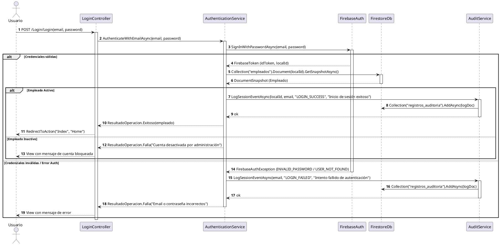

#### **CU-001 - Iniciar sesión con correo y contraseña**

| Campo | Descripción |
| :---- | :---- |
| **Nombre** | ingresarCredenciales(email: string, password: string): Task<IActionResult> |
| **Responsabilidades** | Valida credenciales contra el proveedor identity Firebase Authentication, comprueba el estado activo del empleado en Firestore, registra el evento en auditoría y establece la cookie de sesión autenticada. |
| **Tipo** | Sistema |
| **Referencias cruzadas** | CU-001, CU-001.1 (`ingresarCredenciales`) |
| **Notas** | Participantes: `LoginController`, `AuthenticationService`, `FirebaseAuth`, `FirestoreDb`, `AuditService`, `Empleado`. |
| **Excepciones** | Formato de correo inválido, contraseña vacía, empleado en estado `Inactivo` o servicio de autenticación no disponible. |
| **Salida** | Redirección al dashboard principal en caso de éxito o retorno de vista de login con alerta en caso de falla. |
| **Precondiciones** | El usuario no debe poseer sesión activa. La aplicación tiene conectividad con Firebase Auth y Firestore. |
| **Postcondiciones** | Si las credenciales son válidas y el empleado está activo: se emite cookie segura de sesión (`CookieAuthenticationDefaults`), y se crea un registro en la colección `registros_auditoria` con acción `LOGIN_SUCCESS`.<br>Si las credenciales son incorrectas: no se crea cookie y se registra `LOGIN_FAILED` en `registros_auditoria`. |

---

##### DSD-02 - Iniciar sesión / Registro con Google

* **Operación:** `retornarTokenIdentidad(token, email, nombre, apellido)` / `procesarAutenticacionGoogleExitosa`
* **Casos de Uso cubiertos:** CU-001.2, CU-011

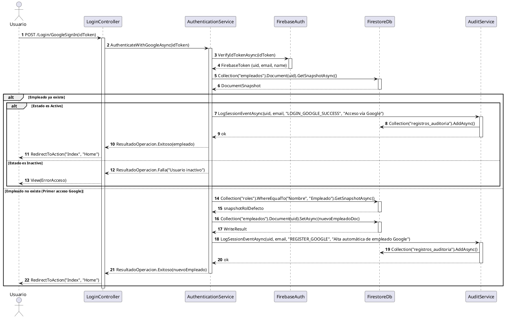

#### **CU-001.2 - Iniciar sesión / Registro con Google**

| Campo | Descripción |
| :---- | :---- |
| **Nombre** | AuthenticateWithGoogleAsync(idToken: string): Task<ResultadoOperacion> |
| **Responsabilidades** | Valida criptográficamente el token OAuth de Google mediante Firebase Auth SDK, consulta o crea el perfil en la colección `empleados` asignando el rol base predeterminado y genera la sesión web. |
| **Tipo** | Sistema |
| **Referencias cruzadas** | CU-001.2, CU-011 (`retornarTokenIdentidad`, `procesarAutenticacionGoogleExitosa`) |
| **Notas** | Participantes: `LoginController`, `AuthenticationService`, `FirebaseAuth`, `FirestoreDb`, `AuditService`, `Empleado`. |
| **Excepciones** | Token expirado o con firma alterada (HTTP 401), usuario previamente dado de baja (HTTP 403). |
| **Salida** | `ResultadoOperacion` con datos del empleado autenticado o mensaje descriptivo de rechazo. |
| **Precondiciones** | Token de identidad válido generado por el cliente OAuth configurado en Google Cloud Console. |
| **Postcondiciones** | Si el usuario existe: se registra acceso exitoso en `registros_auditoria`.<br>Si es nuevo: se crea documento en `empleados` con `_id = uid`, estado `Activo`, rol predeterminado y se audita el alta. |

---

##### DSD-03 - Cerrar sesión

* **Operación:** `solicitarCierreSesion()`
* **Casos de Uso cubiertos:** CU-002

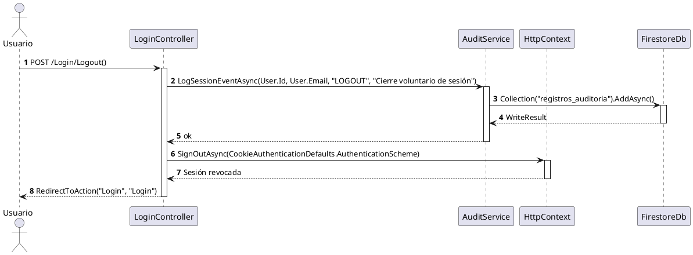

#### **CU-002 - Cerrar sesión**

| Campo | Descripción |
| :---- | :---- |
| **Nombre** | solicitarCierreSesion(): Task<IActionResult> |
| **Responsabilidades** | Invalida y elimina la cookie de autenticación del contexto HTTP, destruye el estado local de sesión y registra la auditoría del cierre voluntario. |
| **Tipo** | Sistema |
| **Referencias cruzadas** | CU-002 (`solicitarCierreSesion`) |
| **Notas** | Participantes: `LoginController`, `AuditService`, `HttpContext`, `FirestoreDb`. |
| **Excepciones** | Ninguna; ante fallos de auditoría se prioriza la revocación de la cookie para proteger la seguridad. |
| **Salida** | Redirección al formulario de login con cabeceras de expiración de cookie (`Set-Cookie: ... Max-Age=0`). |
| **Precondiciones** | El usuario debe poseer una sesión HTTP activa. |
| **Postcondiciones** | Eliminación de la cookie de autenticación en el cliente y creación de un documento en `registros_auditoria` con acción `LOGOUT`. |

---

##### DSD-04 - Recuperar contraseña

* **Operación:** `enviarNuevaContrasenia(token, nuevaPassword)` / `ingresarEmailRecuperacion(email)`
* **Casos de Uso cubiertos:** CU-003

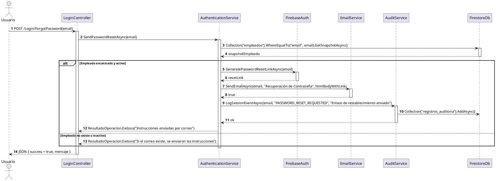

#### **CU-003 - Recuperar contraseña**

| Campo | Descripción |
| :---- | :---- |
| **Nombre** | SendPasswordResetAsync(email: string): Task<ResultadoOperacion> |
| **Responsabilidades** | Valida la existencia del empleado en Firestore, genera un enlace de restablecimiento seguro y despacha un correo electrónico formateado con las instrucciones. |
| **Tipo** | Sistema |
| **Referencias cruzadas** | CU-003 (`ingresarEmailRecuperacion`, `enviarNuevaContrasenia`) |
| **Notas** | Participantes: `LoginController`, `AuthenticationService`, `FirebaseAuth`, `EmailService`, `AuditService`, `FirestoreDb`. |
| **Excepciones** | Falla en el servidor de correo SMTP (se informa error controlado) o cuenta de usuario desactivada. |
| **Salida** | `ResultadoOperacion` indicando confirmación del despacho. |
| **Precondiciones** | Dirección de correo con sintaxis válida. |
| **Postcondiciones** | Despacho de correo vía SMTP con enlace criptográfico de un solo uso y registro del evento en `registros_auditoria`. |

---

##### DSD-05 - Cierre de sesión automático por inactividad

* **Operación:** `verificarTiempoInactividad()`
* **Casos de Uso cubiertos:** CU-004

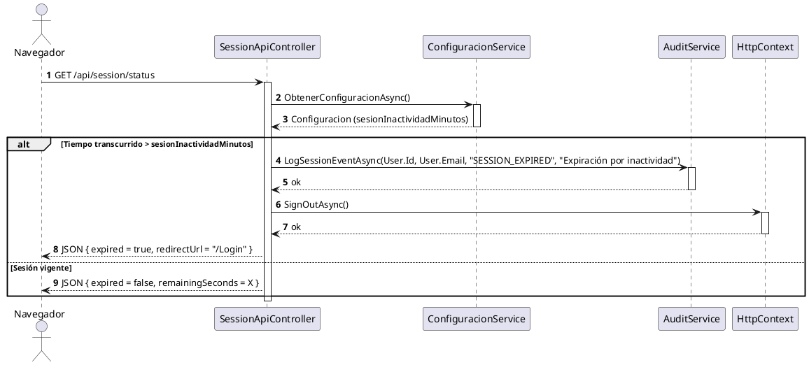

#### **CU-004 - Cierre de sesión automático por inactividad**

| Campo | Descripción |
| :---- | :---- |
| **Nombre** | CheckSessionStatusAsync(): Task<IActionResult> |
| **Responsabilidades** | Compara la última marca temporal de actividad contra el umbral configurado en `Configuracion`, cerrando la sesión de forma transparente si se superó el límite. |
| **Tipo** | Sistema |
| **Referencias cruzadas** | CU-004 (`verificarTiempoInactividad`) |
| **Notas** | Participantes: `SessionApiController`, `ConfiguracionService`, `AuditService`, `HttpContext`. |
| **Excepciones** | Imposibilidad de leer configuración (adopta umbral de seguridad predeterminado de 30 minutos). |
| **Salida** | Task<IActionResult> |
| **Precondiciones** | Sesión web activa en el navegador cliente. |
| **Postcondiciones** | Si expiró: revocación de cookie y registro `SESSION_EXPIRED` en `registros_auditoria`. |

---

#### Módulo Gestión de Empleados

##### DSD-06 - Registrarse por correo

* **Operación:** `ingresarDatosRegistro(nombre, apellido, email, password)`
* **Casos de Uso cubiertos:** CU-005, CU-005.1

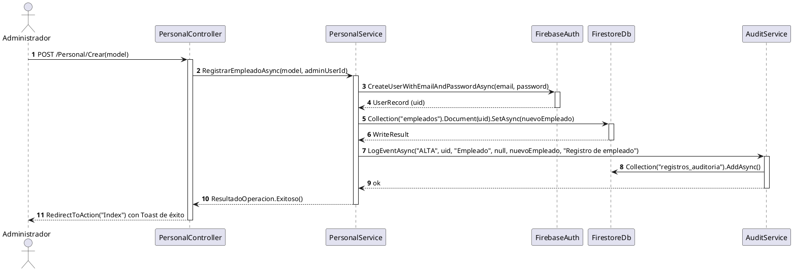

#### **CU-005.1 - Registrarse por correo**

| Campo | Descripción |
| :---- | :---- |
| **Nombre** | RegistrarEmpleadoAsync(model: CrearEmpleadoViewModel, adminUserId: string): Task<ResultadoOperacion> |
| **Responsabilidades** | Da de alta la credencial en Firebase Auth, crea el documento en la colección `empleados` con estado `Activo` y rol asignado, y registra la auditoría del alta. |
| **Tipo** | Sistema |
| **Referencias cruzadas** | CU-005.1 (`ingresarDatosRegistro`) |
| **Notas** | Participantes: `PersonalController`, `PersonalService`, `FirebaseAuth`, `FirestoreDb`, `AuditService`, `Empleado`. |
| **Excepciones** | Email duplicado en Firebase Auth, contraseña que no cumple complejidad o falla en Firestore. |
| **Salida** | `ResultadoOperacion` indicando éxito o motivo de rechazo. |
| **Precondiciones** | El usuario emisor debe tener rol de Administrador. El email no debe existir previamente. |
| **Postcondiciones** | Se crea la cuenta en Firebase Auth, se crea el documento en `empleados` y se escribe un log de auditoría. |

---

##### DSD-07 - Modificar empleado

* **Operación:** `confirmarModificacionEmpleado()`
* **Casos de Uso cubiertos:** CU-006

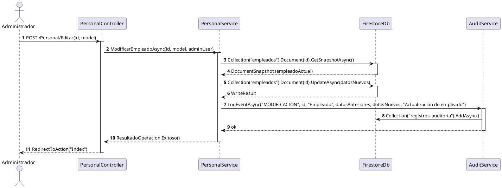

#### **CU-006 - Modificar empleado**

| Campo | Descripción |
| :---- | :---- |
| **Nombre** | ModificarEmpleadoAsync(id: string, model: ModificarEmpleadoInput, adminUser: string): Task<ResultadoOperacion> |
| **Responsabilidades** | Actualiza nombre, apellido y datos de contacto del empleado en `empleados` y audita el cambio comparando valores previos y posteriores. |
| **Tipo** | Sistema |
| **Referencias cruzadas** | CU-006 (`confirmarModificacionEmpleado`) |
| **Notas** | Participantes: `PersonalController`, `PersonalService`, `FirestoreDb`, `AuditService`, `Empleado`. |
| **Excepciones** | Documento inexistente o fallo de concurrencia en Firestore. |
| **Salida** | Task<IActionResult> |
| **Precondiciones** | Empleado existente en Firestore. |
| **Postcondiciones** | Actualización del documento en `empleados` y registro de auditoría con deltas de modificación. |

---

##### DSD-08 - Desactivar y Reactivar empleado

* **Operación:** `confirmarDesactivacion(idEmpleado)` / `confirmarReactivacion(idEmpleado)`
* **Casos de Uso cubiertos:** CU-007, CU-008

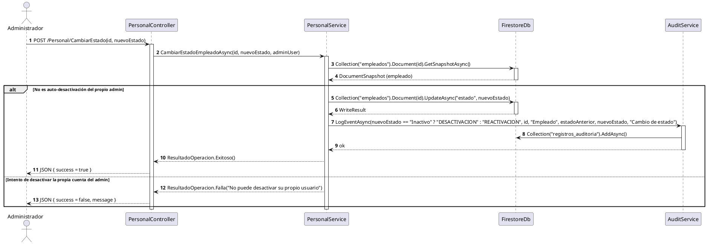

#### **CU-007 - Desactivar y Reactivar empleado**

| Campo | Descripción |
| :---- | :---- |
| **Nombre** | CambiarEstadoEmpleadoAsync(id: string, nuevoEstado: string, adminUser: string): Task<ResultadoOperacion> |
| **Responsabilidades** | Transiciona el atributo `estado` del empleado entre `Activo` e `Inactivo`, previniendo la autodesactivación del administrador en sesión y registrando la auditoría. |
| **Tipo** | Sistema |
| **Referencias cruzadas** | CU-007, CU-008 (`confirmarDesactivacion`, `confirmarReactivacion`) |
| **Notas** | Participantes: `PersonalController`, `PersonalService`, `FirestoreDb`, `AuditService`, `Empleado`. |
| **Excepciones** | El administrador intenta desactivarse a sí mismo o el empleado no existe. |
| **Salida** | Task<IActionResult> |
| **Precondiciones** | Usuario emisor con rol de Administrador; empleado existente. |
| **Postcondiciones** | El campo `estado` en `empleados` cambia y se emite evento de auditoría. |

---

##### DSD-09 - Consultar y filtrar empleados

* **Operación:** `aplicarFiltrosOrdenamiento(rol, estado, orden, pagina)`
* **Casos de Uso cubiertos:** CU-009

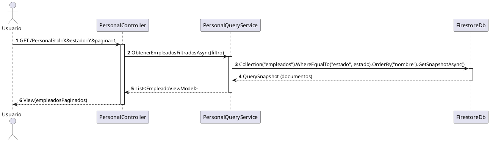

#### **CU-009 - Consultar y filtrar empleados**

| Campo | Descripción |
| :---- | :---- |
| **Nombre** | ObtenerEmpleadosFiltradosAsync(filtro: EmpleadoFilter): Task<List<EmpleadoViewModel>> |
| **Responsabilidades** | Recupera documentos de `empleados` aplicando filtros de rol, estado y ordenamiento determinista sobre Firestore. |
| **Tipo** | Sistema |
| **Referencias cruzadas** | CU-009 (`aplicarFiltrosOrdenamiento`) |
| **Notas** | Participantes: `PersonalController`, `PersonalQueryService`, `FirestoreDb`, `Empleado`. |
| **Excepciones** | Índice inexistente en Firestore o fallo de red. |
| **Salida** | Task<IActionResult> |
| **Precondiciones** | Usuario con permiso `Personal.Consultar`. |
| **Postcondiciones** | Ninguna mutación de datos; renderizado de grilla. |

---

##### DSD-10 - Asignar roles a empleados

* **Operación:** `confirmarAsignacionRol()`
* **Casos de Uso cubiertos:** CU-010

```plantuml
@startuml DSD_10_AsignarRol
autonumber
actor Administrador
participant "PersonalController" as Controller
participant "PersonalService" as PersonalSvc
participant "RolService" as RolSvc
participant "FirestoreDb" as Firestore
participant "AuditService" as Audit

Administrador -> Controller : POST /Personal/AsignarRol(idEmpleado, idRol)
activate Controller
Controller -> PersonalSvc : AsignarRolAsync(idEmpleado, idRol, adminUser)
activate PersonalSvc
PersonalSvc -> RolSvc : ObtenerPorIdAsync(idRol)
activate RolSvc
RolSvc --> PersonalSvc : Rol (rolValido)
deactivate RolSvc

PersonalSvc -> Firestore : Collection("empleados").Document(idEmpleado).UpdateAsync("rolId", idRol)
activate Firestore
Firestore --> PersonalSvc : WriteResult
deactivate Firestore

PersonalSvc -> Audit : LogEventAsync("ASIGNACION_ROL", idEmpleado, "Empleado", rolAnterior, idRol, "Cambio de rol asignado")
activate Audit
Audit -> Firestore : Collection("registros_auditoria").AddAsync()
Audit --> PersonalSvc : ok
deactivate Audit

PersonalSvc --> Controller : ResultadoOperacion.Exitoso()
deactivate PersonalSvc
Controller --> Administrador : JSON { success = true }
deactivate Controller
@enduml
```

#### **CU-010 - Asignar roles a empleados**

| Campo | Descripción |
| :---- | :---- |
| **Nombre** | AsignarRolAsync(idEmpleado: string, idRol: string, adminUser: string): Task<ResultadoOperacion> |
| **Responsabilidades** | Valida la existencia del rol de destino, asocia su identificador en el documento del empleado y registra la auditoría correspondiente. |
| **Tipo** | Sistema |
| **Referencias cruzadas** | CU-010 (`confirmarAsignacionRol`) |
| **Notas** | Participantes: `PersonalController`, `PersonalService`, `RolService`, `FirestoreDb`, `AuditService`, `Empleado`, `Rol`. |
| **Excepciones** | Rol inexistente o inactivo. |
| **Salida** | Task<IActionResult> |
| **Precondiciones** | Usuario con rol Administrador; rol y empleado existentes. |
| **Postcondiciones** | Actualización del campo `rolId` en `empleados` y nuevo registro en `registros_auditoria`. |

---

#### Módulo Gestión de Clientes y Vehículos

##### DSD-11 - Crear cliente

* **Operación:** `confirmarAltaCliente()`
* **Casos de Uso cubiertos:** CU-012

```plantuml
@startuml DSD_11_CrearCliente
autonumber
actor Personal
participant "ClienteController" as Controller
participant "ClienteService" as ClienteSvc
participant "TipoDocumentoService" as TipoDocSvc
participant "FirestoreDb" as Firestore
participant "AuditService" as Audit

Personal -> Controller : POST /Cliente/Crear(input)
activate Controller
Controller -> ClienteSvc : CrearClienteAsync(cliente, user)
activate ClienteSvc
ClienteSvc -> TipoDocSvc : ValidarDocumentoAsync(tipoDocId, nroDoc)
activate TipoDocSvc
TipoDocSvc --> ClienteSvc : bool esValido
deactivate TipoDocSvc

alt Formato de documento válido
    ClienteSvc -> Firestore : Collection("clientes").WhereEqualTo("numeroDocumento", nroDoc).GetSnapshotAsync()
    activate Firestore
    Firestore --> ClienteSvc : snapshotExistente
    deactivate Firestore
    alt No existe cliente duplicado
        ClienteSvc -> Firestore : Collection("clientes").Document().SetAsync(clienteDoc)
        activate Firestore
        Firestore --> ClienteSvc : WriteResult
        deactivate Firestore
        ClienteSvc -> Audit : LogEventAsync("ALTA", cliente.Id, "Cliente", null, clienteDoc, "Alta de cliente")
        activate Audit
        Audit -> Firestore : Collection("registros_auditoria").AddAsync()
        Audit --> ClienteSvc : ok
        deactivate Audit
        ClienteSvc --> Controller : ResultadoOperacion.Exitoso(cliente.Id)
        Controller --> Personal : JSON { success = true, id = cliente.Id }
    else Documento ya registrado
        ClienteSvc --> Controller : ResultadoOperacion.Falla("El documento ya se encuentra registrado")
        Controller --> Personal : JSON { success = false, message }
    end
else Documento no cumple formato
    ClienteSvc --> Controller : ResultadoOperacion.Falla("Formato de documento inválido")
    Controller --> Personal : JSON { success = false, message }
end
deactivate ClienteSvc
deactivate Controller
@enduml
```

#### **CU-012 - Crear cliente**

| Campo | Descripción |
| :---- | :---- |
| **Nombre** | CrearClienteAsync(cliente: Cliente, user: string): Task<ResultadoOperacion> |
| **Responsabilidades** | Valida el número de documento según las reglas de `TipoDocumento`, comprueba unicidad en Firestore, persiste el cliente en la colección `clientes` y audita el alta. |
| **Tipo** | Sistema |
| **Referencias cruzadas** | CU-012 (`confirmarAltaCliente`) |
| **Notas** | Participantes: `ClienteController`, `ClienteService`, `TipoDocumentoService`, `FirestoreDb`, `AuditService`, `Cliente`. |
| **Excepciones** | Documento ya existente en el sistema o formato incompatible con el tipo de documento. |
| **Salida** | Task<IActionResult> |
| **Precondiciones** | Personal autenticado con permiso `Clientes.Crear`. |
| **Postcondiciones** | Documento creado en `clientes` con `estado = "Activo"` y registro en `registros_auditoria`. |

---

##### DSD-12 - Modificar cliente

* **Operación:** `confirmarGuardadoModificaciones()`
* **Casos de Uso cubiertos:** CU-013

```plantuml
@startuml DSD_12_ModificarCliente
autonumber
actor Personal
participant "ClienteController" as Controller
participant "ClienteService" as ClienteSvc
participant "FirestoreDb" as Firestore
participant "AuditService" as Audit

Personal -> Controller : POST /Cliente/Editar(id, input)
activate Controller
Controller -> ClienteSvc : ModificarClienteAsync(cliente, user)
activate ClienteSvc
ClienteSvc -> Firestore : Collection("clientes").Document(cliente.Id).GetSnapshotAsync()
activate Firestore
Firestore --> ClienteSvc : DocumentSnapshot (anterior)
deactivate Firestore

ClienteSvc -> Firestore : Collection("clientes").Document(cliente.Id).SetAsync(cliente, SetOptions.MergeAll)
activate Firestore
Firestore --> ClienteSvc : WriteResult
deactivate Firestore

ClienteSvc -> Audit : LogEventAsync("MODIFICACION", cliente.Id, "Cliente", anterior, cliente, "Modificación de datos")
activate Audit
Audit -> Firestore : Collection("registros_auditoria").AddAsync()
Audit --> ClienteSvc : ok
deactivate Audit

ClienteSvc --> Controller : ResultadoOperacion.Exitoso()
deactivate ClienteSvc
Controller --> Personal : JSON { success = true }
deactivate Controller
@enduml
```

#### **CU-013 - Modificar cliente**

| Campo | Descripción |
| :---- | :---- |
| **Nombre** | ModificarClienteAsync(cliente: Cliente, user: string): Task<ResultadoOperacion> |
| **Responsabilidades** | Actualiza nombre, apellido, teléfono y email del cliente en `clientes`, asegurando trazabilidad en auditoría. |
| **Tipo** | Sistema |
| **Referencias cruzadas** | CU-013 (`confirmarGuardadoModificaciones`) |
| **Notas** | Participantes: `ClienteController`, `ClienteService`, `FirestoreDb`, `AuditService`, `Cliente`. |
| **Excepciones** | Cliente inexistente o teléfono con formato E.164 no válido. |
| **Salida** | Task<IActionResult> |
| **Precondiciones** | Cliente existente en estado `Activo`. |
| **Postcondiciones** | Documento actualizado en `clientes` y registro emitido en `registros_auditoria`. |

---

##### DSD-13 - Desactivar y Reactivar cliente

* **Operación:** `confirmarDesactivacionCliente(idCliente)` / `confirmarReactivacionCliente(idCliente)`
* **Casos de Uso cubiertos:** CU-014, CU-015

```plantuml
@startuml DSD_13_DesactivarReactivarCliente
autonumber
actor Personal
participant "ClienteController" as Controller
participant "ClienteLifecycleService" as LifecycleSvc
participant "FirestoreDb" as Firestore
participant "AuditService" as Audit

Personal -> Controller : POST /Cliente/CambiarEstado(id, nuevoEstado)
activate Controller
Controller -> LifecycleSvc : CambiarEstadoAsync(id, nuevoEstado, user)
activate LifecycleSvc

alt Desactivación
    LifecycleSvc -> Firestore : Collection("lavados").WhereEqualTo("clienteId", id).WhereEqualTo("estado", "EnProceso").GetSnapshotAsync()
    activate Firestore
    Firestore --> LifecycleSvc : snapshotLavadosActivos
    deactivate Firestore
    alt No tiene lavados activos en proceso
        LifecycleSvc -> Firestore : Collection("clientes").Document(id).UpdateAsync("estado", "Inactivo")
        activate Firestore
        Firestore --> LifecycleSvc : WriteResult
        deactivate Firestore
        LifecycleSvc -> Audit : LogEventAsync("DESACTIVACION", id, "Cliente", "Activo", "Inactivo", "Baja lógica")
        activate Audit
        Audit --> LifecycleSvc : ok
        deactivate Audit
        LifecycleSvc --> Controller : ResultadoOperacion.Exitoso()
    else Tiene lavados activos
        LifecycleSvc --> Controller : ResultadoOperacion.Falla("No se puede desactivar: posee lavados en proceso")
    end
else Reactivación
    LifecycleSvc -> Firestore : Collection("clientes").Document(id).UpdateAsync("estado", "Activo")
    activate Firestore
    Firestore --> LifecycleSvc : WriteResult
    deactivate Firestore
    LifecycleSvc -> Audit : LogEventAsync("REACTIVACION", id, "Cliente", "Inactivo", "Activo", "Reactivación")
    activate Audit
    Audit --> LifecycleSvc : ok
    deactivate Audit
    LifecycleSvc --> Controller : ResultadoOperacion.Exitoso()
end
deactivate LifecycleSvc
Controller --> Personal : JSON { success = resultado.Exitoso, message }
deactivate Controller
@enduml
```

#### **CU-014 - Desactivar y Reactivar cliente**

| Campo | Descripción |
| :---- | :---- |
| **Nombre** | CambiarEstadoAsync(idCliente: string, nuevoEstado: string, user: string): Task<ResultadoOperacion> |
| **Responsabilidades** | Valida que el cliente no posea órdenes de servicio activas en `lavados`, conmuta el estado entre `Activo` e `Inactivo` y registra la auditoría. |
| **Tipo** | Sistema |
| **Referencias cruzadas** | CU-014, CU-015 (`confirmarDesactivacionCliente`, `confirmarReactivacionCliente`) |
| **Notas** | Participantes: `ClienteController`, `ClienteLifecycleService`, `FirestoreDb`, `AuditService`, `Cliente`. |
| **Excepciones** | El cliente tiene un lavado en estado `EnProceso`. |
| **Salida** | Task<IActionResult> |
| **Precondiciones** | Cliente registrado en Firestore. |
| **Postcondiciones** | Campo `estado` actualizado en `clientes` y evento de auditoría generado. |

---

##### DSD-14 - Consultar y buscar clientes

* **Operación:** `aplicarFiltrosOrdenamiento(estado, criterioOrden, pagina)` / `ingresarCriterioBusquedaCliente(terminoBusqueda)`
* **Casos de Uso cubiertos:** CU-016, CU-017

```plantuml
@startuml DSD_14_ConsultarClientes
autonumber
actor Personal
participant "ClienteController" as Controller
participant "ClienteService" as ClienteSvc
participant "FirestoreDb" as Firestore

Personal -> Controller : GET /Cliente?termino=Juan&estado=Activo
activate Controller
Controller -> ClienteSvc : ObtenerClientesAsync(filtro)
activate ClienteSvc
ClienteSvc -> Firestore : Collection("clientes").WhereEqualTo("estado", "Activo").OrderBy("apellido").GetSnapshotAsync()
activate Firestore
Firestore --> ClienteSvc : snapshotClientes
deactivate Firestore
ClienteSvc --> Controller : List<ClienteViewModel>
deactivate ClienteSvc
Controller --> Personal : View(clientesPaginados)
deactivate Controller
@enduml
```

#### **CU-016 - Consultar y buscar clientes**

| Campo | Descripción |
| :---- | :---- |
| **Nombre** | ObtenerClientesAsync(filtro: ClienteFilter): Task<List<ClienteViewModel>> |
| **Responsabilidades** | Consulta la colección `clientes` aplicando filtros de estado y búsqueda por prefijo sobre documento o nombre. |
| **Tipo** | Sistema |
| **Referencias cruzadas** | CU-016, CU-017 (`aplicarFiltrosOrdenamiento`, `ingresarCriterioBusquedaCliente`) |
| **Notas** | Participantes: `ClienteController`, `ClienteService`, `FirestoreDb`, `Cliente`. |
| **Excepciones** | Parámetros de ordenamiento inválidos. |
| **Salida** | Task<IActionResult> |
| **Precondiciones** | Personal con permiso de consulta de clientes. |
| **Postcondiciones** | Ninguna mutación en base de datos. |

---

##### DSD-15 - Crear vehículo

* **Operación:** `ingresarDatosVehiculo(tipoVehiculo, patente, marca, modelo, color)`
* **Casos de Uso cubiertos:** CU-018

```plantuml
@startuml DSD_15_CrearVehiculo
autonumber
actor Personal
participant "VehiculoController" as Controller
participant "VehiculoService" as VehiculoSvc
participant "VehiclePlateGuard" as PlateGuard
participant "TipoVehiculoService" as TipoVehSvc
participant "FirestoreDb" as Firestore
participant "AuditService" as Audit

Personal -> Controller : POST /Vehiculo/Crear(input)
activate Controller
Controller -> VehiculoSvc : CrearVehiculoAsync(vehiculoInput, user)
activate VehiculoSvc
VehiculoSvc -> TipoVehSvc : ObtenerPorIdAsync(tipoVehiculoId)
activate TipoVehSvc
TipoVehSvc --> VehiculoSvc : TipoVehiculo
deactivate TipoVehSvc

VehiculoSvc -> PlateGuard : ValidarYFormatearPatente(patente, tipoVehiculo)
activate PlateGuard
PlateGuard --> VehiculoSvc : patenteNormalizada
deactivate PlateGuard

VehiculoSvc -> Firestore : Collection("vehiculos").WhereEqualTo("patente", patenteNormalizada).GetSnapshotAsync()
activate Firestore
Firestore --> VehiculoSvc : snapshotExistente
deactivate Firestore

alt Patente no registrada previamente
    VehiculoSvc -> Firestore : Collection("vehiculos").Document().SetAsync(nuevoVehiculoDoc)
    activate Firestore
    Firestore --> VehiculoSvc : WriteResult
    deactivate Firestore
    VehiculoSvc -> Audit : LogEventAsync("ALTA", nuevoVehiculoDoc.Id, "Vehiculo", null, nuevoVehiculoDoc, "Alta de vehículo")
    activate Audit
    Audit --> VehiculoSvc : ok
    deactivate Audit
    VehiculoSvc --> Controller : ResultadoOperacion.Exitoso(nuevoVehiculoDoc.Id)
    Controller --> Personal : JSON { success = true, id }
else Patente ya existente
    VehiculoSvc --> Controller : ResultadoOperacion.Falla("La patente ya está registrada en el sistema")
    Controller --> Personal : JSON { success = false, message }
end
deactivate VehiculoSvc
deactivate Controller
@enduml
```

#### **CU-018 - Crear vehículo**

| Campo | Descripción |
| :---- | :---- |
| **Nombre** | CrearVehiculoAsync(input: VehiculoInput, user: string): Task<ResultadoOperacion> |
| **Responsabilidades** | Valida el formato de patente según el `TipoVehiculo`, genera la clave de asociación inicial hasheada, almacena el vehículo en `vehiculos` y registra la auditoría. |
| **Tipo** | Sistema |
| **Referencias cruzadas** | CU-018 (`ingresarDatosVehiculo`) |
| **Notas** | Participantes: `VehiculoController`, `VehiculoService`, `VehiclePlateGuard`, `TipoVehiculoService`, `FirestoreDb`, `AuditService`, `Vehiculo`. |
| **Excepciones** | Patente duplicada o formato no coincidente con el tipo de vehículo. |
| **Salida** | Task<IActionResult> |
| **Precondiciones** | Usuario autenticado con permiso de gestión de vehículos. |
| **Postcondiciones** | Documento creado en `vehiculos` con `estado = "Activo"` y clave hash de asociación de 4 dígitos generada. |

---

##### DSD-16 - Modificar vehículo

* **Operación:** `actualizarDatosVehiculo(modelo, color)`
* **Casos de Uso cubiertos:** CU-019

```plantuml
@startuml DSD_16_ModificarVehiculo
autonumber
actor Personal
participant "VehiculoController" as Controller
participant "VehiculoService" as VehiculoSvc
participant "FirestoreDb" as Firestore
participant "AuditService" as Audit

Personal -> Controller : POST /Vehiculo/Editar(id, input)
activate Controller
Controller -> VehiculoSvc : ModificarVehiculoAsync(id, input, user)
activate VehiculoSvc
VehiculoSvc -> Firestore : Collection("vehiculos").Document(id).GetSnapshotAsync()
activate Firestore
Firestore --> VehiculoSvc : snapshotAnterior
deactivate Firestore

VehiculoSvc -> Firestore : Collection("vehiculos").Document(id).UpdateAsync("modelo", input.Modelo, "color", input.Color)
activate Firestore
Firestore --> VehiculoSvc : WriteResult
deactivate Firestore

VehiculoSvc -> Audit : LogEventAsync("MODIFICACION", id, "Vehiculo", anterior, nuevo, "Modificación de datos")
activate Audit
Audit --> VehiculoSvc : ok
deactivate Audit

VehiculoSvc --> Controller : ResultadoOperacion.Exitoso()
deactivate VehiculoSvc
Controller --> Personal : JSON { success = true }
deactivate Controller
@enduml
```

#### **CU-019 - Modificar vehículo**

| Campo | Descripción |
| :---- | :---- |
| **Nombre** | ModificarVehiculoAsync(id: string, input: ModificarVehiculoInput, user: string): Task<ResultadoOperacion> |
| **Responsabilidades** | Actualiza los atributos mutables (modelo y color) del vehículo en `vehiculos`, manteniendo inalterada la patente como identificador natural y auditando el cambio. |
| **Tipo** | Sistema |
| **Referencias cruzadas** | CU-019 (`actualizarDatosVehiculo`) |
| **Notas** | Participantes: `VehiculoController`, `VehiculoService`, `FirestoreDb`, `AuditService`, `Vehiculo`. |
| **Excepciones** | Vehículo no encontrado en la base de datos. |
| **Salida** | Task<IActionResult> |
| **Precondiciones** | Vehículo existente en Firestore. |
| **Postcondiciones** | Documento actualizado en `vehiculos` y evento de auditoría emitido. |

---

##### DSD-17 - Desactivar y Reactivar vehículo

* **Operación:** `solicitarDesactivacionVehiculo(idVehiculo)` / `solicitarReactivacionVehiculo(idVehiculo, idCliente)`
* **Casos de Uso cubiertos:** CU-020, CU-021

```plantuml
@startuml DSD_17_DesactivarReactivarVehiculo
autonumber
actor Personal
participant "VehiculoController" as Controller
participant "VehiculoService" as VehiculoSvc
participant "FirestoreDb" as Firestore
participant "AuditService" as Audit

Personal -> Controller : POST /Vehiculo/CambiarEstado(id, nuevoEstado)
activate Controller
Controller -> VehiculoSvc : CambiarEstadoAsync(id, nuevoEstado, user)
activate VehiculoSvc

alt Desactivación
    VehiculoSvc -> Firestore : Collection("lavados").WhereEqualTo("vehiculoId", id).WhereEqualTo("estado", "EnProceso").GetSnapshotAsync()
    activate Firestore
    Firestore --> VehiculoSvc : snapshotLavadosEnCurso
    deactivate Firestore
    alt No tiene lavados en curso
        VehiculoSvc -> Firestore : Collection("vehiculos").Document(id).UpdateAsync("estado", "Inactivo")
        activate Firestore
        Firestore --> VehiculoSvc : WriteResult
        deactivate Firestore
        VehiculoSvc -> Audit : LogEventAsync("DESACTIVACION", id, "Vehiculo", "Activo", "Inactivo", "Baja lógica")
        activate Audit
        Audit --> VehiculoSvc : ok
        deactivate Audit
        VehiculoSvc --> Controller : ResultadoOperacion.Exitoso()
    else Tiene lavados en curso
        VehiculoSvc --> Controller : ResultadoOperacion.Falla("No se puede desactivar: vehículo con lavado en proceso")
    end
else Reactivación
    VehiculoSvc -> Firestore : Collection("vehiculos").Document(id).UpdateAsync("estado", "Activo")
    activate Firestore
    Firestore --> VehiculoSvc : WriteResult
    deactivate Firestore
    VehiculoSvc -> Audit : LogEventAsync("REACTIVACION", id, "Vehiculo", "Inactivo", "Activo", "Reactivación")
    activate Audit
    Audit --> VehiculoSvc : ok
    deactivate Audit
    VehiculoSvc --> Controller : ResultadoOperacion.Exitoso()
end
deactivate VehiculoSvc
Controller --> Personal : JSON { success = true }
deactivate Controller
@enduml
```

#### **CU-020 - Desactivar y Reactivar vehículo**

| Campo | Descripción |
| :---- | :---- |
| **Nombre** | CambiarEstadoVehiculoAsync(id: string, nuevoEstado: string, user: string): Task<ResultadoOperacion> |
| **Responsabilidades** | Conmuta el estado de disponibilidad del vehículo entre `Activo` e `Inactivo`, impidiendo la baja si el rodado se encuentra siendo atendido en el lavadero. |
| **Tipo** | Sistema |
| **Referencias cruzadas** | CU-020, CU-021 (`solicitarDesactivacionVehiculo`, `solicitarReactivacionVehiculo`) |
| **Notas** | Participantes: `VehiculoController`, `VehiculoService`, `FirestoreDb`, `AuditService`, `Vehiculo`. |
| **Excepciones** | Vehículo asociado a un lavado activo con estado `EnProceso`. |
| **Salida** | Task<IActionResult> |
| **Precondiciones** | Vehículo registrado. |
| **Postcondiciones** | Campo `estado` modificado en `vehiculos` y registro en `registros_auditoria`. |

---

##### DSD-18 - Consultar y buscar vehículos

* **Operación:** `aplicarFiltrosVehiculos(tipoVehiculo, estado, orden, pagina)` / `ingresarTerminoBusquedaVehiculo(termino)`
* **Casos de Uso cubiertos:** CU-022, CU-023

```plantuml
@startuml DSD_18_ConsultarVehiculos
autonumber
actor Personal
participant "VehiculoController" as Controller
participant "VehiculoService" as VehiculoSvc
participant "FirestoreDb" as Firestore

Personal -> Controller : GET /Vehiculo?patente=AB123&tipo=Auto
activate Controller
Controller -> VehiculoSvc : ObtenerVehiculosAsync(filtro)
activate VehiculoSvc
VehiculoSvc -> Firestore : Collection("vehiculos").WhereEqualTo("tipoVehiculoId", filtro.TipoId).GetSnapshotAsync()
activate Firestore
Firestore --> VehiculoSvc : snapshotVehiculos
deactivate Firestore
VehiculoSvc --> Controller : List<VehiculoViewModel>
deactivate VehiculoSvc
Controller --> Personal : View(vehiculosPaginados)
deactivate Controller
@enduml
```

#### **CU-022 - Consultar y buscar vehículos**

| Campo | Descripción |
| :---- | :---- |
| **Nombre** | ObtenerVehiculosAsync(filtro: VehiculoFilter): Task<List<VehiculoViewModel>> |
| **Responsabilidades** | Realiza consultas filtradas sobre la colección `vehiculos` por patente, tipo o estado. |
| **Tipo** | Sistema |
| **Referencias cruzadas** | CU-022, CU-023 (`aplicarFiltrosVehiculos`, `ingresarTerminoBusquedaVehiculo`) |
| **Notas** | Participantes: `VehiculoController`, `VehiculoService`, `FirestoreDb`, `Vehiculo`. |
| **Excepciones** | Fallo de comunicación con Firestore. |
| **Salida** | Task<IActionResult> |
| **Precondiciones** | Usuario con permiso de consulta. |
| **Postcondiciones** | Ninguna mutación de datos. |

---

##### DSD-19 - Vincular vehículo a cliente

* **Operación:** `ingresarPatenteYClave(patente, claveAsociacion)`
* **Casos de Uso cubiertos:** CU-024

```plantuml
@startuml DSD_19_VincularVehiculo
autonumber
actor Cliente
participant "VehiculoController" as Controller
participant "ClienteVehicleService" as VinculoSvc
participant "VehiculoService" as VehiculoSvc
participant "FirestoreDb" as Firestore
participant "AuditService" as Audit

Cliente -> Controller : POST /Vehiculo/Vincular(patente, clave)
activate Controller
Controller -> VinculoSvc : VincularVehiculoAsync(clienteId, patente, clave)
activate VinculoSvc
VinculoSvc -> VehiculoSvc : ObtenerPorPatenteAsync(patente)
activate VehiculoSvc
VehiculoSvc --> VinculoSvc : Vehiculo
deactivate VehiculoSvc

alt Vehiculo existe y clave de asociación válida
    VinculoSvc -> Firestore : Collection("vehiculos").Document(v.Id).UpdateAsync("clientesIds", FieldValue.ArrayUnion(clienteId))
    activate Firestore
    Firestore --> VinculoSvc : WriteResult
    deactivate Firestore
    VinculoSvc -> Audit : LogEventAsync("VINCULACION", v.Id, "Vehiculo", null, clienteId, "Vehículo vinculado a cliente")
    activate Audit
    Audit --> VinculoSvc : ok
    deactivate Audit
    VinculoSvc --> Controller : ResultadoOperacion.Exitoso()
    Controller --> Cliente : JSON { success = true }
else Clave inválida o vehículo no existe
    VinculoSvc --> Controller : ResultadoOperacion.Falla("Patente o clave de asociación incorrecta")
    Controller --> Cliente : JSON { success = false, message }
end
deactivate VinculoSvc
deactivate Controller
@enduml
```

#### **CU-024 - Vincular vehículo a cliente**

| Campo | Descripción |
| :---- | :---- |
| **Nombre** | VincularVehiculoAsync(clienteId: string, patente: string, clave: string): Task<ResultadoOperacion> |
| **Responsabilidades** | Valida el hash de la clave de 4 dígitos contra el guardado en el vehículo y añade el `clienteId` al arreglo `clientesIds` de `vehiculos` mediante una operación atómica `ArrayUnion`. |
| **Tipo** | Sistema |
| **Referencias cruzadas** | CU-024 (`ingresarPatenteYClave`) |
| **Notas** | Participantes: `VehiculoController`, `ClienteVehicleService`, `VehiculoService`, `FirestoreDb`, `AuditService`, `Vehiculo`. |
| **Excepciones** | Clave incorrecta, vehículo inexistente o cliente ya vinculado. |
| **Salida** | Task<IActionResult> |
| **Precondiciones** | Cliente autenticado y vehículo activo previamente registrado. |
| **Postcondiciones** | El arreglo `clientesIds` del vehículo contiene el ID del cliente y se emite registro en `registros_auditoria`. |

---

##### DSD-20 - Desvincular vehículo de cliente

* **Operación:** `solicitarDesvinculacionVehiculo(idCliente, idVehiculo)`
* **Casos de Uso cubiertos:** CU-025

```plantuml
@startuml DSD_20_DesvincularVehiculo
autonumber
actor Cliente
participant "VehiculoController" as Controller
participant "ClienteVehicleService" as VinculoSvc
participant "FirestoreDb" as Firestore
participant "AuditService" as Audit

Cliente -> Controller : POST /Vehiculo/Desvincular(idVehiculo)
activate Controller
Controller -> VinculoSvc : DesvincularVehiculoAsync(clienteId, idVehiculo)
activate VinculoSvc

VinculoSvc -> Firestore : Collection("lavados").WhereEqualTo("vehiculoId", idVehiculo).WhereEqualTo("clienteId", clienteId).WhereEqualTo("estado", "EnProceso").GetSnapshotAsync()
activate Firestore
Firestore --> VinculoSvc : snapshotLavadosEnCurso
deactivate Firestore

alt No posee lavados en proceso con este vehículo
    VinculoSvc -> Firestore : Collection("vehiculos").Document(idVehiculo).UpdateAsync("clientesIds", FieldValue.ArrayRemove(clienteId))
    activate Firestore
    Firestore --> VinculoSvc : WriteResult
    deactivate Firestore
    VinculoSvc -> Audit : LogEventAsync("DESVINCULACION", idVehiculo, "Vehiculo", clienteId, null, "Vehículo desvinculado")
    activate Audit
    Audit --> VinculoSvc : ok
    deactivate Audit
    VinculoSvc --> Controller : ResultadoOperacion.Exitoso()
    Controller --> Cliente : JSON { success = true }
else Posee lavado activo
    VinculoSvc --> Controller : ResultadoOperacion.Falla("No se puede desvincular mientras exista un lavado en curso")
    Controller --> Cliente : JSON { success = false, message }
end
deactivate VinculoSvc
deactivate Controller
@enduml
```

#### **CU-025 - Desvincular vehículo de cliente**

| Campo | Descripción |
| :---- | :---- |
| **Nombre** | DesvincularVehiculoAsync(clienteId: string, idVehiculo: string): Task<ResultadoOperacion> |
| **Responsabilidades** | Comprueba que no haya servicios en curso para el binomio cliente-vehículo y remueve atómicamente el `clienteId` de la lista de titulares del rodado. |
| **Tipo** | Sistema |
| **Referencias cruzadas** | CU-025 (`solicitarDesvinculacionVehiculo`) |
| **Notas** | Participantes: `VehiculoController`, `ClienteVehicleService`, `FirestoreDb`, `AuditService`, `Vehiculo`. |
| **Excepciones** | Lavado activo en curso para el vehículo. |
| **Salida** | Task<IActionResult> |
| **Precondiciones** | El cliente debe figurar como titular asociado al vehículo. |
| **Postcondiciones** | El ID del cliente ya no pertenece a `clientesIds` en `vehiculos`. |

---

##### DSD-21 - Identificar si el número de teléfono está registrado por WhatsApp

* **Operación:** `procesarMensajeEntrante(numeroTelefono)`
* **Casos de Uso cubiertos:** CU-028

```plantuml
@startuml DSD_21_IdentificarTelefonoWhatsApp
autonumber
actor MetaWebhook
participant "WhatsAppWebhookController" as Controller
participant "WhatsAppFlowService" as FlowSvc
participant "WhatsAppSessionService" as SessionSvc
participant "ClienteService" as ClienteSvc
participant "MetaWhatsAppService" as MetaSvc
participant "FirestoreDb" as Firestore

MetaWebhook -> Controller : POST /api/whatsapp/webhook(payload)
activate Controller
Controller -> FlowSvc : ProcessIncomingMessageAsync(message)
activate FlowSvc
FlowSvc -> SessionSvc : GetOrCreateSessionAsync(phoneNumber)
activate SessionSvc
SessionSvc -> Firestore : Collection("whatsapp_sessions").Document(phoneNumber).GetSnapshotAsync()
activate Firestore
Firestore --> SessionSvc : snapshotSesion
deactivate Firestore
SessionSvc --> FlowSvc : WhatsAppSession
deactivate SessionSvc

FlowSvc -> ClienteSvc : ObtenerPorTelefonoAsync(phoneNumber)
activate ClienteSvc
ClienteSvc -> Firestore : Collection("clientes").WhereEqualTo("telefono", phoneNumber).GetSnapshotAsync()
activate Firestore
Firestore --> ClienteSvc : snapshotCliente
deactivate ClienteSvc

alt Cliente ya registrado
    FlowSvc -> MetaSvc : SendTextMessageAsync(phoneNumber, "¡Hola " + cliente.Nombre + "! ¿Qué deseas hacer hoy?\n1. Turnos\n2. Mis Vehículos")
    activate MetaSvc
    MetaSvc --> FlowSvc : ok
    deactivate MetaSvc
    FlowSvc -> SessionSvc : UpdateStateAsync(phoneNumber, "MENU_PRINCIPAL")
else Cliente no registrado
    FlowSvc -> MetaSvc : SendTextMessageAsync(phoneNumber, "¡Bienvenido a LavaFácil! No encontramos tu número registrado. ¿Deseas darte de alta como cliente?\n1. Sí\n2. No")
    activate MetaSvc
    MetaSvc --> FlowSvc : ok
    deactivate MetaSvc
    FlowSvc -> SessionSvc : UpdateStateAsync(phoneNumber, "REGISTRO_CONFIRMACION")
end
FlowSvc --> Controller : Ok()
deactivate FlowSvc
Controller --> MetaWebhook : HTTP 200 OK
deactivate Controller
@enduml
```

#### **CU-028 - Identificar si el número de teléfono está registrado por WhatsApp**

| Campo | Descripción |
| :---- | :---- |
| **Nombre** | ProcessIncomingMessageAsync(message: WhatsAppIncomingMessage): Task<ResultadoOperacion> |
| **Responsabilidades** | Recibe el webhook de WhatsApp Cloud API, carga o crea la sesión conversacional en `whatsapp_sessions`, busca al cliente por número de teléfono E.164 y enruta el diálogo al menú principal o al flujo de registro inicial. |
| **Tipo** | Sistema |
| **Referencias cruzadas** | CU-028 (`procesarMensajeEntrante`) |
| **Notas** | Participantes: `WhatsAppWebhookController`, `WhatsAppFlowService`, `WhatsAppSessionService`, `ClienteService`, `MetaWhatsAppService`, `FirestoreDb`. |
| **Excepciones** | Falla de red en Meta WhatsApp Service o sesión expirada. |
| **Salida** | Task<IActionResult> |
| **Precondiciones** | Webhook configurado con token de verificación y firma HMAC válida. |
| **Postcondiciones** | Actualización de la marca temporal y estado en `whatsapp_sessions` y envío del mensaje interactivo de respuesta. |

---

##### DSD-22 - Registrarse como cliente por WhatsApp

* **Operación:** `enviarDatosPersonales(datos)` / `confirmarRegistro(opcionConfirmar)`
* **Casos de Uso cubiertos:** CU-026

```plantuml
@startuml DSD_22_RegistrarseWhatsApp
autonumber
actor Cliente
participant "WhatsAppWebhookController" as Controller
participant "WhatsAppFlowService" as FlowSvc
participant "WhatsAppSessionService" as SessionSvc
participant "ClienteService" as ClienteSvc
participant "MetaWhatsAppService" as MetaSvc
participant "AuditService" as Audit

Cliente -> Controller : POST /api/whatsapp/webhook ("Juan Pérez, 38123456, DNI")
activate Controller
Controller -> FlowSvc : HandleRegistroClienteAsync(phone, messageText)
activate FlowSvc
FlowSvc -> SessionSvc : SaveTemporaryDataAsync(phone, datosParseadosJson)
activate SessionSvc
SessionSvc --> FlowSvc : ok
deactivate SessionSvc

FlowSvc -> MetaSvc : SendInteractiveButtonsAsync(phone, "¿Confirmas tus datos?\nNombre: Juan Pérez\nDNI: 38123456", ["Confirmar", "Reintentar"])
activate MetaSvc
MetaSvc --> FlowSvc : ok
deactivate MetaSvc
FlowSvc --> Controller : ok
deactivate FlowSvc
Controller --> Cliente : HTTP 200

== Confirmación ==

Cliente -> Controller : POST /api/whatsapp/webhook ("Confirmar")
activate Controller
Controller -> FlowSvc : HandleConfirmacionRegistroAsync(phone)
activate FlowSvc
FlowSvc -> SessionSvc : GetTemporaryDataAsync(phone)
activate SessionSvc
SessionSvc --> FlowSvc : datosJson
deactivate SessionSvc

FlowSvc -> ClienteSvc : CrearClienteAsync(nuevoCliente, "BOT_WHATSAPP")
activate ClienteSvc
ClienteSvc --> FlowSvc : ResultadoOperacion.Exitoso(clienteId)
deactivate ClienteSvc

FlowSvc -> MetaSvc : SendTextMessageAsync(phone, "¡Registro exitoso! Ya eres cliente de LavaFácil. Ahora puedes registrar tu vehículo.")
activate MetaSvc
MetaSvc --> FlowSvc : ok
deactivate MetaSvc

FlowSvc -> SessionSvc : UpdateStateAsync(phone, "MENU_PRINCIPAL")
activate SessionSvc
SessionSvc --> FlowSvc : ok
deactivate SessionSvc
FlowSvc --> Controller : ok
deactivate FlowSvc
Controller --> Cliente : HTTP 200
deactivate Controller
@enduml
```

#### **CU-026 - Registrarse como cliente por WhatsApp**

| Campo | Descripción |
| :---- | :---- |
| **Nombre** | HandleConfirmacionRegistroAsync(phoneNumber: string): Task<ResultadoOperacion> |
| **Responsabilidades** | Lee los datos temporales validados de la sesión de WhatsApp, da de alta el documento en la colección `clientes` y despacha el mensaje de bienvenida. |
| **Tipo** | Sistema |
| **Referencias cruzadas** | CU-026 (`enviarDatosPersonales`, `confirmarRegistro`) |
| **Notas** | Participantes: `WhatsAppWebhookController`, `WhatsAppFlowService`, `WhatsAppSessionService`, `ClienteService`, `MetaWhatsAppService`, `AuditService`, `Cliente`. |
| **Excepciones** | Documento ya registrado durante el proceso o datos incompletos. |
| **Salida** | Task<IActionResult> |
| **Precondiciones** | Sesión en estado `REGISTRO_CONFIRMACION`. |
| **Postcondiciones** | Nuevo documento en `clientes` con `estado = "Activo"` y sesión transicionada a `MENU_PRINCIPAL`. |

---

##### DSD-23 - Registrar vehículo y Regenerar clave por WhatsApp

* **Operación:** `enviarDatosVehiculo(datosVehiculo)` / `solicitarRegeneracionClave(vehiculoId)`
* **Casos de Uso cubiertos:** CU-027

```plantuml
@startuml DSD_23_RegistrarVehiculoWhatsApp
autonumber
actor Cliente
participant "WhatsAppWebhookController" as Controller
participant "WhatsAppFlowService" as FlowSvc
participant "VehiculoService" as VehiculoSvc
participant "ClienteVehicleService" as VinculoSvc
participant "MetaWhatsAppService" as MetaSvc

Cliente -> Controller : POST /api/whatsapp/webhook ("AB123CD, Peugeot, 208, Blanco, Auto")
activate Controller
Controller -> FlowSvc : HandleRegistroVehiculoAsync(phone, text)
activate FlowSvc
FlowSvc -> VehiculoSvc : CrearVehiculoAsync(input, "BOT_WHATSAPP")
activate VehiculoSvc
VehiculoSvc --> FlowSvc : ResultadoOperacion (vehiculoId, clavePlana)
deactivate VehiculoSvc

FlowSvc -> VinculoSvc : VincularVehiculoAsync(clienteId, patente, clavePlana)
activate VinculoSvc
VinculoSvc --> FlowSvc : ok
deactivate VinculoSvc

FlowSvc -> MetaSvc : SendTextMessageAsync(phone, "¡Vehículo registrado con éxito!\nPatente: AB123CD\nTu clave de asociación es: *" + clavePlana + "*\nConsérvala para vincular a otros conductores.")
activate MetaSvc
MetaSvc --> FlowSvc : ok
deactivate MetaSvc
FlowSvc --> Controller : ok
deactivate FlowSvc
Controller --> Cliente : HTTP 200
deactivate Controller
@enduml
```

#### **CU-027 - Registrar vehículo y Regenerar clave por WhatsApp**

| Campo | Descripción |
| :---- | :---- |
| **Nombre** | HandleRegistroVehiculoAsync(phone: string, text: string): Task<ResultadoOperacion> |
| **Responsabilidades** | Da de alta el nuevo vehículo en `vehiculos`, genera y entrega la clave de 4 dígitos plana al titular, vincula el rodado al cliente y responde por WhatsApp. |
| **Tipo** | Sistema |
| **Referencias cruzadas** | CU-027 (`enviarDatosVehiculo`, `solicitarRegeneracionClave`) |
| **Notas** | Participantes: `WhatsAppWebhookController`, `WhatsAppFlowService`, `VehiculoService`, `ClienteVehicleService`, `MetaWhatsAppService`, `Vehiculo`. |
| **Excepciones** | Patente duplicada o formato no admitido. |
| **Salida** | Task<IActionResult> |
| **Precondiciones** | Cliente previamente registrado y sesión activa en WhatsApp. |
| **Postcondiciones** | Documento creado en `vehiculos`, patente normalizada, clave hasheada y vínculo establecido. |

---

##### DSD-24 - Editar datos personales por WhatsApp

* **Operación:** `enviarNuevoValor(campo, nuevoValor)`
* **Casos de Uso cubiertos:** CU-029

```plantuml
@startuml DSD_24_EditarDatosWhatsApp
autonumber
actor Cliente
participant "WhatsAppWebhookController" as Controller
participant "WhatsAppFlowService" as FlowSvc
participant "ClienteService" as ClienteSvc
participant "MetaWhatsAppService" as MetaSvc

Cliente -> Controller : POST /api/whatsapp/webhook ("nuevo_email@dominio.com")
activate Controller
Controller -> FlowSvc : HandleActualizarDatoAsync(phone, "Email", "nuevo_email@dominio.com")
activate FlowSvc
FlowSvc -> ClienteSvc : ModificarEmailClienteAsync(phone, "nuevo_email@dominio.com", "BOT_WHATSAPP")
activate ClienteSvc
ClienteSvc --> FlowSvc : ResultadoOperacion.Exitoso()
deactivate ClienteSvc

FlowSvc -> MetaSvc : SendTextMessageAsync(phone, "Tu email ha sido actualizado correctamente.")
activate MetaSvc
MetaSvc --> FlowSvc : ok
deactivate MetaSvc
FlowSvc --> Controller : ok
deactivate FlowSvc
Controller --> Cliente : HTTP 200
deactivate Controller
@enduml
```

#### **CU-029 - Editar datos personales por WhatsApp**

| Campo | Descripción |
| :---- | :---- |
| **Nombre** | HandleActualizarDatoAsync(phone: string, campo: string, nuevoValor: string): Task<ResultadoOperacion> |
| **Responsabilidades** | Valida el nuevo formato del dato provisto y actualiza el campo correspondiente del cliente en Firestore, informando al usuario por WhatsApp. |
| **Tipo** | Sistema |
| **Referencias cruzadas** | CU-029 (`enviarNuevoValor`) |
| **Notas** | Participantes: `WhatsAppWebhookController`, `WhatsAppFlowService`, `ClienteService`, `MetaWhatsAppService`, `Cliente`. |
| **Excepciones** | Formato de email o nombre inválido. |
| **Salida** | Task<IActionResult> |
| **Precondiciones** | Sesión en estado `EDITANDO_PERFIL` y cliente registrado. |
| **Postcondiciones** | Campo modificado en el documento `clientes` y auditoría del cambio. |

---

#### Módulo Gestión de Servicios y Paquetes

##### DSD-25 - Crear servicio con receta técnica

* **Operación:** `confirmarAltaServicio()`
* **Casos de Uso cubiertos:** CU-030

```plantuml
@startuml DSD_25_CrearServicio
autonumber
actor Administrador
participant "ServicioController" as Controller
participant "ServicioLifecycleService" as LifecycleSvc
participant "InsumosService" as InsumosSvc
participant "FirestoreDb" as Firestore
participant "AuditService" as Audit

Administrador -> Controller : POST /Servicio/Crear(servicioInput, recetaItems)
activate Controller
Controller -> LifecycleSvc : CrearServicioConRecetaAsync(servicioInput, recetaItems, adminUser)
activate LifecycleSvc

loop Para cada item en recetaItems
    LifecycleSvc -> InsumosSvc : ValidarExistenciaInsumoAsync(item.InsumoId)
    activate InsumosSvc
    InsumosSvc --> LifecycleSvc : bool existe
    deactivate InsumosSvc
end

LifecycleSvc -> Firestore : Collection("servicios").Document().SetAsync(servicioDoc)
activate Firestore
Firestore --> LifecycleSvc : WriteResult
deactivate Firestore

LifecycleSvc -> Audit : LogEventAsync("ALTA", servicioDoc.Id, "Servicio", null, servicioDoc, "Alta de servicio")
activate Audit
Audit --> LifecycleSvc : ok
deactivate Audit

LifecycleSvc --> Controller : ResultadoOperacion.Exitoso(servicioDoc.Id)
deactivate LifecycleSvc
Controller --> Administrador : JSON { success = true, id = servicioDoc.Id }
deactivate Controller
@enduml
```

#### **CU-030 - Crear servicio con receta técnica**

| Campo | Descripción |
| :---- | :---- |
| **Nombre** | CrearServicioConRecetaAsync(input: ServicioInput, receta: List<RecetaInsumo>, user: string): Task<ResultadoOperacion> |
| **Responsabilidades** | Valida la coherencia de precios y tiempos, comprueba la existencia de cada insumo configurado en la receta técnica, persiste el servicio en `servicios` y registra la auditoría. |
| **Tipo** | Sistema |
| **Referencias cruzadas** | CU-030 (`confirmarAltaServicio`, `definirRecetaInsumos`) |
| **Notas** | Participantes: `ServicioController`, `ServicioLifecycleService`, `InsumosService`, `FirestoreDb`, `AuditService`, `Servicio`, `RecetaInsumo`. |
| **Excepciones** | Insumos inexistentes, precios menores a cero o tiempo estimado menor a 1 minuto. |
| **Salida** | Task<IActionResult> |
| **Precondiciones** | Administrador autenticado; tipos de servicio y vehículo existentes. |
| **Postcondiciones** | Documento creado en `servicios` con etapas y recetas asociadas; log emitido en `registros_auditoria`. |

---

##### DSD-26 - Modificar servicio

* **Operación:** `confirmarModificacionServicio()`
* **Casos de Uso cubiertos:** CU-031

```plantuml
@startuml DSD_26_ModificarServicio
autonumber
actor Administrador
participant "ServicioController" as Controller
participant "ServicioLifecycleService" as LifecycleSvc
participant "PaqueteServicioService" as PaqueteSvc
participant "FirestoreDb" as Firestore
participant "AuditService" as Audit

Administrador -> Controller : POST /Servicio/Editar(id, input)
activate Controller
Controller -> LifecycleSvc : ModificarServicioAsync(id, input, adminUser)
activate LifecycleSvc
LifecycleSvc -> Firestore : Collection("servicios").Document(id).GetSnapshotAsync()
activate Firestore
Firestore --> LifecycleSvc : snapshotAnterior
deactivate Firestore

LifecycleSvc -> Firestore : Collection("servicios").Document(id).UpdateAsync(datosActualizados)
activate Firestore
Firestore --> LifecycleSvc : WriteResult
deactivate Firestore

alt Hubo cambio en el precio
    LifecycleSvc -> PaqueteSvc : RecalcularPreciosPaquetesQueContienenAsync(id)
    activate PaqueteSvc
    PaqueteSvc --> LifecycleSvc : ok
    deactivate PaqueteSvc
end

LifecycleSvc -> Audit : LogEventAsync("MODIFICACION", id, "Servicio", anterior, datosActualizados, "Modificación de servicio")
activate Audit
Audit --> LifecycleSvc : ok
deactivate Audit

LifecycleSvc --> Controller : ResultadoOperacion.Exitoso()
deactivate LifecycleSvc
Controller --> Administrador : JSON { success = true }
deactivate Controller
@enduml
```

#### **CU-031 - Modificar servicio**

| Campo | Descripción |
| :---- | :---- |
| **Nombre** | ModificarServicioAsync(id: string, input: ModificarServicioInput, user: string): Task<ResultadoOperacion> |
| **Responsabilidades** | Actualiza atributos de tarifa, descripción y composición de etapas de un servicio, disparando el recálculo reactivo de los paquetes compuestos que lo incluyan. |
| **Tipo** | Sistema |
| **Referencias cruzadas** | CU-031 (`confirmarModificacionServicio`) |
| **Notas** | Participantes: `ServicioController`, `ServicioLifecycleService`, `PaqueteServicioService`, `FirestoreDb`, `AuditService`, `Servicio`. |
| **Excepciones** | Servicio no encontrado o valores numéricos fuera de rango. |
| **Salida** | Task<IActionResult> |
| **Precondiciones** | Servicio existente. |
| **Postcondiciones** | Documento actualizado en `servicios`, paquetes afectados recalculados y evento de auditoría generado. |

---

##### DSD-27 - Desactivar y Reactivar servicio

* **Operación:** `confirmarDesactivacionServicio(idServicio)` / `confirmarReactivacionServicio(idServicio)`
* **Casos de Uso cubiertos:** CU-032, CU-033

```plantuml
@startuml DSD_27_DesactivarReactivarServicio
autonumber
actor Administrador
participant "ServicioController" as Controller
participant "ServicioLifecycleService" as LifecycleSvc
participant "FirestoreDb" as Firestore
participant "AuditService" as Audit

Administrador -> Controller : POST /Servicio/CambiarEstado(id, nuevoEstado)
activate Controller
Controller -> LifecycleSvc : CambiarEstadoAsync(id, nuevoEstado, adminUser)
activate LifecycleSvc

alt Desactivación
    LifecycleSvc -> Firestore : Collection("lavados").WhereEqualTo("estado", "EnProceso").GetSnapshotAsync()
    activate Firestore
    Firestore --> LifecycleSvc : snapshotLavados
    deactivate Firestore
    LifecycleSvc -> Firestore : Collection("servicios").Document(id).UpdateAsync("estado", "Inactivo")
    activate Firestore
    Firestore --> LifecycleSvc : WriteResult
    deactivate Firestore
    LifecycleSvc -> Audit : LogEventAsync("DESACTIVACION", id, "Servicio", "Activo", "Inactivo", "Desactivación")
    activate Audit
    Audit --> LifecycleSvc : ok
    deactivate Audit
    LifecycleSvc --> Controller : ResultadoOperacion.Exitoso()
else Reactivación
    LifecycleSvc -> Firestore : Collection("servicios").Document(id).UpdateAsync("estado", "Activo")
    activate Firestore
    Firestore --> LifecycleSvc : WriteResult
    deactivate Firestore
    LifecycleSvc -> Audit : LogEventAsync("REACTIVACION", id, "Servicio", "Inactivo", "Activo", "Reactivación")
    activate Audit
    Audit --> LifecycleSvc : ok
    deactivate Audit
    LifecycleSvc --> Controller : ResultadoOperacion.Exitoso()
end
deactivate LifecycleSvc
Controller --> Administrador : JSON { success = true }
deactivate Controller
@enduml
```

#### **CU-032 - Desactivar y Reactivar servicio**

| Campo | Descripción |
| :---- | :---- |
| **Nombre** | CambiarEstadoAsync(id: string, nuevoEstado: string, user: string): Task<ResultadoOperacion> |
| **Responsabilidades** | Transiciona el estado del servicio en `servicios` para ocultarlo de nuevas contrataciones o restablecerlo en el catálogo. |
| **Tipo** | Sistema |
| **Referencias cruzadas** | CU-032, CU-033 (`confirmarDesactivacionServicio`, `confirmarReactivacionServicio`) |
| **Notas** | Participantes: `ServicioController`, `ServicioLifecycleService`, `FirestoreDb`, `AuditService`, `Servicio`. |
| **Excepciones** | Servicio no encontrado. |
| **Salida** | Task<IActionResult> |
| **Precondiciones** | Servicio existente. |
| **Postcondiciones** | Campo `estado` modificado en `servicios` y registro emitido en `registros_auditoria`. |

---

##### DSD-28 - Consultar y filtrar servicios

* **Operación:** `filtrarServicios(tipoServicio, tipoVehiculo, rangoPrecio, estado)` / `buscarServicios(termino)`
* **Casos de Uso cubiertos:** CU-034, CU-035

```plantuml
@startuml DSD_28_ConsultarServicios
autonumber
actor Usuario
participant "ServicioController" as Controller
participant "ServicioQueryService" as QuerySvc
participant "FirestoreDb" as Firestore

Usuario -> Controller : GET /Servicio?tipoServicio=X&tipoVehiculo=Y&estado=Activo
activate Controller
Controller -> QuerySvc : ObtenerServiciosFiltradosAsync(filtro)
activate QuerySvc
QuerySvc -> Firestore : Collection("servicios").WhereEqualTo("estado", "Activo").GetSnapshotAsync()
activate Firestore
Firestore --> QuerySvc : snapshotServicios
deactivate Firestore
QuerySvc --> Controller : List<ServicioViewModel>
deactivate QuerySvc
Controller --> Usuario : View(serviciosFiltrados)
deactivate Controller
@enduml
```

#### **CU-034 - Consultar y filtrar servicios**

| Campo | Descripción |
| :---- | :---- |
| **Nombre** | ObtenerServiciosFiltradosAsync(filtro: ServicioFilter): Task<List<ServicioViewModel>> |
| **Responsabilidades** | Consulta la colección `servicios` aplicando criterios combinados de tipo de vehículo, categoría y rango de precios. |
| **Tipo** | Sistema |
| **Referencias cruzadas** | CU-034, CU-035 (`filtrarServicios`, `ingresarTerminoBusquedaServicio`) |
| **Notas** | Participantes: `ServicioController`, `ServicioQueryService`, `FirestoreDb`, `Servicio`. |
| **Excepciones** | Falla de conexión a Firestore. |
| **Salida** | Task<IActionResult> |
| **Precondiciones** | Usuario autenticado. |
| **Postcondiciones** | Ninguna mutación persistida. |

---

##### DSD-29 - Crear y Eliminar tipo de servicio

* **Operación:** `confirmarAltaTipoServicio(nombre)` / `confirmarEliminacion(idTipoServicio)`
* **Casos de Uso cubiertos:** CU-036, CU-037

```plantuml
@startuml DSD_29_TipoServicio
autonumber
actor Administrador
participant "TipoServicioController" as Controller
participant "TipoServicioService" as Service
participant "FirestoreDb" as Firestore
participant "AuditService" as Audit

Administrador -> Controller : POST /TipoServicio/Crear(nombre)
activate Controller
Controller -> Service : CrearTipoServicioAsync(nombre, adminUser)
activate Service
Service -> Firestore : Collection("tiposServicio").Document().SetAsync(doc)
activate Firestore
Firestore --> Service : WriteResult
deactivate Firestore
Service -> Audit : LogEventAsync("ALTA", doc.Id, "TipoServicio", null, doc, "Alta de categoría")
activate Audit
Audit --> Service : ok
deactivate Audit
Service --> Controller : ResultadoOperacion.Exitoso()
deactivate Service
Controller --> Administrador : JSON { success = true }
deactivate Controller
@enduml
```

#### **CU-036 - Crear y Eliminar tipo de servicio**

| Campo | Descripción |
| :---- | :---- |
| **Nombre** | CrearTipoServicioAsync(nombre: string, user: string): Task<ResultadoOperacion> |
| **Responsabilidades** | Administra las categorías maestras en la colección `tiposServicio`, verificando antes de eliminar que ningún servicio activo esté categorizado bajo dicho tipo. |
| **Tipo** | Sistema |
| **Referencias cruzadas** | CU-036, CU-037 (`confirmarAltaTipoServicio`, `confirmarEliminacion`) |
| **Notas** | Participantes: `TipoServicioController`, `TipoServicioService`, `FirestoreDb`, `AuditService`, `TipoServicio`. |
| **Excepciones** | Categoría en uso por servicios existentes (impide eliminación). |
| **Salida** | Task<IActionResult> |
| **Precondiciones** | Usuario Administrador; nombre no repetido. |
| **Postcondiciones** | Documento persistido o eliminado en `tiposServicio` y auditado. |

---

##### DSD-30 - Crear y Eliminar tipo de vehículo

* **Operación:** `confirmarAltaTipoVehiculo(nombre, formatoPatente, empleados)` / `confirmarEliminacion(idTipoVehiculo)`
* **Casos de Uso cubiertos:** CU-038, CU-039

```plantuml
@startuml DSD_30_TipoVehiculo
autonumber
actor Administrador
participant "TipoVehiculoController" as Controller
participant "TipoVehiculoService" as Service
participant "FirestoreDb" as Firestore
participant "AuditService" as Audit

Administrador -> Controller : POST /TipoVehiculo/Crear(input)
activate Controller
Controller -> Service : CrearTipoVehiculoAsync(input, adminUser)
activate Service
Service -> Firestore : Collection("tiposVehiculos").Document().SetAsync(doc)
activate Firestore
Firestore --> Service : WriteResult
deactivate Firestore
Service -> Audit : LogEventAsync("ALTA", doc.Id, "TipoVehiculo", null, doc, "Alta tipo vehículo")
activate Audit
Audit --> Service : ok
deactivate Audit
Service --> Controller : ResultadoOperacion.Exitoso()
deactivate Service
Controller --> Administrador : JSON { success = true }
deactivate Controller
@enduml
```

#### **CU-038 - Crear y Eliminar tipo de vehículo**

| Campo | Descripción |
| :---- | :---- |
| **Nombre** | CrearTipoVehiculoAsync(input: TipoVehiculoInput, user: string): Task<ResultadoOperacion> |
| **Responsabilidades** | Configura los formatos de patente, cantidad de operarios requeridos y tarifas base por tipo de rodado en `tiposVehiculos`. |
| **Tipo** | Sistema |
| **Referencias cruzadas** | CU-038, CU-039 (`confirmarAltaTipoVehiculo`, `confirmarEliminacion`) |
| **Notas** | Participantes: `TipoVehiculoController`, `TipoVehiculoService`, `FirestoreDb`, `AuditService`, `TipoVehiculo`. |
| **Excepciones** | Tipo de vehículo en uso en la flota actual de `vehiculos` o en `servicios`. |
| **Salida** | Task<IActionResult> |
| **Precondiciones** | Rol Administrador. |
| **Postcondiciones** | Registro en `tiposVehiculos` y evento de auditoría emitido. |

---

##### DSD-31 - Gestionar etapas del servicio

* **Operación:** `confirmarActualizacionEtapas(idServicio, etapas)`
* **Casos de Uso cubiertos:** CU-040

```plantuml
@startuml DSD_31_GestionarEtapas
autonumber
actor Administrador
participant "ServicioController" as Controller
participant "ServicioService" as Service
participant "FirestoreDb" as Firestore
participant "AuditService" as Audit

Administrador -> Controller : POST /Servicio/ActualizarEtapas(id, listaEtapas)
activate Controller
Controller -> Service : ActualizarEtapasAsync(id, listaEtapas, adminUser)
activate Service
Service -> Firestore : Collection("servicios").Document(id).UpdateAsync("etapas", listaEtapas)
activate Firestore
Firestore --> Service : WriteResult
deactivate Firestore
Service -> Audit : LogEventAsync("ACTUALIZAR_ETAPAS", id, "Servicio", null, listaEtapas, "Actualización de etapas operativas")
activate Audit
Audit --> Service : ok
deactivate Audit
Service --> Controller : ResultadoOperacion.Exitoso()
deactivate Service
Controller --> Administrador : JSON { success = true }
deactivate Controller
@enduml
```

#### **CU-040 - Gestionar etapas del servicio**

| Campo | Descripción |
| :---- | :---- |
| **Nombre** | ActualizarEtapasAsync(idServicio: string, etapas: List<Etapa>, user: string): Task<ResultadoOperacion> |
| **Responsabilidades** | Modifica la secuencia ordenada de fases operativas dentro del documento del servicio en la colección `servicios`. |
| **Tipo** | Sistema |
| **Referencias cruzadas** | CU-040 (`confirmarActualizacionEtapas`) |
| **Notas** | Participantes: `ServicioController`, `ServicioService`, `FirestoreDb`, `AuditService`, `Servicio`, `Etapa`. |
| **Excepciones** | Lista vacía o etapas con orden numérico duplicado. |
| **Salida** | Task<IActionResult> |
| **Precondiciones** | Servicio activo en Firestore. |
| **Postcondiciones** | Arreglo `etapas` modificado en el documento de `servicios` y auditoría registrada. |

---

##### DSD-32 - Crear paquete de servicios

* **Operación:** `confirmarAltaPaquete()`
* **Casos de Uso cubiertos:** CU-041

```plantuml
@startuml DSD_32_CrearPaquete
autonumber
actor Administrador
participant "PaqueteServicioController" as Controller
participant "PaqueteServicioService" as PaqueteSvc
participant "ServicioService" as ServicioSvc
participant "ConfiguracionService" as ConfigSvc
participant "FirestoreDb" as Firestore
participant "AuditService" as Audit

Administrador -> Controller : POST /PaqueteServicio/Crear(input)
activate Controller
Controller -> PaqueteSvc : CrearPaqueteAsync(input, adminUser)
activate PaqueteSvc

PaqueteSvc -> ConfigSvc : ObtenerConfiguracionAsync()
activate ConfigSvc
ConfigSvc --> PaqueteSvc : Configuracion (paquetesDescuentoStep = 5)
deactivate ConfigSvc

PaqueteSvc -> ServicioSvc : ObtenerPorIdsAsync(input.ServiciosIds)
activate ServicioSvc
ServicioSvc --> PaqueteSvc : List<Servicio>
deactivate ServicioSvc

PaqueteSvc -> PaqueteSvc : RecalcularPrecioYTiempo(servicios, input.PorcentajeDescuento)

PaqueteSvc -> Firestore : Collection("paquetes_servicios").Document().SetAsync(nuevoPaqueteDoc)
activate Firestore
Firestore --> PaqueteSvc : WriteResult
deactivate Firestore

PaqueteSvc -> Audit : LogEventAsync("ALTA", nuevoPaqueteDoc.Id, "PaqueteServicio", null, nuevoPaqueteDoc, "Alta de paquete")
activate Audit
Audit --> PaqueteSvc : ok
deactivate Audit

PaqueteSvc --> Controller : ResultadoOperacion.Exitoso(nuevoPaqueteDoc.Id)
deactivate PaqueteSvc
Controller --> Administrador : JSON { success = true, id = nuevoPaqueteDoc.Id }
deactivate Controller
@enduml
```

#### **CU-041 - Crear paquete de servicios**

| Campo | Descripción |
| :---- | :---- |
| **Nombre** | CrearPaqueteAsync(input: CrearPaqueteInput, user: string): Task<ResultadoOperacion> |
| **Responsabilidades** | Valida que el descuento respete el step configurado, calcula el precio bonificado y la duración agregada a partir de los servicios base, persiste en `paquetes_servicios` y audita la acción. |
| **Tipo** | Sistema |
| **Referencias cruzadas** | CU-041 (`confirmarAltaPaquete`) |
| **Notas** | Participantes: `PaqueteServicioController`, `PaqueteServicioService`, `ServicioService`, `ConfiguracionService`, `FirestoreDb`, `AuditService`, `PaqueteServicio`. |
| **Excepciones** | Menos de 2 servicios o servicios pertenecientes a distintos tipos de rodados. |
| **Salida** | Task<IActionResult> |
| **Precondiciones** | Al menos dos servicios activos para el mismo tipo de vehículo. |
| **Postcondiciones** | Documento creado en `paquetes_servicios` con `estado = "Activo"` y log en `registros_auditoria`. |

---

##### DSD-33 - Modificar paquete de servicios

* **Operación:** `confirmarModificacionPaquete()`
* **Casos de Uso cubiertos:** CU-042

```plantuml
@startuml DSD_33_ModificarPaquete
autonumber
actor Administrador
participant "PaqueteServicioController" as Controller
participant "PaqueteServicioService" as PaqueteSvc
participant "ServicioService" as ServicioSvc
participant "FirestoreDb" as Firestore
participant "AuditService" as Audit

Administrador -> Controller : POST /PaqueteServicio/Editar(id, input)
activate Controller
Controller -> PaqueteSvc : ModificarPaqueteAsync(id, input, adminUser)
activate PaqueteSvc
PaqueteSvc -> ServicioSvc : ObtenerPorIdsAsync(input.ServiciosIds)
activate ServicioSvc
ServicioSvc --> PaqueteSvc : List<Servicio>
deactivate ServicioSvc

PaqueteSvc -> PaqueteSvc : RecalcularPrecioYTiempo(servicios, input.PorcentajeDescuento)

PaqueteSvc -> Firestore : Collection("paquetes_servicios").Document(id).UpdateAsync(datosActualizados)
activate Firestore
Firestore --> PaqueteSvc : WriteResult
deactivate Firestore

PaqueteSvc -> Audit : LogEventAsync("MODIFICACION", id, "PaqueteServicio", anterior, datosActualizados, "Modificación de paquete")
activate Audit
Audit --> PaqueteSvc : ok
deactivate Audit

PaqueteSvc --> Controller : ResultadoOperacion.Exitoso()
deactivate PaqueteSvc
Controller --> Administrador : JSON { success = true }
deactivate Controller
@enduml
```

#### **CU-042 - Modificar paquete de servicios**

| Campo | Descripción |
| :---- | :---- |
| **Nombre** | ModificarPaqueteAsync(id: string, input: ModificarPaqueteInput, user: string): Task<ResultadoOperacion> |
| **Responsabilidades** | Reasigna servicios y porcentaje de descuento en un paquete, recalcula importe y duración final y actualiza en `paquetes_servicios`. |
| **Tipo** | Sistema |
| **Referencias cruzadas** | CU-042 (`confirmarModificacionPaquete`) |
| **Notas** | Participantes: `PaqueteServicioController`, `PaqueteServicioService`, `ServicioService`, `FirestoreDb`, `AuditService`, `PaqueteServicio`. |
| **Excepciones** | Lista con menos de dos servicios o porcentaje de descuento negativo. |
| **Salida** | Task<IActionResult> |
| **Precondiciones** | Paquete existente. |
| **Postcondiciones** | Actualización del documento en `paquetes_servicios` y auditoría del cambio. |

---

##### DSD-34 - Desactivar y Reactivar paquete de servicios

* **Operación:** `confirmarDesactivacionPaquete(idPaquete)` / `confirmarReactivacionPaquete(idPaquete)`
* **Casos de Uso cubiertos:** CU-043, CU-044

```plantuml
@startuml DSD_34_DesactivarReactivarPaquete
autonumber
actor Administrador
participant "PaqueteServicioController" as Controller
participant "PaqueteServicioService" as PaqueteSvc
participant "FirestoreDb" as Firestore
participant "AuditService" as Audit

Administrador -> Controller : POST /PaqueteServicio/CambiarEstado(id, nuevoEstado)
activate Controller
Controller -> PaqueteSvc : CambiarEstadoAsync(id, nuevoEstado, adminUser)
activate PaqueteSvc
PaqueteSvc -> Firestore : Collection("paquetes_servicios").Document(id).UpdateAsync("estado", nuevoEstado)
activate Firestore
Firestore --> PaqueteSvc : WriteResult
deactivate Firestore
PaqueteSvc -> Audit : LogEventAsync(nuevoEstado == "Inactivo" ? "DESACTIVACION" : "REACTIVACION", id, "PaqueteServicio", null, nuevoEstado, "Cambio de estado")
activate Audit
Audit --> PaqueteSvc : ok
deactivate Audit
PaqueteSvc --> Controller : ResultadoOperacion.Exitoso()
deactivate PaqueteSvc
Controller --> Administrador : JSON { success = true }
deactivate Controller
@enduml
```

#### **CU-043 - Desactivar y Reactivar paquete de servicios**

| Campo | Descripción |
| :---- | :---- |
| **Nombre** | CambiarEstadoPaqueteAsync(id: string, nuevoEstado: string, user: string): Task<ResultadoOperacion> |
| **Responsabilidades** | Modifica el atributo `estado` del paquete entre `Activo` e `Inactivo` en Firestore y audita el evento. |
| **Tipo** | Sistema |
| **Referencias cruzadas** | CU-043, CU-044 (`confirmarDesactivacionPaquete`, `confirmarReactivacionPaquete`) |
| **Notas** | Participantes: `PaqueteServicioController`, `PaqueteServicioService`, `FirestoreDb`, `AuditService`, `PaqueteServicio`. |
| **Excepciones** | Paquete no encontrado. |
| **Salida** | Task<IActionResult> |
| **Precondiciones** | Paquete existente. |
| **Postcondiciones** | Campo `estado` actualizado en `paquetes_servicios` y evento en `registros_auditoria`. |

---

##### DSD-35 - Consultar paquetes de servicios

* **Operación:** `filtrarPaquetes(tipoVehiculo, estado)`
* **Casos de Uso cubiertos:** CU-045

```plantuml
@startuml DSD_35_ConsultarPaquetes
autonumber
actor Usuario
participant "PaqueteServicioController" as Controller
participant "PaqueteServicioService" as PaqueteSvc
participant "FirestoreDb" as Firestore

Usuario -> Controller : GET /PaqueteServicio?tipoVehiculo=Auto&estado=Activo
activate Controller
Controller -> PaqueteSvc : ObtenerPaquetesAsync(filtro)
activate PaqueteSvc
PaqueteSvc -> Firestore : Collection("paquetes_servicios").WhereEqualTo("estado", "Activo").GetSnapshotAsync()
activate Firestore
Firestore --> PaqueteSvc : snapshotPaquetes
deactivate Firestore
PaqueteSvc --> Controller : List<PaqueteServicioViewModel>
deactivate PaqueteSvc
Controller --> Usuario : View(paquetesFiltrados)
deactivate Controller
@enduml
```

#### **CU-045 - Consultar paquetes de servicios**

| Campo | Descripción |
| :---- | :---- |
| **Nombre** | ObtenerPaquetesAsync(filtro: PaqueteFilter): Task<List<PaqueteServicioViewModel>> |
| **Responsabilidades** | Recupera los paquetes de servicios desde `paquetes_servicios` aplicando filtros por tipo de vehículo y vigencia. |
| **Tipo** | Sistema |
| **Referencias cruzadas** | CU-045 (`filtrarPaquetes`) |
| **Notas** | Participantes: `PaqueteServicioController`, `PaqueteServicioService`, `FirestoreDb`, `PaqueteServicio`. |
| **Excepciones** | Error de conexión a la base de datos. |
| **Salida** | Task<IActionResult> |
| **Precondiciones** | Usuario autenticado. |
| **Postcondiciones** | Ninguna mutación persistida. |

---

##### DSD-36 - Actualizar precios masivamente

* **Operación:** `confirmarActualizacionMasiva()`
* **Casos de Uso cubiertos:** CU-111

```plantuml
@startuml DSD_36_AjusteMasivoPrecios
autonumber
actor Administrador
participant "ServicioController" as Controller
participant "ServicioPriceBatchService" as BatchSvc
participant "FirestoreDb" as Firestore
participant "AuditService" as Audit

Administrador -> Controller : POST /Servicio/AjusteMasivo(request)
activate Controller
Controller -> BatchSvc : AplicarAjusteMasivoAsync(request, adminUser)
activate BatchSvc

alt Vigencia Inmediata
    BatchSvc -> Firestore : Collection("servicios").WhereEqualTo("estado", "Activo").GetSnapshotAsync()
    activate Firestore
    Firestore --> BatchSvc : snapshotServicios
    deactivate Firestore
    
    BatchSvc -> Firestore : RunTransactionAsync(transaction)
    activate Firestore
    loop Para cada servicio alcanzado
        Firestore -> Firestore : Update(servicio.Reference, "precio", nuevoPrecio)
    end
    Firestore --> BatchSvc : TransactionResult
    deactivate Firestore
    
    BatchSvc -> Audit : LogEventAsync("AJUSTE_MASIVO_PRECIOS", "servicios", "Catalogo", null, request, "Incremento masivo inmediato")
    activate Audit
    Audit --> BatchSvc : ok
    deactivate Audit
    BatchSvc --> Controller : ResultadoOperacion.Exitoso(serviciosActualizadosCount)
else Vigencia Programada Futura
    BatchSvc -> Firestore : Collection("actualizaciones_precios").Document().SetAsync(programacionDoc)
    activate Firestore
    Firestore --> BatchSvc : WriteResult
    deactivate Firestore
    BatchSvc -> Audit : LogEventAsync("PROGRAMAR_AJUSTE_PRECIOS", programacionDoc.Id, "ActualizacionPrecios", null, request, "Programación de ajuste futuro")
    activate Audit
    Audit --> BatchSvc : ok
    deactivate Audit
    BatchSvc --> Controller : ResultadoOperacion.Exitoso("Ajuste tarifario programado con éxito")
end
deactivate BatchSvc
Controller --> Administrador : JSON { success = true, message }
deactivate Controller
@enduml
```

#### **CU-111 - Actualizar precios masivamente**

| Campo | Descripción |
| :---- | :---- |
| **Nombre** | AplicarAjusteMasivoAsync(request: AjusteMasivoRequest, user: string): Task<ResultadoOperacion> |
| **Responsabilidades** | Aplica un incremento uniforme (por porcentaje o monto fijo) sobre los servicios filtrados de forma atómica en Firestore o almacena la directiva en `actualizaciones_precios` si es diferida. |
| **Tipo** | Sistema |
| **Referencias cruzadas** | CU-111 (`confirmarActualizacionMasiva`) |
| **Notas** | Participantes: `ServicioController`, `ServicioPriceBatchService`, `FirestoreDb`, `AuditService`, `Servicio`, `ActualizacionPreciosProgramada`. |
| **Excepciones** | Factor de aumento inválido (menor o igual a cero) o fecha futura anterior al momento actual. |
| **Salida** | Task<IActionResult> |
| **Precondiciones** | Rol Administrador; servicios activos existentes. |
| **Postcondiciones** | Actualización masiva de precios en `servicios` o nuevo documento en `actualizaciones_precios`; registro emitido en `registros_auditoria`. |

---

##### DSD-37 - Aplicar actualizaciones programadas de precios (Proceso en Segundo Plano)

* **Operación:** `ejecutarRevisionActualizacionesProgramadas(fechaHoraActual)`
* **Casos de Uso cubiertos:** CU-112

```plantuml
@startuml DSD_37_AplicarAjustesProgramados
autonumber
actor BackgroundTimer
participant "PriceUpdateWorker" as Worker
participant "ServicioPriceBatchService" as BatchSvc
participant "FirestoreDb" as Firestore
participant "AuditService" as Audit

BackgroundTimer -> Worker : ExecuteAsync() [Cron Diario 00:01]
activate Worker
Worker -> BatchSvc : EjecutarActualizacionesProgramadasVencidasAsync(DateTime.UtcNow)
activate BatchSvc

BatchSvc -> Firestore : Collection("actualizaciones_precios").WhereEqualTo("estado", "Pendiente").WhereLessThanOrEqualTo("fechaEntradaVigencia", DateTime.UtcNow).GetSnapshotAsync()
activate Firestore
Firestore --> BatchSvc : snapshotProgramacionesVencidas
deactivate Firestore

loop Para cada programacion en snapshotProgramacionesVencidas
    BatchSvc -> Firestore : RunTransactionAsync(batchUpdate)
    activate Firestore
    loop Para cada servicio en programacion.ServiciosAfectados
        Firestore -> Firestore : Update(servicioRef, "precio", nuevoPrecio)
    end
    Firestore -> Firestore : Update(programacionRef, "estado", "Aplicada", "fechaAplicacion", UtcNow)
    Firestore --> BatchSvc : ok
    deactivate Firestore
    
    BatchSvc -> Audit : LogEventAsync("APLICAR_AJUSTE_PROGRAMADO", programacion.Id, "ActualizacionPrecios", "Pendiente", "Aplicada", "Ajuste aplicado automáticamente por el sistema")
    activate Audit
    Audit --> BatchSvc : ok
    deactivate Audit
end

BatchSvc --> Worker : totalActualizacionesProcesadas
deactivate BatchSvc
deactivate Worker
@enduml
```

#### **CU-112 - Aplicar actualizaciones programadas de precios (Proceso en Segundo Plano)**

| Campo | Descripción |
| :---- | :---- |
| **Nombre** | EjecutarActualizacionesProgramadasVencidasAsync(fechaActual: DateTime): Task<int> |
| **Responsabilidades** | Proceso desatendido que identifica directivas de aumento tarifario vencidas en `actualizaciones_precios`, impacta los nuevos precios en `servicios` mediante transacción atómica y marca la programación como `Aplicada`. |
| **Tipo** | Sistema |
| **Referencias cruzadas** | CU-112 (`ejecutarRevisionActualizacionesProgramadas`) |
| **Notas** | Participantes: `PriceUpdateWorker`, `ServicioPriceBatchService`, `FirestoreDb`, `AuditService`, `Servicio`, `ActualizacionPreciosProgramada`. |
| **Excepciones** | Falla de red en Firestore (se reintenta en el próximo ciclo programado sin duplicar ajustes). |
| **Salida** | Task<IActionResult> |
| **Precondiciones** | Proceso con credenciales de cuenta de servicio de Firestore. |
| **Postcondiciones** | Actualización de precios en `servicios`, cambio de estado a `Aplicada` en `actualizaciones_precios` y log emitido en `registros_auditoria`. |

---

##### DSD-38 - Cancelar actualización programada de precios

* **Operación:** `confirmarCancelacionActualizacion(idActualizacion)`
* **Casos de Uso cubiertos:** CU-113

```plantuml
@startuml DSD_38_CancelarAjusteProgramado
autonumber
actor Administrador
participant "ServicioController" as Controller
participant "ServicioPriceBatchService" as BatchSvc
participant "FirestoreDb" as Firestore
participant "AuditService" as Audit

Administrador -> Controller : POST /Servicio/CancelarAjusteProgramado(idActualizacion)
activate Controller
Controller -> BatchSvc : CancelarActualizacionProgramadaAsync(idActualizacion, adminUser)
activate BatchSvc

BatchSvc -> Firestore : Collection("actualizaciones_precios").Document(idActualizacion).GetSnapshotAsync()
activate Firestore
Firestore --> BatchSvc : snapshot
deactivate Firestore

alt Estado actual es "Pendiente"
    BatchSvc -> Firestore : Collection("actualizaciones_precios").Document(idActualizacion).UpdateAsync("estado", "Cancelada", "canceladoPor", adminUser)
    activate Firestore
    Firestore --> BatchSvc : WriteResult
    deactivate Firestore
    BatchSvc -> Audit : LogEventAsync("CANCELAR_AJUSTE_PROGRAMADO", idActualizacion, "ActualizacionPrecios", "Pendiente", "Cancelada", "Cancelación manual de ajuste futuro")
    activate Audit
    Audit --> BatchSvc : ok
    deactivate Audit
    BatchSvc --> Controller : ResultadoOperacion.Exitoso()
    Controller --> Administrador : JSON { success = true }
else Estado no es Pendiente (ya aplicada o cancelada)
    BatchSvc --> Controller : ResultadoOperacion.Falla("La actualización ya no puede cancelarse")
    Controller --> Administrador : JSON { success = false, message }
end
deactivate BatchSvc
deactivate Controller
@enduml
```

#### **CU-113 - Cancelar actualización programada de precios**

| Campo | Descripción |
| :---- | :---- |
| **Nombre** | CancelarActualizacionProgramadaAsync(idActualizacion: string, user: string): Task<ResultadoOperacion> |
| **Responsabilidades** | Invalida una directiva tarifaria futura pendiente en la colección `actualizaciones_precios`, impidiendo que el worker automático la ejecute. |
| **Tipo** | Sistema |
| **Referencias cruzadas** | CU-113 (`confirmarCancelacionActualizacion`) |
| **Notas** | Participantes: `ServicioController`, `ServicioPriceBatchService`, `FirestoreDb`, `AuditService`, `ActualizacionPreciosProgramada`. |
| **Excepciones** | Programación inexistente o previamente aplicada. |
| **Salida** | Task<IActionResult> |
| **Precondiciones** | Programación en estado `Pendiente`. |
| **Postcondiciones** | Campo `estado` cambiado a `Cancelada` en `actualizaciones_precios` y log registrado en `registros_auditoria`. |

---

#### Módulo Registro de Lavados

##### DSD-39 - Registrar realización de un servicio (Lavado)

* **Operación:** `confirmarRegistroLavado()`
* **Casos de Uso cubiertos:** CU-046

```plantuml
@startuml DSD_39_RegistrarLavado
autonumber
actor Operador
participant "LavadosController" as Controller
participant "LavadoCreationService" as CreationSvc
participant "LavadoAssociatedClientService" as ClientAssocSvc
participant "ConfiguracionService" as ConfigSvc
participant "FirestoreDb" as Firestore
participant "AuditService" as Audit

Operador -> Controller : POST /Lavados/Crear(request)
activate Controller
Controller -> CreationSvc : CrearLavadoAsync(request, operadorUser)
activate CreationSvc

CreationSvc -> ConfigSvc : ObtenerConfiguracionAsync()
activate ConfigSvc
ConfigSvc --> CreationSvc : Configuracion (capacidadMaximaConcurrente)
deactivate ConfigSvc

CreationSvc -> Firestore : Collection("lavados").WhereEqualTo("estado", "EnProceso").GetSnapshotAsync()
activate Firestore
Firestore --> CreationSvc : snapshotEnProceso
deactivate Firestore

alt Concurrencia actual < capacidadMaximaConcurrente
    CreationSvc -> ClientAssocSvc : ResolverClienteAsociadoAsync(request.VehiculoId, request.ClienteId)
    activate ClientAssocSvc
    ClientAssocSvc --> CreationSvc : clienteValido
    deactivate ClientAssocSvc

    CreationSvc -> Firestore : Collection("lavados").Document().SetAsync(nuevoLavadoDoc)
    activate Firestore
    Firestore --> CreationSvc : WriteResult
    deactivate Firestore

    CreationSvc -> Audit : LogEventAsync("ALTA", nuevoLavadoDoc.Id, "Lavado", null, nuevoLavadoDoc, "Recepción de vehículo para lavado")
    activate Audit
    Audit --> CreationSvc : ok
    deactivate Audit

    CreationSvc --> Controller : ResultadoOperacion.Exitoso(nuevoLavadoDoc.Id)
    Controller --> Operador : JSON { success = true, id = nuevoLavadoDoc.Id }
else Capacidad superada
    CreationSvc --> Controller : ResultadoOperacion.Falla("Capacidad concurrente máxima alcanzada")
    Controller --> Operador : JSON { success = false, message }
end
deactivate CreationSvc
deactivate Controller
@enduml
```

#### **CU-046 - Registrar realización de un servicio (Lavado)**

| Campo | Descripción |
| :---- | :---- |
| **Nombre** | CrearLavadoAsync(input: CrearLavadoRequest, user: string): Task<ResultadoOperacion> |
| **Responsabilidades** | Valida el aforo disponible según `Configuracion`, construye el documento raíz `Lavado` con su jerarquía embebida de `ServicioEnLavado`, `EtapaEnLavado` y `PagoLavado`, persiste en `lavados` y emite evento de auditoría. |
| **Tipo** | Sistema |
| **Referencias cruzadas** | CU-046 (`confirmarRegistroLavado`) |
| **Notas** | Participantes: `LavadosController`, `LavadoCreationService`, `LavadoAssociatedClientService`, `ConfiguracionService`, `FirestoreDb`, `AuditService`, `Lavado`. |
| **Excepciones** | Capacidad máxima concurrente superada o vehículo no vinculado. |
| **Salida** | Task<IActionResult> |
| **Precondiciones** | Vehículo y cliente activos; aforo no saturado. |
| **Postcondiciones** | Documento creado en `lavados` con `estado = "EnProceso"` y registro en `registros_auditoria`. |

---

##### DSD-40 - Consultar, buscar y ver detalle de lavados

* **Operación:** `filtrarLavados(estado, fecha, cliente, patente)` / `obtenerDetalleLavado(idLavado)`
* **Casos de Uso cubiertos:** CU-047, CU-048, CU-049

```plantuml
@startuml DSD_40_ConsultarLavados
autonumber
actor Operador
participant "LavadosController" as Controller
participant "LavadoService" as LavadoSvc
participant "FirestoreDb" as Firestore

Operador -> Controller : GET /Lavados?estado=EnProceso&patente=AB123
activate Controller
Controller -> LavadoSvc : ObtenerLavadosFiltradosAsync(filtro)
activate LavadoSvc
LavadoSvc -> Firestore : Collection("lavados").WhereEqualTo("estado", "EnProceso").OrderByDescending("tiempoInicio").GetSnapshotAsync()
activate Firestore
Firestore --> LavadoSvc : snapshotLavados
deactivate Firestore
LavadoSvc --> Controller : List<LavadoListViewModel>
deactivate LavadoSvc
Controller --> Operador : View(grillaLavados)

== Ver Detalle Completo ==

Operador -> Controller : GET /Lavados/Detalle/idLavado123
activate Controller
Controller -> LavadoSvc : ObtenerDetalleCompletoAsync("idLavado123")
activate LavadoSvc
LavadoSvc -> Firestore : Collection("lavados").Document("idLavado123").GetSnapshotAsync()
activate Firestore
Firestore --> LavadoSvc : snapshotDocumento
deactivate Firestore
LavadoSvc --> Controller : LavadoDetalleViewModel (con servicios, etapas y pagos embebidos)
deactivate LavadoSvc
Controller --> Operador : View(detalleLavado)
deactivate Controller
@enduml
```

#### **CU-047 - Consultar, buscar y ver detalle de lavados**

| Campo | Descripción |
| :---- | :---- |
| **Nombre** | ObtenerDetalleCompletoAsync(idLavado: string): Task<LavadoDetalleViewModel> |
| **Responsabilidades** | Recupera el documento documental consolidado de `lavados`, extrayendo la jerarquía completa de fases operativas y pagos asociados para su presentación. |
| **Tipo** | Sistema |
| **Referencias cruzadas** | CU-047, CU-048, CU-049 (`filtrarLavados`, `obtenerDetalleLavado`) |
| **Notas** | Participantes: `LavadosController`, `LavadoService`, `FirestoreDb`, `Lavado`. |
| **Excepciones** | Lavado no encontrado. |
| **Salida** | Task<IActionResult> |
| **Precondiciones** | Usuario con permiso de visualización de lavados. |
| **Postcondiciones** | Ninguna mutación de datos. |

---

##### DSD-41 - Iniciar servicio y etapa en lavado

* **Operación:** `iniciarServicioLavado(idLavado, idServicio)` / `iniciarEtapaServicio(idLavado, idServicio, idEtapa)`
* **Casos de Uso cubiertos:** CU-050, CU-051

```plantuml
@startuml DSD_41_IniciarServicioEtapa
autonumber
actor Operador
participant "LavadosController" as Controller
participant "LavadoService" as LavadoSvc
participant "InsumosService" as InsumosSvc
participant "FirestoreDb" as Firestore
participant "AuditService" as Audit

Operador -> Controller : POST /Lavados/IniciarEtapa(idLavado, idServicio, idEtapa)
activate Controller
Controller -> LavadoSvc : IniciarEtapaAsync(idLavado, idServicio, idEtapa, operadorUser)
activate LavadoSvc

LavadoSvc -> Firestore : Collection("lavados").Document(idLavado).GetSnapshotAsync()
activate Firestore
Firestore --> LavadoSvc : DocumentSnapshot (Lavado)
deactivate Firestore

LavadoSvc -> LavadoSvc : IniciarEtapa(idServicio, idEtapa, DateTime.UtcNow)

alt Etapa posee receta de insumos
    LavadoSvc -> InsumosSvc : RegistrarConsumoTeoricoEtapaAsync(idLavado, idEtapa, recetaInsumos, operadorUser)
    activate InsumosSvc
    InsumosSvc -> Firestore : Actualizar stock y registrar MovimientoStock(ConsumoEtapa)
    InsumosSvc --> LavadoSvc : ok
    deactivate InsumosSvc
end

LavadoSvc -> Firestore : Collection("lavados").Document(idLavado).UpdateAsync("servicios", lavado.Servicios)
activate Firestore
Firestore --> LavadoSvc : WriteResult
deactivate Firestore

LavadoSvc -> Audit : LogEventAsync("INICIAR_ETAPA", idLavado, "Lavado", null, idEtapa, "Inicio de etapa operativa")
activate Audit
Audit --> LavadoSvc : ok
deactivate Audit

LavadoSvc --> Controller : ResultadoOperacion.Exitoso()
deactivate LavadoSvc
Controller --> Operador : JSON { success = true }
deactivate Controller
@enduml
```

#### **CU-050 - Iniciar servicio y etapa en lavado**

| Campo | Descripción |
| :---- | :---- |
| **Nombre** | IniciarEtapaAsync(idLavado: string, idServicio: string, idEtapa: string, user: string): Task<ResultadoOperacion> |
| **Responsabilidades** | Marca el inicio temporal de la etapa en el subdocumento correspondiente, descuenta el stock de insumos previsto en la receta técnica emitiendo un `MovimientoStock` de tipo `ConsumoEtapa`, persiste en `lavados` y audita la acción. |
| **Tipo** | Sistema |
| **Referencias cruzadas** | CU-050, CU-051 (`iniciarServicioLavado`, `iniciarEtapaServicio`) |
| **Notas** | Participantes: `LavadosController`, `LavadoService`, `InsumosService`, `FirestoreDb`, `AuditService`, `Lavado`, `EtapaEnLavado`. |
| **Excepciones** | Etapas anteriores no completadas o insumos con stock insuficiente (emite advertencia). |
| **Salida** | Task<IActionResult> |
| **Precondiciones** | Lavado en estado `EnProceso`; etapa en estado `Pendiente`. |
| **Postcondiciones** | Estado de la etapa actualizado a `EnProceso`, marca temporal `tiempoInicio` asignada, stock de insumos decrementado y registro en `movimientosStock`. |

---

##### DSD-42 - Finalizar etapa y servicio en lavado

* **Operación:** `finalizarEtapaServicio(idLavado, idServicio, idEtapa)` / `finalizarServicioLavado(idLavado, idServicio)`
* **Casos de Uso cubiertos:** CU-052, CU-053

```plantuml
@startuml DSD_42_FinalizarEtapaServicio
autonumber
actor Operador
participant "LavadosController" as Controller
participant "LavadoService" as LavadoSvc
participant "MetaWhatsAppService" as WhatsAppSvc
participant "FirestoreDb" as Firestore
participant "AuditService" as Audit

Operador -> Controller : POST /Lavados/FinalizarEtapa(idLavado, idServicio, idEtapa)
activate Controller
Controller -> LavadoSvc : FinalizarEtapaAsync(idLavado, idServicio, idEtapa, operadorUser)
activate LavadoSvc

LavadoSvc -> Firestore : Collection("lavados").Document(idLavado).GetSnapshotAsync()
activate Firestore
Firestore --> LavadoSvc : DocumentSnapshot (Lavado)
deactivate Firestore

LavadoSvc -> LavadoSvc : FinalizarEtapa(idServicio, idEtapa, DateTime.UtcNow)

alt Todas las etapas del servicio concluidas
    LavadoSvc -> LavadoSvc : FinalizarServicio(idServicio, DateTime.UtcNow)
end

LavadoSvc -> Firestore : Collection("lavados").Document(idLavado).UpdateAsync("servicios", lavado.Servicios)
activate Firestore
Firestore --> LavadoSvc : WriteResult
deactivate Firestore

opt Notificación automática de etapa habilitada
    LavadoSvc -> WhatsAppSvc : SendTextMessageAsync(clienteTelefono, "Aviso LavaFácil: Concluyó la etapa de " + nombreEtapa)
    activate WhatsAppSvc
    WhatsAppSvc --> LavadoSvc : ok
    deactivate WhatsAppSvc
end

LavadoSvc -> Audit : LogEventAsync("FINALIZAR_ETAPA", idLavado, "Lavado", null, idEtapa, "Conclusión de etapa")
activate Audit
Audit --> LavadoSvc : ok
deactivate Audit

LavadoSvc --> Controller : ResultadoOperacion.Exitoso()
deactivate LavadoSvc
Controller --> Operador : JSON { success = true }
deactivate Controller
@enduml
```

#### **CU-052 - Finalizar etapa y servicio en lavado**

| Campo | Descripción |
| :---- | :---- |
| **Nombre** | FinalizarEtapaAsync(idLavado: string, idServicio: string, idEtapa: string, user: string): Task<ResultadoOperacion> |
| **Responsabilidades** | Registra el fin de la etapa, computa la duración real, transiciona el servicio a `Completado` si era la última etapa y despacha notificación opcional al cliente. |
| **Tipo** | Sistema |
| **Referencias cruzadas** | CU-052, CU-053 (`finalizarEtapaServicio`, `finalizarServicioLavado`) |
| **Notas** | Participantes: `LavadosController`, `LavadoService`, `MetaWhatsAppService`, `FirestoreDb`, `AuditService`, `Lavado`. |
| **Excepciones** | Etapa no iniciada previamente. |
| **Salida** | Task<IActionResult> |
| **Precondiciones** | Etapa en estado `EnProceso`. |
| **Postcondiciones** | `estado = "Completada"`, marca temporal `tiempoFinalizacion` asignada y documento `lavados` actualizado. |

---

##### DSD-43 - Finalizar lavado completo

* **Operación:** `finalizarLavadoCompleto(idLavado)`
* **Casos de Uso cubiertos:** CU-054, CU-080

```plantuml
@startuml DSD_43_FinalizarLavadoCompleto
autonumber
actor Operador
participant "LavadosController" as Controller
participant "LavadoService" as LavadoSvc
participant "MetaWhatsAppService" as WhatsAppSvc
participant "EmailService" as EmailSvc
participant "FirestoreDb" as Firestore
participant "AuditService" as Audit

Operador -> Controller : POST /Lavados/FinalizarLavado(idLavado)
activate Controller
Controller -> LavadoSvc : FinalizarLavadoCompletoAsync(idLavado, operadorUser)
activate LavadoSvc

LavadoSvc -> Firestore : Collection("lavados").Document(idLavado).GetSnapshotAsync()
activate Firestore
Firestore --> LavadoSvc : DocumentSnapshot (Lavado)
deactivate Firestore

LavadoSvc -> LavadoSvc : FinalizarLavado(DateTime.UtcNow)

LavadoSvc -> Firestore : Collection("lavados").Document(idLavado).UpdateAsync("estado", "Realizado", "tiempoFinalizacion", DateTime.UtcNow)
activate Firestore
Firestore --> LavadoSvc : WriteResult
deactivate Firestore

LavadoSvc -> WhatsAppSvc : SendTextMessageAsync(cliente.Telefono, "¡Tu vehículo " + vehiculo.Patente + " está listo para retirar en LavaFácil!")
activate WhatsAppSvc
WhatsAppSvc --> LavadoSvc : ok
deactivate WhatsAppSvc

opt Cliente posee email registrado
    LavadoSvc -> EmailSvc : SendEmailAsync(cliente.Email, "Tu vehículo está listo", "Aviso de finalización")
    activate EmailSvc
    EmailSvc --> LavadoSvc : ok
    deactivate EmailSvc
end

LavadoSvc -> Audit : LogEventAsync("FINALIZAR_LAVADO", idLavado, "Lavado", "EnProceso", "Realizado", "Lavado completado y listo para retiro")
activate Audit
Audit --> LavadoSvc : ok
deactivate Audit

LavadoSvc --> Controller : ResultadoOperacion.Exitoso()
deactivate LavadoSvc
Controller --> Operador : JSON { success = true }
deactivate Controller
@enduml
```

#### **CU-054 - Finalizar lavado completo**

| Campo | Descripción |
| :---- | :---- |
| **Nombre** | FinalizarLavadoCompletoAsync(idLavado: string, user: string): Task<ResultadoOperacion> |
| **Responsabilidades** | Transiciona el lavado a `Realizado`, libera capacidad de aforo concurrente, registra la fecha de conclusión y envía automáticamente la notificación de retiro al cliente por WhatsApp y correo. |
| **Tipo** | Sistema |
| **Referencias cruzadas** | CU-054, CU-080 (`finalizarLavadoCompleto`, `notificarLavadoConcluidoAutomatico`) |
| **Notas** | Participantes: `LavadosController`, `LavadoService`, `MetaWhatsAppService`, `EmailService`, `FirestoreDb`, `AuditService`, `Lavado`. |
| **Excepciones** | Existen servicios pendientes de finalización o cancelación dentro del lavado. |
| **Salida** | Task<IActionResult> |
| **Precondiciones** | Lavado en estado `EnProceso`; servicios completados. |
| **Postcondiciones** | `estado = "Realizado"` en `lavados`, mensaje de WhatsApp y correo despachados, y registro en `registros_auditoria`. |

---

##### DSD-44 - Cancelar lavado y servicio en lavado

* **Operación:** `cancelarLavado(idLavado, motivo)` / `cancelarServicioLavado(idLavado, idServicio, motivo)`
* **Casos de Uso cubiertos:** CU-055, CU-056

```plantuml
@startuml DSD_44_CancelarLavado
autonumber
actor Operador
participant "LavadosController" as Controller
participant "LavadoService" as LavadoSvc
participant "InsumosService" as InsumosSvc
participant "FirestoreDb" as Firestore
participant "AuditService" as Audit

Operador -> Controller : POST /Lavados/CancelarLavado(idLavado, motivo)
activate Controller
Controller -> LavadoSvc : CancelarLavadoAsync(idLavado, motivo, operadorUser)
activate LavadoSvc

LavadoSvc -> Firestore : Collection("lavados").Document(idLavado).GetSnapshotAsync()
activate Firestore
Firestore --> LavadoSvc : DocumentSnapshot (Lavado)
deactivate Firestore

LavadoSvc -> LavadoSvc : CancelarLavado(motivo)

opt Hubo insumos consumidos que deben registrarse como merma por cancelación
    LavadoSvc -> InsumosSvc : RegistrarMermaPorCancelacionAsync(idLavado, motivo, operadorUser)
    activate InsumosSvc
    InsumosSvc -> Firestore : Collection("movimientosStock").AddAsync(MermaCancelacion)
    InsumosSvc --> LavadoSvc : ok
    deactivate InsumosSvc
end

LavadoSvc -> Firestore : Collection("lavados").Document(idLavado).UpdateAsync("estado", "Cancelado", "motivoCancelacion", motivo)
activate Firestore
Firestore --> LavadoSvc : WriteResult
deactivate Firestore

LavadoSvc -> Audit : LogEventAsync("CANCELACION_LAVADO", idLavado, "Lavado", "EnProceso", "Cancelado", motivo)
activate Audit
Audit --> LavadoSvc : ok
deactivate Audit

LavadoSvc --> Controller : ResultadoOperacion.Exitoso()
deactivate LavadoSvc
Controller --> Operador : JSON { success = true }
deactivate Controller
@enduml
```

#### **CU-055 - Cancelar lavado y servicio en lavado**

| Campo | Descripción |
| :---- | :---- |
| **Nombre** | CancelarLavadoAsync(idLavado: string, motivo: string, user: string): Task<ResultadoOperacion> |
| **Responsabilidades** | Interrumpe la atención del vehículo, registra el motivo en el documento, registra mermas de insumos en Kardex si correspondiera, libera el aforo concurrente y audita el evento. |
| **Tipo** | Sistema |
| **Referencias cruzadas** | CU-055, CU-056 (`cancelarLavado`, `cancelarServicioLavado`) |
| **Notas** | Participantes: `LavadosController`, `LavadoService`, `InsumosService`, `FirestoreDb`, `AuditService`, `Lavado`. |
| **Excepciones** | Lavado ya finalizado o retirado. |
| **Salida** | Task<IActionResult> |
| **Precondiciones** | Lavado en estado `EnProceso`. |
| **Postcondiciones** | `estado = "Cancelado"` en `lavados`, `motivoCancelacion` persistido y log en `registros_auditoria`. |

---

##### DSD-45 - Registrar pago recibido (Total o Parcial)

* **Operación:** `confirmarRegistroPago()`
* **Casos de Uso cubiertos:** CU-057, CU-058

```plantuml
@startuml DSD_45_RegistrarPago
autonumber
actor Operador
participant "LavadosController" as Controller
participant "LavadoService" as LavadoSvc
participant "FirestoreDb" as Firestore
participant "AuditService" as Audit

Operador -> Controller : POST /Lavados/RegistrarPago(idLavado, monto, medioPago, notas)
activate Controller
Controller -> LavadoSvc : RegistrarCobroAsync(idLavado, monto, medioPago, notas, operadorUser)
activate LavadoSvc

LavadoSvc -> Firestore : Collection("lavados").Document(idLavado).GetSnapshotAsync()
activate Firestore
Firestore --> LavadoSvc : DocumentSnapshot (Lavado)
deactivate Firestore

LavadoSvc -> LavadoSvc : RegistrarCobro(monto, medioPago, notas)

LavadoSvc -> Firestore : Collection("lavados").Document(idLavado).UpdateAsync("pago", lavado.Pago)
activate Firestore
Firestore --> LavadoSvc : WriteResult
deactivate Firestore

LavadoSvc -> Audit : LogEventAsync("REGISTRO_PAGO", idLavado, "Lavado", saldoAnterior, nuevoSaldo, "Cobro $" + monto + " vía " + medioPago)
activate Audit
Audit --> LavadoSvc : ok
deactivate Audit

LavadoSvc --> Controller : ResultadoOperacion.Exitoso(lavado.Pago)
deactivate LavadoSvc
Controller --> Operador : JSON { success = true, estadoPago = lavado.Pago.Estado, saldoPendiente = lavado.Pago.SaldoPendiente }
deactivate Controller
@enduml
```

#### **CU-057 - Registrar pago recibido (Total o Parcial)**

| Campo | Descripción |
| :---- | :---- |
| **Nombre** | RegistrarCobroAsync(idLavado: string, monto: decimal, medioPago: string, notas: string, user: string): Task<ResultadoOperacion> |
| **Responsabilidades** | Agrega un subdocumento `DetallePago` a la lista embebida de pagos, incrementa `montoPagado`, recalcula `saldoPendiente`, actualiza el estado (`ParcialmentePagado` o `Pagado`) y audita el cobro. |
| **Tipo** | Sistema |
| **Referencias cruzadas** | CU-057, CU-058 (`confirmarRegistroPago`) |
| **Notas** | Participantes: `LavadosController`, `LavadoService`, `FirestoreDb`, `AuditService`, `Lavado`, `PagoLavado`, `DetallePago`. |
| **Excepciones** | Monto mayor al saldo pendiente o menor o igual a cero. |
| **Salida** | Task<IActionResult> |
| **Precondiciones** | Lavado existente con saldo pendiente mayor a cero. |
| **Postcondiciones** | Subdocumento embebido en `lavados.pago.detalles`, `saldoPendiente` actualizado y log en `registros_auditoria`. |

---

##### DSD-46 - Marcar vehículo como retirado

* **Operación:** `confirmarRetiroVehiculo(idLavado, clienteRetiraId)`
* **Casos de Uso cubiertos:** CU-059

```plantuml
@startuml DSD_46_RetiroVehiculo
autonumber
actor Operador
participant "LavadosController" as Controller
participant "LavadoService" as LavadoSvc
participant "FirestoreDb" as Firestore
participant "AuditService" as Audit

Operador -> Controller : POST /Lavados/Retirar(idLavado, clienteRetiraId)
activate Controller
Controller -> LavadoSvc : RegistrarRetiroAsync(idLavado, clienteRetiraId, operadorUser)
activate LavadoSvc

LavadoSvc -> Firestore : Collection("lavados").Document(idLavado).GetSnapshotAsync()
activate Firestore
Firestore --> LavadoSvc : DocumentSnapshot (Lavado)
deactivate Firestore

alt Lavado Realizado y Pagado
    LavadoSvc -> Firestore : Collection("lavados").Document(idLavado).UpdateAsync("estadoRetiro", "Retirado", "fechaRetiro", DateTime.UtcNow)
    activate Firestore
    Firestore --> LavadoSvc : WriteResult
    deactivate Firestore
    LavadoSvc -> Audit : LogEventAsync("RETIRO_VEHICULO", idLavado, "Lavado", "NoRetirado", "Retirado", "Vehículo entregado al cliente")
    activate Audit
    Audit --> LavadoSvc : ok
    deactivate Audit
    LavadoSvc --> Controller : ResultadoOperacion.Exitoso()
    Controller --> Operador : JSON { success = true }
else Saldo pendiente o lavado incompleto
    LavadoSvc --> Controller : ResultadoOperacion.Falla("El vehículo posee saldo pendiente o no ha finalizado")
    Controller --> Operador : JSON { success = false, message }
end
deactivate LavadoSvc
deactivate Controller
@enduml
```

#### **CU-059 - Marcar vehículo como retirado**

| Campo | Descripción |
| :---- | :---- |
| **Nombre** | RegistrarRetiroAsync(idLavado: string, clienteRetiraId: string, user: string): Task<ResultadoOperacion> |
| **Responsabilidades** | Valida que el servicio esté concluido y con saldo saldado, actualiza `estadoRetiro = "Retirado"` y fija la marca temporal de salida del predio. |
| **Tipo** | Sistema |
| **Referencias cruzadas** | CU-059 (`confirmarRetiroVehiculo`) |
| **Notas** | Participantes: `LavadosController`, `LavadoService`, `FirestoreDb`, `AuditService`, `Lavado`. |
| **Excepciones** | Saldo impago o vehículo ya marcado como retirado. |
| **Salida** | Task<IActionResult> |
| **Precondiciones** | Lavado en estado `Realizado` con `Pago.SaldoPendiente == 0`. |
| **Postcondiciones** | `estadoRetiro = "Retirado"`, `fechaRetiro` registrada en `lavados` y evento de auditoría emitido. |

---

##### DSD-47 - Calcular duración estimada de lavado

* **Operación:** `solicitarCalculoDuracionEstimada(serviciosIds, tipoVehiculoId)`
* **Casos de Uso cubiertos:** CU-060

```plantuml
@startuml DSD_47_CalcularDuracion
autonumber
actor Operador
participant "LavadosController" as Controller
participant "LavadoService" as LavadoSvc
participant "ServicioService" as ServicioSvc

Operador -> Controller : GET /Lavados/CalcularDuracion?serviciosIds=s1,s2&tipoVehiculoId=Auto
activate Controller
Controller -> LavadoSvc : CalcularDuracionEstimadaAsync(serviciosIds, tipoVehiculoId)
activate LavadoSvc
LavadoSvc -> ServicioSvc : ObtenerPorIdsAsync(serviciosIds)
activate ServicioSvc
ServicioSvc --> LavadoSvc : List<Servicio>
deactivate ServicioSvc

LavadoSvc -> LavadoSvc : SumarDuraciones(servicios)
LavadoSvc --> Controller : int duracionMinutos
deactivate LavadoSvc
Controller --> Operador : JSON { duracionMinutos = 45 }
deactivate Controller
@enduml
```

#### **CU-060 - Calcular duración estimada de lavado**

| Campo | Descripción |
| :---- | :---- |
| **Nombre** | CalcularDuracionEstimadaAsync(serviciosIds: List<string>, tipoVehiculoId: string): Task<int> |
| **Responsabilidades** | Obtiene los servicios requeridos y totaliza sus tiempos estándar de ejecución para estimar la ventana de trabajo en el lavadero. |
| **Tipo** | Sistema |
| **Referencias cruzadas** | CU-060 (`solicitarCalculoDuracionEstimada`) |
| **Notas** | Participantes: `LavadosController`, `LavadoService`, `ServicioService`, `Servicio`. |
| **Excepciones** | Lista vacía (retorna 0 minutos). |
| **Salida** | Task<IActionResult> |
| **Precondiciones** | Servicios existentes en catálogo. |
| **Postcondiciones** | Ninguna mutación. |

---

#### Módulo Configuración

##### DSD-48 - Guardar configuración general del lavadero

* **Operación:** `guardarConfiguracionGeneral()`
* **Casos de Uso cubiertos:** CU-061, CU-062, CU-063, CU-064, CU-065, CU-066

```plantuml
@startuml DSD_48_GuardarConfiguracion
autonumber
actor Administrador
participant "ConfiguracionController" as Controller
participant "ConfiguracionService" as ConfigSvc
participant "FirestoreDb" as Firestore
participant "AuditService" as Audit

Administrador -> Controller : POST /Configuracion/Guardar(configInput)
activate Controller
Controller -> ConfigSvc : GuardarConfiguracionAsync(configInput, adminUser)
activate ConfigSvc
ConfigSvc -> Firestore : Collection("configuracion").Document("system_config").GetSnapshotAsync()
activate Firestore
Firestore --> ConfigSvc : DocumentSnapshot (anterior)
deactivate Firestore

ConfigSvc -> Firestore : Collection("configuracion").Document("system_config").SetAsync(configInput, SetOptions.MergeAll)
activate Firestore
Firestore --> ConfigSvc : WriteResult
deactivate Firestore

ConfigSvc -> ConfigSvc : InvalidarCacheLocal()

ConfigSvc -> Audit : LogEventAsync("CONFIGURACION_SISTEMA", "system_config", "Configuracion", anterior, configInput, "Actualización de parámetros operativos")
activate Audit
Audit --> ConfigSvc : ok
deactivate Audit

ConfigSvc --> Controller : ResultadoOperacion.Exitoso()
deactivate ConfigSvc
Controller --> Administrador : JSON { success = true }
deactivate Controller
@enduml
```

#### **CU-061 - Guardar configuración general del lavadero**

| Campo | Descripción |
| :---- | :---- |
| **Nombre** | GuardarConfiguracionAsync(c: Configuracion, user: string): Task<ResultadoOperacion> |
| **Responsabilidades** | Valida y persiste los parámetros del lavadero en el documento singleton `system_config` de la colección `configuracion`, invalida la memoria caché distribuida y registra la auditoría. |
| **Tipo** | Sistema |
| **Referencias cruzadas** | CU-061 a CU-066 (`configurarHorarios`, `configurarCapacidad`, `configurarTiemposTolerancia`, `configurarDuracionSesion`, `configurarNombreUbicacion`, `configurarPasoDescuento`) |
| **Notas** | Participantes: `ConfiguracionController`, `ConfiguracionService`, `FirestoreDb`, `AuditService`, `Configuracion`. |
| **Excepciones** | Capacidad menor a 1 o franjas horarias con hora de cierre anterior a hora de apertura. |
| **Salida** | Task<IActionResult> |
| **Precondiciones** | Rol Administrador; valores numéricos estrictamente positivos. |
| **Postcondiciones** | Documento `system_config` actualizado en Firestore y log emitido en `registros_auditoria`. |

---

#### Módulo Planificación de Turnos

##### DSD-49 - Registrar turno y asignar sin superposición

* **Operación:** `confirmarRegistroTurno()` / `evaluarDisponibilidadTurno()`
* **Casos de Uso cubiertos:** CU-067, CU-074

```plantuml
@startuml DSD_49_RegistrarTurno
autonumber
actor Operador
participant "TurnosController" as Controller
participant "TurnoService" as TurnoSvc
participant "ConfiguracionService" as ConfigSvc
participant "FirestoreDb" as Firestore
participant "AuditService" as Audit

Operador -> Controller : POST /Turnos/Crear(turnoInput)
activate Controller
Controller -> TurnoSvc : RegistrarTurnoAsync(turnoInput, operadorUser)
activate TurnoSvc

TurnoSvc -> ConfigSvc : ObtenerConfiguracionAsync()
activate ConfigSvc
ConfigSvc --> TurnoSvc : Configuracion (horariosAtencion, capacidadMaxima)
deactivate ConfigSvc

TurnoSvc -> TurnoSvc : ValidarHorarioLaborable(turnoInput.FechaHora)

TurnoSvc -> Firestore : Collection("turnos").WhereEqualTo("fechaHora", turnoInput.FechaHora).WhereIn("estado", ["Pendiente", "Confirmado"]).GetSnapshotAsync()
activate Firestore
Firestore --> TurnoSvc : snapshotTurnosEnHorario
deactivate Firestore

alt Franja con disponibilidad de aforo
    TurnoSvc -> Firestore : Collection("turnos").Document().SetAsync(nuevoTurnoDoc)
    activate Firestore
    Firestore --> TurnoSvc : WriteResult
    deactivate Firestore
    
    TurnoSvc -> Audit : LogEventAsync("ALTA", nuevoTurnoDoc.Id, "Turno", null, nuevoTurnoDoc, "Reserva de turno")
    activate Audit
    Audit --> TurnoSvc : ok
    deactivate Audit
    
    TurnoSvc --> Controller : ResultadoOperacion.Exitoso(nuevoTurnoDoc.Id)
    Controller --> Operador : JSON { success = true, id = nuevoTurnoDoc.Id }
else Franja sin cupo disponible
    TurnoSvc --> Controller : ResultadoOperacion.Falla("No hay disponibilidad en el horario seleccionado")
    Controller --> Operador : JSON { success = false, message }
end
deactivate TurnoSvc
deactivate Controller
@enduml
```

#### **CU-067 - Registrar turno y asignar sin superposición**

| Campo | Descripción |
| :---- | :---- |
| **Nombre** | RegistrarTurnoAsync(input: TurnoInput, user: string): Task<ResultadoOperacion> |
| **Responsabilidades** | Comprueba que la fecha/hora solicitada caiga dentro de los días y franjas laborables según `Configuracion`, verifica que no se sobrepase el límite de aforo concurrente, persiste el documento en `turnos` y audita la reserva. |
| **Tipo** | Sistema |
| **Referencias cruzadas** | CU-067, CU-074 (`confirmarRegistroTurno`, `asignarTurnoAutomaticamenteSinSuperposicion`) |
| **Notas** | Participantes: `TurnosController`, `TurnoService`, `ConfiguracionService`, `FirestoreDb`, `AuditService`, `Turno`. |
| **Excepciones** | Franja horaria no laborable o aforo de turnos superado para dicho intervalo. |
| **Salida** | Task<IActionResult> |
| **Precondiciones** | Cliente y vehículo registrados; servicios activos. |
| **Postcondiciones** | Documento creado en `turnos` con `estado = "Pendiente"` y evento registrado en `registros_auditoria`. |

---

##### DSD-50 - Modificar turno y validar disponibilidad

* **Operación:** `confirmarModificacionTurno()` / `validarDisponibilidadAlMoverTurno()`
* **Casos de Uso cubiertos:** CU-068, CU-075

```plantuml
@startuml DSD_50_ModificarTurno
autonumber
actor Operador
participant "TurnosController" as Controller
participant "TurnoService" as TurnoSvc
participant "FirestoreDb" as Firestore
participant "AuditService" as Audit

Operador -> Controller : POST /Turnos/Editar(id, input)
activate Controller
Controller -> TurnoSvc : ReprogramarTurnoAsync(id, input.NuevaFechaHora, input.ServiciosIds, operadorUser)
activate TurnoSvc

TurnoSvc -> TurnoSvc : ValidarDisponibilidadAsync(nuevaFechaHora, duracionTotal, idExcluir = id)

alt Nueva franja disponible
    TurnoSvc -> Firestore : Collection("turnos").Document(id).UpdateAsync("fechaHora", nuevaFechaHora, "serviciosIds", serviciosIds, "duracionEstimada", nuevaDuracion)
    activate Firestore
    Firestore --> TurnoSvc : WriteResult
    deactivate Firestore
    
    TurnoSvc -> Audit : LogEventAsync("REPROGRAMACION", id, "Turno", anterior, nuevo, "Reprogramación de turno")
    activate Audit
    Audit --> TurnoSvc : ok
    deactivate Audit
    
    TurnoSvc --> Controller : ResultadoOperacion.Exitoso()
    Controller --> Operador : JSON { success = true }
else Conflicto de horario
    TurnoSvc --> Controller : ResultadoOperacion.Falla("El nuevo horario no posee capacidad libre")
    Controller --> Operador : JSON { success = false, message }
end
deactivate TurnoSvc
deactivate Controller
@enduml
```

#### **CU-068 - Modificar turno y validar disponibilidad**

| Campo | Descripción |
| :---- | :---- |
| **Nombre** | ReprogramarTurnoAsync(id: string, nuevaFecha: DateTime, serviciosIds: List<string>, user: string): Task<ResultadoOperacion> |
| **Responsabilidades** | Valida el aforo en la nueva fecha excluyendo el propio turno, actualiza los campos de programación en `turnos` y audita la reprogramación. |
| **Tipo** | Sistema |
| **Referencias cruzadas** | CU-068, CU-075 (`confirmarModificacionTurno`, `validarDisponibilidadAlMoverUnTurno`) |
| **Notas** | Participantes: `TurnosController`, `TurnoService`, `FirestoreDb`, `AuditService`, `Turno`. |
| **Excepciones** | Superposición horaria con la capacidad máxima del predio. |
| **Salida** | Task<IActionResult> |
| **Precondiciones** | Turno en estado `Pendiente` o `Confirmado`. |
| **Postcondiciones** | Documento actualizado en `turnos` y registro de auditoría con valores previos y posteriores. |

---

##### DSD-51 - Consultar turnos asignados

* **Operación:** `solicitarConsultaTurnos(fecha, estado)`
* **Casos de Uso cubiertos:** CU-069

```plantuml
@startuml DSD_51_ConsultarTurnos
autonumber
actor Operador
participant "TurnosController" as Controller
participant "TurnoService" as TurnoSvc
participant "FirestoreDb" as Firestore

Operador -> Controller : GET /Turnos?fecha=2026-11-20&estado=Pendiente
activate Controller
Controller -> TurnoSvc : ObtenerTurnosAsync(inicioDia, finDia, estado)
activate TurnoSvc
TurnoSvc -> Firestore : Collection("turnos").WhereGreaterThanOrEqualTo("fechaHora", inicioDia).WhereLessThanOrEqualTo("fechaHora", finDia).OrderBy("fechaHora").GetSnapshotAsync()
activate Firestore
Firestore --> TurnoSvc : snapshotTurnos
deactivate Firestore
TurnoSvc --> Controller : List<TurnoAgendaViewModel>
deactivate TurnoSvc
Controller --> Operador : View(calendarioTurnos)
deactivate Controller
@enduml
```

#### **CU-069 - Consultar turnos asignados**

| Campo | Descripción |
| :---- | :---- |
| **Nombre** | ObtenerTurnosAsync(inicio: DateTime, fin: DateTime, estado: EstadoTurno?): Task<List<TurnoAgendaViewModel>> |
| **Responsabilidades** | Recupera los turnos en el rango temporal seleccionado ordenados cronológicamente para visualizar la grilla o agenda diaria. |
| **Tipo** | Sistema |
| **Referencias cruzadas** | CU-069 (`solicitarConsultaTurnosAsignados`) |
| **Notas** | Participantes: `TurnosController`, `TurnoService`, `FirestoreDb`, `Turno`. |
| **Excepciones** | Rango de fechas invertido. |
| **Salida** | Task<IActionResult> |
| **Precondiciones** | Usuario autenticado con acceso a la agenda. |
| **Postcondiciones** | Ninguna mutación. |

---

##### DSD-52 - Cancelar turno y reorganizar agenda

* **Operación:** `confirmarCancelacionTurno(idTurno, motivo)` / `reorganizarAgendaAnteCancelaciones(idTurno)`
* **Casos de Uso cubiertos:** CU-070, CU-076

```plantuml
@startuml DSD_52_CancelarTurno
autonumber
actor Operador
participant "TurnosController" as Controller
participant "TurnoService" as TurnoSvc
participant "MetaWhatsAppService" as WhatsAppSvc
participant "FirestoreDb" as Firestore
participant "AuditService" as Audit

Operador -> Controller : POST /Turnos/Cancelar(idTurno, motivo)
activate Controller
Controller -> TurnoSvc : CancelarTurnoAsync(idTurno, motivo, operadorUser)
activate TurnoSvc

TurnoSvc -> Firestore : Collection("turnos").Document(idTurno).UpdateAsync("estado", "Cancelado", "motivoCancelacion", motivo)
activate Firestore
Firestore --> TurnoSvc : WriteResult
deactivate Firestore

TurnoSvc -> Audit : LogEventAsync("CANCELACION_TURNO", idTurno, "Turno", "Pendiente", "Cancelado", motivo)
activate Audit
Audit --> TurnoSvc : ok
deactivate Audit

opt Notificar al cliente la cancelación
    TurnoSvc -> WhatsAppSvc : SendTextMessageAsync(cliente.Telefono, "Aviso LavaFácil: Tu turno ha sido cancelado. Motivo: " + motivo)
    activate WhatsAppSvc
    WhatsAppSvc --> TurnoSvc : ok
    deactivate WhatsAppSvc
end

TurnoSvc --> Controller : ResultadoOperacion.Exitoso()
deactivate TurnoSvc
Controller --> Operador : JSON { success = true }
deactivate Controller
@enduml
```

#### **CU-070 - Cancelar turno y reorganizar agenda**

| Campo | Descripción |
| :---- | :---- |
| **Nombre** | CancelarTurnoAsync(idTurno: string, motivo: string, user: string): Task<ResultadoOperacion> |
| **Responsabilidades** | Cancela la reserva en `turnos`, libera el cupo en la agenda, envía notificación informativa al cliente y audita el motivo. |
| **Tipo** | Sistema |
| **Referencias cruzadas** | CU-070, CU-076 (`confirmarCancelacionTurno`, `reorganizarAgendaAnteCancelaciones`) |
| **Notas** | Participantes: `TurnosController`, `TurnoService`, `MetaWhatsAppService`, `FirestoreDb`, `AuditService`, `Turno`. |
| **Excepciones** | Turno ya completado o cancelado previamente. |
| **Salida** | Task<IActionResult> |
| **Precondiciones** | Turno activo en estado `Pendiente` o `Confirmado`. |
| **Postcondiciones** | Campo `estado = "Cancelado"` en `turnos` y registro emitido en `registros_auditoria`. |

---

##### DSD-53 - Gestión de Turnos por WhatsApp (Solicitud, Consulta y Cancelación)

* **Operación:** `solicitarTurnoPorWhatsApp()` / `consultarTurnosProximos()` / `cancelarTurnoPorWhatsApp()`
* **Casos de Uso cubiertos:** CU-071, CU-072, CU-073

```plantuml
@startuml DSD_53_TurnosWhatsApp
autonumber
actor Cliente
participant "WhatsAppWebhookController" as Controller
participant "WhatsAppFlowService" as FlowSvc
participant "TurnoService" as TurnoSvc
participant "MetaWhatsAppService" as MetaSvc

Cliente -> Controller : POST /api/whatsapp/webhook ("1. Solicitar Turno")
activate Controller
Controller -> FlowSvc : HandleOpcionTurnosAsync(phone, "SOLICITAR_TURNO")
activate FlowSvc

FlowSvc -> TurnoSvc : AsignarTurnoAutomaticoAsync(clienteId, vehiculoId, serviciosIds, fechaPreferida)
activate TurnoSvc
TurnoSvc --> FlowSvc : ResultadoOperacion (turnoId, fechaHoraAsignada)
deactivate TurnoSvc

FlowSvc -> MetaSvc : SendTextMessageAsync(phone, "¡Turno agendado! Te esperamos el *" + fechaHoraAsignada.ToString("dd/MM HH:mm") + "* para tu vehículo.")
activate MetaSvc
MetaSvc --> FlowSvc : ok
deactivate MetaSvc

FlowSvc --> Controller : ok
deactivate FlowSvc
Controller --> Cliente : HTTP 200
deactivate Controller
@enduml
```

#### **CU-071 - Gestión de Turnos por WhatsApp (Solicitud, Consulta y Cancelación)**

| Campo | Descripción |
| :---- | :---- |
| **Nombre** | HandleOpcionTurnosAsync(phone: string, accion: string): Task<ResultadoOperacion> |
| **Responsabilidades** | Procesa las interacciones conversacionales del menú de turnos, delegando en `TurnoService` para agendar, listar reservas activas o cancelar citas del cliente y respondiendo de forma asíncrona por WhatsApp. |
| **Tipo** | Sistema |
| **Referencias cruzadas** | CU-071, CU-072, CU-073 (`solicitarTurnoPorWhatsApp`, `consultarTurnosProximosPorWhatsApp`, `cancelarTurnoPorWhatsApp`) |
| **Notas** | Participantes: `WhatsAppWebhookController`, `WhatsAppFlowService`, `TurnoService`, `MetaWhatsAppService`, `Turno`. |
| **Excepciones** | Cliente sin vehículos asociados o sin disponibilidad horaria en la fecha indicada. |
| **Salida** | Task<IActionResult> |
| **Precondiciones** | Cliente registrado con vehículos asociados. |
| **Postcondiciones** | Creación, consulta o cancelación de documento en `turnos` con `origen = "WhatsApp"`. |

---

#### Módulo Notificación al Cliente

##### DSD-54 - Enviar notificación por WhatsApp

* **Operación:** `enviarNotificacionWhatsApp(clienteId, mensaje, parametros)`
* **Casos de Uso cubiertos:** CU-077

```plantuml
@startuml DSD_54_NotificacionWhatsApp
autonumber
actor Operador
participant "NotificacionesController" as Controller
participant "ClienteService" as ClienteSvc
participant "MetaWhatsAppService" as WhatsAppSvc
participant "AuditService" as Audit

Operador -> Controller : POST /Notificaciones/EnviarWhatsApp(clienteId, textoMensaje)
activate Controller
Controller -> ClienteSvc : ObtenerPorIdAsync(clienteId)
activate ClienteSvc
ClienteSvc --> Controller : Cliente (telefono)
deactivate ClienteSvc

Controller -> WhatsAppSvc : SendTextMessageAsync(cliente.Telefono, textoMensaje)
activate WhatsAppSvc
WhatsAppSvc --> Controller : bool enviado
deactivate WhatsAppSvc

Controller -> Audit : LogEventAsync("NOTIFICACION_WHATSAPP", clienteId, "Cliente", null, textoMensaje, "Notificación manual enviada")
activate Audit
Audit --> Controller : ok
deactivate Audit

Controller --> Operador : JSON { success = enviado }
deactivate Controller
@enduml
```

#### **CU-077 - Enviar notificación por WhatsApp**

| Campo | Descripción |
| :---- | :---- |
| **Nombre** | EnviarNotificacionWhatsAppAsync(clienteId: string, mensaje: string, user: string): Task<ResultadoOperacion> |
| **Responsabilidades** | Resuelve el número telefónico del cliente, despacha la plantilla o texto libre a través de `MetaWhatsAppService` hacia Meta Cloud API y registra la auditoría del mensaje. |
| **Tipo** | Sistema |
| **Referencias cruzadas** | CU-077 (`enviarNotificacionPorWhatsApp`) |
| **Notas** | Participantes: `NotificacionesController`, `ClienteService`, `MetaWhatsAppService`, `AuditService`, `Cliente`. |
| **Excepciones** | Error de autenticación en token de Meta o teléfono no registrado en WhatsApp. |
| **Salida** | Task<IActionResult> |
| **Precondiciones** | Personal con permiso de envío de avisos; cliente con teléfono en formato E.164. |
| **Postcondiciones** | Despacho HTTP hacia Meta Cloud API y evento emitido en `registros_auditoria`. |

---

##### DSD-55 - Enviar notificación por correo electrónico

* **Operación:** `despacharCorreoTransaccional(emailDestino, asunto, cuerpoHTML)`
* **Casos de Uso cubiertos:** CU-078

```plantuml
@startuml DSD_55_NotificacionEmail
autonumber
actor Operador
participant "NotificacionesController" as Controller
participant "EmailService" as EmailSvc
participant "AuditService" as Audit

Operador -> Controller : POST /Notificaciones/EnviarEmail(emailDestino, asunto, cuerpo)
activate Controller
Controller -> EmailSvc : SendEmailAsync(emailDestino, asunto, cuerpo)
activate EmailSvc
EmailSvc --> Controller : bool despachado
deactivate EmailSvc

Controller -> Audit : LogEventAsync("NOTIFICACION_EMAIL", emailDestino, "Correo", null, asunto, "Correo despachado")
activate Audit
Audit --> Controller : ok
deactivate Audit

Controller --> Operador : JSON { success = despachado }
deactivate Controller
@enduml
```

#### **CU-078 - Enviar notificación por correo electrónico**

| Campo | Descripción |
| :---- | :---- |
| **Nombre** | SendEmailAsync(to: string, subject: string, bodyHtml: string): Task<bool> |
| **Responsabilidades** | Construye el mensaje MIME y lo transfiere vía protocolo SMTP autenticado al servidor de correo saliente. |
| **Tipo** | Sistema |
| **Referencias cruzadas** | CU-078 (`enviarNotificacionPorCorreoElectronico`) |
| **Notas** | Participantes: `NotificacionesController`, `EmailService`, `AuditService`. |
| **Excepciones** | Servidor SMTP no disponible o timeout de conexión. |
| **Salida** | Task<IActionResult> |
| **Precondiciones** | Configuración SMTP válida en `EmailSettings`. |
| **Postcondiciones** | Conexión y transferencia SMTP exitosa y log en `registros_auditoria`. |

---

##### DSD-56 - Notificar etapa finalizada y lavado concluido automáticamente

* **Operación:** `notificarEtapaFinalizadaAutomatica()` / `notificarLavadoConcluidoAutomatico()`
* **Casos de Uso cubiertos:** CU-079, CU-080

```plantuml
@startuml DSD_56_NotificacionAutomatica
autonumber
participant "LavadoService" as LavadoSvc
participant "ClienteService" as ClienteSvc
participant "MetaWhatsAppService" as WhatsAppSvc
participant "AuditService" as Audit

LavadoSvc -> ClienteSvc : ObtenerPorIdAsync(lavado.ClienteId)
activate ClienteSvc
ClienteSvc --> LavadoSvc : Cliente (telefono)
deactivate ClienteSvc

LavadoSvc -> WhatsAppSvc : SendTextMessageAsync(cliente.Telefono, "Tu servicio ha finalizado con éxito. Ya puedes retirar tu vehículo.")
activate WhatsAppSvc
WhatsAppSvc --> LavadoSvc : bool enviado
deactivate WhatsAppSvc

LavadoSvc -> Audit : LogEventAsync("NOTIFICACION_AUTOMATICA", lavado.Id, "Lavado", null, "Aviso de finalización WhatsApp", "Despacho automático")
activate Audit
Audit --> LavadoSvc : ok
deactivate Audit
@enduml
```

#### **CU-079 - Notificar etapa finalizada y lavado concluido automáticamente**

| Campo | Descripción |
| :---- | :---- |
| **Nombre** | DispararNotificacionAutomaticaAsync(idLavado: string, tipoEvento: string): Task |
| **Responsabilidades** | Invocado internamente por el ciclo de vida del lavado cuando concluye una etapa o el proceso completo, generando la comunicación automática al cliente. |
| **Tipo** | Sistema |
| **Referencias cruzadas** | CU-079, CU-080 (`notificarEtapaFinalizada`, `notificarLavadoFinalizado`) |
| **Notas** | Participantes: `LavadoService`, `ClienteService`, `MetaWhatsAppService`, `AuditService`, `Lavado`. |
| **Excepciones** | Fallo temporal de API externa (se registra en log sin interrumpir la operación de lavado). |
| **Salida** | Task<IActionResult> |
| **Precondiciones** | Lavado concluido y cliente con teléfono registrado. |
| **Postcondiciones** | Notificación enviada al dispositivo móvil del cliente y auditoría registrada. |

---

##### DSD-57 - Solicitar hablar con el personal por WhatsApp

* **Operación:** `seleccionarOpcionHablarConPersonal()`
* **Casos de Uso cubiertos:** CU-081

```plantuml
@startuml DSD_57_HablarConPersonal
autonumber
actor Cliente
participant "WhatsAppWebhookController" as Controller
participant "WhatsAppFlowService" as FlowSvc
participant "WhatsAppSessionService" as SessionSvc
participant "MetaWhatsAppService" as MetaSvc
participant "AuditService" as Audit

Cliente -> Controller : POST /api/whatsapp/webhook ("Hablar con asesor")
activate Controller
Controller -> FlowSvc : HandleTransferenciaHumanaAsync(phone)
activate FlowSvc

FlowSvc -> SessionSvc : UpdateStateAsync(phone, "ESPERA_ATENCION_HUMANA")
activate SessionSvc
SessionSvc --> FlowSvc : ok
deactivate SessionSvc

FlowSvc -> MetaSvc : SendTextMessageAsync(phone, "Hemos pausado el asistente virtual. Un representante del lavadero te responderá a la brevedad.")
activate MetaSvc
MetaSvc --> FlowSvc : ok
deactivate MetaSvc

FlowSvc -> Audit : LogEventAsync("SOLICITUD_ATENCION_HUMANA", phone, "WhatsAppSession", null, null, "Cliente solicitó hablar con operador")
activate Audit
Audit --> FlowSvc : ok
deactivate Audit

FlowSvc --> Controller : ok
deactivate FlowSvc
Controller --> Cliente : HTTP 200
deactivate Controller
@enduml
```

#### **CU-081 - Solicitar hablar con el personal por WhatsApp**

| Campo | Descripción |
| :---- | :---- |
| **Nombre** | HandleTransferenciaHumanaAsync(phone: string): Task<ResultadoOperacion> |
| **Responsabilidades** | Transiciona el autómata de la sesión a `ESPERA_ATENCION_HUMANA` para suspender temporalmente las respuestas automatizadas del bot y audita la solicitud para alertar al personal de recepción. |
| **Tipo** | Sistema |
| **Referencias cruzadas** | CU-081 (`solicitarHablarConElPersonal`) |
| **Notas** | Participantes: `WhatsAppWebhookController`, `WhatsAppFlowService`, `WhatsAppSessionService`, `MetaWhatsAppService`, `AuditService`. |
| **Excepciones** | Sesión no iniciada. |
| **Salida** | Task<IActionResult> |
| **Precondiciones** | Sesión conversacional activa. |
| **Postcondiciones** | Estado `ESPERA_ATENCION_HUMANA` persistido en `whatsapp_sessions`. |

---

#### Módulo Estadísticas y Reportes

##### DSD-58 - Consultar estadísticas básicas del dashboard

* **Operación:** `solicitarConsultaEstadisticasDashboard(rangoFechas)`
* **Casos de Uso cubiertos:** CU-082

```plantuml
@startuml DSD_58_EstadisticasDashboard
autonumber
actor Administrador
participant "EstadisticasController" as Controller
participant "EstadisticasService" as EstadisticasSvc
participant "FirestoreDb" as Firestore

Administrador -> Controller : GET /Estadisticas?rango=MesActual
activate Controller
Controller -> EstadisticasSvc : ObtenerEstadisticasGeneralesAsync(inicio, fin)
activate EstadisticasSvc

EstadisticasSvc -> Firestore : Collection("lavados").WhereGreaterThanOrEqualTo("tiempoInicio", inicio).WhereLessThanOrEqualTo("tiempoInicio", fin).GetSnapshotAsync()
activate Firestore
Firestore --> EstadisticasSvc : snapshotLavados
deactivate Firestore

EstadisticasSvc -> Firestore : Collection("turnos").WhereGreaterThanOrEqualTo("fechaHora", inicio).WhereLessThanOrEqualTo("fechaHora", fin).GetSnapshotAsync()
activate Firestore
Firestore --> EstadisticasSvc : snapshotTurnos
deactivate Firestore

EstadisticasSvc -> Firestore : Collection("insumos").WhereEqualTo("estado", "Activo").GetSnapshotAsync()
activate Firestore
Firestore --> EstadisticasSvc : snapshotInsumos
deactivate Firestore

EstadisticasSvc -> EstadisticasSvc : ComputarMetricas(lavados, turnos, insumos)

EstadisticasSvc --> Controller : EstadisticasDashboardViewModel
deactivate EstadisticasSvc
Controller --> Administrador : View(dashboardEstadisticas)
deactivate Controller
@enduml
```

#### **CU-082 - Consultar estadísticas básicas del dashboard**

| Campo | Descripción |
| :---- | :---- |
| **Nombre** | ObtenerEstadisticasGeneralesAsync(inicio: DateTime, fin: DateTime): Task<EstadisticasDashboardViewModel> |
| **Responsabilidades** | Agrega y totaliza reactivamente la cantidad de lavados, facturación, ticket promedio, cumplimiento de agenda y criticidad de stock para el intervalo temporal indicado. |
| **Tipo** | Sistema |
| **Referencias cruzadas** | CU-082 (`solicitarEstadisticasBasicas`, `cambiarRangoAnalisis`) |
| **Notas** | Participantes: `EstadisticasController`, `EstadisticasService`, `FirestoreDb`, `EstadisticasDashboardViewModel`. |
| **Excepciones** | Rango temporal inválido o mayor a 1 año. |
| **Salida** | Task<IActionResult> |
| **Precondiciones** | Usuario con rol Administrador. |
| **Postcondiciones** | Ninguna mutación de datos. |

---

##### DSD-59 - Consultar historial de pagos

* **Operación:** `solicitarConsultaHistorialPagos(medioPago, rangoFechas, cliente)`
* **Casos de Uso cubiertos:** CU-083

```plantuml
@startuml DSD_59_HistorialPagos
autonumber
actor Administrador
participant "EstadisticasController" as Controller
participant "EstadisticasService" as EstadisticasSvc
participant "FirestoreDb" as Firestore

Administrador -> Controller : GET /Estadisticas/HistorialPagos?medioPago=Efectivo
activate Controller
Controller -> EstadisticasSvc : ObtenerHistorialPagosAsync(filtro)
activate EstadisticasSvc

EstadisticasSvc -> Firestore : Collection("lavados").WhereEqualTo("pago.estado", "Pagado").OrderByDescending("tiempoFinalizacion").GetSnapshotAsync()
activate Firestore
Firestore --> EstadisticasSvc : snapshotLavados
deactivate Firestore

EstadisticasSvc -> EstadisticasSvc : AplanarDetallesPago(snapshotLavados, filtro)

EstadisticasSvc --> Controller : List<DetallePagoViewModel>
deactivate EstadisticasSvc
Controller --> Administrador : View(grillaPagos)
deactivate Controller
@enduml
```

#### **CU-083 - Consultar historial de pagos**

| Campo | Descripción |
| :---- | :---- |
| **Nombre** | ObtenerHistorialPagosAsync(filtro: HistorialPagosFilter): Task<List<DetallePagoViewModel>> |
| **Responsabilidades** | Proyecta y aplana las transacciones financieras embebidas dentro de `lavados.pago.detalles` filtrando por medio de cobro y período. |
| **Tipo** | Sistema |
| **Referencias cruzadas** | CU-083 (`solicitarConsultaHistorialPagos`, `aplicarFiltrosPagos`) |
| **Notas** | Participantes: `EstadisticasController`, `EstadisticasService`, `FirestoreDb`, `PagoLavado`, `DetallePago`. |
| **Excepciones** | Error al recuperar datos de Firestore. |
| **Salida** | Task<IActionResult> |
| **Precondiciones** | Permiso de consulta financiera. |
| **Postcondiciones** | Ninguna mutación. |

---

##### DSD-60 - Generar y exportar reportes (PDF / Excel)

* **Operación:** `definirParametrosReporte(tipoReporte, rangoFechas)` / `solicitarExportarReporte(formato)`
* **Casos de Uso cubiertos:** CU-084, CU-084.1

```plantuml
@startuml DSD_60_GenerarReporte
autonumber
actor Administrador
participant "ReportesController" as Controller
participant "ReporteService" as ReporteSvc
participant "EstadisticasService" as EstadisticasSvc
participant "ReportDocumentGenerator" as Generator

Administrador -> Controller : POST /Reportes/Exportar(parametros, formato="PDF")
activate Controller
Controller -> ReporteSvc : ExportarReporteAsync(parametros, "PDF")
activate ReporteSvc

ReporteSvc -> EstadisticasSvc : ObtenerDatosReporteAsync(parametros)
activate EstadisticasSvc
EstadisticasSvc --> ReporteSvc : ReporteDatosViewModel
deactivate EstadisticasSvc

ReporteSvc -> Generator : GenerarPdf(datosReporte)
activate Generator
Generator --> ReporteSvc : byte[] pdfBytes
deactivate Generator

ReporteSvc --> Controller : ReportDocumentResult (pdfBytes, "application/pdf", "Reporte_Lavados.pdf")
deactivate ReporteSvc
Controller --> Administrador : File(pdfBytes, "application/pdf", "Reporte_Lavados.pdf")
deactivate Controller
@enduml
```

#### **CU-084 - Generar y exportar reportes (PDF / Excel)**

| Campo | Descripción |
| :---- | :---- |
| **Nombre** | ExportarReporteAsync(params: ReporteParametros, formato: string): Task<ReportDocumentResult> |
| **Responsabilidades** | Consolida la información operativa, financiera o de insumos del rango solicitado y transforma los datos estructurados en un documento binario imprimible (PDF) o planilla de cálculo (Excel). |
| **Tipo** | Sistema |
| **Referencias cruzadas** | CU-084, CU-084.1 (`solicitarGeneracionReporte`, `definirParametrosReporte`, `solicitarExportarReporte`) |
| **Notas** | Participantes: `ReportesController`, `ReporteService`, `EstadisticasService`, `ReportDocumentGenerator`, `ReportDocumentResult`. |
| **Excepciones** | Formato de exportación no soportado o período sin datos registrados. |
| **Salida** | Task<IActionResult> |
| **Precondiciones** | Rol Administrador. |
| **Postcondiciones** | Ninguna mutación de base de datos; descarga de archivo por HTTP. |

---

#### Módulo Auditoría del Sistema

##### DSD-61 - Consultar, filtrar y ver detalle de auditoría

* **Operación:** `aplicarFiltrosAuditoria(rangoFechas, email, accion, entidad)` / `seleccionarRegistroAuditoria(idLog)`
* **Casos de Uso cubiertos:** CU-085, CU-086, CU-087

```plantuml
@startuml DSD_61_ConsultarAuditoria
autonumber
actor Auditor
participant "AuditoriaController" as Controller
participant "AuditQueryService" as QuerySvc
participant "FirestoreDb" as Firestore

Auditor -> Controller : GET /Auditoria?accion=MODIFICACION&usuario=admin@lavadero.com
activate Controller
Controller -> QuerySvc : ConsultarLogsAsync(filtro)
activate QuerySvc
QuerySvc -> Firestore : Collection("registros_auditoria").WhereEqualTo("action", "MODIFICACION").OrderByDescending("timestamp").Limit(50).GetSnapshotAsync()
activate Firestore
Firestore --> QuerySvc : snapshotLogs
deactivate Firestore
QuerySvc --> Controller : List<AuditLogViewModel>
deactivate QuerySvc
Controller --> Auditor : View(grillaAuditoria)

== Ver Detalle de Cambios ==

Auditor -> Controller : GET /Auditoria/Detalle/logId456
activate Controller
Controller -> QuerySvc : ObtenerPorIdAsync("logId456")
activate QuerySvc
QuerySvc -> Firestore : Collection("registros_auditoria").Document("logId456").GetSnapshotAsync()
activate Firestore
Firestore --> QuerySvc : snapshotLogDetallado
deactivate Firestore
QuerySvc --> Controller : AuditLog (con JSON de antes y despues)
deactivate QuerySvc
Controller --> Auditor : PartialViewModal(diffViewer)
deactivate Controller
@enduml
```

#### **CU-085 - Consultar, filtrar y ver detalle de auditoría**

| Campo | Descripción |
| :---- | :---- |
| **Nombre** | ConsultarLogsAsync(filtro: AuditFilter): Task<List<AuditLogViewModel>> |
| **Responsabilidades** | Consulta y pagina la colección `registros_auditoria` con orden temporal descendente y permite inspeccionar los estados serializados (`antes`/`después`) de cada mutación. |
| **Tipo** | Sistema |
| **Referencias cruzadas** | CU-085, CU-086, CU-087 (`solicitarConsultaHistorialAuditoria`, `aplicarFiltrosAuditoria`, `seleccionarRegistroAuditoria`) |
| **Notas** | Participantes: `AuditoriaController`, `AuditQueryService`, `FirestoreDb`, `AuditLog`. |
| **Excepciones** | Registro inexistente. |
| **Salida** | Task<IActionResult> |
| **Precondiciones** | Usuario con permiso de auditoría. |
| **Postcondiciones** | Ninguna mutación. |

---

##### DSD-62 - Registrar todas las acciones para auditoría

* **Operación:** `LogEvent()` / `LogSessionEvent()`
* **Casos de Uso cubiertos:** CU-088

```plantuml
@startuml DSD_62_RegistrarAuditoria
autonumber
participant "ServicioNegocio" as Service
participant "AuditService" as AuditSvc
participant "AuditCampos" as Helper
participant "FirestoreDb" as Firestore

Service -> AuditSvc : LogEventAsync("ALTA", targetId, "Cliente", antes, despues, "Alta de nuevo cliente")
activate AuditSvc
AuditSvc -> Helper : SanitizarYSerializarDeltas(antes, despues)
activate Helper
Helper --> AuditSvc : (jsonAntesSanitizado, jsonDespuesSanitizado)
deactivate Helper

AuditSvc -> Firestore : Collection("registros_auditoria").Document().SetAsync(nuevoRegistroLog)
activate Firestore
Firestore --> AuditSvc : WriteResult
deactivate Firestore

AuditSvc --> Service : ok
deactivate AuditSvc
@enduml
```

#### **CU-088 - Registrar todas las acciones para auditoría**

| Campo | Descripción |
| :---- | :---- |
| **Nombre** | LogEventAsync(accion: string, targetId: string, targetType: string, antes: object, despues: object, detalles: string): Task |
| **Responsabilidades** | Sanitiza datos sensibles (passwords, tokens), serializa las estructuras de datos modificadas y persiste un documento inmutable en `registros_auditoria`. |
| **Tipo** | Sistema |
| **Referencias cruzadas** | CU-088 (`LogEvent`, `LogSessionEvent`) |
| **Notas** | Participantes: `ServicioNegocio`, `AuditService`, `AuditCampos`, `FirestoreDb`, `AuditLog`. |
| **Excepciones** | Falla de persistencia (se registra en log de aplicación sin abortar la transacción principal). |
| **Salida** | Task<IActionResult> |
| **Precondiciones** | Contexto de usuario autenticado presente. |
| **Postcondiciones** | Documento inmutable agregado a la colección `registros_auditoria`. |

---

#### Módulo Gestión de Roles y Permisos

##### DSD-63 - Crear rol

* **Operación:** `confirmarCreacionRol()`
* **Casos de Uso cubiertos:** CU-089

```plantuml
@startuml DSD_63_CrearRol
autonumber
actor Administrador
participant "RolController" as Controller
participant "RolService" as RolSvc
participant "RolReglas" as Reglas
participant "FirestoreDb" as Firestore
participant "AuditService" as Audit

Administrador -> Controller : POST /Rol/Crear(input)
activate Controller
Controller -> RolSvc : CrearRolAsync(nuevoRol, adminUser)
activate RolSvc
RolSvc -> Reglas : ValidarPermisos(nuevoRol.Permisos)
activate Reglas
Reglas --> RolSvc : bool validos
deactivate Reglas

RolSvc -> Firestore : Collection("roles").Document().SetAsync(nuevoRolDoc)
activate Firestore
Firestore --> RolSvc : WriteResult
deactivate Firestore

RolSvc -> Audit : LogEventAsync("ALTA", nuevoRolDoc.Id, "Rol", null, nuevoRolDoc, "Creación de rol")
activate Audit
Audit --> RolSvc : ok
deactivate Audit

RolSvc --> Controller : ResultadoOperacion.Exitoso(nuevoRolDoc.Id)
deactivate RolSvc
Controller --> Administrador : JSON { success = true }
deactivate Controller
@enduml
```

#### **CU-089 - Crear rol**

| Campo | Descripción |
| :---- | :---- |
| **Nombre** | CrearRolAsync(rol: Rol, user: string): Task<ResultadoOperacion> |
| **Responsabilidades** | Valida el conjunto de permisos contra el catálogo oficial del sistema, persiste el documento en la colección `roles` y emite evento de auditoría. |
| **Tipo** | Sistema |
| **Referencias cruzadas** | CU-089 (`confirmarCreacionRol`) |
| **Notas** | Participantes: `RolController`, `RolService`, `RolReglas`, `FirestoreDb`, `AuditService`, `Rol`. |
| **Excepciones** | Nombre duplicado o permisos no reconocidos. |
| **Salida** | Task<IActionResult> |
| **Precondiciones** | Rol Administrador; nombre de rol no repetido. |
| **Postcondiciones** | Nuevo documento en `roles` y registro en `registros_auditoria`. |

---

##### DSD-64 - Modificar rol

* **Operación:** `confirmarModificacionRol()`
* **Casos de Uso cubiertos:** CU-090

```plantuml
@startuml DSD_64_ModificarRol
autonumber
actor Administrador
participant "RolController" as Controller
participant "RolService" as RolSvc
participant "RolReglas" as Reglas
participant "FirestoreDb" as Firestore
participant "AuditService" as Audit

Administrador -> Controller : POST /Rol/Editar(id, input)
activate Controller
Controller -> RolSvc : ActualizarRolAsync(id, input, adminUser)
activate RolSvc

RolSvc -> Reglas : EsRolProtegido(input.Nombre)
activate Reglas
Reglas --> RolSvc : bool esProtegido
deactivate Reglas

alt Rol no protegido o modificación permitida
    RolSvc -> Firestore : Collection("roles").Document(id).UpdateAsync("descripcion", input.Descripcion, "permisos", input.Permisos)
    activate Firestore
    Firestore --> RolSvc : WriteResult
    deactivate Firestore
    
    RolSvc -> Audit : LogEventAsync("MODIFICACION", id, "Rol", anterior, input, "Modificación de permisos de rol")
    activate Audit
    Audit --> RolSvc : ok
    deactivate Audit
    
    RolSvc --> Controller : ResultadoOperacion.Exitoso()
    Controller --> Administrador : JSON { success = true }
else Intento de quitar permisos críticos a Administrador
    RolSvc --> Controller : ResultadoOperacion.Falla("No se pueden alterar los permisos base del rol Administrador")
    Controller --> Administrador : JSON { success = false, message }
end
deactivate RolSvc
deactivate Controller
@enduml
```

#### **CU-090 - Modificar rol**

| Campo | Descripción |
| :---- | :---- |
| **Nombre** | ActualizarRolAsync(id: string, input: ModificarRolInput, user: string): Task<ResultadoOperacion> |
| **Responsabilidades** | Actualiza la lista de permisos asignados al rol en `roles`, impidiendo la degradación de privilegios esenciales en los roles protegidos del sistema. |
| **Tipo** | Sistema |
| **Referencias cruzadas** | CU-090 (`confirmarModificacionRol`) |
| **Notas** | Participantes: `RolController`, `RolService`, `RolReglas`, `FirestoreDb`, `AuditService`, `Rol`. |
| **Excepciones** | Rol protegido o intento de auto-revocación del permiso de gestión de roles. |
| **Salida** | Task<IActionResult> |
| **Precondiciones** | Rol existente. |
| **Postcondiciones** | Campo `permisos` actualizado en `roles` y log en `registros_auditoria`. |

---

##### DSD-65 - Consultar roles

* **Operación:** `filtrarRoles(criterio, orden, pagina)`
* **Casos de Uso cubiertos:** CU-091

```plantuml
@startuml DSD_65_ConsultarRoles
autonumber
actor Administrador
participant "RolController" as Controller
participant "RolService" as RolSvc
participant "FirestoreDb" as Firestore

Administrador -> Controller : GET /Rol
activate Controller
Controller -> RolSvc : ObtenerRolesAsync()
activate RolSvc
RolSvc -> Firestore : Collection("roles").WhereEqualTo("estado", "Activo").OrderBy("nombre").GetSnapshotAsync()
activate Firestore
Firestore --> RolSvc : snapshotRoles
deactivate Firestore
RolSvc --> Controller : List<Rol>
deactivate RolSvc
Controller --> Administrador : View(roles)
deactivate Controller
@enduml
```

#### **CU-091 - Consultar roles**

| Campo | Descripción |
| :---- | :---- |
| **Nombre** | ObtenerRolesAsync(): Task<List<Rol>> |
| **Responsabilidades** | Recupera los roles disponibles desde `roles` para administración y asignación de usuarios. |
| **Tipo** | Sistema |
| **Referencias cruzadas** | CU-091 (`filtrarRoles`) |
| **Notas** | Participantes: `RolController`, `RolService`, `FirestoreDb`, `Rol`. |
| **Excepciones** | Error de lectura en Firestore. |
| **Salida** | Task<IActionResult> |
| **Precondiciones** | Rol Administrador. |
| **Postcondiciones** | Ninguna mutación. |

---

##### DSD-66 - Eliminar rol

* **Operación:** `confirmarEliminacion(idRol)`
* **Casos de Uso cubiertos:** CU-092

```plantuml
@startuml DSD_66_EliminarRol
autonumber
actor Administrador
participant "RolController" as Controller
participant "RolService" as RolSvc
participant "RolReglas" as Reglas
participant "FirestoreDb" as Firestore
participant "AuditService" as Audit

Administrador -> Controller : POST /Rol/Eliminar(idRol)
activate Controller
Controller -> RolSvc : EliminarRolAsync(idRol, adminUser)
activate RolSvc

RolSvc -> Reglas : EsRolBase(rol.Nombre)
activate Reglas
Reglas --> RolSvc : bool esBase
deactivate Reglas

alt No es rol protegido
    RolSvc -> Firestore : Collection("empleados").WhereEqualTo("rolId", idRol).WhereEqualTo("estado", "Activo").GetSnapshotAsync()
    activate Firestore
    Firestore --> RolSvc : snapshotEmpleadosConRol
    deactivate Firestore
    alt Ningún empleado activo tiene este rol
        RolSvc -> Firestore : Collection("roles").Document(idRol).UpdateAsync("estado", "Inactivo")
        activate Firestore
        Firestore --> RolSvc : WriteResult
        deactivate Firestore
        RolSvc -> Audit : LogEventAsync("BAJA_ROL", idRol, "Rol", "Activo", "Inactivo", "Baja lógica de rol")
        activate Audit
        Audit --> RolSvc : ok
        deactivate Audit
        RolSvc --> Controller : ResultadoOperacion.Exitoso()
        Controller --> Administrador : JSON { success = true }
    else Hay empleados asignados
        RolSvc --> Controller : ResultadoOperacion.Falla("No se puede eliminar: existen empleados con este rol asignado")
        Controller --> Administrador : JSON { success = false, message }
    end
else Es rol del sistema
    RolSvc --> Controller : ResultadoOperacion.Falla("Los roles base del sistema no pueden eliminarse")
    Controller --> Administrador : JSON { success = false, message }
end
deactivate RolSvc
deactivate Controller
@enduml
```

#### **CU-092 - Eliminar rol**

| Campo | Descripción |
| :---- | :---- |
| **Nombre** | EliminarRolAsync(idRol: string, user: string): Task<ResultadoOperacion> |
| **Responsabilidades** | Valida que el rol no sea un rol base del sistema y que ningún empleado activo lo tenga asignado antes de efectuar la baja lógica en `roles`. |
| **Tipo** | Sistema |
| **Referencias cruzadas** | CU-092 (`confirmarEliminacion`) |
| **Notas** | Participantes: `RolController`, `RolService`, `RolReglas`, `FirestoreDb`, `AuditService`, `Rol`, `Empleado`. |
| **Excepciones** | Rol protegido o con empleados vinculados. |
| **Salida** | Task<IActionResult> |
| **Precondiciones** | Rol existente; sin empleados activos asignados. |
| **Postcondiciones** | Campo `estado = "Inactivo"` en `roles` y registro en `registros_auditoria`. |

---

#### Módulo Gestión de Insumos y Stock

##### DSD-67 - Crear insumo

* **Operación:** `confirmarRegistroInsumo()`
* **Casos de Uso cubiertos:** CU-093

```plantuml
@startuml DSD_67_CrearInsumo
autonumber
actor Administrador
participant "InsumosController" as Controller
participant "InsumosService" as InsumosSvc
participant "TipoInsumoService" as TipoInsumoSvc
participant "FirestoreDb" as Firestore
participant "AuditService" as Audit

Administrador -> Controller : POST /Insumos/Crear(input)
activate Controller
Controller -> InsumosSvc : CrearInsumoAsync(input, adminUser)
activate InsumosSvc

InsumosSvc -> TipoInsumoSvc : ValidarTipoAsync(input.TipoId)
activate TipoInsumoSvc
TipoInsumoSvc --> InsumosSvc : bool esValido
deactivate TipoInsumoSvc

InsumosSvc -> Firestore : Collection("insumos").Document().SetAsync(nuevoInsumoDoc)
activate Firestore
Firestore --> InsumosSvc : WriteResult
deactivate Firestore

InsumosSvc -> Audit : LogEventAsync("ALTA", nuevoInsumoDoc.Id, "Insumo", null, nuevoInsumoDoc, "Alta de insumo")
activate Audit
Audit --> InsumosSvc : ok
deactivate Audit

InsumosSvc --> Controller : ResultadoOperacion.Exitoso(nuevoInsumoDoc.Id)
deactivate InsumosSvc
Controller --> Administrador : JSON { success = true, id = nuevoInsumoDoc.Id }
deactivate Controller
@enduml
```

#### **CU-093 - Crear insumo**

| Campo | Descripción |
| :---- | :---- |
| **Nombre** | CrearInsumoAsync(input: CrearInsumoInput, user: string): Task<ResultadoOperacion> |
| **Responsabilidades** | Valida parámetros de magnitud y unidad de medida, persiste el nuevo artículo en `insumos` con `stockActual = 0` y audita el registro. |
| **Tipo** | Sistema |
| **Referencias cruzadas** | CU-093 (`confirmarRegistroInsumo`) |
| **Notas** | Participantes: `InsumosController`, `InsumosService`, `TipoInsumoService`, `FirestoreDb`, `AuditService`, `Insumo`. |
| **Excepciones** | Stock mínimo negativo o unidad no compatible con el tipo. |
| **Salida** | Task<IActionResult> |
| **Precondiciones** | Rol Administrador; valores numéricos no negativos. |
| **Postcondiciones** | Documento creado en `insumos` con `estado = "Activo"` y log en `registros_auditoria`. |

---

##### DSD-68 - Modificar insumo

* **Operación:** `confirmarModificacionInsumo()`
* **Casos de Uso cubiertos:** CU-094

```plantuml
@startuml DSD_68_ModificarInsumo
autonumber
actor Administrador
participant "InsumosController" as Controller
participant "InsumosService" as InsumosSvc
participant "FirestoreDb" as Firestore
participant "AuditService" as Audit

Administrador -> Controller : POST /Insumos/Editar(id, input)
activate Controller
Controller -> InsumosSvc : ModificarInsumoAsync(id, input, adminUser)
activate InsumosSvc
InsumosSvc -> Firestore : Collection("insumos").Document(id).GetSnapshotAsync()
activate Firestore
Firestore --> InsumosSvc : snapshotAnterior
deactivate Firestore

InsumosSvc -> Firestore : Collection("insumos").Document(id).UpdateAsync(datosActualizados)
activate Firestore
Firestore --> InsumosSvc : WriteResult
deactivate Firestore

InsumosSvc -> Audit : LogEventAsync("MODIFICACION", id, "Insumo", anterior, datosActualizados, "Modificación de insumo")
activate Audit
Audit --> InsumosSvc : ok
deactivate Audit

InsumosSvc --> Controller : ResultadoOperacion.Exitoso()
deactivate InsumosSvc
Controller --> Administrador : JSON { success = true }
deactivate Controller
@enduml
```

#### **CU-094 - Modificar insumo**

| Campo | Descripción |
| :---- | :---- |
| **Nombre** | ModificarInsumoAsync(id: string, input: ModificarInsumoInput, user: string): Task<ResultadoOperacion> |
| **Responsabilidades** | Actualiza umbrales de stock mínimo, cantidades de reposición, proveedores habilitados y costo de compra en `insumos`. |
| **Tipo** | Sistema |
| **Referencias cruzadas** | CU-094 (`confirmarModificacionInsumo`) |
| **Notas** | Participantes: `InsumosController`, `InsumosService`, `FirestoreDb`, `AuditService`, `Insumo`. |
| **Excepciones** | Insumo no encontrado o valores numéricos negativos. |
| **Salida** | Task<IActionResult> |
| **Precondiciones** | Insumo existente en Firestore. |
| **Postcondiciones** | Documento actualizado en `insumos` y evento en `registros_auditoria`. |

---

##### DSD-69 - Desactivar y Reactivar insumo

* **Operación:** `confirmarDesactivacionInsumo(idInsumo)` / `confirmarReactivacionInsumo(idInsumo)`
* **Casos de Uso cubiertos:** CU-095, CU-096

```plantuml
@startuml DSD_69_DesactivarReactivarInsumo
autonumber
actor Administrador
participant "InsumosController" as Controller
participant "InsumosService" as InsumosSvc
participant "FirestoreDb" as Firestore
participant "AuditService" as Audit

Administrador -> Controller : POST /Insumos/CambiarEstado(id, nuevoEstado)
activate Controller
Controller -> InsumosSvc : CambiarEstadoInsumoAsync(id, nuevoEstado, adminUser)
activate InsumosSvc

alt Desactivación
    InsumosSvc -> Firestore : Collection("ordenesCompra").WhereEqualTo("estado", "Enviada").GetSnapshotAsync()
    activate Firestore
    Firestore --> InsumosSvc : snapshotOrdenesAbiertas
    deactivate Firestore
    alt Insumo no tiene órdenes pendientes de entrega
        InsumosSvc -> Firestore : Collection("insumos").Document(id).UpdateAsync("estado", "Inactivo")
        activate Firestore
        Firestore --> InsumosSvc : WriteResult
        deactivate Firestore
        InsumosSvc -> Audit : LogEventAsync("DESACTIVACION", id, "Insumo", "Activo", "Inactivo", "Baja de insumo")
        activate Audit
        Audit --> InsumosSvc : ok
        deactivate Audit
        InsumosSvc --> Controller : ResultadoOperacion.Exitoso()
    else Tiene órdenes abiertas
        InsumosSvc --> Controller : ResultadoOperacion.Falla("No se puede desactivar: forma parte de órdenes de compra en curso")
    end
else Reactivación
    InsumosSvc -> Firestore : Collection("insumos").Document(id).UpdateAsync("estado", "Activo")
    activate Firestore
    Firestore --> InsumosSvc : WriteResult
    deactivate Firestore
    InsumosSvc -> Audit : LogEventAsync("REACTIVACION", id, "Insumo", "Inactivo", "Activo", "Reactivación de insumo")
    activate Audit
    Audit --> InsumosSvc : ok
    deactivate Audit
    InsumosSvc --> Controller : ResultadoOperacion.Exitoso()
end
deactivate InsumosSvc
Controller --> Administrador : JSON { success = true }
deactivate Controller
@enduml
```

#### **CU-095 - Desactivar y Reactivar insumo**

| Campo | Descripción |
| :---- | :---- |
| **Nombre** | CambiarEstadoInsumoAsync(id: string, nuevoEstado: string, user: string): Task<ResultadoOperacion> |
| **Responsabilidades** | Comprueba que no existan pedidos pendientes de arribo en `ordenesCompra` y actualiza el estado entre `Activo` e `Inactivo` en `insumos`. |
| **Tipo** | Sistema |
| **Referencias cruzadas** | CU-095, CU-096 (`confirmarDesactivacionInsumo`, `confirmarReactivacionInsumo`) |
| **Notas** | Participantes: `InsumosController`, `InsumosService`, `FirestoreDb`, `AuditService`, `Insumo`. |
| **Excepciones** | Insumo con órdenes de compra pendientes de entrega. |
| **Salida** | Task<IActionResult> |
| **Precondiciones** | Insumo existente. |
| **Postcondiciones** | Campo `estado` modificado en `insumos` y evento en `registros_auditoria`. |

---

##### DSD-70 - Consultar inventario y alertas de stock

* **Operación:** `aplicarFiltrosInventario(tipoInsumo, soloBajoMinimo, criterioBusqueda, pagina)`
* **Casos de Uso cubiertos:** CU-097

```plantuml
@startuml DSD_70_ConsultarInventario
autonumber
actor Operador
participant "InsumosController" as Controller
participant "InsumosService" as InsumosSvc
participant "FirestoreDb" as Firestore

Operador -> Controller : GET /Insumos?soloBajoMinimo=true
activate Controller
Controller -> InsumosSvc : ObtenerInventarioAsync(filtro)
activate InsumosSvc
InsumosSvc -> Firestore : Collection("insumos").WhereEqualTo("estado", "Activo").GetSnapshotAsync()
activate Firestore
Firestore --> InsumosSvc : snapshotInsumos
deactivate Firestore
InsumosSvc -> InsumosSvc : FiltrarYComputarAlertas(snapshotInsumos, soloBajoMinimo)
InsumosSvc --> Controller : InventarioAgrupadoViewModel
deactivate InsumosSvc
Controller --> Operador : View(grillaInventario)
deactivate Controller
@enduml
```

#### **CU-097 - Consultar inventario y alertas de stock**

| Campo | Descripción |
| :---- | :---- |
| **Nombre** | ObtenerInventarioAsync(filtro: InsumoFilter): Task<InventarioAgrupadoViewModel> |
| **Responsabilidades** | Recupera el stock actual de `insumos` identificando productos cuya existencia esté por debajo de `stockMinimo` para renderizar indicadores y alertas. |
| **Tipo** | Sistema |
| **Referencias cruzadas** | CU-097 (`aplicarFiltrosInventario`) |
| **Notas** | Participantes: `InsumosController`, `InsumosService`, `FirestoreDb`, `Insumo`. |
| **Excepciones** | Error de lectura en base de datos. |
| **Salida** | Task<IActionResult> |
| **Precondiciones** | Usuario autenticado. |
| **Postcondiciones** | Ninguna mutación. |

---

##### DSD-71 - Crear proveedor

* **Operación:** `confirmarAltaProveedor()`
* **Casos de Uso cubiertos:** CU-098

```plantuml
@startuml DSD_71_CrearProveedor
autonumber
actor Administrador
participant "InsumosController" as Controller
participant "InsumosService" as InsumosSvc
participant "FirestoreDb" as Firestore
participant "AuditService" as Audit

Administrador -> Controller : POST /Proveedores/Crear(input)
activate Controller
Controller -> InsumosSvc : CrearProveedorAsync(input, adminUser)
activate InsumosSvc

InsumosSvc -> Firestore : Collection("proveedores").WhereEqualTo("cuit", input.Cuit).GetSnapshotAsync()
activate Firestore
Firestore --> InsumosSvc : snapshotExistente
deactivate Firestore

alt CUIT no registrado previamente
    InsumosSvc -> Firestore : Collection("proveedores").Document().SetAsync(nuevoProveedorDoc)
    activate Firestore
    Firestore --> InsumosSvc : WriteResult
    deactivate Firestore
    InsumosSvc -> Audit : LogEventAsync("ALTA", nuevoProveedorDoc.Id, "Proveedor", null, nuevoProveedorDoc, "Alta de proveedor")
    activate Audit
    Audit --> InsumosSvc : ok
    deactivate Audit
    InsumosSvc --> Controller : ResultadoOperacion.Exitoso(nuevoProveedorDoc.Id)
    Controller --> Administrador : JSON { success = true }
else CUIT duplicado
    InsumosSvc --> Controller : ResultadoOperacion.Falla("El CUIT ya se encuentra registrado")
    Controller --> Administrador : JSON { success = false, message }
end
deactivate InsumosSvc
deactivate Controller
@enduml
```

#### **CU-098 - Crear proveedor**

| Campo | Descripción |
| :---- | :---- |
| **Nombre** | CrearProveedorAsync(input: ProveedorInput, user: string): Task<ResultadoOperacion> |
| **Responsabilidades** | Valida el algoritmo de CUIT (11 dígitos), verifica unicidad en `proveedores`, almacena la ficha comercial y audita el registro. |
| **Tipo** | Sistema |
| **Referencias cruzadas** | CU-098 (`confirmarAltaProveedor`) |
| **Notas** | Participantes: `InsumosController`, `InsumosService`, `FirestoreDb`, `AuditService`, `Proveedor`. |
| **Excepciones** | CUIT inválido o ya existente. |
| **Salida** | Task<IActionResult> |
| **Precondiciones** | Rol Administrador. |
| **Postcondiciones** | Documento creado en `proveedores` con `estado = "Activo"` y log en `registros_auditoria`. |

---

##### DSD-72 - Modificar proveedor

* **Operación:** `confirmarModificacionProveedor()`
* **Casos de Uso cubiertos:** CU-099

```plantuml
@startuml DSD_72_ModificarProveedor
autonumber
actor Administrador
participant "InsumosController" as Controller
participant "InsumosService" as InsumosSvc
participant "FirestoreDb" as Firestore
participant "AuditService" as Audit

Administrador -> Controller : POST /Proveedores/Editar(id, input)
activate Controller
Controller -> InsumosSvc : ModificarProveedorAsync(id, input, adminUser)
activate InsumosSvc
InsumosSvc -> Firestore : Collection("proveedores").Document(id).GetSnapshotAsync()
activate Firestore
Firestore --> InsumosSvc : snapshotAnterior
deactivate Firestore

InsumosSvc -> Firestore : Collection("proveedores").Document(id).UpdateAsync("telefono", input.Telefono, "direccion", input.Direccion, "email", input.Email)
activate Firestore
Firestore --> InsumosSvc : WriteResult
deactivate Firestore

InsumosSvc -> Audit : LogEventAsync("MODIFICACION", id, "Proveedor", anterior, input, "Modificación de datos de proveedor")
activate Audit
Audit --> InsumosSvc : ok
deactivate Audit

InsumosSvc --> Controller : ResultadoOperacion.Exitoso()
deactivate InsumosSvc
Controller --> Administrador : JSON { success = true }
deactivate Controller
@enduml
```

#### **CU-099 - Modificar proveedor**

| Campo | Descripción |
| :---- | :---- |
| **Nombre** | ModificarProveedorAsync(id: string, input: ModificarProveedorInput, user: string): Task<ResultadoOperacion> |
| **Responsabilidades** | Actualiza canales de contacto del proveedor en `proveedores`, preservando CUIT y razón social inmutables. |
| **Tipo** | Sistema |
| **Referencias cruzadas** | CU-099 (`confirmarModificacionProveedor`) |
| **Notas** | Participantes: `InsumosController`, `InsumosService`, `FirestoreDb`, `AuditService`, `Proveedor`. |
| **Excepciones** | Proveedor no encontrado o formato de correo inválido. |
| **Salida** | Task<IActionResult> |
| **Precondiciones** | Proveedor existente. |
| **Postcondiciones** | Documento actualizado en `proveedores` y log en `registros_auditoria`. |

---

##### DSD-73 - Desactivar y Reactivar proveedor

* **Operación:** `confirmarDesactivacionProveedor(idProveedor)` / `confirmarReactivacionProveedor(idProveedor)`
* **Casos de Uso cubiertos:** CU-100, CU-101

```plantuml
@startuml DSD_73_DesactivarReactivarProveedor
autonumber
actor Administrador
participant "InsumosController" as Controller
participant "InsumosService" as InsumosSvc
participant "FirestoreDb" as Firestore
participant "AuditService" as Audit

Administrador -> Controller : POST /Proveedores/CambiarEstado(id, nuevoEstado)
activate Controller
Controller -> InsumosSvc : CambiarEstadoProveedorAsync(id, nuevoEstado, adminUser)
activate InsumosSvc

alt Desactivación
    InsumosSvc -> Firestore : Collection("ordenesCompra").WhereEqualTo("proveedorId", id).WhereEqualTo("estado", "Enviada").GetSnapshotAsync()
    activate Firestore
    Firestore --> InsumosSvc : snapshotOrdenesAbiertas
    deactivate Firestore
    alt No tiene órdenes abiertas
        InsumosSvc -> Firestore : Collection("proveedores").Document(id).UpdateAsync("estado", "Inactivo")
        activate Firestore
        Firestore --> InsumosSvc : WriteResult
        deactivate Firestore
        InsumosSvc -> Audit : LogEventAsync("DESACTIVACION", id, "Proveedor", "Activo", "Inactivo", "Baja de proveedor")
        activate Audit
        Audit --> InsumosSvc : ok
        deactivate Audit
        InsumosSvc --> Controller : ResultadoOperacion.Exitoso()
    else Tiene órdenes abiertas
        InsumosSvc --> Controller : ResultadoOperacion.Falla("No se puede desactivar: posee órdenes de compra pendientes")
    end
else Reactivación
    InsumosSvc -> Firestore : Collection("proveedores").Document(id).UpdateAsync("estado", "Activo")
    activate Firestore
    Firestore --> InsumosSvc : WriteResult
    deactivate Firestore
    InsumosSvc -> Audit : LogEventAsync("REACTIVACION", id, "Proveedor", "Inactivo", "Activo", "Reactivación de proveedor")
    activate Audit
    Audit --> InsumosSvc : ok
    deactivate Audit
    InsumosSvc --> Controller : ResultadoOperacion.Exitoso()
end
deactivate InsumosSvc
Controller --> Administrador : JSON { success = true }
deactivate Controller
@enduml
```

#### **CU-100 - Desactivar y Reactivar proveedor**

| Campo | Descripción |
| :---- | :---- |
| **Nombre** | CambiarEstadoProveedorAsync(id: string, nuevoEstado: string, user: string): Task<ResultadoOperacion> |
| **Responsabilidades** | Valida que no haya órdenes abiertas emitidas hacia este proveedor y actualiza su estado en `proveedores`. |
| **Tipo** | Sistema |
| **Referencias cruzadas** | CU-100, CU-101 (`confirmarDesactivacionProveedor`, `confirmarReactivacionProveedor`) |
| **Notas** | Participantes: `InsumosController`, `InsumosService`, `FirestoreDb`, `AuditService`, `Proveedor`. |
| **Excepciones** | Órdenes de compra vigentes pendientes de arribo. |
| **Salida** | Task<IActionResult> |
| **Precondiciones** | Proveedor existente. |
| **Postcondiciones** | Campo `estado` actualizado en `proveedores` y registro emitido en `registros_auditoria`. |

---

##### DSD-74 - Consultar proveedores

* **Operación:** `filtrarProveedores(criterio, estado, pagina)`
* **Casos de Uso cubiertos:** CU-102

```plantuml
@startuml DSD_74_ConsultarProveedores
autonumber
actor Operador
participant "InsumosController" as Controller
participant "InsumosService" as InsumosSvc
participant "FirestoreDb" as Firestore

Operador -> Controller : GET /Proveedores?estado=Activo
activate Controller
Controller -> InsumosSvc : ObtenerProveedoresAsync(filtro)
activate InsumosSvc
InsumosSvc -> Firestore : Collection("proveedores").WhereEqualTo("estado", "Activo").OrderBy("razonSocial").GetSnapshotAsync()
activate Firestore
Firestore --> InsumosSvc : snapshotProveedores
deactivate Firestore
InsumosSvc --> Controller : List<ProveedorViewModel>
deactivate InsumosSvc
Controller --> Operador : View(grillaProveedores)
deactivate Controller
@enduml
```

#### **CU-102 - Consultar proveedores**

| Campo | Descripción |
| :---- | :---- |
| **Nombre** | ObtenerProveedoresAsync(filtro: ProveedorFilter): Task<List<ProveedorViewModel>> |
| **Responsabilidades** | Obtiene la lista paginada de proveedores activos o históricos desde la colección `proveedores`. |
| **Tipo** | Sistema |
| **Referencias cruzadas** | CU-102 (`filtrarProveedores`) |
| **Notas** | Participantes: `InsumosController`, `InsumosService`, `FirestoreDb`, `Proveedor`. |
| **Excepciones** | Error de conexión a Firestore. |
| **Salida** | Task<IActionResult> |
| **Precondiciones** | Usuario autenticado. |
| **Postcondiciones** | Ninguna mutación. |

---

##### DSD-75 - Registrar ingreso manual de insumos

* **Operación:** `confirmarIngresoManual()`
* **Casos de Uso cubiertos:** CU-103

```plantuml
@startuml DSD_75_IngresoManualStock
autonumber
actor Administrador
participant "InsumosController" as Controller
participant "InsumosService" as InsumosSvc
participant "FirestoreDb" as Firestore
participant "AuditService" as Audit

Administrador -> Controller : POST /Insumos/IngresoManual(idInsumo, cantidad, costo, motivo)
activate Controller
Controller -> InsumosSvc : RegistrarIngresoManualAsync(idInsumo, cantidad, costo, motivo, adminUser)
activate InsumosSvc

InsumosSvc -> Firestore : RunTransactionAsync(transaction)
activate Firestore
Firestore -> Firestore : GetSnapshot(insumoRef)
Firestore -> Firestore : Update(insumoRef, "stockActual", stockActual + cantidad, "costoUnitarioCompra", costo ?? costoActual)
Firestore -> Firestore : Create(movimientoStockRef, MovimientoStock { Tipo = "IngresoManual", Cantidad = cantidad, Saldo = nuevoSaldo })
Firestore --> InsumosSvc : TransactionResult
deactivate Firestore

InsumosSvc -> Audit : LogEventAsync("INGRESO_STOCK_MANUAL", idInsumo, "Insumo", stockAnterior, nuevoSaldo, motivo)
activate Audit
Audit --> InsumosSvc : ok
deactivate Audit

InsumosSvc --> Controller : ResultadoOperacion.Exitoso()
deactivate InsumosSvc
Controller --> Administrador : JSON { success = true }
deactivate Controller
@enduml
```

#### **CU-103 - Registrar ingreso manual de insumos**

| Campo | Descripción |
| :---- | :---- |
| **Nombre** | RegistrarIngresoManualAsync(idInsumo: string, cant: decimal, costo: decimal?, motivo: string, user: string): Task<ResultadoOperacion> |
| **Responsabilidades** | Ejecuta una transacción atómica que incrementa `stockActual` en `insumos`, actualiza el costo de referencia y persiste un `MovimientoStock` de tipo `IngresoManual` en el Kardex. |
| **Tipo** | Sistema |
| **Referencias cruzadas** | CU-103 (`confirmarIngresoManual`) |
| **Notas** | Participantes: `InsumosController`, `InsumosService`, `FirestoreDb`, `AuditService`, `Insumo`, `MovimientoStock`. |
| **Excepciones** | Insumo inexistente o cantidad menor o igual a cero. |
| **Salida** | Task<IActionResult> |
| **Precondiciones** | Rol Administrador; cantidad mayor a cero. |
| **Postcondiciones** | `stockActual` incrementado en `insumos`, nuevo documento en `movimientosStock` y log en `registros_auditoria`. |

---

##### DSD-76 - Registrar egreso manual / baja de insumo

* **Operación:** `confirmarEgresoManual()`
* **Casos de Uso cubiertos:** CU-104

```plantuml
@startuml DSD_76_EgresoManualStock
autonumber
actor Administrador
participant "InsumosController" as Controller
participant "InsumosService" as InsumosSvc
participant "FirestoreDb" as Firestore
participant "AuditService" as Audit

Administrador -> Controller : POST /Insumos/EgresoManual(idInsumo, cantidad, causa, justificacion)
activate Controller
Controller -> InsumosSvc : RegistrarEgresoManualAsync(idInsumo, cantidad, causa, justificacion, adminUser)
activate InsumosSvc

InsumosSvc -> Firestore : RunTransactionAsync(transaction)
activate Firestore
Firestore -> Firestore : GetSnapshot(insumoRef)
alt StockActual >= cantidad
    Firestore -> Firestore : Update(insumoRef, "stockActual", stockActual - cantidad)
    Firestore -> Firestore : Create(movimientoStockRef, MovimientoStock { Tipo = "EgresoManual", Cantidad = cantidad, Justificacion = justificacion })
    Firestore --> InsumosSvc : TransactionResult
    deactivate Firestore
    InsumosSvc -> Audit : LogEventAsync("EGRESO_STOCK_MANUAL", idInsumo, "Insumo", stockAnterior, nuevoSaldo, causa + ": " + justificacion)
    activate Audit
    Audit --> InsumosSvc : ok
    deactivate Audit
    InsumosSvc --> Controller : ResultadoOperacion.Exitoso()
    Controller --> Administrador : JSON { success = true }
else Stock insuficiente
    Firestore --> InsumosSvc : Error("Existencia insuficiente")
    InsumosSvc --> Controller : ResultadoOperacion.Falla("No es posible egresar una cantidad superior al stock disponible")
    Controller --> Administrador : JSON { success = false, message }
end
deactivate InsumosSvc
deactivate Controller
@enduml
```

#### **CU-104 - Registrar egreso manual / baja de insumo**

| Campo | Descripción |
| :---- | :---- |
| **Nombre** | RegistrarEgresoManualAsync(idInsumo: string, cant: decimal, causa: string, justif: string, user: string): Task<ResultadoOperacion> |
| **Responsabilidades** | Verifica que haya existencia física suficiente, descuenta atómicamente el stock en `insumos` y genera un registro de tipo `EgresoManual` con la justificación en `movimientosStock`. |
| **Tipo** | Sistema |
| **Referencias cruzadas** | CU-104 (`confirmarEgresoManual`) |
| **Notas** | Participantes: `InsumosController`, `InsumosService`, `FirestoreDb`, `AuditService`, `Insumo`, `MovimientoStock`. |
| **Excepciones** | Stock insuficiente para cubrir la merma. |
| **Salida** | Task<IActionResult> |
| **Precondiciones** | Cantidad menor o igual a `stockActual`. |
| **Postcondiciones** | `stockActual` decrementado en `insumos`, nuevo registro en `movimientosStock` y log en `registros_auditoria`. |

---

##### DSD-77 - Consultar movimientos de stock (Kardex)

* **Operación:** `filtrarMovimientosStock(idInsumo, tipoMovimiento, rangoFechas, pagina)`
* **Casos de Uso cubiertos:** CU-105

```plantuml
@startuml DSD_77_ConsultarKardex
autonumber
actor Operador
participant "InsumosController" as Controller
participant "InsumosService" as InsumosSvc
participant "FirestoreDb" as Firestore

Operador -> Controller : GET /Insumos/Kardex?insumoId=ins123&cursor=xyz
activate Controller
Controller -> InsumosSvc : ObtenerKardexAsync(filtro)
activate InsumosSvc

InsumosSvc -> Firestore : Collection("movimientosStock").WhereEqualTo("insumoId", filtro.InsumoId).OrderByDescending("fechaHora").OrderByDescending(FieldPath.DocumentId).StartAfter(filtro.CursorDoc).Limit(20).GetSnapshotAsync()
activate Firestore
Firestore --> InsumosSvc : snapshotKardex
deactivate Firestore

InsumosSvc --> Controller : ResultadoKardexPaginado (Movimientos, SiguienteCursor)
deactivate InsumosSvc
Controller --> Operador : View(grillaKardex)
deactivate Controller
@enduml
```

#### **CU-105 - Consultar movimientos de stock (Kardex)**

| Campo | Descripción |
| :---- | :---- |
| **Nombre** | ObtenerKardexAsync(filtro: KardexFilter): Task<ResultadoKardexPaginado> |
| **Responsabilidades** | Consulta cronológica reversible de la colección `movimientosStock` utilizando paginación determinista por cursores compuestos (`fechaHora` + `DocumentId`). |
| **Tipo** | Sistema |
| **Referencias cruzadas** | CU-105 (`filtrarMovimientosStock`) |
| **Notas** | Participantes: `InsumosController`, `InsumosService`, `FirestoreDb`, `MovimientoStock`, `ResultadoKardexPaginado`. |
| **Excepciones** | Cursor inválido o expirado. |
| **Salida** | Task<IActionResult> |
| **Precondiciones** | Usuario autenticado. |
| **Postcondiciones** | Ninguna mutación. |

---

##### DSD-78 - Disparar orden de compra automática

* **Operación:** `detectarStockCriticoInsumo(idInsumo)`
* **Casos de Uso cubiertos:** CU-106

```plantuml
@startuml DSD_78_DisparoOrdenCompraAutomatica
autonumber
participant "InsumosService" as InsumosSvc
participant "ConfiguracionService" as ConfigSvc
participant "EmailService" as EmailSvc
participant "FirestoreDb" as Firestore
participant "AuditService" as Audit

InsumosSvc -> InsumosSvc : EvaluarStockCriticoAsync(idInsumo)
activate InsumosSvc

InsumosSvc -> Firestore : Collection("insumos").Document(idInsumo).GetSnapshotAsync()
activate Firestore
Firestore --> InsumosSvc : Insumo (stockActual, stockMinimo, permiteReabastecimientoAutomatico)
deactivate Firestore

alt StockActual <= stockMinimo Y PermiteReabastecimientoAutomatico == true
    InsumosSvc -> Firestore : Collection("ordenesCompra").WhereEqualTo("estado", "Enviada").GetSnapshotAsync()
    activate Firestore
    Firestore --> InsumosSvc : snapshotOrdenesAbiertas
    deactivate Firestore
    
    alt Insumo no tiene orden de compra pendiente
        InsumosSvc -> ConfigSvc : ObtenerConfiguracionAsync()
        activate ConfigSvc
        ConfigSvc --> InsumosSvc : Configuracion (requiereAprobacionHumanaOrdenes)
        deactivate ConfigSvc
        
        alt Requiere Aprobación Humana == false
            InsumosSvc -> Firestore : Collection("ordenesCompra").Document().SetAsync(nuevaOrdenDoc [Estado="Enviada"])
            activate Firestore
            Firestore --> InsumosSvc : WriteResult
            deactivate Firestore
            InsumosSvc -> EmailSvc : SendEmailAsync(proveedor.Email, "Orden de Compra Automática", cuerpoOC)
            activate EmailSvc
            EmailSvc --> InsumosSvc : ok
            deactivate EmailSvc
            InsumosSvc -> Audit : LogEventAsync("ORDEN_COMPRA_AUTO_EMITIDA", nuevaOrdenDoc.Id, "OrdenCompra", null, nuevaOrdenDoc, "Emisión directa")
        else Requiere Aprobación Humana == true
            InsumosSvc -> Firestore : Collection("ordenesCompra").Document().SetAsync(nuevaOrdenDoc [Estado="PendienteAprobacion"])
            activate Firestore
            Firestore --> InsumosSvc : WriteResult
            deactivate Firestore
            InsumosSvc -> Audit : LogEventAsync("ORDEN_COMPRA_PROPUESTA", nuevaOrdenDoc.Id, "OrdenCompra", null, nuevaOrdenDoc, "Borrador generado en espera de aprobación")
        end
    end
end
deactivate InsumosSvc
@enduml
```

#### **CU-106 - Disparar orden de compra automática**

| Campo | Descripción |
| :---- | :---- |
| **Nombre** | EvaluarStockCriticoAsync(idInsumo: string): Task<bool> |
| **Responsabilidades** | Detecta cuando la existencia desciende por debajo de `stockMinimo`, verifica directivas en `Configuracion` y emite una orden directa o en estado `PendienteAprobacion` en `ordenesCompra`. |
| **Tipo** | Sistema |
| **Referencias cruzadas** | CU-106 (`detectarStockCriticoInsumo`) |
| **Notas** | Participantes: `InsumosService`, `ConfiguracionService`, `EmailService`, `FirestoreDb`, `AuditService`, `Insumo`, `OrdenCompra`. |
| **Excepciones** | Insumo sin proveedor principal asignado. |
| **Salida** | Task<IActionResult> |
| **Precondiciones** | Disparado tras consumos en lavados o bajas manuales. |
| **Postcondiciones** | Documento creado en `ordenesCompra` y registro en `registros_auditoria`. |

---

##### DSD-79 - Generar orden de compra manual

* **Operación:** `confirmarEmisionOrdenCompra()`
* **Casos de Uso cubiertos:** CU-107

```plantuml
@startuml DSD_79_OrdenCompraManual
autonumber
actor Administrador
participant "InsumosController" as Controller
participant "InsumosService" as InsumosSvc
participant "EmailService" as EmailSvc
participant "FirestoreDb" as Firestore
participant "AuditService" as Audit

Administrador -> Controller : POST /OrdenesCompra/Crear(input)
activate Controller
Controller -> InsumosSvc : EmitirOrdenCompraManualAsync(input, adminUser)
activate InsumosSvc

InsumosSvc -> Firestore : Collection("ordenesCompra").Document().SetAsync(ordenDoc [Estado="Enviada"])
activate Firestore
Firestore --> InsumosSvc : WriteResult
deactivate Firestore

InsumosSvc -> EmailSvc : SendEmailAsync(ordenDoc.ProveedorEmail, "Orden de Compra - LavaFácil", cuerpoHTML)
activate EmailSvc
EmailSvc --> InsumosSvc : ok
deactivate EmailSvc

InsumosSvc -> Audit : LogEventAsync("ALTA_ORDEN_COMPRA", ordenDoc.Id, "OrdenCompra", null, ordenDoc, "Emisión manual despachada al proveedor")
activate Audit
Audit --> InsumosSvc : ok
deactivate Audit

InsumosSvc --> Controller : ResultadoOperacion.Exitoso(ordenDoc.Id)
deactivate InsumosSvc
Controller --> Administrador : JSON { success = true, id = ordenDoc.Id }
deactivate Controller
@enduml
```

#### **CU-107 - Generar orden de compra manual**

| Campo | Descripción |
| :---- | :---- |
| **Nombre** | EmitirOrdenCompraManualAsync(req: EmitirOrdenRequest, user: string): Task<ResultadoOperacion> |
| **Responsabilidades** | Construye la orden en firme en `ordenesCompra` con `modalidadOrigen = "Manual"`, calcula subtotales, despacha el correo formal al proveedor y audita la emisión. |
| **Tipo** | Sistema |
| **Referencias cruzadas** | CU-107 (`confirmarEmisionOrdenCompra`) |
| **Notas** | Participantes: `InsumosController`, `InsumosService`, `EmailService`, `FirestoreDb`, `AuditService`, `OrdenCompra`, `OrdenCompraItem`. |
| **Excepciones** | Proveedor inactivo o falla de transporte SMTP. |
| **Salida** | Task<IActionResult> |
| **Precondiciones** | Proveedor activo y artículos con cantidades mayores a cero. |
| **Postcondiciones** | Documento creado en `ordenesCompra` con `estado = "Enviada"` y correo enviado. |

---

##### DSD-80 - Consultar y gestionar órdenes de compra (Aprobar y Cancelar)

* **Operación:** `aprobarYDespacharOrden(idOrden)` / `cancelarOrdenCompra(idOrden, motivoDescarte)`
* **Casos de Uso cubiertos:** CU-108

```plantuml
@startuml DSD_80_GestionarOrdenCompra
autonumber
actor Administrador
participant "InsumosController" as Controller
participant "InsumosService" as InsumosSvc
participant "EmailService" as EmailSvc
participant "FirestoreDb" as Firestore
participant "AuditService" as Audit

Administrador -> Controller : POST /OrdenesCompra/Aprobar(idOrden)
activate Controller
Controller -> InsumosSvc : AprobarYDespacharOrdenAsync(idOrden, adminUser)
activate InsumosSvc

InsumosSvc -> Firestore : Collection("ordenesCompra").Document(idOrden).GetSnapshotAsync()
activate Firestore
Firestore --> InsumosSvc : DocumentSnapshot (OrdenCompra)
deactivate Firestore

InsumosSvc -> Firestore : Collection("ordenesCompra").Document(idOrden).UpdateAsync("estado", "Enviada", "fechaEmision", DateTime.UtcNow)
activate Firestore
Firestore --> InsumosSvc : WriteResult
deactivate Firestore

InsumosSvc -> EmailSvc : SendEmailAsync(orden.ProveedorEmail, "Orden de Compra Aprobada", cuerpoHTML)
activate EmailSvc
EmailSvc --> InsumosSvc : ok
deactivate EmailSvc

InsumosSvc -> Audit : LogEventAsync("APROBACION_ORDEN", idOrden, "OrdenCompra", "PendienteAprobacion", "Enviada", "Aprobación y despacho de orden")
activate Audit
Audit --> InsumosSvc : ok
deactivate Audit

InsumosSvc --> Controller : ResultadoOperacion.Exitoso()
deactivate InsumosSvc
Controller --> Administrador : JSON { success = true }
deactivate Controller
@enduml
```

#### **CU-108 - Consultar y gestionar órdenes de compra (Aprobar y Cancelar)**

| Campo | Descripción |
| :---- | :---- |
| **Nombre** | AprobarYDespacharOrdenAsync(idOrden: string, user: string): Task<ResultadoOperacion> |
| **Responsabilidades** | Transiciona una orden desde `PendienteAprobacion` a `Enviada`, despachando el correo electrónico al proveedor, o la anula a `Cancelada` registrando el motivo. |
| **Tipo** | Sistema |
| **Referencias cruzadas** | CU-108 (`aprobarYDespacharOrden`, `cancelarOrdenCompra`) |
| **Notas** | Participantes: `InsumosController`, `InsumosService`, `EmailService`, `FirestoreDb`, `AuditService`, `OrdenCompra`. |
| **Excepciones** | Orden ya recepcionada previamente. |
| **Salida** | Task<IActionResult> |
| **Precondiciones** | Orden en estado `PendienteAprobacion` o `Enviada`. |
| **Postcondiciones** | Estado modificado en `ordenesCompra`, correo enviado (si se aprueba) y log en `registros_auditoria`. |

---

##### DSD-81 - Registrar recepción de orden de compra

* **Operación:** `confirmarRecepcionMercaderia(cancelarCotizacionesConcurrentes)`
* **Casos de Uso cubiertos:** CU-109

```plantuml
@startuml DSD_81_RecepcionOrdenCompra
autonumber
actor Operador
participant "InsumosController" as Controller
participant "InsumosService" as InsumosSvc
participant "FirestoreDb" as Firestore
participant "AuditService" as Audit

Operador -> Controller : POST /OrdenesCompra/Recepcionar(idOrden, itemsArribados, cancelarConcurrentes=true)
activate Controller
Controller -> InsumosSvc : RecepcionarOrdenCompraAsync(idOrden, itemsArribados, cancelarConcurrentes, operadorUser)
activate InsumosSvc

InsumosSvc -> Firestore : RunTransactionAsync(transaction)
activate Firestore
Firestore -> Firestore : GetSnapshot(ordenRef)
loop Para cada item arribado
    Firestore -> Firestore : Update(insumoRef, "stockActual", stockActual + item.CantidadRecibida)
    Firestore -> Firestore : Create(movimientoStockRef, MovimientoStock { Tipo="RecepcionOrden", Cantidad=item.CantidadRecibida, OrdenCompraId=idOrden })
end
Firestore -> Firestore : Update(ordenRef, "estado", "Recibida", "fechaRecepcion", UtcNow)

opt cancelarConcurrentes == true Y orden.GrupoSolicitudId != null
    Firestore -> Firestore : Update solicitudes concurrentes del mismo grupo a "Cancelada"
end

Firestore --> InsumosSvc : TransactionResult
deactivate Firestore

InsumosSvc -> Audit : LogEventAsync("RECEPCION_ORDEN_COMPRA", idOrden, "OrdenCompra", "Enviada", "Recibida", "Mercadería recepcionada e ingresada a stock")
activate Audit
Audit --> InsumosSvc : ok
deactivate Audit

InsumosSvc --> Controller : ResultadoOperacion.Exitoso()
deactivate InsumosSvc
Controller --> Operador : JSON { success = true }
deactivate Controller
@enduml
```

#### **CU-109 - Registrar recepción de orden de compra**

| Campo | Descripción |
| :---- | :---- |
| **Nombre** | RecepcionarOrdenCompraAsync(idOrden: string, itemsArribados: List<RecepcionOrdenItem>, cancelarConcurrentes: bool, user: string): Task<ResultadoOperacion> |
| **Responsabilidades** | Ejecuta una transacción que incrementa el stock de cada insumo recibido, registra los movimientos correspondientes en `movimientosStock`, transiciona la orden a `Recibida` y descarta cotizaciones alternativas del mismo grupo. |
| **Tipo** | Sistema |
| **Referencias cruzadas** | CU-109 (`confirmarRecepcionMercaderia`) |
| **Notas** | Participantes: `InsumosController`, `InsumosService`, `FirestoreDb`, `AuditService`, `OrdenCompra`, `Insumo`, `MovimientoStock`. |
| **Excepciones** | Cantidades recibidas negativas o incompatibles con los ítems de la orden. |
| **Salida** | Task<IActionResult> |
| **Precondiciones** | Orden en estado `Enviada` o `Confirmada`. |
| **Postcondiciones** | `stockActual` aumentado en `insumos`, `movimientosStock` generados con tipo `RecepcionOrden`, orden marcada como `Recibida` y log de auditoría emitido. |

---

##### DSD-82 - Configurar directivas de reabastecimiento automático

* **Operación:** `confirmarGuardadoDirectivas()`
* **Casos de Uso cubiertos:** CU-110

```plantuml
@startuml DSD_82_DirectivasReabastecimiento
autonumber
actor Administrador
participant "InsumosController" as Controller
participant "InsumosService" as InsumosSvc
participant "FirestoreDb" as Firestore
participant "AuditService" as Audit

Administrador -> Controller : POST /Insumos/Directivas(directivaInput)
activate Controller
Controller -> InsumosSvc : GuardarDirectivasReabastecimientoAsync(directivaInput, adminUser)
activate InsumosSvc

InsumosSvc -> Firestore : Collection("configuracion").Document("system_config").UpdateAsync("requiereAprobacionHumanaOrdenes", directivaInput.RequiereAprobacionHumana, "plantillaEmailAsunto", directivaInput.PlantillaAsunto, "plantillaEmailEncabezado", directivaInput.PlantillaEncabezado, "plantillaEmailNotas", directivaInput.PlantillaNotas)
activate Firestore
Firestore --> InsumosSvc : WriteResult
deactivate Firestore

InsumosSvc -> Audit : LogEventAsync("DIRECTIVAS_REABASTECIMIENTO", "system_config", "Configuracion", anterior, directivaInput, "Actualización de directivas de compra")
activate Audit
Audit --> InsumosSvc : ok
deactivate Audit

InsumosSvc --> Controller : ResultadoOperacion.Exitoso()
deactivate InsumosSvc
Controller --> Administrador : JSON { success = true }
deactivate Controller
@enduml
```

#### **CU-110 - Configurar directivas de reabastecimiento automático**

| Campo | Descripción |
| :---- | :---- |
| **Nombre** | GuardarDirectivasReabastecimientoAsync(input: DirectivaInput, user: string): Task<ResultadoOperacion> |
| **Responsabilidades** | Guarda en `configuracion` si la emisión automática despacha directo o genera borrador pendiente de firma, junto a los textos plantilla de los correos a proveedores. |
| **Tipo** | Sistema |
| **Referencias cruzadas** | CU-110 (`confirmarGuardadoDirectivas`) |
| **Notas** | Participantes: `InsumosController`, `InsumosService`, `FirestoreDb`, `AuditService`, `Configuracion`. |
| **Excepciones** | Plantillas con campos vacíos. |
| **Salida** | Task<IActionResult> |
| **Precondiciones** | Rol Administrador. |
| **Postcondiciones** | Campos de directivas actualizados en `configuracion/system_config` y evento en `registros_auditoria`. |

---

##### DSD-83 - Generar solicitud de cotización (RFQ)

* **Operación:** `confirmarEnvioSolicitudCotizacion()`
* **Casos de Uso cubiertos:** CU-114

```plantuml
@startuml DSD_83_SolicitudCotizacionRFQ
autonumber
actor Administrador
participant "InsumosController" as Controller
participant "InsumosService" as InsumosSvc
participant "EmailService" as EmailSvc
participant "FirestoreDb" as Firestore
participant "AuditService" as Audit

Administrador -> Controller : POST /Cotizaciones/Crear(proveedoresIds, items, notas)
activate Controller
Controller -> InsumosSvc : CrearSolicitudCotizacionAsync(proveedoresIds, items, notas, adminUser)
activate InsumosSvc

InsumosSvc -> InsumosSvc : GenerarGrupoSolicitudId()

loop Para cada proveedorId en proveedoresIds
    InsumosSvc -> Firestore : Collection("solicitudesCotizacion").Document().SetAsync(solicitudDoc [GrupoSolicitudId, Estado="Enviada"])
    activate Firestore
    Firestore --> InsumosSvc : WriteResult
    deactivate Firestore
    
    InsumosSvc -> EmailSvc : SendEmailAsync(proveedor.Email, "Compulsa de Precios - LavaFácil", cuerpoCotizacionHTML)
    activate EmailSvc
    EmailSvc --> InsumosSvc : ok
    deactivate EmailSvc
end

InsumosSvc -> Audit : LogEventAsync("EMISION_RFQ", grupoId, "SolicitudCotizacion", null, items, "Solicitud de cotización enviada a proveedores")
activate Audit
Audit --> InsumosSvc : ok
deactivate Audit

InsumosSvc --> Controller : ResultadoOperacion.Exitoso(grupoId)
deactivate InsumosSvc
Controller --> Administrador : JSON { success = true, grupoId }
deactivate Controller
@enduml
```

#### **CU-114 - Generar solicitud de cotización (RFQ)**

| Campo | Descripción |
| :---- | :---- |
| **Nombre** | CrearSolicitudCotizacionAsync(proveedoresIds: List<string>, items: List<ItemSolicitud>, notas: string, user: string): Task<ResultadoOperacion> |
| **Responsabilidades** | Agrupa una compulsa bajo un `GrupoSolicitudId`, persiste documentos en `solicitudesCotizacion` para cada proveedor seleccionado, despacha los correos con la petición de precios y audita la emisión. |
| **Tipo** | Sistema |
| **Referencias cruzadas** | CU-114 (`confirmarEnvioSolicitudCotizacion`) |
| **Notas** | Participantes: `InsumosController`, `InsumosService`, `EmailService`, `FirestoreDb`, `AuditService`, `SolicitudCotizacion`, `Proveedor`. |
| **Excepciones** | Lista vacía de proveedores o insumos inexistentes. |
| **Salida** | Task<IActionResult> |
| **Precondiciones** | Al menos un proveedor activo y artículos válidos. |
| **Postcondiciones** | Documentos en `solicitudesCotizacion` en estado `Enviada`, correos despachados y registro en `registros_auditoria`. |

---

##### DSD-84 - Registrar respuesta de cotización de proveedor

* **Operación:** `confirmarRegistroCotizacion()`
* **Casos de Uso cubiertos:** CU-115

```plantuml
@startuml DSD_84_RegistrarRespuestaCotizacion
autonumber
actor Administrador
participant "InsumosController" as Controller
participant "InsumosService" as InsumosSvc
participant "FirestoreDb" as Firestore
participant "AuditService" as Audit

Administrador -> Controller : POST /Cotizaciones/Responder(idSolicitud, itemsCotizados, plazoDias, obs)
activate Controller
Controller -> InsumosSvc : RegistrarRespuestaCotizacionAsync(idSolicitud, itemsCotizados, plazoDias, obs, adminUser)
activate InsumosSvc

InsumosSvc -> Firestore : Collection("solicitudesCotizacion").Document(idSolicitud).UpdateAsync("items", itemsCotizados, "plazoEntregaDias", plazoDias, "estado", "Respondida", "fechaRespuesta", DateTime.UtcNow)
activate Firestore
Firestore --> InsumosSvc : WriteResult
deactivate Firestore

InsumosSvc -> Audit : LogEventAsync("RESPUESTA_COTIZACION", idSolicitud, "SolicitudCotizacion", "Enviada", "Respondida", "Carga de oferta de proveedor")
activate Audit
Audit --> InsumosSvc : ok
deactivate Audit

InsumosSvc --> Controller : ResultadoOperacion.Exitoso()
deactivate InsumosSvc
Controller --> Administrador : JSON { success = true }
deactivate Controller
@enduml
```

#### **CU-115 - Registrar respuesta de cotización de proveedor**

| Campo | Descripción |
| :---- | :---- |
| **Nombre** | RegistrarRespuestaCotizacionAsync(idSolicitud: string, items: List<CotizacionRespuesta>, plazo: int, obs: string, user: string): Task<ResultadoOperacion> |
| **Responsabilidades** | Carga los precios unitarios cotizados, disponibilidad de stock y plazo de entrega en el documento de `solicitudesCotizacion`, transicionándolo a `Respondida`. |
| **Tipo** | Sistema |
| **Referencias cruzadas** | CU-115 (`confirmarRegistroCotizacion`) |
| **Notas** | Participantes: `InsumosController`, `InsumosService`, `FirestoreDb`, `AuditService`, `SolicitudCotizacion`, `CotizacionRespuesta`. |
| **Excepciones** | Precios negativos o solicitud ya adjudicada o cancelada. |
| **Salida** | Task<IActionResult> |
| **Precondiciones** | Solicitud en estado `Enviada`. |
| **Postcondiciones** | Documento actualizado a `Respondida` en `solicitudesCotizacion` y evento en `registros_auditoria`. |

---

##### DSD-85 - Adjudicar cotización y generar orden de compra

* **Operación:** `confirmarAdjudicacionCotizacion(idSolicitud)`
* **Casos de Uso cubiertos:** CU-116

```plantuml
@startuml DSD_85_AdjudicarCotizacion
autonumber
actor Administrador
participant "InsumosController" as Controller
participant "InsumosService" as InsumosSvc
participant "EmailService" as EmailSvc
participant "FirestoreDb" as Firestore
participant "AuditService" as Audit

Administrador -> Controller : POST /Cotizaciones/Adjudicar(idSolicitud)
activate Controller
Controller -> InsumosSvc : AdjudicarCotizacionAsync(idSolicitud, adminUser)
activate InsumosSvc

InsumosSvc -> Firestore : RunTransactionAsync(transaction)
activate Firestore
Firestore -> Firestore : GetSnapshot(solicitudGanadoraRef)
Firestore -> Firestore : Create(ordenCompraRef, OrdenCompra { ModalidadOrigen="Cotizacion", Estado="Enviada", Items=itemsAdjudicados })
Firestore -> Firestore : Update(solicitudGanadoraRef, "estado", "Adjudicada", "ordenCompraGeneradaId", ordenCompraRef.Id)

loop Para cada solicitud en mismo GrupoSolicitudId (distinta a la ganadora)
    Firestore -> Firestore : Update(solicitudAlternativaRef, "estado", "Cancelada")
end

loop Para cada item adjudicado
    Firestore -> Firestore : Update(insumoRef, "costoUnitarioCompra", item.PrecioUnitarioPactado)
end

Firestore --> InsumosSvc : TransactionResult
deactivate Firestore

InsumosSvc -> EmailSvc : SendEmailAsync(proveedorGanador.Email, "Orden de Compra en Firme - Adjudicación", cuerpoHTML)
activate EmailSvc
EmailSvc --> InsumosSvc : ok
deactivate EmailSvc

InsumosSvc -> Audit : LogEventAsync("ADJUDICACION_COTIZACION", idSolicitud, "SolicitudCotizacion", "Respondida", "Adjudicada", "Adjudicación y generación de orden en firme")
activate Audit
Audit --> InsumosSvc : ok
deactivate Audit

InsumosSvc --> Controller : ResultadoOperacion.Exitoso(ordenCompraRef.Id)
deactivate InsumosSvc
Controller --> Administrador : JSON { success = true, ordenCompraId = ordenCompraRef.Id }
deactivate Controller
@enduml
```

#### **CU-116 - Adjudicar cotización y generar orden de compra**

| Campo | Descripción |
| :---- | :---- |
| **Nombre** | AdjudicarCotizacionAsync(idSolicitud: string, user: string): Task<ResultadoOperacion> |
| **Responsabilidades** | Ejecuta una transacción que crea la `OrdenCompra` en firme con `estado = "Enviada"`, marca la cotización ganadora como `Adjudicada`, cancela las demás cotizaciones del mismo grupo, actualiza el costo de referencia en `insumos`, despacha el segundo correo de compra al proveedor ganador y audita la adjudicación. |
| **Tipo** | Sistema |
| **Referencias cruzadas** | CU-116 (`confirmarAdjudicacionCotizacion`) |
| **Notas** | Participantes: `InsumosController`, `InsumosService`, `EmailService`, `FirestoreDb`, `AuditService`, `SolicitudCotizacion`, `OrdenCompra`, `Insumo`. |
| **Excepciones** | Cotización no respondida o ya adjudicada previamente. |
| **Salida** | Task<IActionResult> |
| **Precondiciones** | Solicitud en estado `Respondida`. |
| **Postcondiciones** | Orden de compra creada en `ordenesCompra`, cotización ganadora en `Adjudicada`, alternativas en `Cancelada`, costo actualizado en `insumos`, correo enviado y log emitido en `registros_auditoria`. |
